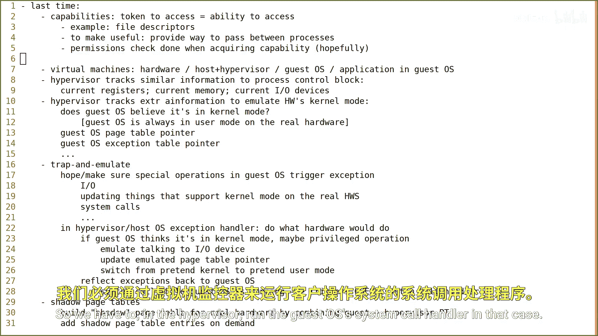
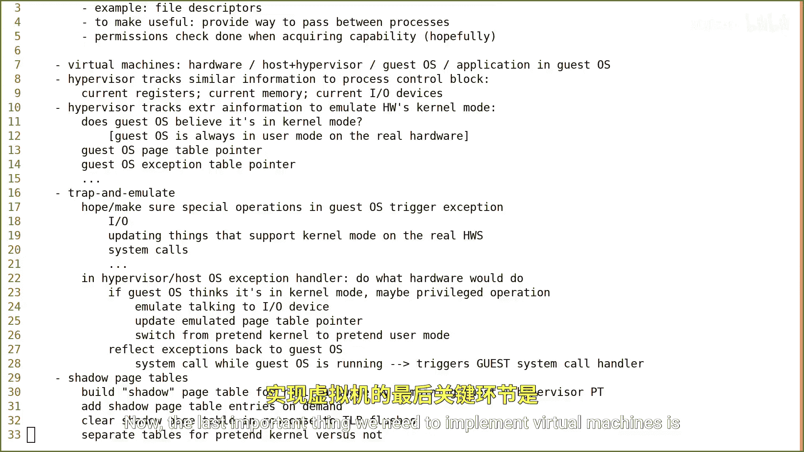
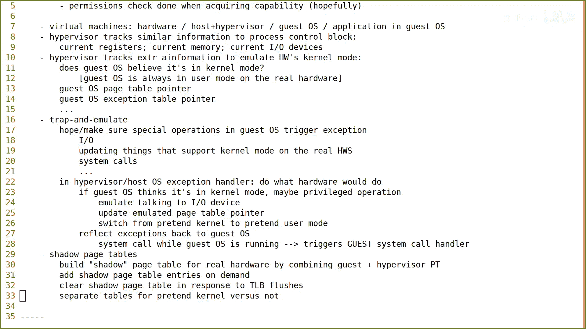
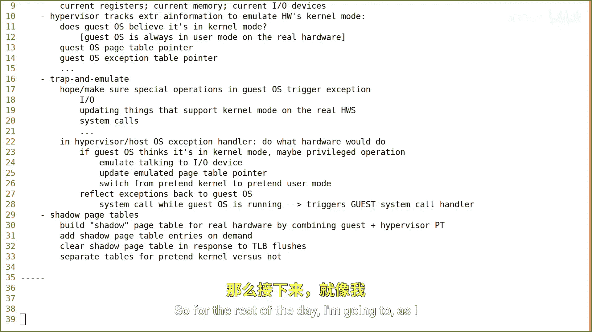
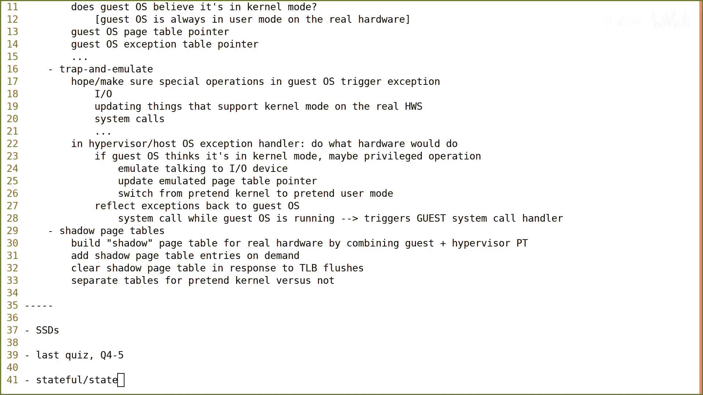
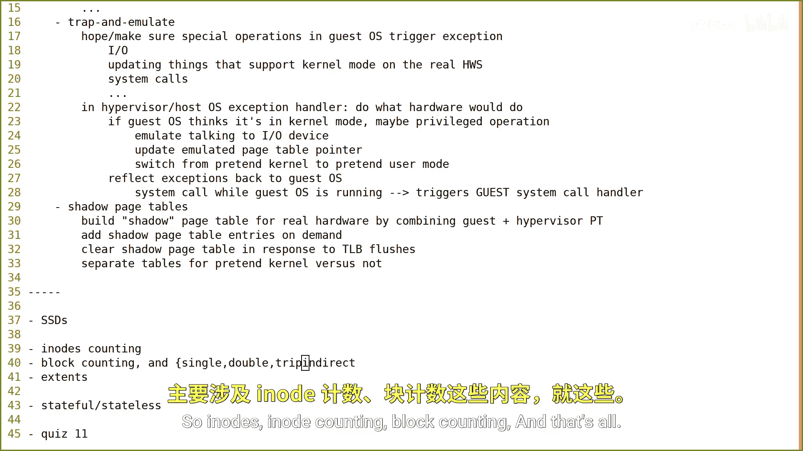
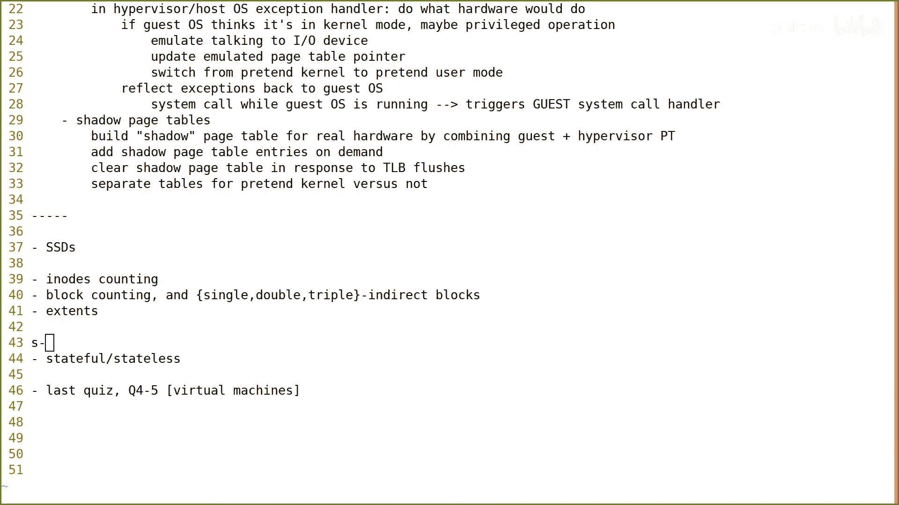

操作系统：P27：期末考试复习 🧠

在本节课中，我们将回顾之前讨论过的两个核心主题：**能力（Capabilities）** 和**虚拟机（Virtual Machines）**。我们将深入探讨它们的工作原理、实现策略以及相关的技术细节，确保你对这些概念有清晰的理解。

---

### 能力（Capabilities）🔑

上一节我们介绍了访问控制，本节中我们来看看一种替代方案——能力机制。

能力机制的核心思想是：访问资源时，不再通过全局名称并依赖旁侧信息（如访问控制列表）进行权限检查。相反，系统（例如内核）会通过一种**令牌（Token）** 来确认访问权限。持有该令牌即表示拥有访问权限。

一个典型的例子是文件描述符（File Descriptors）：
*   当你通过 `open()` 系统调用打开一个文件时，系统会在此刻进行权限检查。
*   成功获取文件描述符后，后续对该描述符进行 `read()`、`write()` 等操作时，**无需再次**核对访问控制列表。因为文件描述符本身已承载了“你拥有访问权限”这一信息。

---

### 虚拟机（Virtual Machines）🖥️

接下来，我们转向一个更大的主题——虚拟机。我们构建了一个分层架构：

1.  **真实硬件（Real Hardware）**
2.  **管理程序（Hypervisor）** 和**宿主机操作系统（Host OS）**
3.  **客户机操作系统（Guest OS）**
4.  **应用程序（Applications）**

管理程序管理客户机OS的方式，类似于普通OS管理一个进程。它会维护一个类似**进程控制块（PCB）** 的结构，用于跟踪：

*   客户机OS的当前寄存器状态
*   客户机OS的内存布局
*   客户机OS可访问的I/O设备

此外，管理程序还需要跟踪一些额外信息，因为它需要为客户机OS模拟内核模式（Kernel Mode）的环境。客户机OS有时会认为自己处于内核模式，但实际上并非如此。为了实现这一点，管理程序需要跟踪处理器在内核模式下会维护的信息，例如：

*   客户机OS**认为**自己处于内核模式还是用户模式
*   页表指针（Page Table Pointer）
*   异常表指针（Exception Table Pointer）

这些信息在真实硬件上是由内核设置的，由于我们在模拟硬件，因此需要为客户机OS跟踪这些状态。

#### 核心实现策略：陷入与模拟（Trap and Emulate）⚙️

我们实现虚拟机的主要策略基于“陷入与模拟”方法。其核心思想是：确保客户机OS中那些特殊的操作（我们**不**希望它在虚拟环境中像在真实硬件上一样执行的操作）会触发一个异常（Trap）。

这些“特殊操作”通常包括：
*   I/O操作
*   更新内核模式支持项（如页表指针）
*   系统调用（System Calls）

当这些操作触发异常后，管理程序中的异常处理程序（Exception Handler）就会接管，并模拟真实硬件在这种情况下会执行的行为。

例如：
*   如果客户机OS认为自己处于内核模式并试图进行I/O操作，管理程序就模拟该I/O操作（可能映射到不同的真实设备）。
*   如果客户机OS设置页表指针，管理程序就更新其内部记录的客户机OS页表指针。
*   如果客户机OS从内核模式切换到用户模式，管理程序就更新其记录的客户机OS当前模式。

#### 异常反射（Exception Reflection）🔄

另一种情况是，当客户机OS内部发生某些事件（这些事件在真实硬件上会触发异常）时，我们需要确保这个异常被“反射”回客户机OS自身处理，而不是由宿主机OS处理。

例如，如果客户机OS中发生了一个系统调用，在真实硬件上这会触发客户机OS自己的系统调用处理程序。因此，在虚拟化环境中，管理程序需要负责调用客户机OS的系统调用处理程序。

#### 内存管理挑战与影子页表（Shadow Page Table）💾

实现虚拟机的最后一个重要部分是处理内存。这里有一个难点：客户机OS设置的页表（将客户机虚拟地址映射到客户机物理地址）并不是硬件所期望的页表。硬件期望的页表，需要完成从**客户机虚拟地址**到**最终物理地址**的完整映射（即经过客户机OS页表转换，再经过管理程序为客户机OS设置的映射）。

**解决方案**是构建一个**影子页表（Shadow Page Table）** 并提供给真实硬件。这个页表完成了上述的完整地址转换。其名称“影子”源于它是通过将客户机OS的页表“投影”到管理程序的映射上而得到的。

我们可以按需更新这个影子页表：
*   在客户机OS访问内存时填充它。
*   当客户机OS刷新TLB（Translation Lookaside Buffer）时，相应地清除影子页表中的部分条目。客户机OS刷新TLB的操作会提供一种机制来通知管理程序。

#### 权限模拟的细节🔐

这个方案的一个细节是，真实的硬件页表可能无法原生支持我们需要的所有功能。例如，我们可能希望根据客户机OS认为自己处于内核模式还是用户模式，来控制页面的可访问性。

然而，真实硬件页表的控制位只能控制页面能否被访问。我们**不能**使用真实硬件的内核模式位，因为客户机OS从未在真实的内核模式下运行。为了模拟这种模式切换的权限控制，我们需要采用一些技巧，例如维护页表的两个副本。

---

### 课程总结 📚

本节课我们一起回顾了操作系统的两个高级主题：
1.  **能力（Capabilities）**：一种基于令牌的、更高效的权限管理模型，以文件描述符为例。
2.  **虚拟机（Virtual Machines）**：包括其分层架构、核心的“陷入与模拟”实现策略、异常反射机制，以及通过**影子页表**解决内存虚拟化的挑战。

理解这些概念有助于你掌握现代操作系统如何实现资源隔离、安全访问和系统虚拟化。