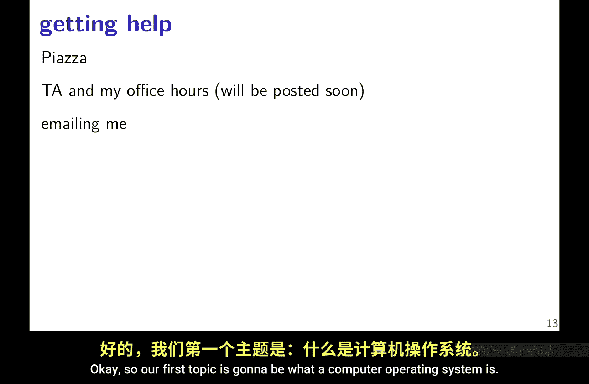
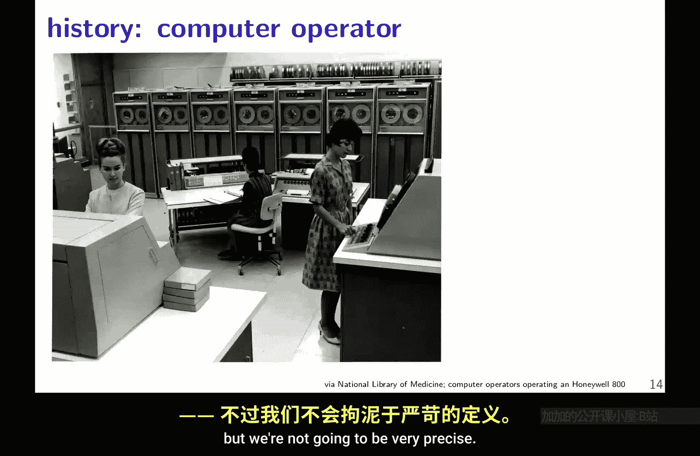
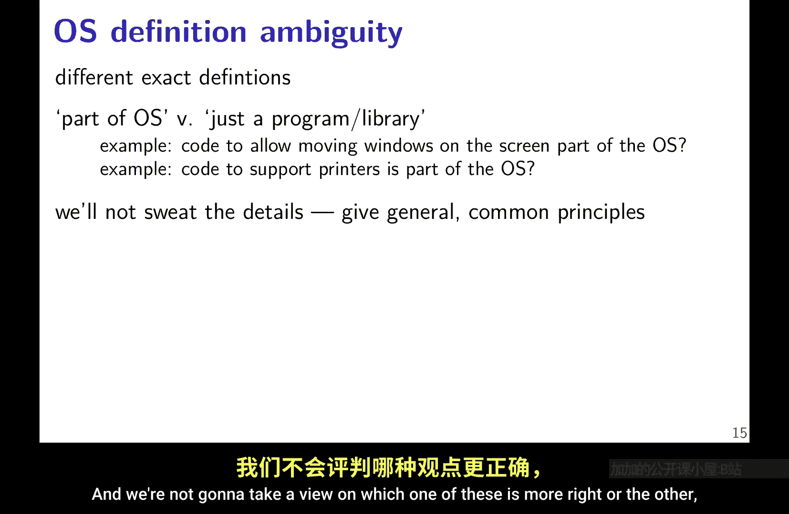

# 弗吉尼亚大学【中英⚡操作系统｜CS4414 2020 Operating System】 p01 P1 What are OSes Logistics -BV1mjePzoESb_p1-

Good afternoon。So。Hopefully you're here for operating systems。

I'm going to start out by going over a bit of logistics。

 and then I'm going to go into talking about what an operating system is and about about system calls first on our。

Tour of logistics， the course has a webpage， it's linked off collabab。

 so you don't need to frantically copy down this URL， find it in collabab。啊。

That's where all information on assignment， schedule， and so on is。We will have homework assignments。

 which will be 55% of the grades， so they're actually very important， the first is to next Friday。

Most of the homework assignments will be in C or C++。

 so I understand it's been a while for some of you， since you've seen those programming languages。

 to brush off a little， will be one in Python near the end。

The program assignments will generally will give you one or two weeks， if it's two weeks。

 there will be a checkpoint submission about halfway in the middle。

And the two week assignments will be worth more。Partly because we expect you to spend more time on them。

 so please actually budget to spend more time on them。嗯。

Some of the assignments will use a teaching operating system called XV6。

 this is based on an old UNX version built by some people in MIT。

 history was they previously used a real old UNX version and then sometime in the '90s decided that maybe they shouldn't be using something that uses a of a computer that you can't buy anymore。

So it's a rewrite of that you'll do next version for 32 at XD6。

 that Sports Multicore could theoretically boot on real XD6 hardware。

 but we're running it in an emulator to make things reasonable to develop。In addition to homeworks。

 we will have quizzes， there will be online quizzes after each week of lecture covering things。

 we went over in lecture that week， it's the same interface it's 30 through 30。

 if you've taken 3030 with me， if not go over to Thursday， first quiz will be due next Tuesday。

 their open open notes， open internet。So they're intended to get you to actually review the material and not just。

Forget about it or not even attend lecture in any way and forget about it。

And not remember it in the first place。 We'll also have a midroom in a final Ds are on the schedule。

 and I hope not to change them。 The final is a combined final with the other section at 7 PM。

 It is not during the normal time。Please let us know at some point if you can't make either of those。

And we'll talk about it， in particular， there's a slight possibility to have a final for a different course at the same time let us know if that's the case。

Figre something out there's a late policy， it's on the website， I'm not going to go over it。

 you can read it if it applies to you。We have textbooks。Recommended textbook。

 which is Anderson Doll operating systems， principles and practice。There's no required textbook。

 and there's also a suggested textbook。Operating systems3 and PCs are。Husband and wife are Peci Dau。

Be available as free PDFs from the author if you don't like having hard copy books and you meant something cheap。

 I recommend Anderson Dolin because I find it less terse for some of the things we'reing。Over it。

They bothThey both go through most of the same material。Just in slightly different ways。And I I said。

 there's no required textbook， you could also look at silver shirts if you know someone that took this course a while ago or just kept copying around。

For a different perspective。嗯。I probably should go over academic honesty。

 homeworks are individual assignments。This means you shouldn't use code from prior semesters。

 except maybe your own code from prior semesters， you should not share code， pseudocode。

 detailed descriptions of code， or other things where I'm going to look at your two pieces of code and say。

 how could you have possibly written this without talking to each other about this code very specifically？

Or sharing the code， copying and pasting， et cetera。嗯。Please don't use code from the Internet。

 you know， books in the library， etc cea， with limited exception。 So if it's solving things。

 which are not the main point of the assignment。 So， for example。

 if you need to split a string into an array and the assignment is is not mostly about text personsing。

Yeah， go ahead do that like this is not a course about。We're， you know。

How you split strings into arrays？But if you do so， please actually cite it in the code。

So if it's clearly not part of the assignment， that sort of thing' fine。

Make sure you cite where you got it in the code， so when I read your code and I see this function that's clearly in a different style。

 I know what happened。And in as said it should not be the main point of the assignment。

 it should be something clearly ancillary like I need to make an array of these strings。

 I need to turn this these pointers into vectors or vice versa。

 that sort of like common task that's not specific to what we're having you do。

If it's part of the major objective assignment， don't do it， if you have questions on what counts。

 please ask us first。In particular， like even if you're only using the split string code。

 like please do not look for a shell for the shell assignment。To find that code。It's not acceptable。

On the quizzes， quizzes are also individual， they're open book open notes。

 but please do not share answers with each other， please don't I am people for answers。

 please don't copy the quiz question onto stack overflow。Or something like that。

We still want you to do them individually。And as a last piece of you know。Those logistics。

 if you're waitlisted， if you need this course this semester to graduate on time。

 email me with specifics and you're here on the waitlist and I will figure something out。

When you do so， please indicate which sections you are able to attend。 if it's not both of them。

 you should please explain why not just tell me。You know，I prefer the other section。

 or else I'll assume that that's just a preference and not an actual requirement。嗯。On getting help。

 you can use piazza。Someone should respond at some point there， will have office hours。

 I have office hours that are tentative because I might need to schedule a meeting around them。

 but posted， I'll try to finalize those soon and RTA should have lots of office hours posted soon for help on assignments。

 etc。And you can also email me。As a last option for questions。So any questions about logistics？Yes。

来给我吃。Can you attend either lecture， I do not intend to check your lecture attendance in any way。

 except that you may not take them final midterm in the wrong lecture， please。

Because we'll run out of seats。Other questions， yeah？A lectures recorded， they should be recorded。

 I do not guarantee that something won't go wrong with my recording setup up。

 but I will attempt to record them。Are there questions？Okay。

 so our first topic is going to be what a computer operating system is。 And to talk about that。

 we'll start with。

说。Now you have well computer operating systems like many programs are trying to automate something that you might do manually。

 so historically there was a job of a computer operator where you had all your tapes storing your equivalent of files and programs and you needed someone to like load them into the appropriate place and press the controls in the computer to make it start the program and so on。

Like this manual ish job。你好。Some has to do physically to coordinate all the programs and files and so on。

 and now we've automated it and we have an operating system that does this for。😡，Now。

I'm going to talk about what an operating system is， but。

We're not going to be very precise。 And the reason we're not going to be very precise is because the world is not very precise of what they consider an operating system。

 They're clear that it's about automating these tasks like load programs， writing programs。

 getting programs， their input and output， things like that， but。The boundary is not well defined。😡。

啊。In particular， you'll find some people will say that something is part of the OS and somebody of you will say。

 oh， there's just a library or there's just a program， it's not really part of the OS。😡。

This might include things like。Say the code， which allows me to move windows on my screen。😡。

Some people will say that's part of the O S。 operating system allows you to move windows on your screens It' of running well program。

 Some might say， well， that's just a program that's running on your that you're running that lets you arrange windows。

You， just happened to be preinstalled，ItJust a program， it's not part of the US。

 and we're not going to take a view on which one of these is more right than the other。

 I'm just going to tell you。

