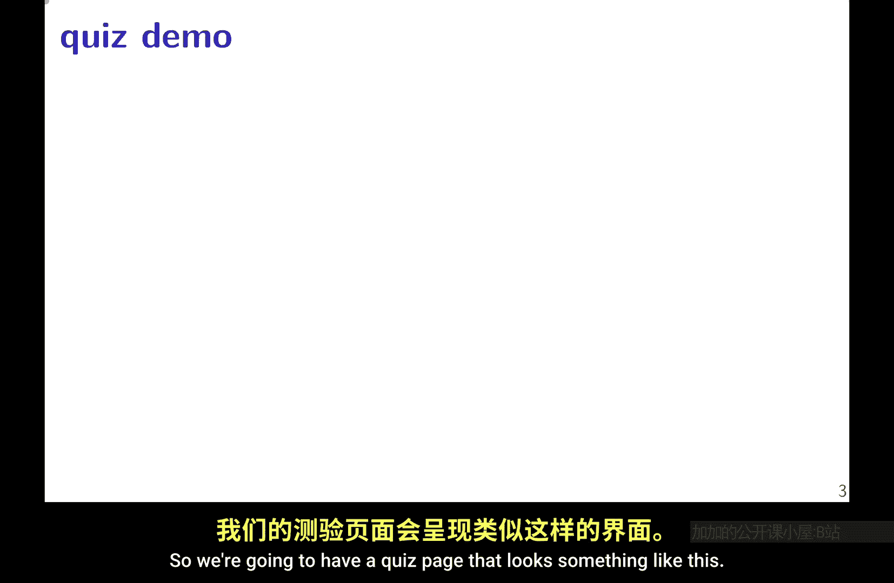
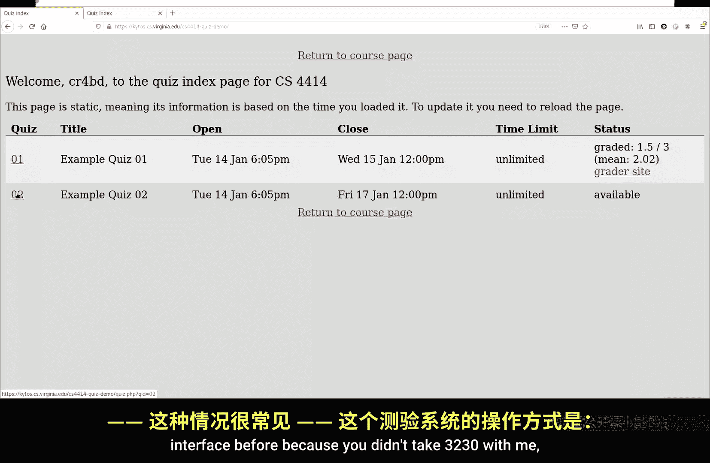
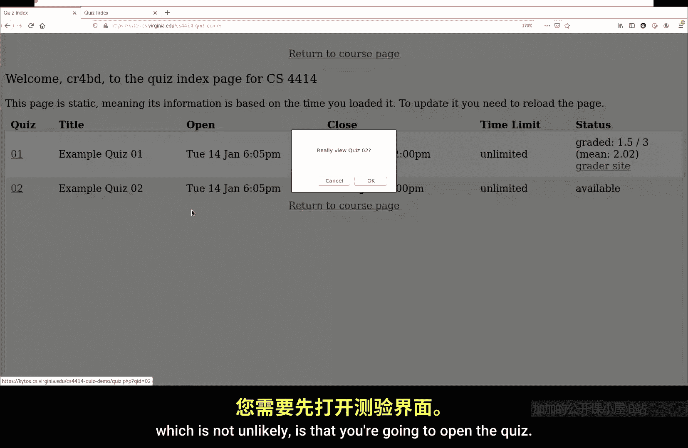
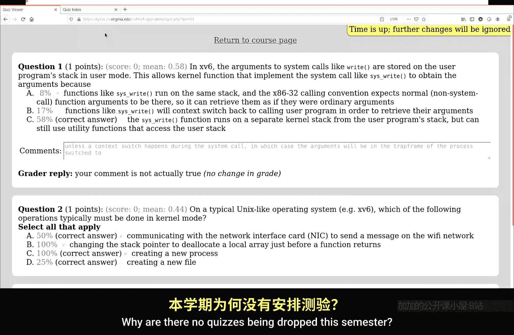

# 弗吉尼亚大学【中英⚡操作系统｜CS4414 2020 Operating System】 p02 P2 Exceptions Context Switching -BV1mjePzoESb_p2-

Good afternoon。So。Last time he started off by talking out some logistics， then we went into。

The traditional way of implementing operating system after briefly talking about what an operating system is。

Talked about this idea that， since we want to。runun multiple applications and protect them from each other and not allow every application。

 even though we run it directly on the CPU to do everything that。The system is capable of doing。

 you have this separation between kernel and user mode implemented by our hardware or our hardware will reserve certain operations for the OS。

And the mechanism it has for doing that is it tracks whether it's in what we call kernel mode。

 and if so it allows the OS operations otherwise it doesn't。

 and the OS arranges for all programs that users write to run in user mode。

And only the operating system coach running kernelonelev。

Now one problem we have here is that we need some way of running OS code and curl mode for several reasons。

 so one reason was well when some events happen the operating system needs to handle them。

 and it needs to handle them using those privilege instructions。

 like if I press a key in the keyboard you to talk to whatever is giving the keyboard input。

 that's going to be a privilege instruction， we don't allow every program to go interact directly with the keyboard。

 the OS instead tracks what's supposed to happen with the keyboard input。

You also mention that we don't want to let a program run forever。

 so we have some mechanism of running the OS even if that program is like running an infinite loop。

And we also want it to be the case that programs can explicitlyly request that the OS do something that requires that。

There privileged operations。 So one example is that。

We limit the memory of program can access using we mentioned address translation that's a mapping set by the OS。

And。If we don't。Have that mapping be setable in user mode。

 which would be dangerous because then programs can manipulate memory they're not supposed to。

Then we need something in curl Mo to run to expand that map and to allocate more memory。

So we have a mechanism where programs can request that the US do something on their behalf。

 and all of this is handled using one hardware sort of set of functionality known as exceptions。

And it's controlled mechanism for both switching from user to curl mode and the basic idea is that runs a handler that the operating system set up on boots。

It's at a well known location with carefully written code back。

The operating system uses to decide what to do in the case of whatever event triggered that exception。

We also looked a bit at。XP6， we did a little brief demonstration， and as you know。

 the assignment that's due a week from Friday。You should get that working and you're going to add a couple system calls to XV6。

And as part of helping you understand how system calls work and helping you start on that assignment we went through the path of the right system called an XV6。

 and I'll review that in a bit。Talked about how we had the user space part。

 this wrapper function that actually had the special trigger and exception instruction。

 And then we went into this common entry point for exceptions in XV6 and that trap function。

 And from there。 We figured out， oh， this is a system call。

 And we figured out which particular system call it was。

 And eventually called the actual handler for that。

 which then retrieved the arguments and did the right operation。 And then we return back。Into。

The user program back to user。So before I move on to topics for today。

And questions about anything we covered last time。然后。Okay， so。As a piece of logistics。

 I mentioned last time we're going to have weekly quizzes。

 so I'm going to show how this works so you all know how they work。嗯。

So we're going to have a quiz page that looks something like this。

The actual one is this one， but I'm not going to use the demo because these quizzes aren't open yet。

 so we have。Week by week quizzes。Numbers， the open time and the close time。

 I have them opening at 8 PM。 So I have time after this class to make sure I don't ask questions about things we didn't talk about。

啊。嗯。That actually happens and they close at 12， 15 pm， the other sections at 1230。

 and I prefer people in the other section do not complete the quiz during lecture。

I'm sorry that this prevents you from completing the quiz just before lecture。

I'm asking the same questions。And so the way this works， if you haven't seen this interface before。

 because you didn't take 3 through30 with me， which is not unlikely。

that you're going to open the quiz。 It will ask if you really want to。 When you look at it。

 you'll have questions。 you can have multiple choice questions。 And when you select。

Answ and see where the answer level is from the far away。

The box around it will turn green if it turns yellow with the red border。

 then your answer is not recorded。 For example， maybe you're logged out of Ne badge or your w-fi disconnected or something。

 but your answer is not recorded。嗯。So please note that。In addition to selecting an answer。

 you can write a comment， know， something about this answer， like probably more specific。

And when you focus out of there， it will record it and be green。

We will eventually have either me or some TA read all the comments for all questions with wrong answers and decide whether you actually understood what was going on and we should give you credit or whether like the question was broken and we should give everyone credit。

But this is the way to handle， like， I think you made a typo in this question。

 and it doesn't make any sense。 Great a comment explaining that。嗯。

Rather than like trying to frantically find me in time and ask me， also notably。

 I'm going to be very limited on clarifications I'll give to questions because I don't want it to be the case that you need to know the clarifications on Monday morning because that isn't very nice to the people who like try to do all the quizzes on Friday or something like that。

Secretly， you actually have to do them on Monday， even if you have class in the morning。

To actually get all the really clarified versions。 So instead。

 I'm going to like try to do the best I can with those questions and possibly like drop options or something if the question was really bad。

So we have multiple choice questions， we might have select all that apply questions and free response questions where you type in and answer。

And if you tap away， here's that。So。Once you submit these， it was submit， if it's turned green。

 it's logged， you can check if your answer is submitted because if you go back to the main quiz page。

 like from the main coursese webp page，And you open up。And again。

 you'll should see your answers there that if you're unsure what my answer really recorded。

 that's the way to check， just go back to the course webage， open up the quiz again。

 if your answers are there， they're recorded， we got them。so after the quizz is due。

 it will be automatically graded and you'll say you can go to the grading web page something like this。

 so I has the answers I entered marked and the comment I entered marked。

 we have the percentage of people who gave each answer so you can get an idea of how confused the class about this question or more importantly。

 I can get an idea of how confused the class was。We have your comment。

 if a gradeer has read your comment， which will not happen immediately， we don't just sit here at 12。

 15 pm and frantically read all the comments。Then there maybe be a reply to your comment indicating any adjustment in grade。

 if we haven't read it yet， it will still be graded and there will be no reply。

And we'll eventually get to it， but it will probably take like a week or two or three。That's for。

All these questions。Since it is graded automatically after。The closing deadline。

 I can't do extensions for the quiz。If you are sick or have some other good reason that you can't take the quiz。

 we will do something else。But I can't just give you an extension because anyone can open this up and get all the answers。

That's not very reasonable way of giving you one person an extension。When the answers are just there。

Also， in some prior classes that use this tool there may have been drop quizzes。

 I'm not intending to drop any quizzes。So questions on quizzes。Yes。

I have never dropped any quizzes in this course。