# 弗吉尼亚大学【中英⚡操作系统｜CS4414 2020 Operating System】 p03 P3 The Unix API 1 -BV1mjePzoESb_p3-

Good afternoon。Last time。We started by moving on from discussing how XB6 handle system calls to talking about other kinds of exceptions。

And。They shared a lot of the same code as far as how we got into the kernel and。You know are。

Our first entry point， that trap function， but after that we needed different things basically just depending on what the exception was for。

 it was for IO， we'd need to do something with the IO device。

 if it was a timer we'd think about whether we wanted to switch to a different program and so on。

Then we went into how we actually switched to different programs in X V6。

 and X V6 using a strategy where each。Thread and user space had a corresponding kernel stack。

 and we switched between from one kernel stack to the other。And when doing this。

 we're taking advantage of our exception handling code to save the user registers。

The user registers were saved in the kernel stack， and by switching from one kernel stack to the other。

 we switched the set of user registers that were active at the time。

Because they would be restored later on when we returned from the current exception。

So and we talked about our main switch function， which needed to be written in assembly just because there's no way in seed to like actually change stack pointers。

啊。And it would basically just save everything you need to save on the stock。

Switch to the other stack and restore things that were previously saved in that other。

In addition there were some extra details， we mentioned that the user part was handled with the trap entry exit。

 we also have to deal with address spaces， which we'll talk about a lot more like basically halfway through the semester。

Which is another part of that switch operation。So questions about this before we talk about。

Weve gone to our topics today about managing processes。

So one detail that we were missing when we were talking about this context switch operation is that as we had things before。

 we switched to another thread and we switched to a place where the thread is already called switch previously。

And this。Its missing a piece because we need a way of starting threats。When a threat starts。

 I've already called switchitch， how do we deal with that？

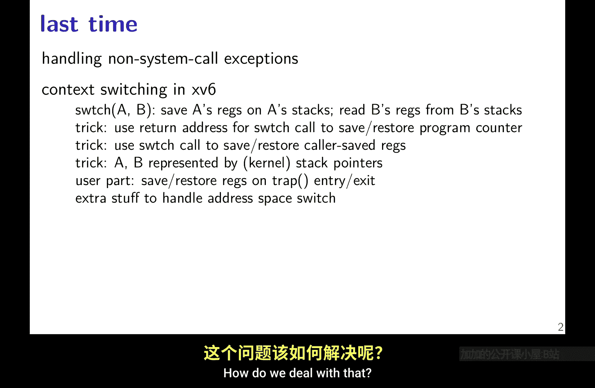

So， you， we needed information on that stack that would have been placed there from a call a switch。

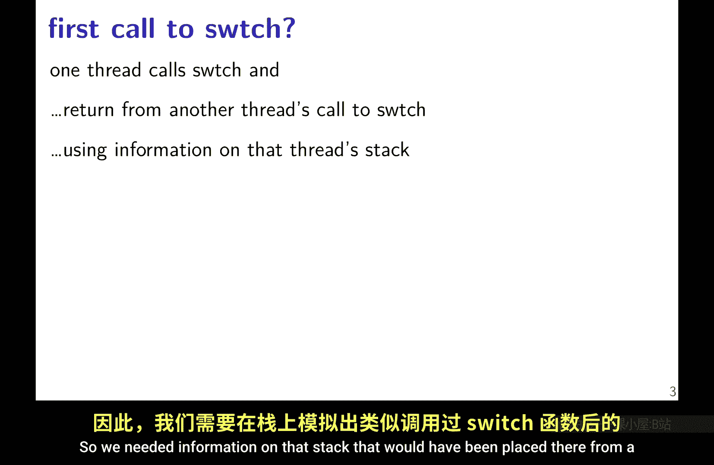

And the trick we use to deal with that in XV6， at least。

 is that we set up the initial stack of the thread as if it were in the middle of a call the switch。

 we put the same things on a stack that would have been put by a call the switch there。

So it's ready to switch to。This avoids sort of an alternate possible implementation where we'd have like two versions of switch。

 one to switch to a thread which has already started。

 and one to switch to a thread which is just starting。And so we just use that one piece of code。

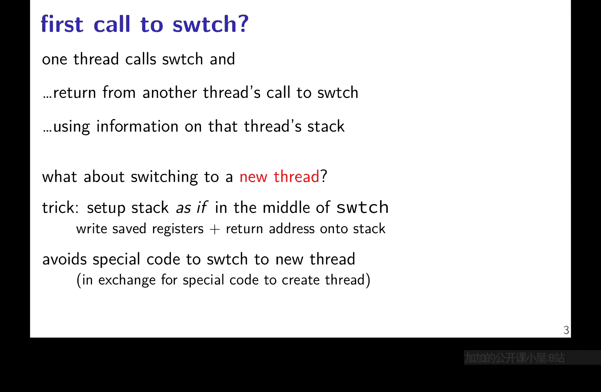

So the code to do this in XB6 is in a function called AlEC proc， aEC prock for Allocate process。

 it's process and not thread because in XB6， each process has exactly one thread。

And one of this functions is called this first before the code I'm showing you a kernel sta allocated and。

This code here is going to construct an artificial contents of that kernel stack starting with the top of the stack。

 so it has this stack pointer variable， which is sort of a virtual stack pointer for filling in the new stack。

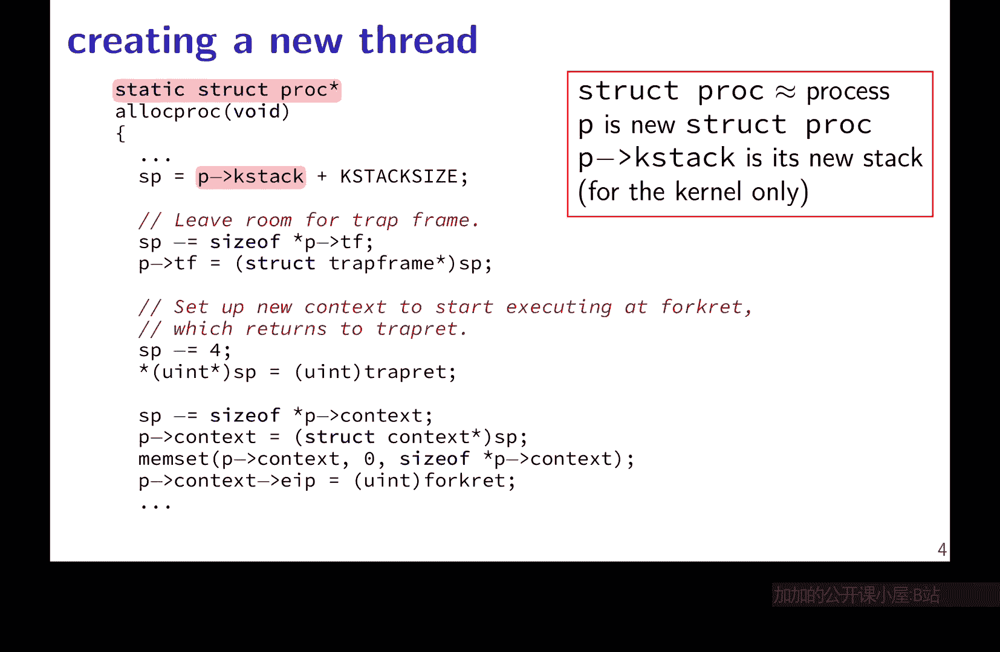

So initially， we set the stack pointer to point to the top of that kernel stack where it was going to start and how X D6 work。

 it's going to grow towards lower addresses。And then we allocate space on that stack by decrementing our stack pointer for the new stack to include space for a trap frame。

This is the set of save registers that are going to be used when we return from the track function。

 or in this case， we pretend to return from the track function。Now。

 so we have this user registers that we're going to restore and then return from the exception when we switch to this program。

And we need to run that code， which is going to restore those registers and return from the exception。

 That code is just wherever track returns to。So to enable this。

The assembly code that calls Tra has a label called Tra RET immediately after they're called the trap。

😡。

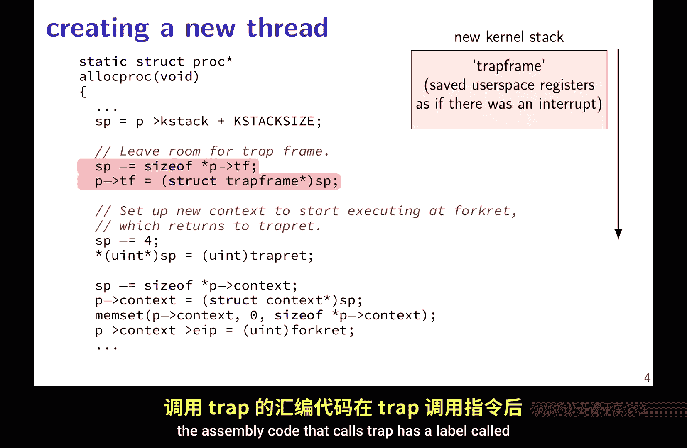

Just so we can insert that address on the stack we're constructing here。

So trap rat is just a pointer to the instruction right after called trap in that assembly。

So this means when we switch to this， we're going to go from the the。The， the bottom of the stack。

Down here。And eventually we're going to get to a point where we want to return and we're going to return back to that code track returns to restorestore user registers。

 go back to user mode with those registers， and the quote I showed you here doesn't actually put anything in these user registers。

 but there's some other code that will set up the initial value of the registers the way we want it to be based on the new thread where're start。

So。This handles returning from trap。 But remember that we actually have a call to switch that we need to simulate。

 So the next thing we're going to put on here is we're going to simulate a call to switch and the call to switch is going to happen from somewhere。

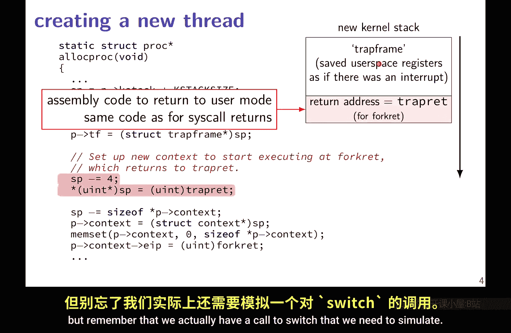

And there's a special little function called fork rect。

 So it's called Fork rect because the system call that's used to create a new process is going to be called forRC。

 So forR is the return part of that。 And this contains extra setup code we want to run when we start a new threat。

So there's a little extra set of code， and then it returns。So。

You knowFork RE's going to run and then return using this address to Traret。

 so it's going to return the same place Tra would return to。

 and that's how we're going to start running this new thread in user mode。

And this return address to Forret is going to be the return address that switch reads when we switch to this new threat。

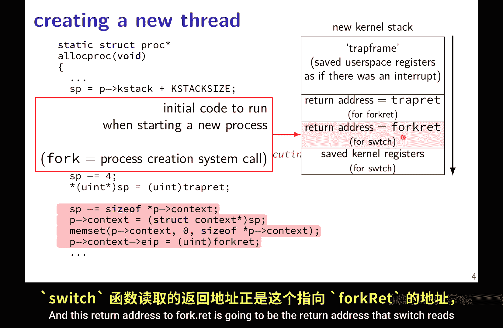

So switch is going to start with this set of safe registers， including the return address。

So when we switch to this new stack， it's going to pop those off load。All the registers。

Pop return using fork grat， run the fork grat function， the fork ratt function is going to finish。

 then we're going to do the same thing we do if we finish a trap。And go back to user Mo。

And this coherre is just setting it up。 So the context is constructed just to mirror what the switch function expects on the stack。

Just so we can do this setup up here so we can set EIP to be the return address part of what Switch is looking for on the stack。

And the rest of that， all those register values is going to pop or just set to zero to give them a value。

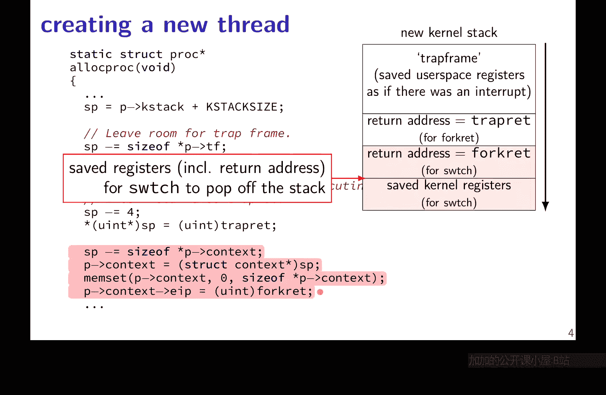

And so this new stack basically is equivalent to like we're in the middle of what a call the switch。

That's about to return from a system call the ending part of the ForRC system call。

We'll talk about how the Fork system call works a bit later。

And that's going to return from trap and then go back to user。And so we've set up this fake stack。

 even though there wasn't a real call to switch， the stack makes it look like there was one so we can actually use the switch function and have switch return from this fake other call the switch。

😡，So any questions about this trick of setting up an initial stack of which works？Yes。

 is this function called right before which is called or like right a？

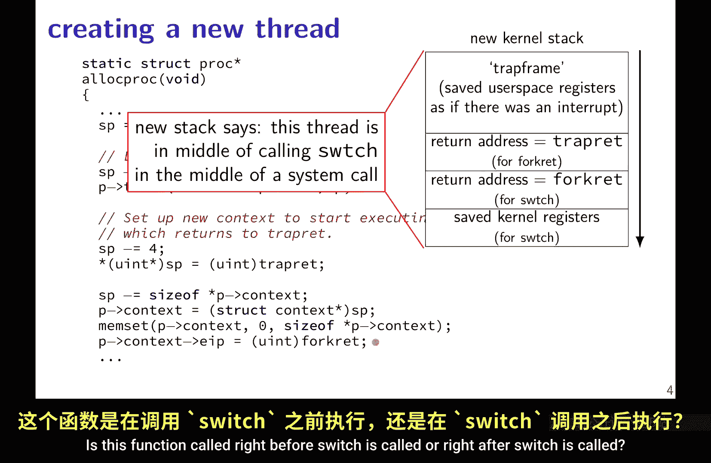

The questionest is， when is this function called relative to a call switch， Well。

 we're not going to be able to switch to this new girl stack until it's set up。

 So it has to be called before and。In X V6， it's kind of decoupled。 We first create the process。

 and then we let it get switched to by just the normal operation of things like the timer expiring and so on。

Other questions？This is our threat setup so something which shows up here is this P variable。

 which is the astruct pro， and this is a data structure used to represent the information about a process and an XV6 since every process has exactly one thread。

 it's also where we have the information about a thread。

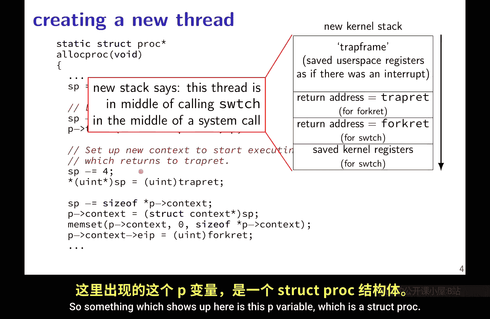

And a generic term for this is a process control block。So XV6 represents us with struckpro。

 and why don't we look at like what's in a process。

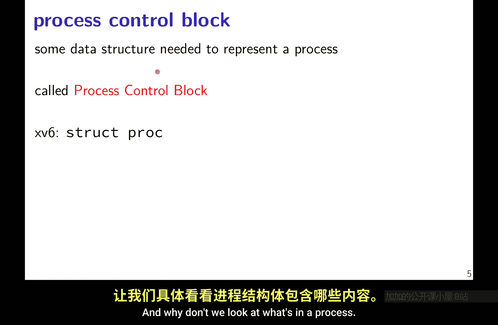

We saw that we had a kernel stack。For that the thread that the process was running。

 you also have some other information that we keep track of。

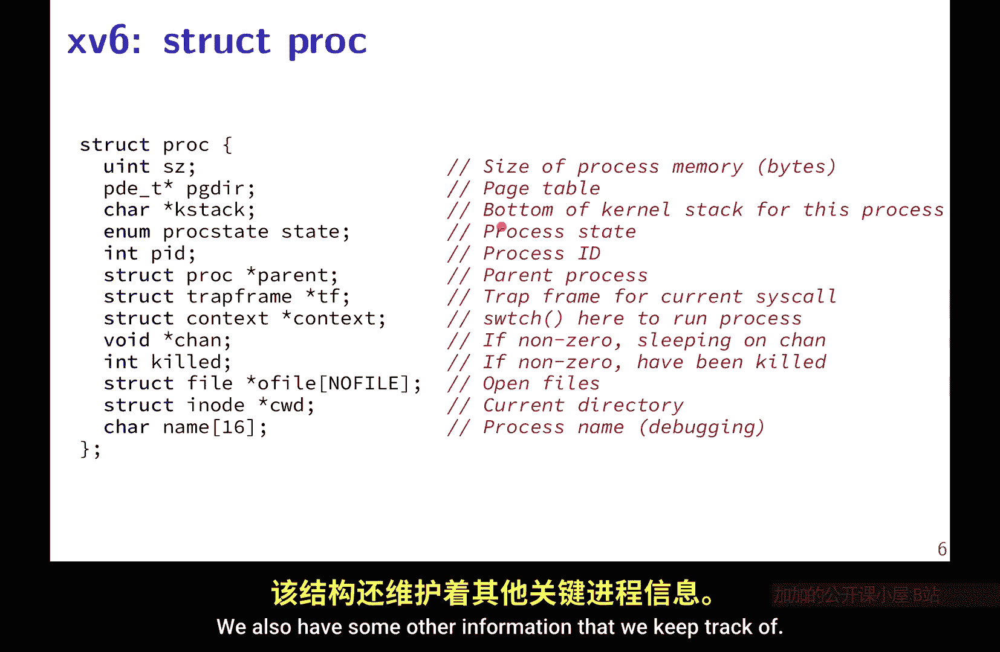

So one thing we've seen before is that we have the current trap frame for if there's a system call Act。

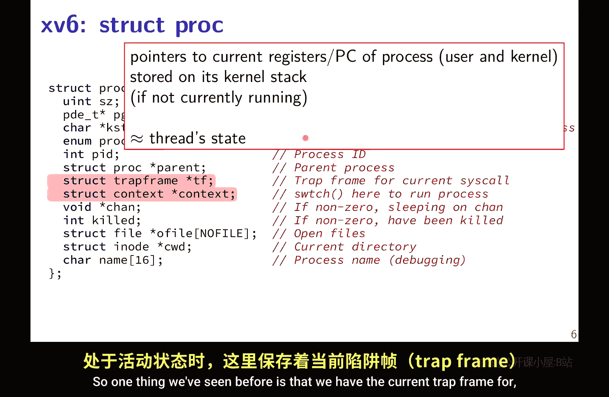