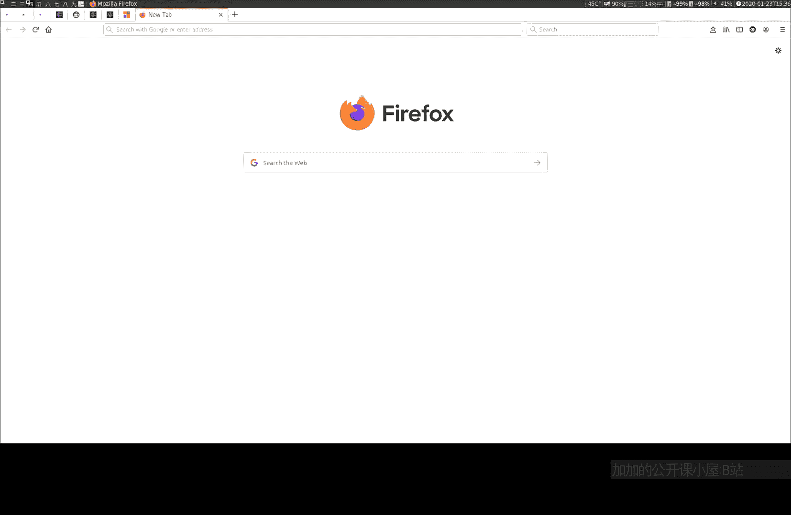
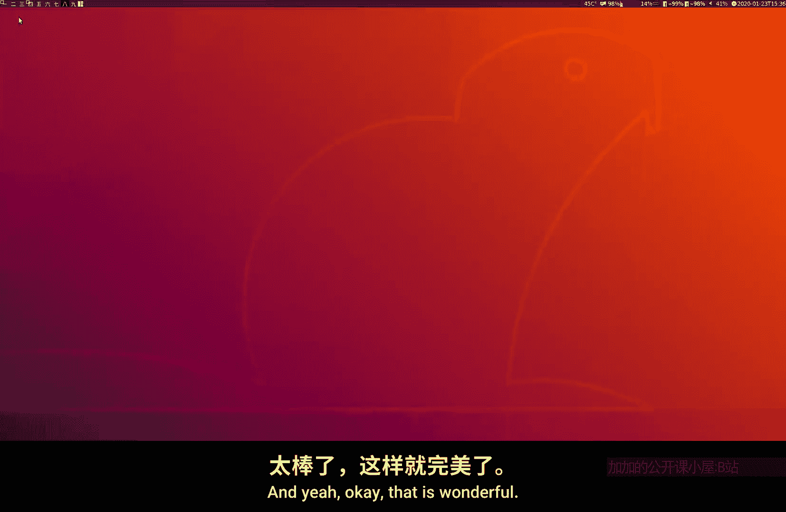
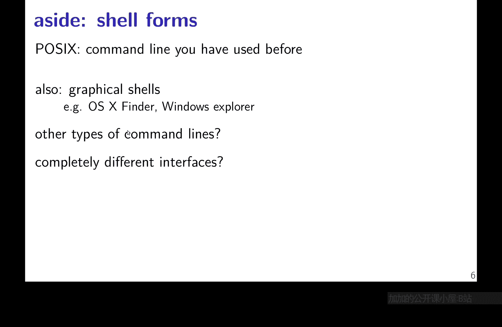
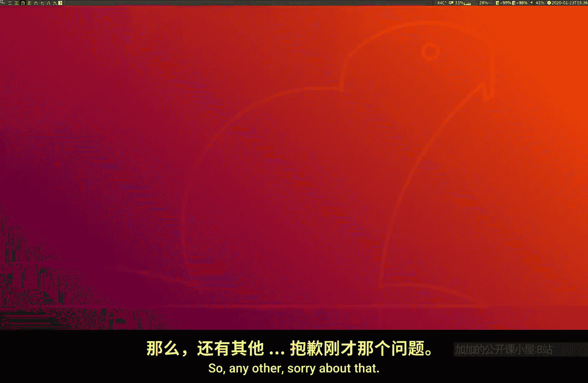
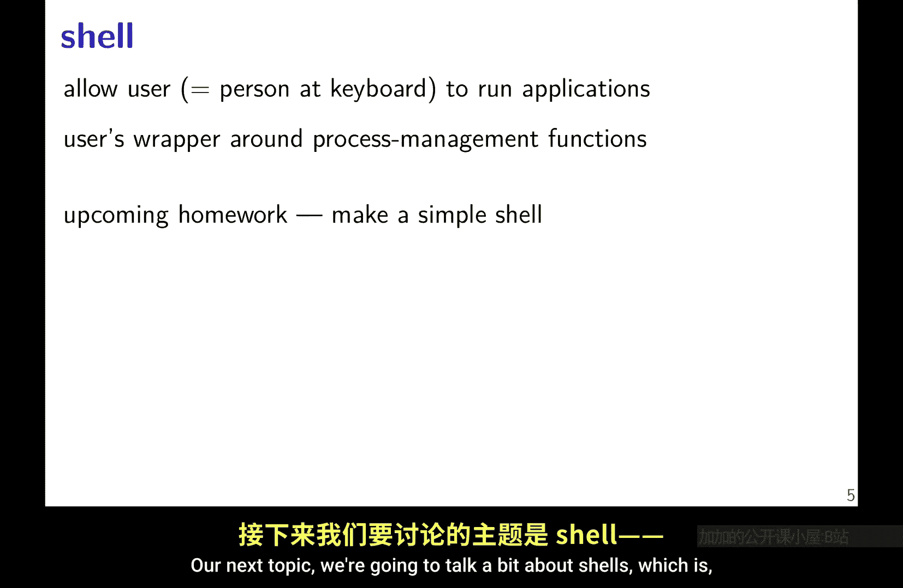

# 弗吉尼亚大学【中英⚡操作系统｜CS4414 2020 Operating System】 p04 P4 The Unix API 2 -BV1mjePzoESb_p4-

Good afternoon。So I have an exercise which is about what we covered last time。

 if if we haven't looked at 30 seconds， you can discuss with your neighbor。

I minute what you think is going on？We have a loop where we call fork， the loop X cubes twice。

 so we call fork at least twice。And in the child， because work return 0， we run the echo command。

 If you remember the echo command prints out its arguments。 And by convention。

 the arguments start at the。Rrg v of1 so the' zero， so that EO program will print out0 in a new line。

And we also have a print of one and two。Before and after which calls weight PID twice。Oh， scream。So。

So， let's see so。Who thinks the answer is A？一。Hopefully it's project up there。C，D。一。Yeah。G。Okay， H。

And it seems like most people have no opinion and also we' talking with their neighbor。

To try to figure it out。看。So。I think the best answer is E。So what goes on here is we have。許すね。Why。

Yes。I running out of。Have a。Okay。嗯。気ちやして。I that we have。Its that we have our main program。

 forks and executes。The echo andesza again。The children Ch programs don't do that because once they reach the exec。

There's。然后。我看。There's no way for。This is real puzzleuzzling。There's no way for them to。Sup puzzle。

Once they reach the exec， there's no way for them to actually。

Continue on because when exactec fee works， which we say is an assumption here， that means that。

That thread stops executing。This means that。The。Those are executing in parallel and while that's happening。

So we start those two threads and while they're running。

 the main program goes on to try to go to this weight PID。So it prints one。

 and because that's happening in parallel with the print of0 and0 from the two jaw processes。

 those can happen in any or。So we can have one and 0 and 0 printed out in any possible order。

But we call weight PiID。😡，On each of the child processes and that weight pad won't finish until that echo command exits and that echo command won't exit until a zero is printed out。

 So the first iteration of loop weights for the first zero to be printed out and the second iteration of loop weights for the second zero to be printed out。

It might be the case that the zeros are printed out before the loop even starts。 It might not。

 But we know after the loop is done， both of the zeros have been printed out。

 So the two has to be printed out last。Whi gives us the answer of A， B or C。Okay， so。Some内。Yeah。How。

Okay， I这个。発すな。And yeah。

That is wonderful。

系。Sorry about technical difficulties， I would like to be able to draw things。And。

I see what's happening here， okay？哦。很重。上在。Okay， so can I draw things with this setup？We we。Maybe。

No， okay， interesting。Well。See is this work okay， that will work。Any other sorry about that？

So that's what we cover。Last time。If I can actually display what I want to display again。

I discovered last time fork Exec and weight PID， and we see this sort of an extension of the typical pattern。

That we call fork， then if we're in the child， we call exactec。

And then we call weight after we want to wait for the child to finish。 In this case。

 we like fork twice。D both of the execs and then waited for all them at once。

We also last time talked a bit about politics in general and about。

The missing piece of context switching， which is how did we switch to a thread the first time。

 and our trick for that was we set up the stack as if we had already switched away from it。

 even though we never switched to it。So sorry if we're hopefully I'll have no more technical difficulties and any questions where I to move on。

Yes。Would you mind just sketching out what？For what the tree would look like for the exercise。

 So now， which is what I intended to do。So yeah， so we have our main thread。

 we call fork the first time。And that makes a child， and we call fork。The second time。

 and that makes a child。This child is going to print zero， and this one is going to print zero。

And our main thread is going to call weight。On the first child， so this child is going to exc。

That weight's going to finish， it's going to call weight on the second one。And when that child exits。

 that's going to finish， and then it's going to print out two here and one before the week。

And that one could happen before or after the zeros because these are in parallel。And depending on。

 you have multiple cores， the relative speed things run at。

 and you if we have a single core when timer interrupts happen。

When the OS decides to switch to what program we could get all the possible outcomes。Yes。

One continue。So question， why wouldn't the first child。

 So here I s the first child in both of these trials， I'm saying exec， why don't they fork again。

Because there's a fork in this loop， and the reason why is that exec does not reach her。

If exact returns， that means it wasn't successful。And we have this assumption in the question that exact feed does not fit。

Okay questionsestions。Practice。Okay。So。Our next topic we're going to talk a bit about shells。

 which is if some of you've looked ahead the next assignment。

