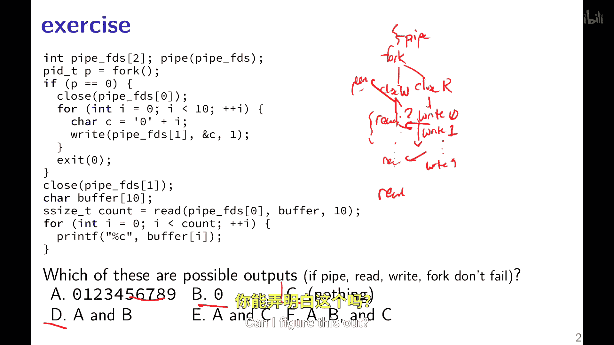
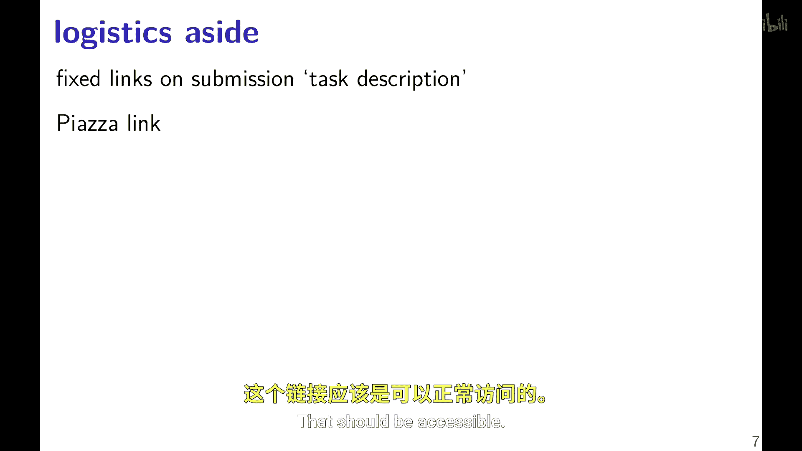
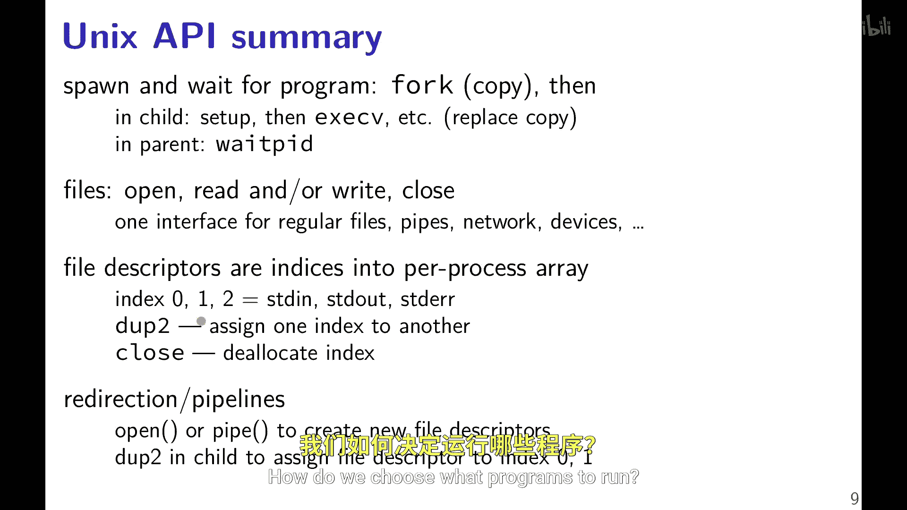
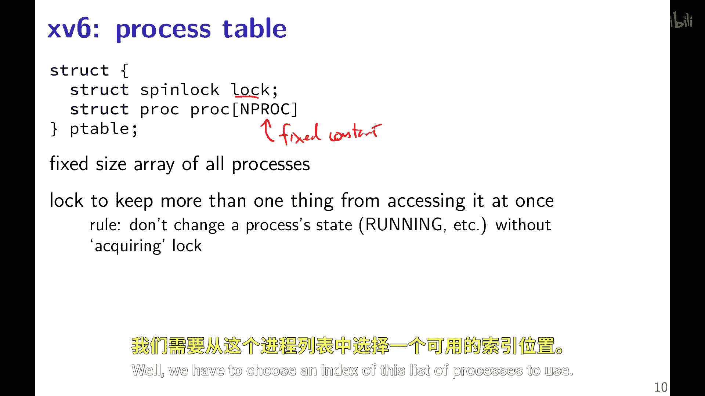
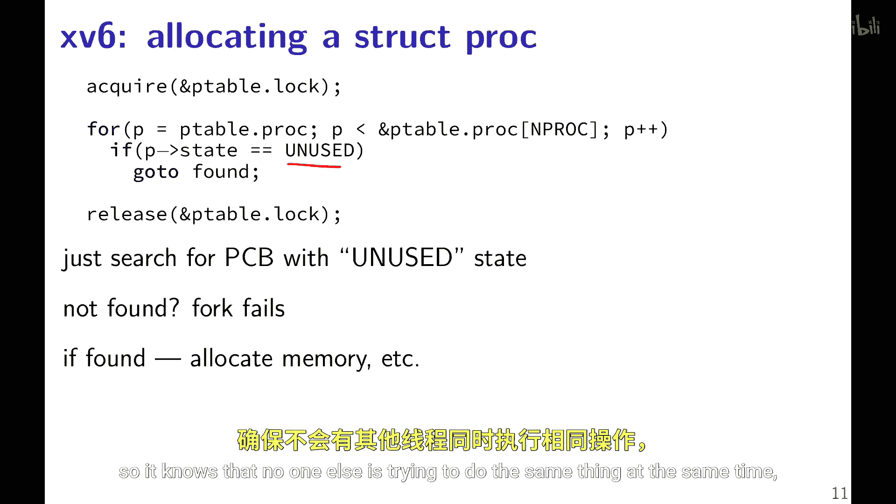

# 弗吉尼亚大学【中英⚡操作系统｜CS4414 2020 Operating System】 p05 P5 The Unix API 3 Scheduling 1 -BV1mjePzoESb_p5-

Good afternoon。So I'll start off with an exercise about pipes。

 which we finished up basically last time， so here I have some code where we make a pipe。

 we call four， we close the reading of the pipe in the child and then write zero one。

 all the way up to nine。And then exc， and then the parent because the right ends and read。我在哪玩。

Buffffer with 10 fights in it， like an argument of 10。

 and then we print out the contents of that buffer。Up to the count that was read。And the question is。

Well， what are we going to get out， are we going to get out everything that the child wrote。

 are we going to get out just the first thing， are we going to possibly get out nothing or some combination of these。

Give you some time to think about that。 You can check with your neighbor。

 and then we'll see what you。So who thinks A？B。C。啊，D。一。😊，F。Okay， so I。agree with the plurality。

And I think D is correct。So first， let's talk about why multiple things are possible。

The issues we have。These write bring alongside the reads， and the question is。

 well how fast does the child execute versus the parent。

 does it get to run the whole thing before the parent gets to call Reed？Or not。

 and that depends on if we have multiple cores， how fast the two cores run。

 if we don't have multiple cores， when do we switch between the two programs。

 when do timer interrupts happen， and that can vary a lot。

So we could have the case where we managed to write。0 through9， and the read happens after that。

 in which case we'll get everything， we could have the read happen just half three right0。

 in which case we could get B， or we could have it happen somewhere in between in which case we get something between0 and0 through nine。

Now， then there's the question about nothing and it seems like， well。

 wait let's say that all these writes happen， let's say the read happens like way up here。

 the read happens before the child has to do anything， to be sensible for the read to return nothing。

 but Poss has made a decision that that wouldn't be useful if they decided if you're calling read on a pipe。

 we're going to wait until there's something for you to read so that it won't return nothing。

 it will wait for something to be written or the pipe to be closed。And something's right in。

 so it's going to return at least zero。看。So questions。Let figure this out。

And if you tried this empirically， here's the distribution I got on my laptop from 1 thousand0 trials。

 you say yeah， really， in fact。Everything is possible just depends on how the timing works out。

Because there stay sort of。A parent randomness and how fast does the parent and child run and when exactly are they run and so on。

And our main topic for today， as we move on from talking about the Poss API is talking about， well。

 how do we choose when when we run the child versus the parent。Now。

And since we see like everything happens。So get to that before I finished reviewing last time。

 just a logistics note， I noticed that the submission site has links to the assignments。

 those links went to the wrong semester which should have been pretty obvious because there's a big header on the last semester's website saying it's not for the semester。

I think most people didn't notice that but that's fixed also I received an anonymous feedback suggesting someone was having trouble finding the piazza that I did create for this course。

 which should have been linked about the anonymous feedback button which works for me maybe it doesn't work for everyone。

 I also put a direct link on the coursese web page so。If you can't find it there， that should work。

 if not， let me know that should be accessible。

And。Now that we're finishing up with the Uniix API。

 I'm going to mention what we talked about just to view it。So。

In case we have any final questions before we go to a different topic talk about how we spawn processes and the UniX API made this kind of strange choice of saying when we make a new process。

 we're going to copy an existing one， we're going to do something special for the first process in fact later today we'll talk about what that is for XV6 but otherwise we're copying an existing process and if you don't want to run the same program。

 there's a separate system call which replaces a process with a new one but use it the same process control block。

And sometimes you want to wait for a program to finish， like you run a command。

 you want to have the command finished before you ask for the next command。

 and we have a system called weight PID， which can wait for a process you created to exit。

Talked about files and we had this unifying feature that we had this open file to create it。

 and we saw that， well， it's not always open。 So pipes are files。

 but they are created with the pipe function instead of open。

 but it's the same idea that we have this setup function before we can use the file。

And then once we've set it up， we can do read and rights。 And when we're done with it。

 we call it close。嗯。And。To determine which file we've set up that we're referring to。

 we have this array of what we call file descriptors for every process。

And the way we figured out where our output usually went and where input usually came from was we just had a convention that index0 was input。

 index1 was the normal output， index2 was the normal error output。😡。

And we saw that in addition to having these indices。

 we had ways of manipulating these indicees and this is how we would tell a program， hey。

 your're output into this file instead of the terminal is we change what that index was before you end the program using a function like Du 2。

So before I move on from talking about the PosX API。

 any questions about these things we covered in the last。So。

Our main topic for today is going to be about sort of more under the hood。

 how do we choose what programs to run， and the first step in that is we have to keep track of what programs are active。

And in X V6， this means we have to know about all the process control blocks。

And this is how they're of in XV6。 We have this struct called P table， which contains a lock。

 We'll talk about what that is in a second and an array of processes struck pros。

 process control blocks。And it's of a size where this is a fixed。Constant。

That's the number of process control blocks，66 hack。

 if you want to run more processes than that at once， too bad。

 you have to change that constant and recompile。Obviously in a more commercial list。

 that might not be an acceptable strategy。😡，But keep things simple in X V 6。

 That's what they've done。 I think that's like 32 or something like that。

That's just all the processes and we have this lock。

 So the purpose of the lock and we'll talk a lot more about this layer so I'm just giving the high level overview。

 but the purpose of the lock is to make sure only one thing at a time tries to access the list of processes to change。

 for example， what processes are runable。😡，A reason this is a concern is that we have things like timer interrupts that try to change what processes are runnable。

 and we don't want it to be the case that we're deciding to choose a different process to run。

 And while we're doing that， a timer interrupt happens and makes a different decision about which process to run。

 And as a result， we're confused about what process we're running next。 So to prevent that。

 we're going to have one thing at a time， manipulate the states of processes。

 whether they're runnable or not runable。And so。And this lock is going to let us do that。

So one of the things the lock is going to do is even on a single core。

 it's going to keep things from like timer interrupts from happening while we're manipulating。😡。

The list of。Processes， and on a multi core， it's also going to keep other cores from manipulating that while we're deciding what to run。

So we have this list of processes。 How do we get something in here？ Well， we have to choose an index。

Of this list of processes to use。 And this is the code X V6 uses for that。

It just looks through a list and finds something that is marked as unused。And take it。

And it does this with the lock， so it knows that no one else。

