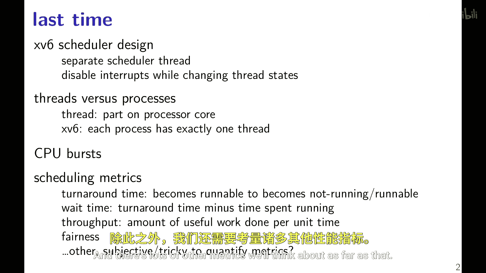
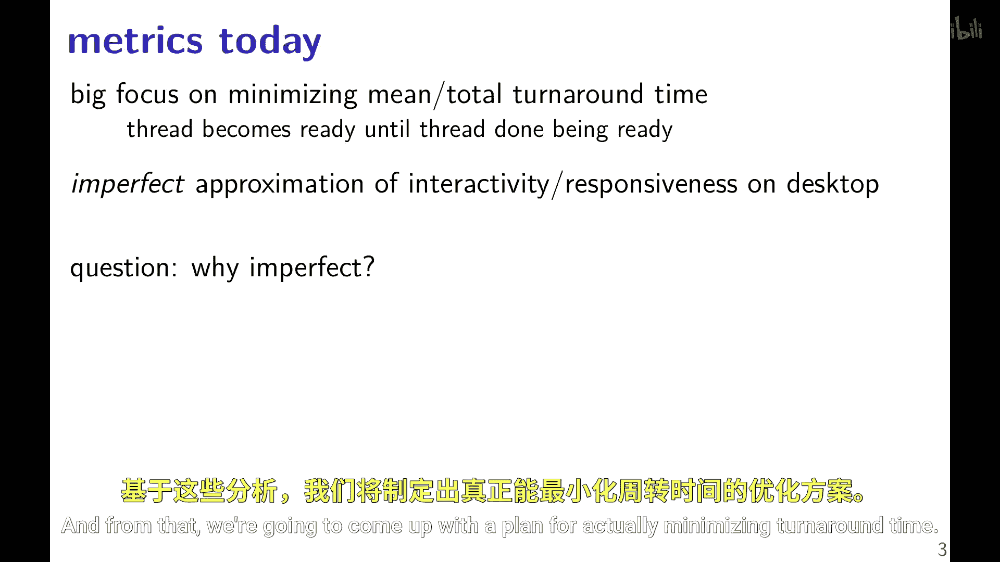
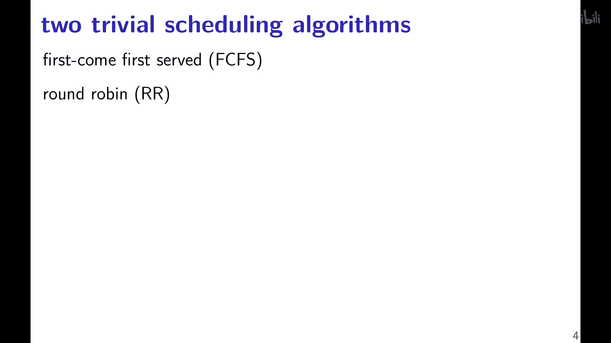
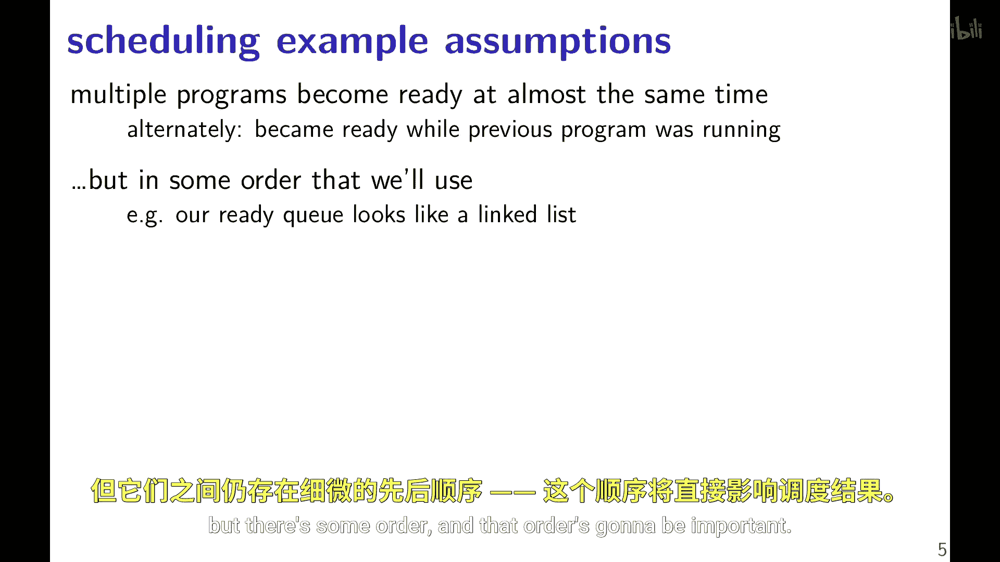
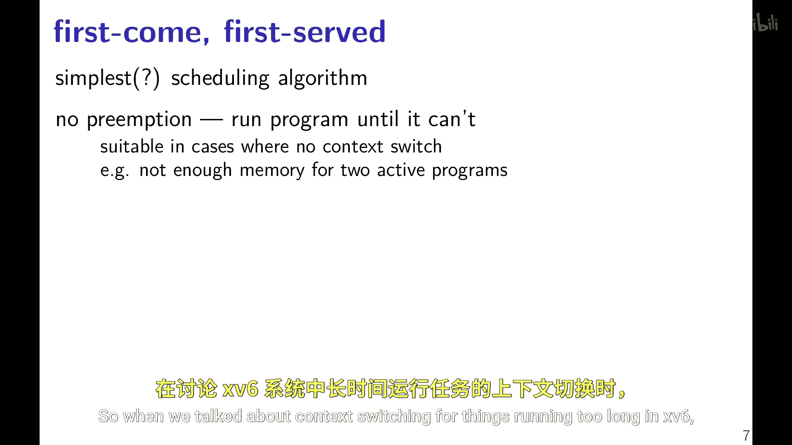

# 弗吉尼亚大学【中英⚡操作系统｜CS4414 2020 Operating System】 p06 P6 Scheduling 2 -BV1mjePzoESb_p6-

Good afternoon。So last time we started delving into how。Scheduls in particular。Processor schedulers。

 things pushed。Divide up CPU time among。Different threads that we have to run。

We wentnt into how XB6's Schr code work。Worked and had this design where for convenience of programming。

 probably they had a separate schedule or thread。啊。

So you switched to that scheduler thread and that schedule or thread was just writing a loop where it would switch to one thread。

 then another， then another and so on。We saw that there were some details with respect to how you did that switch。

 and one thing we need to worry about is what if we trigger a switch from you know？

Some event like waiting for AO and at the same time。

 another event also triggers a switch like we have a timer interrupt telling us to switch away from the current program that could result in us being confused about what programs are running and。

Whether we're in the middle of a switch or not， So to deal with that， we used。A lot。

 which we'll talk about how that works later， which happened to disable interrupts while we were changing those threat states。

 So we didn't have to worry about having that confusion of switching while switching。

We also mentioned generally that when we're talking about scheduling the CPU。

 we're going to talk about thread scheduling because thread is the part that goes in the processor core。

 it's the registers， the program counter， stack pointer， and so on。But in XV6。

 this is kind of conflated with process scheduling because each process has exactly one thread so we they're the same problem in XV6。

 but this is not true in a more general operating system。So after we looked at。How X V 6。Actually。

Schedule things。 we saw that there didn't seem to be an actual sort of。

Design decision about this is the best thing to run next。

 They just chose what was most convenient for their code。 So we started thinking about， well。

 how are we going to figure out what makes sense to run next， what's better than the other。

And for that， we needed a model of well， what are our programs doing anyways。

 And our model for things like desktops or laptops was this notion of CPU burst that programs are alternating between doing a little bit of computation and during IO。

So they can do more computation， like waiting for us to press a key。

 waiting for some data to come on the network， and after they get that。

 they're going to process in response to that for a little bit。

 so we have these what we call CPU burst， and these are what we're scheduling and where the scheduling problem is interesting is when we have multiple applications all of which want to run some CPU bursts。

So。We needed some way of comparing how good is one scheduling decision versus another。

 so we have these metrics。So two metrics。We talked about are related to some notion of how quickly do things get run。

 So we had turnaround time， which is。What's the time from when things were runable。

 so usually an IO finished， like I pressed a key to when they finish running。

Until when they're waiting for their next IO。And wait time。

 which is just basically another way of measuring the same thing。

It same kind of thing of what's the time from when something was ready to run until when it was finished。

 then it wasn't actually using the CPU。 How much time did we spend running other things when it was still。

Had work to do。So we also talked about metrics which are going to be conflicting with these turnaround time。

So one of those was throughputs。 And that's the amount of useful work done per unit time。And。Yeah。

 it might seem from my first approximation， well， if we're using the CPU all the time。

 we're getting all the work we can get done， but that's not true because some of the stuff we're doing and scheduling。

 we don't think of as useful then the biggest one was context switching we also have other costs like if I have to do a lot of computation to decide what to re next that's going to be you know。

What we called overhead things that aren't useful work。

That are going to lower the amount of work we actually get done。

And we had a last consideration we mentioned of barness。And the idea of fairness is that， well。

 some schedules。Are going to disadvantage certain programs。

 And we started off with a model that like each user has one program。

 even though maybe that's very rarely true these days， but used to be the case。

 But some schedules are going to favor one program or one user over others。

And we might not like that。 We might want to have some notion of everything gets treated least kind of similarly。

And。Those were just some examples of metrics。 There's a whole bunch of others we could talk about。

 and many of them are more subjective。 So fairness starts getting pretty subjective。

 We can come up with specific definitions。 but like there's。Yeah， the。

There's a notion that we have in our heads that is hard to write down in a way where I can compute a number and say this is less or good。

😡，There's lots of other metrics we'll think about。

As far as that。So for today， I'm going to be spending most of my time focusing on how we can schedule to minimize mean or total turnaround time。

 I have or because we minimize mean turnaround time。

 We minimize total turnaround time because there's so many things running。Yeah， so the total is just。

The mean is just the total divided by the number of things running， so they're the same。

Same to minimize， not the same number。And the reason we'll focus on this is because this is an imperfect approximation。

Of。Sort of interactivity or responsiveness on something like a desktop or a laptop or a phone。

So but why is it impermeect， like what's an example of something where this metric is not actually what we care about if we're thinking about how responsive is my app desktop or。

How interactive。You， it's my phone。So we're talking about minimizing time from when events happen to when the program that's responding to that input gets to finish。

What's the reason why this might not match my notion of。 I set you in front of two machines。

 one of which has a better scheduler for this metric。

 Why might you be dissatisfied with a better scheduler。LikeWhat could be happening？

You're playing like a game on your。And you get some push notification。

 you don't necessarily want it to happen。Yes， Sir。Yeah。

 so our scheduler doesn't actually distinguish between what type of events are being responded to。

 So， yeah， so you're saying your example is like a game like responding to like my key presses and mouse presses versus something doing something based on the network。

Like， this metric doesn't distinguish between that。 It says they're equally important。

And that probably doesn't match your idea of what's important。And there are other mismats like that。

 so this is imperfect。Yeah，And the biggest complaint is that like we aren't actually measuring what you see。

 We're measuring just input to finish regardless of what it's for。

We also aren't doing relative importance， like if I have my web browser open in the background。

And Skype。Y。Probably I care more about Skype being slow。Then my web browser。

 but this metric says they're equally important。So we're going to start by talking about two trivial scheduling algorithms。

 which don't seem to do anything with metrics， they're not making any direct choices about trying to be good for a metric。

😡，Like turnaround time， but we'll look at what do they actually do for turnaround time and from that we're going to come up with a plan for actually minimizing turnaround。

😡。

And these two trivial schedulers are something called first come first served and Groundroing。

I'll start with first come first serve because that's probably the simplest possible scheduler and you can probably guess how it works。

I'm going to give several examples of schedulers and we're going to keep things nice and simple to start out here and say that we're assuming that multiple programs become ready at almost the same time。

😡，So they're all just ready to do their CPU where some IO finished almost the same time。

 but there's some order。So one was first， one was second。

 like was all like in the same microseconds or milliseconds， but。

there's some order and that order is going to be important。

 and the reason the order is going to be important for first come first serve is because。

First， come， know， that's going to matter。So first come first served。Let's look at that。

So this is going to have no preemption。 So when we talked about like context switching in for like things running too long in XBC。

