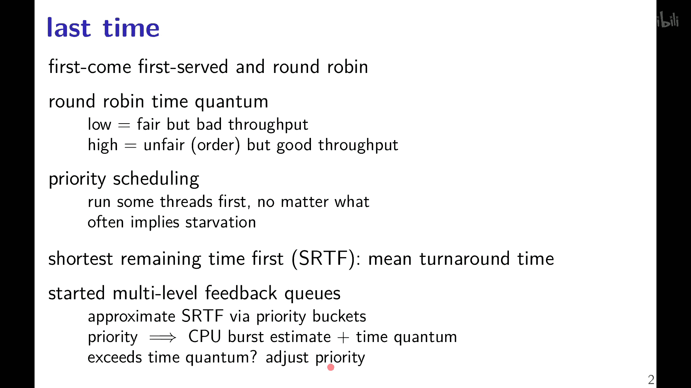
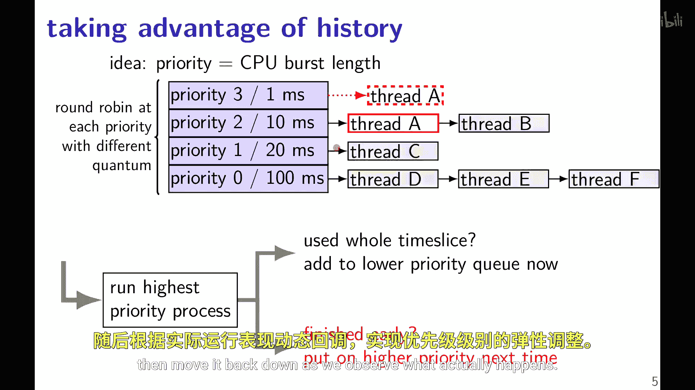
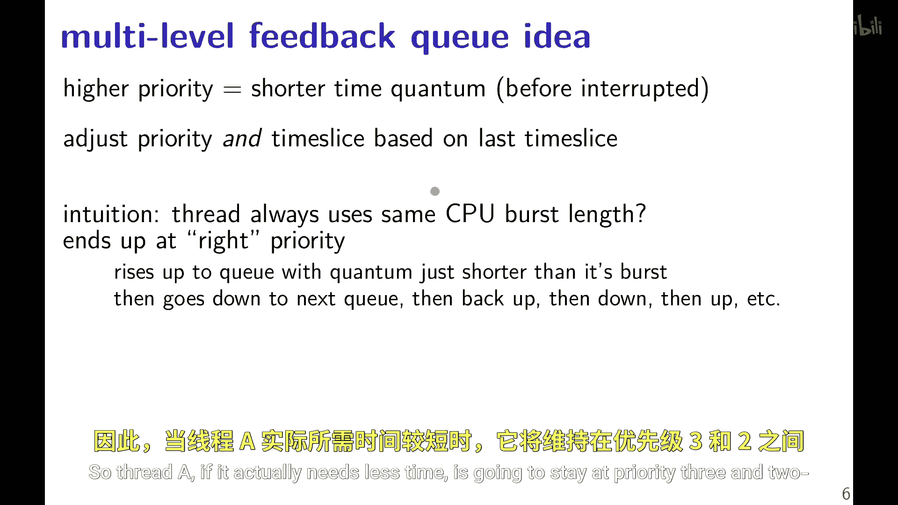
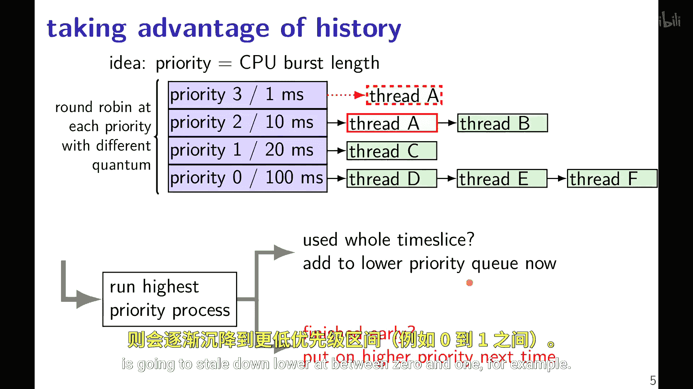
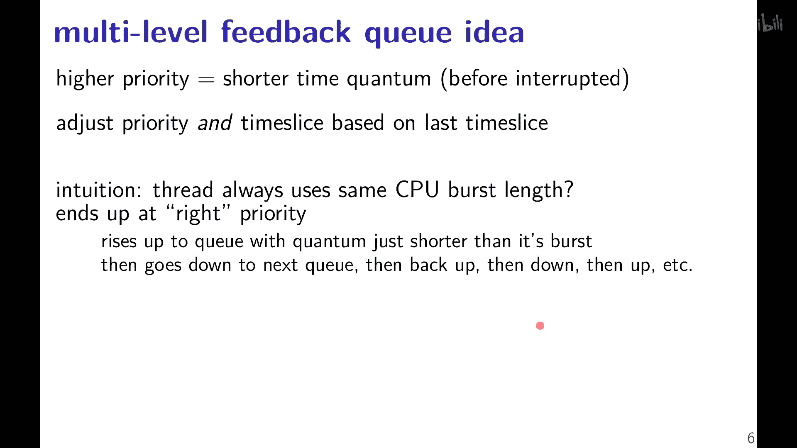
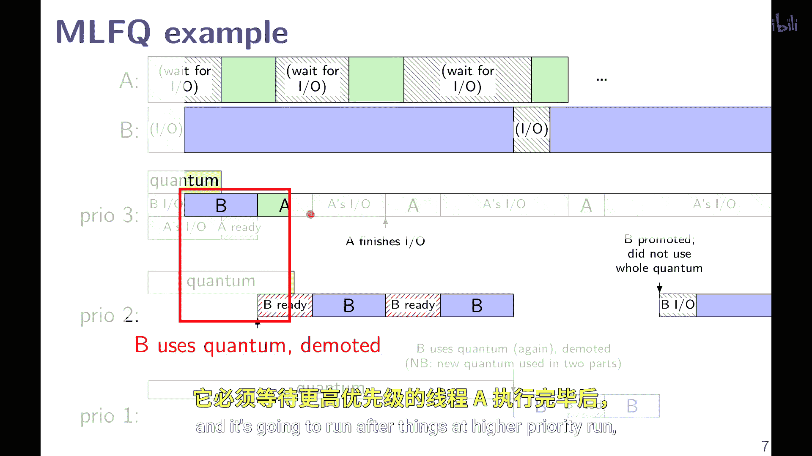

# 弗吉尼亚大学【中英⚡操作系统｜CS4414 2020 Operating System】 p07 P7 Scheduling 3 -BV1mjePzoESb_p7-

Good afternoon。So last time。We talked about several。Scheduling policies we started with probably。

The simplest of first come first served， like probably the simplest scheduler you can write。

 just run the next thing on the list when something comes in， add it to the end of the list。

And we said， well， first come first served has this problem that well。

 something wants to run for a while it's going to and other things won't run。

 so we had a solution to that which was interrupting getting to run something else and this gave us round robin。

are basically our simplest preemptive scheduler。And with that slightly more complicated scheduler。

 we suddenly had a choice。 We need to choose this time quantum。

 and we have this trade off that if we made the time quantum really sure。Our scheduler would be。

 in some sense， fair that at least we wouldn't have order mattering a lot for when you run exactly。

But we had bad throughput because we have more and more。

 depending on how short we made that time quantum context which overhead。When we read it high。

 we'd eventually approach what first Com first served did and get less and less fair。

 more advantage to going first。But we have better for。

Let me talk about a different type of scheduling goal where we have some system administrator who say。

 well， I know what needs to run first， what's most important。

 I'm going to run that thing absolutely first when we have this idea of priority scheduling divide our threads up into different types and we'd say one type runs first。

 no matter what and we were really serious about no matter what you might say you know just because something's more important doesn't mean it's that much more important that it should like。

Always run， but that's the decision we made if it's more important， always runs。

 even though that meant we had starvation， this thing where the less important thing would not run a lot less。

 it would run never。😡，We're very close to never。And this is the reason why we might not like things that are based on priority scheduling is that we'll get this starvation effect。

whichch usually when we were thinking about priority， we weren't that serious about it。

 we didn't really want it to always take for sudden in between。

 and today we're going to give some examples of things which are kind of in between as far as you know giving preference but not total 100% preference。

So， we look at。Back to this goal of turnaround time。 When we looked at first comfort first surge。

 we learned， oh， the order changes our turnaround time a lot。

 And turnaround time is this sort of analog to how responsive or interactive things are。

 So it's something that's useful to optimize。But first come first served didn't do it because like it just what were things came in。

 Brown Robin didn't do it， but we learned that。The orders that were best had the shorter thing first。

 and so it turned out that if we wanted to optimize for average turnaround time。

 we use shortest remaining time first。And here we're getting to this family of schedulers where we're basically using the priority scheduling idea with。

A different way of setting the priority。And this gave us a solution。

For a problem we had with shortest remaining time， which is it's great that we're optimizing turnaround time。

 but we couldn't actually implement it。Because we can't measure a remaining time except by actually running the thing。

 and if we're actually running the thing。😡，That gets rid of choosing the right thing to run。

So we need some way of estimating it。And a good way to estimate how much time something's going to take。

😡，Is to look at how much time it took last， because most programs are going to be reasonably consistent。

So。Last time when we finished up， we started on this way of appxiating short remaining time first with priorities where just like short remaining time first。

 we have our highest priority be the thing that we're guessing has the shortest remaining time。

And we enforce our guests in a sense by saying if you took more than a certain amount of time based on your priority。

 we'd say， we were wrong， you shouldn't be at that priority in Des Moines。😡。

So our priority implied both our estimate of how much time you need it and how much time we'd actually give you。

 we set the time quantum based on that priority， so if our guest was wrong，😡。

The most we do is run you for that amount of time， roughly equal to our estimate。

 and then we'd run other things with a good estimate before going back to you。😡。

So we do this adjustment of priority with this sort of free signal of if something used the whole time quantum。

 we have to interrupt it， something was wrong with our。

So before I continue talking about multilevel feedback cues。

Any questions about things we covered last time？

Okay， so。When we were talking about multilevel feedback cues last time we said we had。

Different priorities with different quantums。And our idea is that if Fred A is here that we're guessing it has something like a 10 millisecond remaining time every time it runs。

And we look at what happens after we run it， we're going to run threat A first because it's the highest priority thing and it's the highest priority。

 which has something， it's the first thing in the list。If it uses the whole time slice。

 we're going to say， well， our guest wasn't very good。

 we're going to demote it and run the rest of that。😡，Remaining time later。

 took more than 10 milliseconds of remaining time， it's not good。If it finishes early。

 we're going to remember that that happened and we're going to speculate that maybe it has a shorter time slice。

Sort， sort of。Remaining time， the next time it wakes up from I O。

 So we're going to remember that when it's ready the next time we're going to put it at the highest priority in this case。

Move it one up。And you know guess that maybe it needs less time and if we're wrong。

 it will go back down。😡，Or it'll go back down and takes more than that。

 this is sort of automatically correcting if things vary in how much time they use that we're going to experimentally move it up a little bit。

Then we were back down。As we observe what actually has。

就。The idea here is that we're going to always end up with the right priority。

rather around the right priority， we aren't going to stay at the right priority with the scheme。

 we're going to kind of oscillate， but we're going to oscillate around the right place。 so for a。

 if it actually needs less time is going to stay at priority 3 and 2。

 not go down further because it's shorter versus something which always uses more than 10 milliseconds。

 it's going to stay down lower and between 0 and1， for example。

So to give an example of this， heres。So的。That multile fair queuing， where I have three priority。

 that priority， the highest priority， I have this quantum。

 I have a bigger one at the next and a much bigger one。At the lowest priority， and I have A。

 which is mostly doing IO and doing little bits of CPUU。

 so our intuition is A should be at a higher priority， and we have B， which is doing IO regularly。

 so it's not like completely CPU bound but it does lots of CPU so it should run into lower prayer。

And when they start。We're going to guess that they're at the highest priority。

 If we start them at the lowest priority， we might never run them and figure out that， for example。

 A really should run first。 So we're going to guess they're at the highest priority。

 And in this case， B becomes ready first。 So we run B for a time quantum。And we find out， oh。

 it used the whole time。And then we run in。 So that's our first set that we run B for the whole time quantum。

Then it finishes， and then we look for the next thing to run。

 And that's the next thing in our round robin schedule at this highest priority。

 which is going to be A and a is going to run。And use。Less than this whole time quantum。

 so we're going to keep it at the highest priority， we can't increase its priority anymore。

 so it stays right there。牛变。Since it uses this whole time quantum， but doesn't finish。

If we're going to keep it。In one of our run queuees and at some priority。

 but we're going to demote it。 We're going to send it to the next lower priority。

And it's going to run after things of higher prayer。

