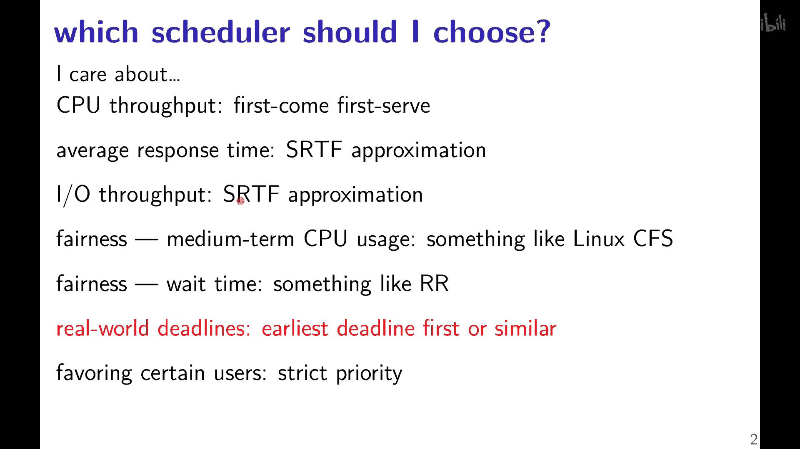
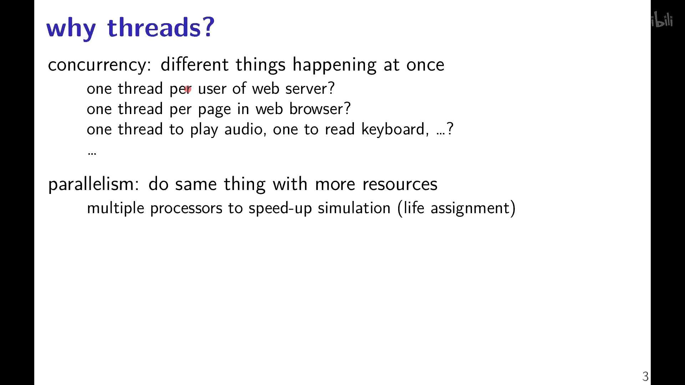
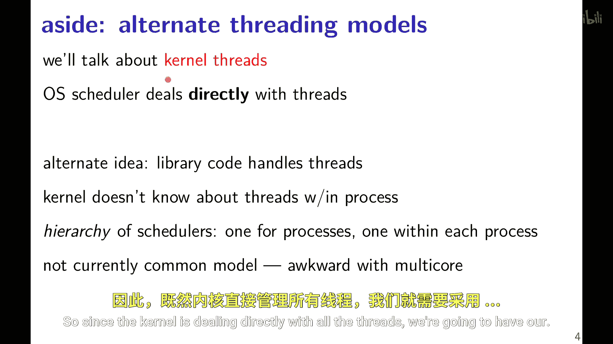
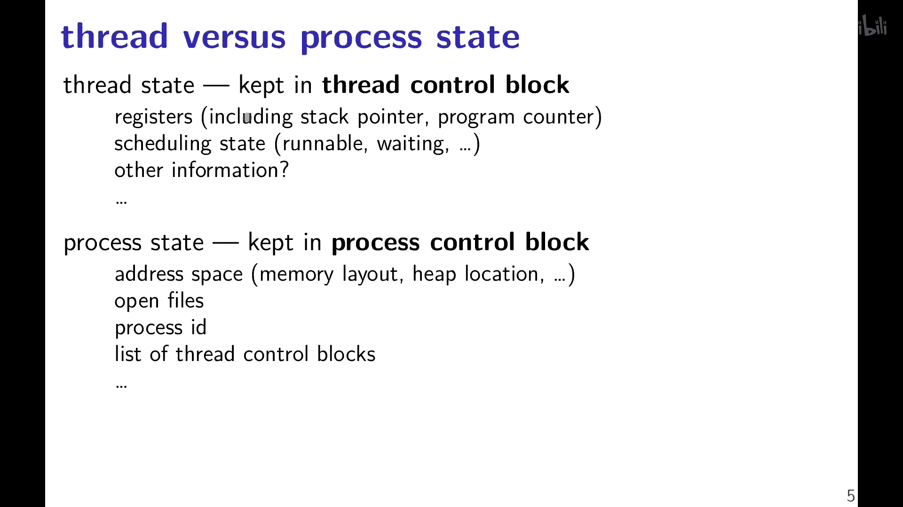
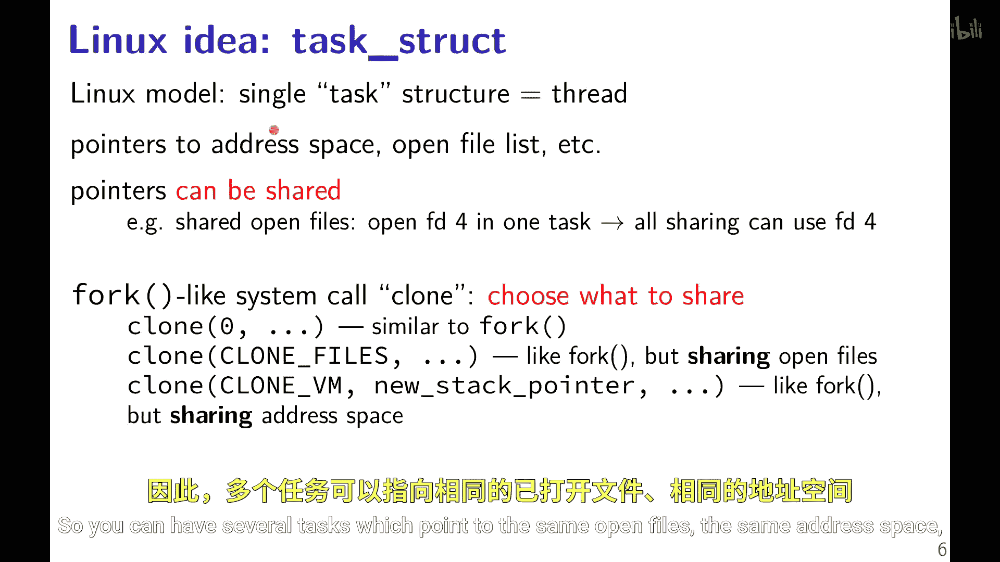

# 弗吉尼亚大学【中英⚡操作系统｜CS4414 2020 Operating System】 p08 P8 Threads Synchronization 1- Locks 1 -BV1mjePzoESb_p8-

Good afternoon。So last time we finished up talking about thread scheduling。And。

We started by talking about very simple schedulers or simplest ones first come first served。

And we found that that was what optimized throughput。

 it minimized the overhead of making a complicated decision about what to run and of having many contact switches。

Often that wasn't what we were looking for。啊。And when we're doing further analysis。

 we discovered a sort of idealistic scheduler that would minimize sort of responsiveness or response time。

 so maximize responsiveness。In some sense， that was shortest remaining time first。

But we had a problem that we couldn't actually implement that in practice。

 so we talked about strategies based on priority scheduling where we said， well。

 shortest remaining time first runs things at higher lower remaining time earlier so let's use a priority scheduler with higher priority having things with shorter remaining times。

And we'll guess what has a shorter remaining time because we can't figure that out exactly。😡。

Based on what happened previously。So we had this approximation of multilel feedback use for short remaining time first。

 there's some others out there。Not real literature。

We also looked at a completely different goal of fairness。

And we had our lottery scheduler sort of a more flexible fair scheduler where we could have our fairness be not just everything is equal。

 but we could assign weights。啊。And we had a deterministic version of that where we looked at what the Linux completely fair scheduler did。

Which essentially， also。没有。Has this notion of fairness。

 but with proportional shares where sound amount you're entitled to， that might be more than others。

And also tried to deal with， well， what if you do IO for a bit。

 does that really mean you don't deserve as much CP time， and Linuxex said。

As long as it's short enough。It doesn't， if it's too long， it does。啊。And we also mentioned。

Our strict priority schedulers so we mentioned priority schedulers as sort of a way to build our short and rating time first approximation。

 but we also mentioned them sort of as a means to an end if we have。

Sort of a strict hierarchy we want to enforce， that's the schedule or to。So before I move on。

 any questions about things we covered？Last time。Schedullerers。

So there's one type of scheduler that's on here that I'm just want to mention。

 we're not going to cover it。That's for real world heads。 And I'm mentioning。

So the algorithm name here is earliest deadline first you can probably guess how that works。

 there's some other algorithms in his family where you have some real world deadline and an example of that like I'm writing the computer that controls the brakes in the car and there's a point in time by which I better tell the brake what to do or else things go really wrong。

So if you have a system like that， you don't。 You want to use a scheduler that actually guarantees that。

 which is not the ones we talked about directly。更好看的。So。

Any questions before I move on to our talk for the day， which is about。

Threads and programming with threads in general。

Okay， so we're going to talk about programming with threads。By threads， I mean in the same process。

So presumably， we have one sort of overarching task that we're doing with multiple threads。

 We don't have independent programs， but they're somehow related。

 and there's two ways we're going to talk about doing related things。

 So one is with what I'll call concurrency， which is where we have one overarching task。

But we have different pieces of it that are happening at the same time。

 So like we have a web server that's serving one website。

But we have different users requesting different parts of that website。

 and we might have different threads to handle each of the users。

 the threads are sharing data about what's on the website。

 but they're otherwise acting independently。Or we might have different tabs in a web browser。

 they have to coordinate to figure out who's the right to active tab。

 they might have to share some information， but they're otherwise mostly independent as far as what they're doing and they're handling different tasks or you might imagine something like a game where you have like a thread for playing audio。

 a thread for getting and processing the keyboard input and other tasks divided up in that sort of way。

 so I'll call this concurrent。😡，We'll also talk about perilism where I have one single task that would be most natural to do sort of。

You know， as one single thread， but that's not good enough， probably for performance。

So you want to make that faster。And we'll have an example of this in an upcoming assignment。

 so we're going to have an assignment where you're going to do a simulation。

 we'll give you a single threaded just loop that does the simulation and we want you to make it faster by using multiple threads and this will be faster assuming we have multiple course。

So that's going to be one of our big use cases for threads is that we have one task。

 we're just dividing it up so we can use multiple cores， or we have one。Overarching goal。

 and we have separate， mostly independent tasks with some coordination。啊。Which is our concurrency。

 No， for concurrency that。Using threads in that case is beneficial， arguably。

 even if we don't have multiple cores， because it still is helpful to divide the task up into these separate pieces。

And to make sure one piece doesn't wait on the other unnecessarily， one user's request can。

 if it stalls， it doesn't delay another user's request to the same web server。This is our context。

 we're going to be a little far apart from actual applications for a while。啊。

I just want to set set the stage。Now we're going to talk about how threads work。

 and I'm going to assume a threading model called kernel threads that we talked about scheduling threads。

 and we gave you the impression that there's a scheduler in the operating system kernel that schedules all the threads and that's what we're going to assume that all the threads are scheduled directly by the OS kernel。

😡。

And this is the most common model today。 this is how most operating systems work for most programs。

 but it is not the only way to do these do multith programs。 and fact。

 historically wasn't even the most common。So an alternate idea is that you can have library code that's not in the kernel handle threads。

😡，And then the OS scheduler schedule lose。These schedules programs which schedule their own threads。

So there's a hierarchy of schedulers。So that's a model which is still possible and historically very common。

 but it's not common today， and the main thing in the cha which made it uncommon is that this hierarchy of schedulers is really awkward with multicore。

 because if we want to take advantage of multiple cores。

 we want to figure out what program has the most work to do and give that all the cores it needs。😡。

And if we have this hierarchy of scheduler， it's hard to arrange for that to happen。

So since the kernel is dealing directly with all the threads， we're going to have our。

Thread state separated from the rest of our process state。

 so we'll have what we'll call a thread control block， which contains the register。

 stack pointer program counter and so on for a thread is scheduling state so whether each thread is runnable waiting for some piece of IO and so on and any other information we need。

And we'll have that separate from the process state， which will be like the memory of the thread。

 what files it has opened， its process ID， and each process control block will be associated with a list of threads。

 so it will have a list of thread control blocks。😡。

And our OS scheduler is just going to deal with the threat control blocks and running those。

So this is the conceptual model I'm going to use。 So before move on questions about。

That's in the thread control block。Now。Some Os don't quite work this way。

 And Linux is an example of this。 So Linux。Doesn't choose to have really an obvious processor or thread control block。

 even though it has that kernel threading model。 the kernel schedules each thread。 instead。

 Linux has a single task data structure that represents a thread。

 but rather than having threads that point to process control blocks and vice versa。

 the task structure has a pointer to what's the current address space， the memory。

 What's the current list of open files。 These are all pointers。

 and multiple tasks can share the same pointer。 So you can have several。

