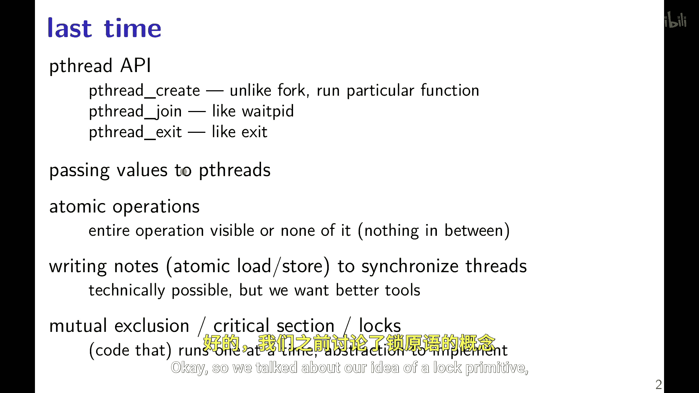
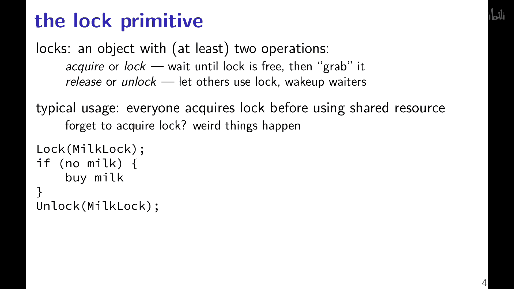
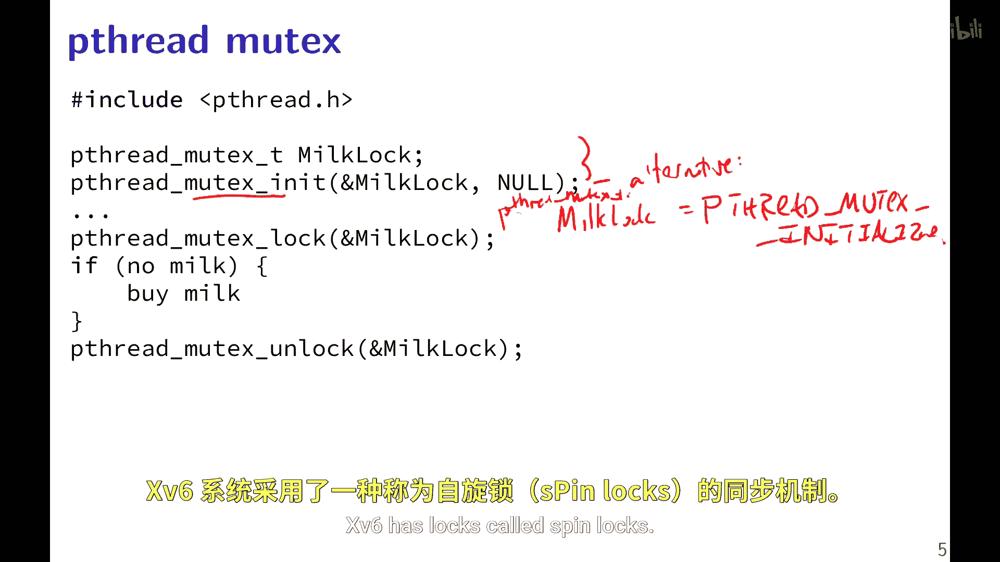
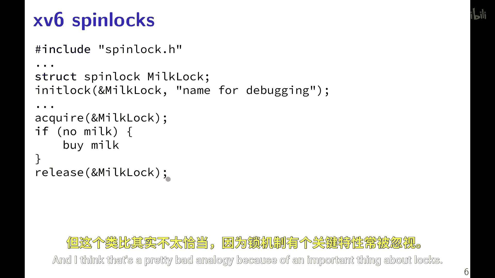
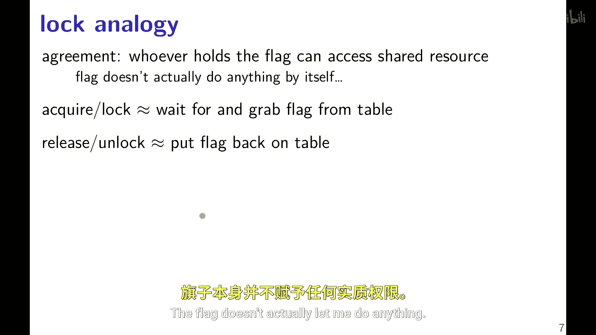

# 弗吉尼亚大学【中英⚡操作系统｜CS4414 2020 Operating System】 p09 P9 Synchronization 2- Locks 2, Mutexes -BV1mjePzoESb_p9-

Good afternoon。やめる。So the last time we started by looking at。The Poss API for threads。

 which is called P threads。We saw equivalentence to the functions we were using for managing processes。

So instead of fork， we had P thread create， this was probably the most different。

From what we had for cross， so instead of returning twice to the same place。

Peter at Create took a function to run， and that function would be what the new thread would run to completion。

Blessed， exit early somehow。We had our equivalent of weight。Which was join。And unlike with processes。

 we didn't have this how did exc and an exc code if it called exc。

 we have just a pointer get returned through joint。

So most of the time we won't actually end up using that pointer with mic examples。And we had。

An exc set function， P thread X set， which is like excE。

 but only X X one thread instead of the entire process， and all the threads contained。

We looked at several examples of how you might pass values to P threads。

 which I went through because。A lot of people look at oh。

 I have to pass a void star pointer how do I use that to do anything and we saw that there were several strategies for that we could justbed convert a number to a pointer or more flexibly。

 we could allocate some structure and pass a pointer to that structure。

Possibly we might need to point put that structure on the heap if we wanted to make sure it stayed around for a while。

Then we talked about， well， we were just doing things where we started a thread。

 waited for it to finish and then looked at what happened after that。

 and there's a lot of things we can do that way， but often we might want to coordinate what two threads do at a finer granularity that something other than wait for the entire thread to finish。

😡，And to do that， we need to figure out， well， when two threads are working on the same thing。

 what's going to happen？And we have this concept of an atomic operation that there things we hope happen。

All together or not at all， we don't want an in- betweenwe state。

 and we saw the example of like if we're editing values。

 we'd like it to be the case that we see the new value or the old value when we're checking that from elsewhere。

 not something in between。And we saw that that wasn't the case with even individual instructions like an ad。

 that that wasn' an a comic that we could see some in betweenwe state where the value hasn't changed。

 but we had retrieved the value to add。Already。And this meant we got a result which perhaps wasn't what we were expecting。

And would make it harder for us to have two threads acting on the same value。So we said， okay。

 we need things to be atomic。And。We said， well， probably we can assume that writing or reading single values in memory。

 that's going to be atomic。And I said that I had a real world analogy of like reading and writing notes。

 So we looked at， well， if we're reading and writing notes， can we。You get two threads to coordinate。

 and the operation we wanted to coordinate is that exactly one thread checks for something and does it。

Our example was we check if we have milk and。You know， we need to buy milk therefore。 And if so。

 bought milk。And。We saw that， well， it's technically possible to do this sort of coordination。

 but really tricky。And we mentioned， we're not going to be doing that。 We want better tools。

 It's not going to be good enough for the hardware to just give us。

This atomic load and store operation。It's just not powerful enough。And we still want。

This type of coordination and the type of coordination that we're going to start talking about is what we call mutual exclusion that we have two threads and at most one of them does an operation at a time and our operation our first example was like。

Check for milk， if there is no milk， P milk， all that should happen。😡，One at a time。

And we have other examples we could think of like adding to a number， we should read the old number。

 compute the sum， and store the menu sum that could all happen one at a time。

 that would be an atomic ad， so we do it with mutual exclusion to implement that。😡。

And we call the set of code where we have mutual exclusion。

 where one thread at the time does it a critical section。And we have this。Absstruction called locks。

Which is going to be how we're going to actually implement that。

 So something is going to give us this abstraction called locks。

 I'll talk a little today about the simplest ways of implementing locks。

And probably next time we'll talk about better ways of implementing locks。

We need to look at what a lock is。 So I'm going to go。Look at review Lux and。A little more。In a bit。

 but first questions about anything else we covered last time。So。

We talked about our idea of a lock primitive。 So we have this acquire operation where we wait until a lock is free and。

Then grab it。And we have this release operation where we let others use the lock remake the lock free。

 So the lock is either taken or not taken。 There's no in between。 And when it's taken。

 there's exactly one thread you can point to， which has it。And that it's necessary。

 so we have our mutual exclusion property。So with our milk example， we have a lock。

For checking for and buying milk。And we get the lock before we started doing that。

 release it afterwards。 And from this， we know that we take turns doing this check。And buying。

 and we wouldn't have an in between state which would cause confusion。

So。There are some APIs for implementing these locks。 So one P threads has。

A version of locks called a Ut， we'll talk more about what Ut means a little later。

 that's a particular kind of lock。And so this is an example of using it。 Instead of doing this。

 I knit， we could have also initialized the lock to a special constant。Called。P thread。

New text initializer。You can see the exact spelling。In the manual page。

But either we initialize it to the special constant or call this init function to set up the new text。

 and then there's a lock and an unlock operation。And that's how we use Peter。

So this is an alternative。Is to declare the walk equal to this special constant。

But one of those things to set up the lock， and then we lock and unlock it。

like XV6 has locks called spin locks。 we'll talk later today about what is a spin lock。

 what particular kind of lock that is。

So they're represented by a struct， you declare the struct。

 and you have to have some function initialize it。 typicallyyp this is done in code。

 which is called that boot。Unlike。P3 Mutex locks， there's no alternative to do this without some code which runs at Bo。

You have to do it。have some coarite boots， and then there's an acquire and release operation。

 that's why I gave both the acquire and lock same thing， release and unlock， same thing。

W I gave book。Now the name now are questions on this API。His API is here。Our key threads API。And are。

It's been lock it。So the name lock。Seems to imply that I should be telling you to think of a lock like locking a door or something。

 And I think that's a pretty bad analogy because of an important thing about lock。

So locks are about when we use them， we have some sort of agreement。

 So I think of locks more like a flag， so I have like a little flag that I put on my table。😡。

And when we went to do something， I agree that I'm going to grab the flag。

 and then I'm allowed to do it。And only if I have the flag， can I do it， when I'm done doing it。

 I put the flag back on the table so you can get it。

So our acquire or lock operation is look at the table， wait for you flag when there is grab it。😡。

And the release operation is put the flag back on the table。And why I like this analogy better is。

This is an agreement， right， Whoever holds the flag can do that。Only because we agreed on that。

 not because anything is going to stop me from doing anything because I don't have the flag like the flag。

