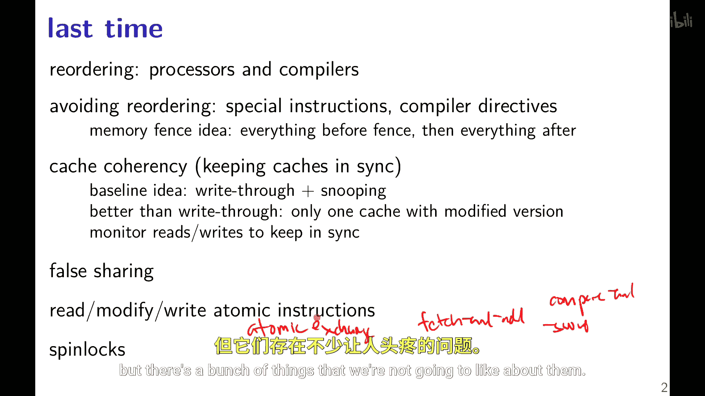
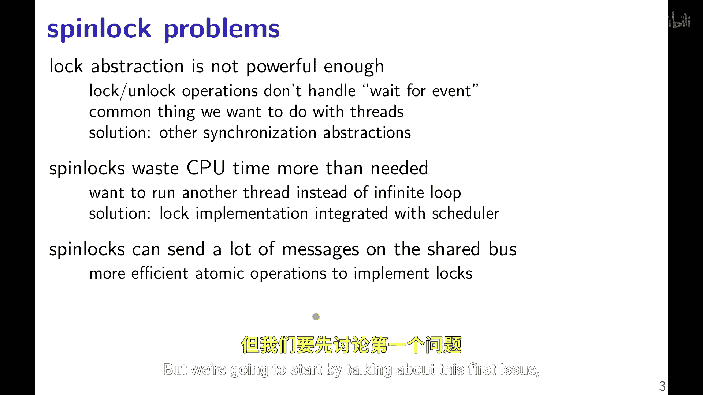

# 弗吉尼亚大学【中英⚡操作系统｜CS4414 2020 Operating System】 p10 P10 Synchronization 3- Monitors and Semaphores -BV1mjePzoESb_p10-

Good afternoon。So。Last time。We started off by talking about。Reordering of loads in stores。

 So you mentioned， we had this idea that hopefully our loads and stores were atomic。

And that led us kind of reason about what would happen。

When we had multiple threads accessing the same things。啊m。And we found out that， well。

 they're atomic， they happen to all at once or not at all， as far as observing them。

 or you don't have an in between state。But it turns out that processors and compilers don't do them in the order。

 we writeite them in our program all the time。And to avoid this for the processors。

 we needed special instructions， which have。Stronger rules about。The processor knocking that off。

 not doing that reordering， and we need ways of telling the compilerr， hey， don't do that。

And for those special instructions， we have this idea of a memory fence that there would be some special instruction which ensures that everything before it isn't reordered to after it and everything after it isn't reordered to before it。

 so we have actual separation， and this would let us start to reason about what would our programs do。

And we learned that things like P threads has you know， like create， join， lock， and so on would all。

Use those special instructions as appropriate and also tell the compiler， hey。

 there are other threads going on here。😡，Don't do those silly tricks you were doing to load things earlier that will make my lock or my join or my create not have the results I would expect from things executing in order。

😡，So then we looked at， well。If processors can share data。

 how does that actually work and the simplest model we have is that they're all connected to memory and they all go to memory every time they need to read or write a value。

 but we know that that is not actually what happens because that would be too slow that we actually have caches on our processors and typically one per core。

And we want to cache a value on a core， even though another core might want to use that value。

Now the simplest way we could make this work and not have the corerus get confused about what value is actually there would be to always send out the value whenever we write it that's a valid approach。

 but that's typically too inefficient， it gets rid of a lot of the reason we have caches in the first place is so we don't have to talk to memory and every single other core every time we do something。

Every time we write isn't。All the time， but it's。Most of the time， and that would be too much。

So our idea was that we'd take advantage of all the cores and memory being put together。

 and we'd have this property。 we'd enforce that at most one core would be modifying a value at a time。

 and if a core was modifying a value， no other core would have a copy of it cached。

And to enforce that， we'd have to tell the other cores when we were writing a value so they'd get rid of their copy。

 and we'd have to make sure that if another core wanted to read a value。

 we'd give them the modified copy。And we had a protocol where we tracked states for each cash block that ensured those properties would hold。

And。I mentioned that we had this protocol where we ensured that we had it most one modified version of each cache block。

 and I saidC block because the cache works in these block units which are turns out larger than what we typically read or write for memory。

 and that makes sense because that's less bookkeeping and we want to read and write a lot for memory anyways。

But it creates this problem that。I can have one core right of value in one part of the cache block and another core right of value in the other part of the cache block。

 and they have to take terms， even though it's a different value。

 the caches only know about the whole block。And they assume if you're writing part of the cash block。

 you're changing the whole thing， even though that's not really true。

And this means that we have bad performance if because they'll be sending that value back and forth。

 even though for。In cases where it's different parts of the cash block。

 they could just work independently if only they had the bookkeeping to do that。

And we called this problem of false sharing， and the solution was， well。

 keep the values in separate cash blocks， even though usually we hope that we don't have to worry about what is a cash block。

Now。After looking at cash coherency， we found oh， there's something we can do with this that's going to help us with a problem we had earlier。

 which was implementing locks， we saw we technically could implement locks with atomic loads in stores。

 assuming they weren't reordered， and we learned we could keep them from being reordered。

 but it was really annoying。And we'd like the processor to provide us something better。

 And the way cash coherency works， it's actually pretty easy for the processor to let us。

Read and write a value that it has cached without any other processor getting in the way。

 And that's easy because to write the value， it needs to be the only one having the value， anyways。

So you can just reallywrite it while it's doing that。

And this gave us read modify write atomic instructions， the main one we saw was atomic exchange。😡。

I mentioned very briefly that there are others。That processors can easily implement like fetch and add So read and also add to a value or compare and swap。

Which is。Read and possibly write to a value。 whole bunch of them。

 We gave start with the atomic exchange because it's probably the simplest and was enough to implement locks。

 though there are these others， which are easy to implement in more powerful。That you know。

 if you wanted to have better locks or。Other types of synchronization。

And I saidomic exchange was enough to implement locks and the locks we implemented were these spin locks where the idea was that we'd have a variable representing the lock。

 which would be a global in memory and we'd have a value saying it's not taken or it's taken。

 and we use atomic exchange to set it to taken while reading its old value into a temporary。

 we'd look at that temporary and say， oh， wasn't already locked if so。

 then I didn't change anything about it， and I didn't lock it， if it wasn't already locked。

 then I locked it so I can move on， I've completed my lock operation。😡。

So questions of any of this before we move on and look at things that spin locks don't do。Okay。

So spin locks， they're enough to get our synchronization。 but there's a bunch of things that。

we're not going to like about that。So one of them is that we have locks。

There are things we're going to want to do where locks just aren't going to be good enough。

Rlocks are just the wrong tool for coordinating what threads are doing。

 So they're great for making sure threads don't interfere with each other。

 But there's other types of coordination that we've， in fact， already seen。

That locks are going to be a very poor fit for。😡，Another issue with spinlocks is。

Even though they implement the lock abstractstruction。😡。

They're kind of inefficient that when we're waiting for a lock， if that's going to be a long time。

 we're going to waste a lot of CPU time。And what's worse is， let's say I have a single core。

 and I use spin locks。Or I have multiple cores。 But the thing that。

Has the lock isn't running right now。😡，Then I'm going to check， is the lock still taken。

 Is the lock still taken， Is the lock still taken over and over again。

When I could be running the thing that's going to use the thing that the lock protects and then release the lock。

😡，Could be delaying the lock from being released。In order to run the is the lock still taking code？

Like to do better there。 A third issue， which we won't talk about much， but is that spin locks。

 it turns out， are not the most efficient way of implementing locks in terms of atomic instructions。

 in terms of how efficient they are as far as messages sent between processes there are。

More intelligent ways of using atomic operations that don't send as many messages and therefore are more efficient with lots of cores。

 especially。But we're going to start by talking about this first issue that things the lock abstraction doesn't do。

And I said， you've already seen some cases like this。

 Now we haven't worked much with threads in particular。

 though you've seen one of the cases where locks don aren't enough to implement something with threads。

But you've seen this definitely more with processes where。

You have a thread in one process and a thread in one another process。

 which need to coordinate in some way。And。The mechanisms we've seen so far， this。

