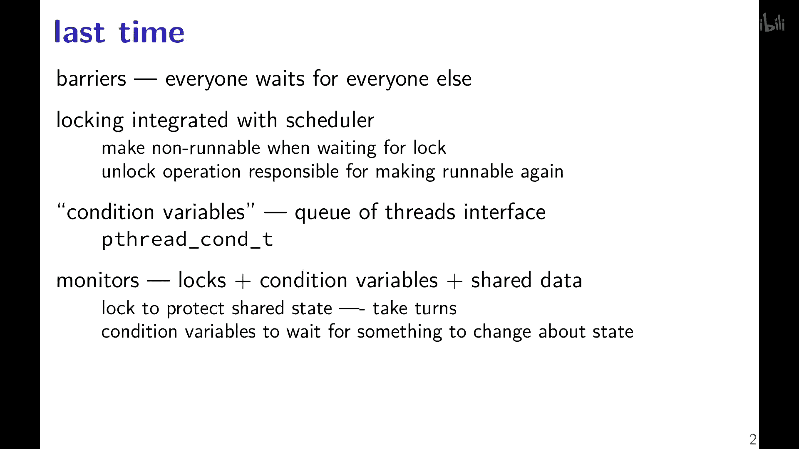
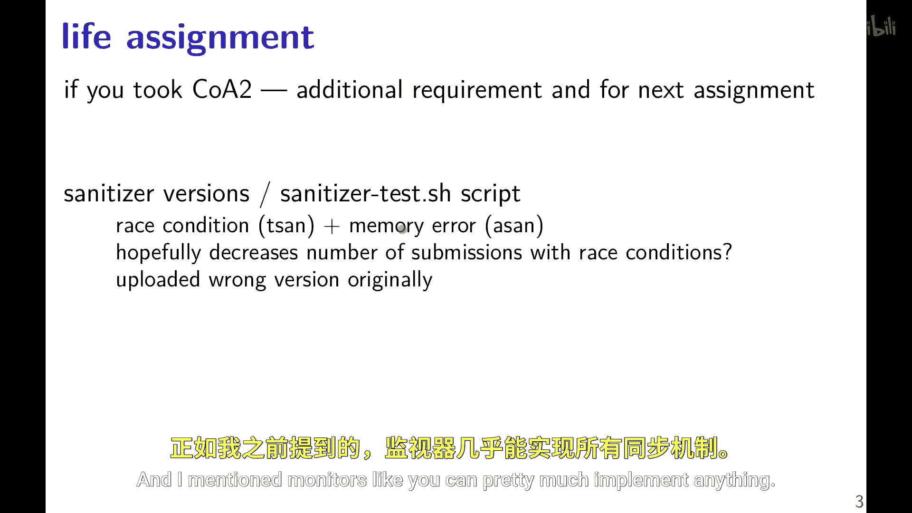
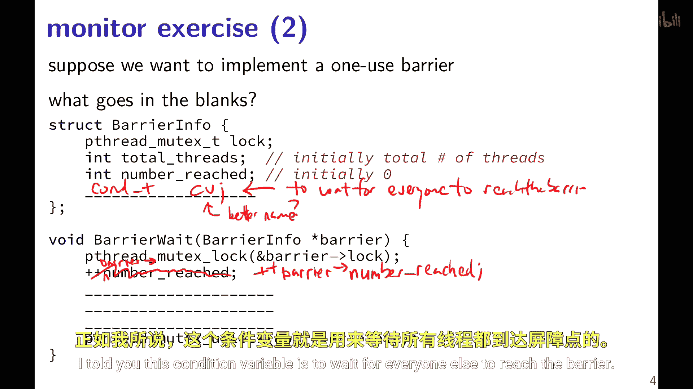

# 弗吉尼亚大学【中英⚡操作系统｜CS4414 2020 Operating System】 p11 P11 Synchronization 4- Semaphores and Monitors con't Reader+Writer Locks -BV1mjePzoESb_p11-

Good afternoon。So last time。We。Talked briefly about barriers。

 which were a super specialized way of syncing up between threads to handle the case where we wanted every other thread to wait for。

Every other thread。And we found that that pattern happens often in things that look like simulations。

Which is why it was worthwhile having this。You know， single purpose inchronization construct。

 And we saw that Pos implemented one。 And you mentioned it early。

 partly so you could start the life assignment， which stood this week and。

You don't have to use barriers to do the life assignment。

 but it's almost certainly this easiest way of doing the assignment。Then we talked about。

Locking again， we had spin locks already， and we had disabling interrupts to do locks in a single core。

We wanted locks that actually integrated with a scheduler because bin locks were really dissatisfying in that。

They meant that we would have to wait a long time doing nothing useful。

Just trying to get this spin lock when we could be writing something more useful。

So we had an alternative idea for locks。Where we'd make something not runnable while it was waiting for the lock。

But this meant that our unlock operation became more complicated and now needs to make that thing runable again。

 and to make this work， we need to have some sort of integration with the scheduler。

 so we have a way of making things runnable and not runable without running into other race conditions。

So then we talked about。Monitorors starting with condition variables。

 which are this very general synchronization construct。

 So they're going to allow us to pretty much do any sort of， I want threads to wait at this time。

Operation we want to do， unlike barriers where we had to like choose a specific thing or locks where there's one pattern they。

And。We have these conditioned variables， which are very poorly named。😡。

Which are basically just an interface around a queue of threads waiting for something。

 So there's the interface to access that queue， you can put yourself on the queue and you can remove threads from the queue and add them to the list of runable threads。

And these always are used in。Combination with a lock。 So hence， this concept of a monitor。

 So we have a lock protecting some shared data。 We have a condition that's related to that shared data。

And our operation to wait on a condition variable is coordinated with this lock。

 So we unlock the lock when we start waiting and we relock the lock when we continue waiting。

 because it's coordinated with this。 We don't have to worry about what if I。You know， start waiting。

 But just the millisecond before I start waiting， the condition I'm waiting for changes。

That's not possible because the operation of starting waiting happens simultaneously。

With unlocking that lock。 So the condition can't change until we start with。

And we called this combination of that shared data projected by that lock。

 So we know what doesn't change at unsafe times， condition variable。A monitor。

Some questions about what we covered last time。

Okay， so。Some brief notes on the life assignment。 So if you took Coa 2。

 which is the pilot computer organization architecture course。

 that is the in the new pilot curriculum。You should know who you are。

 you have an additional requirement for the life assignment and an additional requirement for the pool assignment。

 this is because in COA2， there's an assignment which is extremely similar to the life assignment so you don't get to have that practice for free。

We want you to do a little extra。Also， there are sanitizer versions that we build。

 So these are sanitizers。 are these compiler integrated tools that find common errors。This semester。

 unlike previous ones， have the script building。Thread sanitizer T sand shorthand。

 which hopefully finds race conditions。 It doesn't find every race condition， because。

It requires you to execute something that exposes the race condition。

 but it should be pretty good and hopefully if you actually use this。

 it will reduce the number of students who submit code。

 which still has race conditions for especially the next assignment， I'm not so concerned for life。

It did turn out that the sanitizers test script I submitted with。嗯。

The life assignment didn't work because I had the names of my solution testing binaries and not the ones you'll actually use。

 So there's an update for that。 And I sent an answer。Lets just brief notes on the life assignment。

Now， let's go on talk about monitors more。And I mentioned monitors， like you can pretty much。

Implement anything。 So let's talk about implementing barriers with monitors。

So I want a one use barrier。So here I have my partial implementation of a one use barrier。

 I have a walk。I have a total number of threads， which would be set by our equivalent of barrier in it。

 which I am not showing for space。And I'm keeping track of a number， reach the barrier。TheQuest is。

 you know， I need something else。In thisstruct to represent the barrier。 And I need some。Cohere， and。

I'll correct not very minor error that this should be。Brier number reach， not just random。

Global variable call member reached。So question is what goes in the blanks？So。

Or check with your neighbor。Look。And this is all read it out， so it's clear。Should be barrier number。

Re。Yeah。Yes。Okay， so can someone get me started on something I'm going to need in some of these blanks？

Over back there。So you want a condition variable。Okay。So， for alcohol。I'll just call it CV。

 there might be this probably a bad name。5。We don't know what it's used for。Yeah， so that that's。

 I agree。 something that would definitely be useful。Because we have to wait for something。

And the thing we have to wait for is。So this is going be one of the threads need to wait for。

 to wait for everyone else。For everyone to。Everyone。2。Reach their barrier。

Because that's what we know we need to wait for。So。

How am I going to use this condition variable to wait。

 I told you this condition variable is to wait for everyone else to reach。

