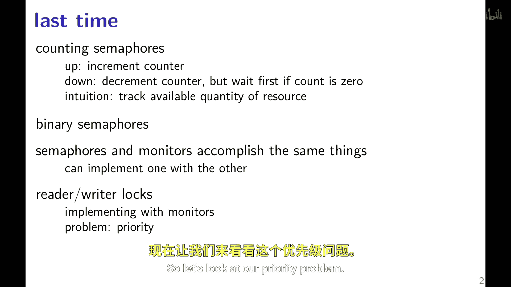
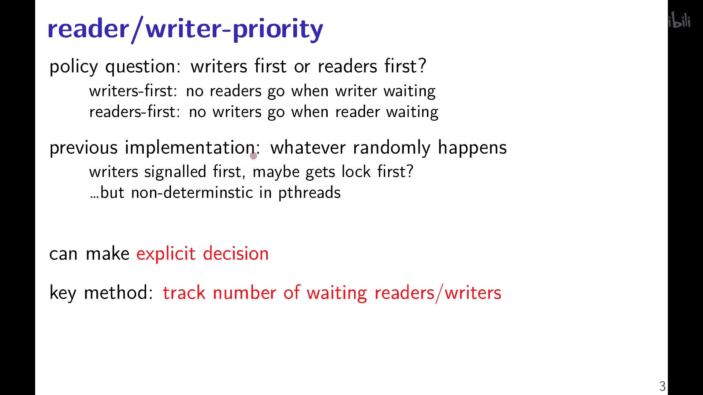
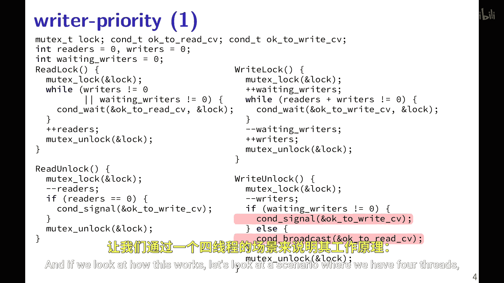
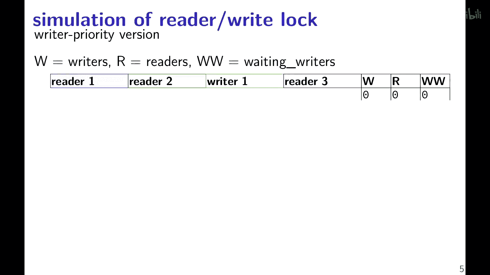

# 弗吉尼亚大学【中英⚡操作系统｜CS4414 2020 Operating System】 p12 P12 Synchronization 5- Reader+Writer con't Deadlock -BV1mjePzoESb_p12-

Good afternoon。Last time。We talked about。And。Alternative to。Our monitors。

 which we said we were solving the problem that locks weren't flexible enough for us。啊。

So went it' some way of having a more general synchronization construct that we could use to solve a lot of different problems。

 So our second。So pollution was this thing called semaphores and semaphores were a counter。

 but we never actually like read the value of the counter instead we used these two operations to manipulate the counter。

 there was an up operation that in it。And a down operation that decremented it。

If the counter would go below zero instead of waiting for it to be positive first。

And the intuition we have with this is that you keep track of how much of a resource you have with these counters。

 and you just do the appropriate bookkeeping to make sure that count stays accurate。

And just by doing that， you're going to wait when you're not missing some of that resource and you want more because of how the down operation waits while the count would have become negative。

😡，mentioned that， though we introduced counting sephos。

 there's a simpler to implement version of called binary Semiphos where。

Rather than a account that's zero up to some large number， we just say zero or1。

 that's the only numbers you can have。And it turns out that that's just as good。As counting sephores。

 in the sense that if you have a bunch of binary senophos and some storage。

 you can implement counting sephos that they must be able to do。

Everything that county S force can do。You also mentioned， well， semaphos and monitors。

 like they look very different， and it's not obvious that they solve the same problems。

 but we can show that they really have the same capabilities because we can use semaphos to implement monitors。

And this this wasn't so obvious because it looked like we had a big problem with。

A disconnect between how sephos worked and monitors worked with sephos。

 when we did this up operation， it seemed like we were affecting what happened in the future。

 so even if something wasn't waiting， we'd stop something in the future from waiting。

 whereas with conditioned variables and monitors we had this signal or broadcast operation。

 which only cared about things which we're waiting now。And we have this trick to avoid that。

We'll see again later today。Of tracking well， how many people are waiting and based on that。

 we made a decision of how much to increment or semaphore。

 and the key idea is that we could track whether there were waiters and therefore we could undo the property that we wake up someone in the future by doing。

 well， if there's no one to wake up， don't increment the semaphore。

We saw that also monitors could be used to implement semi folkss。Then we talk about a。

Synchronization construct that's more focused。 So when we started， we introduced barriers。

 which we managed to have this very particular problem。 That's just very common。

 So we wanted something specialized for them。 talked about another type of synchronization。

 We run something specialized， which is reader writer。

So here we have some data structure that multiple threads can read at the same time without problems。

 but if any thread's writing it， we better not have anyone else。

Trying to look at it or else they' get confused。 Like， maybe we have like a hash table。

 and we don't want to risk anyone trying to access it while someone might be resizing it and rehashing everything。

Or get confused。 And reader writer locks can provide this sort of。Property。And we saw that， well。

 reader runner locks are primitive you could rely on your threading library having。

 but there's also something that we can use to illustrate how we can implement sort of our own choice of how to synchronize things with monitor。

And I showed you an implementation with monitors， and I believe when we left off。

 we realized that that implementation had this sort of oddity in a case when a writer was finishing up。

 that we needed to decide， well。😡，You know， there's no more the writer is finished and if we have a reader and a writer ready to go。

 what do we do and the decision in our implementation was we woke both of them up。

And one of them would run first。 Which one well， depends how the condition variables work。

And whichever woke up first would inement the number of readers or writers。

 the one that woke up second would look at the numbers of readers or writers and say， oh。

 I was woken up， but I can't do anything and start waiting again。

And we might be pretty dissatisfied with that。 So We'll talk about how to fix that with what by choosing a priority between the two later。

 But before I move on， questions about semaphores。Or relating monitors and seminar4s and so。So。

Let's look at our priority problem， so I said。

With our reader writer Locke， originally we were in this situation where we just woke up the readers and woke up the writers。

When there were no readers or writers。And。Just let whatever happens happen。😡。

But we might instead want a policy which avoids the problem of waking people up who aren't going to be able to go and also take this chance to make a decision about what's important to us。

Writers to go first or readers to go first。And we can implement both policies and when we write down what does it mean for writers to go first。

 we get a statement like， well， if writers go first， then no reader should go when a writer is weak。

And this statement is going to tell us how we're going to add that to our implementation of Read writer locks。

 that this means that to make writers go first， we need to figure out if there's a writer waiting。

 So we need some sort of variable that tracks that。

And we need to check that before we allow a reader to proceed。

And that's precisely what we're going to do to make that decision。And similarly。

 in the reader's first case。The extra condition you write down is that no writers go when a reader is rap。

So we're going to use this。The first observation we have about this is that， well。

 we need to track the number of writing readers or writers depending on which of these policies were implemented。

And in order to make that decision。How are we going to do that， Well， we can just have accounts。

And like you saw when we were。Implementing。Condition variables with semaphos will just increment the count when someone starts waiting。

 decreement it when they stop。So with that in mind。

 here's my writer prior of implementationmentation where I've just added a few things。

That weren't there。Taking into account this waiting rid。

So one thing I added was just the counter of waiting writers。 So I said。Okay。

 we have a number of waiting writers initially zero。 and before I start waiting in write lock。

 I increment the number after I'm done waiting， I decrement it。That's keeping track of that count。

And then we have the rule that I wrote down was， no readers can go。When there's a waiting writerer。

So， while。There are while there are writers or there are waiting writers。 readers have to wait。

Previously， it's just while they were writers。 Now。

 they also have to wait if any writers are waiting， even if they can't go yet。

And we have a second part to this， which is that we need to make sure that the cases where we signal our readers matches up with this。

 or else we'll be waking up readers when they can't go。 so I need to make sure。

That if waiting writer， if there are waiting writers， I don't broadcast to my readers。

 So I'm making sure。That。This broadcast。The readers not matches up with my new condition。Questions。系。

So by implementing this policy， I've now decided that writers get priority over readers。

 we might want to do this because， well， if we have a lot of readers。

 writers might be starved otherwise， and this prevents that。And to implement that。

 I needed to not only track the number of waiting writers and update when readers wait。You know。

To make sure I didn't needlessly wake up readers， I also。

Updated the code around broadcasting to wake up readers to be consistent with what readers were now waiting for。

😡，And if we look up how this works， let's look at a scenario where we have four threads。

