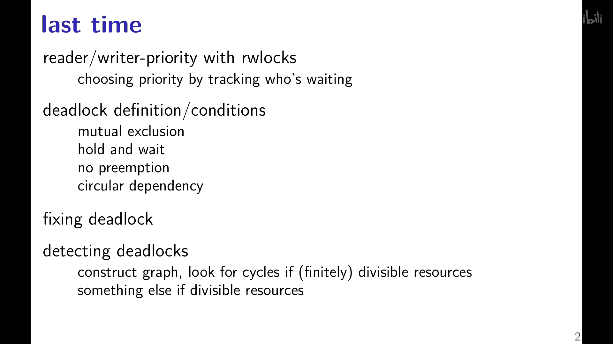
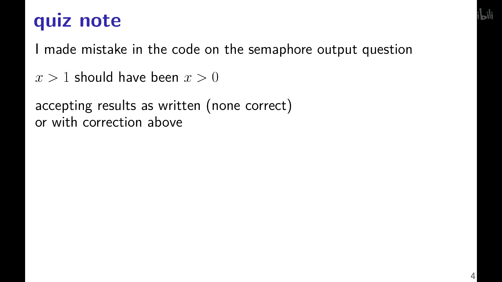
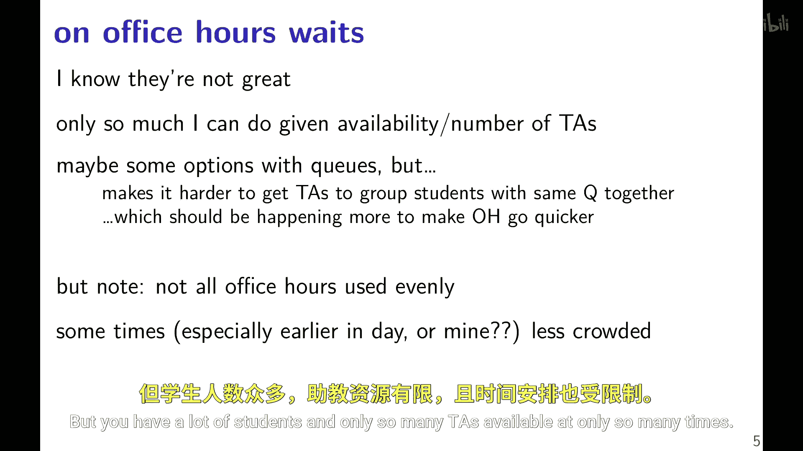
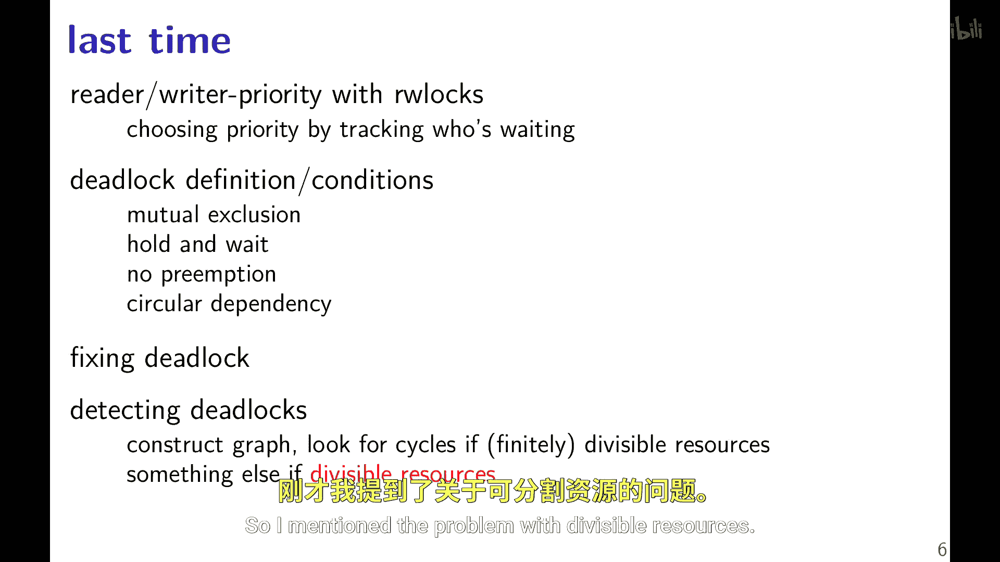
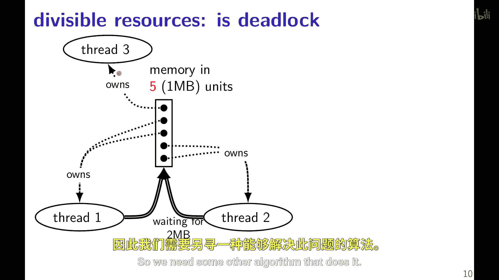
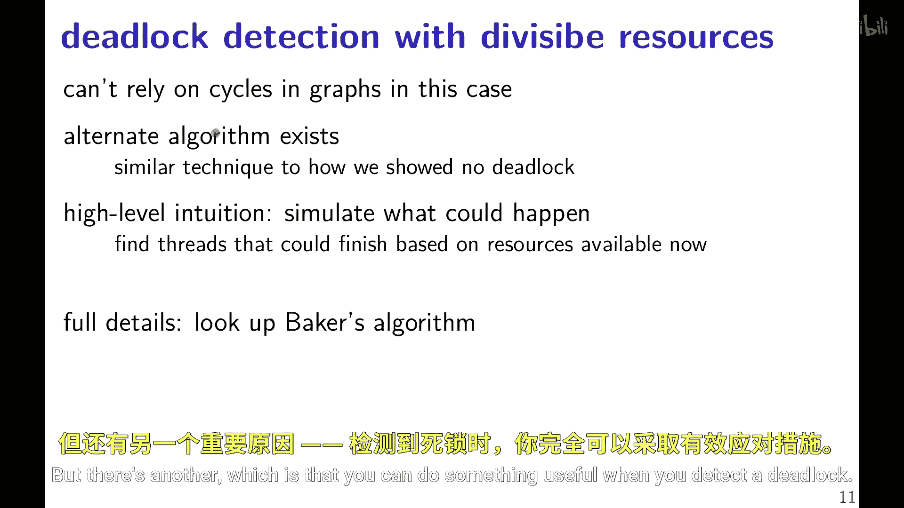
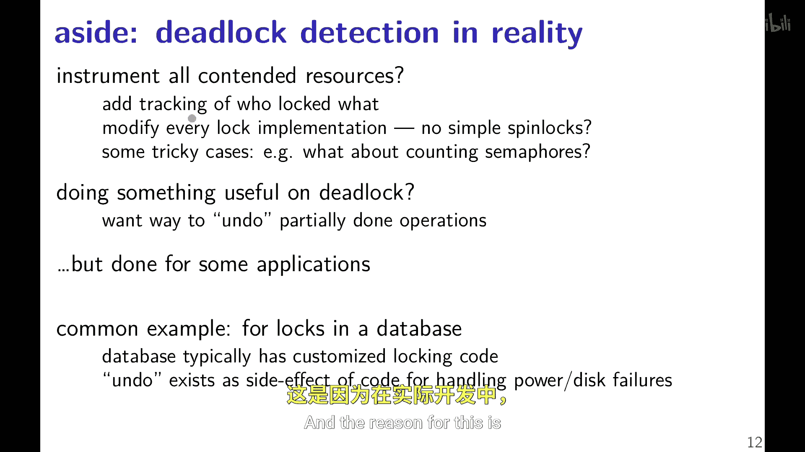

# 弗吉尼亚大学【中英⚡操作系统｜CS4414 2020 Operating System】 p13 P13 Virtual Memory 1 -BV1mjePzoESb_p13-

Good afternoon。So。Last time。We started by talking about reader writer blocks。

And we were looking at a strategy for implementing them using monitors。

 and we mentioned we had this choice that there were sometimes when we wanted to wake up multiple threads。

 which were waiting for different conditions。And in our original implementation， we just lent。

Can signal and con broadcast， decide who gets to run first and it might not be the choice that we felt was ideal。

 but we could be explicit about that choice by adding an extra condition about who goes first to。

The reasons we wait and also when we decide to signal or broadcast。

 am I doing that we could choose this writer priority。

And we mentioned we could also implement other policies that might be useful to us。

After we looked at monitors， we went to a more general problem。

 which we think of as primarily being a thing with locks。

 like the easiest way of having this problem with locks。

 but we saw that we had this problem when any time we had something that acted kind of like a lot where。

A thread could own a resource。😡，And wait for another resource when we have resources like that。

 we saw an example of blocks。 We saw an example of buffers for pipes that work this way and some other things。

 we had this bug called Denlock。And in deadlock。Everyone was hanging。

And we had this sort of formal idea of the conditions for deadlock。

 so we have mutual exclusion that we need to have some resource where at least for each unit of the resource。

 exactly when thread owns it， that we don't share it。

Between multiple threads that when you own a resource， you hold and wait for another resource。

And that。When you're asking for a resource from another thread。

 you can't just take it away from them like we can with the CPU， for example。

 you have to actually wait for that thread to be done and voluntarily give it up。And。

Where we had our hanging problems， we had a circular dependency。

 one thread could be waiting on another thread， which is waiting on the first thread or some longer chain of dependencies that ends up cycling back around。

So we have this definition of deadlock and this definition helped us figure out how we could resolve them。

And our key idea is we looked at each of those conditions of the definition and found a way of making it not hold。

And for Devlock that involved locks， our easiest solution was to make the circular dependency part at hole we still wanted locks to wait for the resource。

 we still wanted locks to be something that we can acquire while we have another lock。

But we wanted some way of avoiding the circular feency， and we did that by choosing an ordering。

And that prevented that cyclic dependency。When we had some other strategies like not holding and waiting。

 we can just try to get in and if we don't get it， give up。😡。

And various other solutions that fix the good block problem。And when we were finishing up。

 we talked about detecting deadlocks and I first gave you this idea of doing this with a situation where we would be concerned about debugging。

 that if I have a deadlock， it would be really nice if there was some function in my debugger where I could say。

 hey， I think I might be deadlock telling me what's going on and identify like this lock， this lock。

 this lock， this is your problem， these are the things where you need to provide one of our solutions to get rid of those criteria for deadlock。

 you need to make it so there's no circular dependency or you need to give up that you can't cut the lock or something like that。

And we saw that with locks， we could just construct the graph and use algorithms you may or may not remember from prior classes for funding cycles in a graph。

And you mentioned， well， you know， that seems great。

 but it doesn't work in the more general case because we have some resources which don't look like locks where we have them divided into pieces like if we have。

Memory， for example， we can have a deadlock if we're waiting for memory。😡，By the。Deadlock。

 you know if we look at the graph， we're to of course have we're going to have cycles。

 even if there's maybe not really a deadlock because if three programs are trying to allocate memory right now。

 well， and those three programs also have memory allocated。

 those are more than three cycles because everyone's using memory。

 but we really need to look at how much memory is there versus how much is the program allocateocating。

 which means that deadlock detection gets more complicated。

And we're not going to talk about how you actually implement the。

More complete deadlock detection except to say that there is a way of doing it。

 and if you ever actually need to do it， you should look that up and not just assume you look for cycles。

😡，So before I move on。Today， any questions about the topics we covered last time？

Okay so some little logistical notes， so on the quiz。

 there' is an output about the output of a program with Sappphos。

 I would be to not write the code I intended to write。

We're accepting both the answers for their question as written， where other outputs were possible。

And the answer is， if you assumed I corrected that， bug。

Cha that one to a zero or greater than to a greater and equal。So accepted both because of that。

Other thing， so office hour wait so I know there have gotten scatter complaints about office hour time waiting。

 so there's only so much I can do to make TAs available at the times to seem to want to use office hours there might be some improvements we can do with cues maybe but there's trade offs like if we have a queue we're not going to have Ts grouping students together if they have the same problem。

And people kind of use cues if they're online maybe differently than in person which may may not be good but but we're looking at it。

 just to note for you， so I'm aware of this problem and not all of the office hours are used evenly like I get reports from students and Ts about office hours being really crowded and this does not reflect my experience that for example。

 my office hours。I don't know if I'm scary or giving back help， but。

 and I know this also does not reflect the experience of all the TAs at all the office hour times which we have many。

 you don't all have to comment like 7 p。m on Thursday。So just mentioning that and yes。

 I'm aware the situation is not great。But you， have a lot of students and only so many Ts available ahead。

Only7 times。So。あ。Going on to picking out where we were last time。

 so I mentioned problem with the visible resources。

 so our issue was that we could produce our graph for deadlock with in this case memory。

 but here we have a cycle。

Because thread two is waiting on memory that thread one owns。

 which is waiting on memory that thread two owns。 We have a cycle， for example， there。

 but we don't know if that cycle is actually causing a deadlock。

Because there might be enough extra memory， and in this case， there is。

 it's just not obvious that there's enough extra memory because of this thread3。

 but we could have little changes like if thread3 was waiting on thread1。Or if we had less memory。

 it would actually be a dead block。So we need some other algorithm that does it， it exists。

 you can look it up。

High level intuition is it simulates what would happen。But we're not going to test you on it because。

 you， if you need to implement it， you'll look it up and do it because you're not just going to guess what it is anyways。

But when I talk you about Den detection， I was giving you sort of the impression that this was a debugging tool。

And that is like one of them or。Practical reasons to use deadlock but detection， but there's another。

 which is that you can do something useful when you detected deadlock。

And deella does seem hard because you have to instrument where you have deadlocks。😡。

And then what do you do with that information besides tell the programmer， but for some applications。

 this is actually done and databases are probably the biggest example。

 so some databases take sort of queries from users and that means that they can't easily use the consistent order because if the user says do A then do B in one query and says do B then do A in the other。

You know the natural way of implementing that you're going to have a lock order problem。😡。

So some databases use a solution where they you do deadlock detection and when they detected a deadlock。

They have the mechanism to revoke the walk and undo the operation。

Undo part of the operation and retry it later。😡，Now this requires you have a lot more instrumentation。

 but this is actually something some programs do in cases where the deadlock prevention solutions are not so practical。

Questions on the lock detection。Okay， so now that we've talked a lot about threads。

 I'm going to talk about not using threads。And the reason for this。

