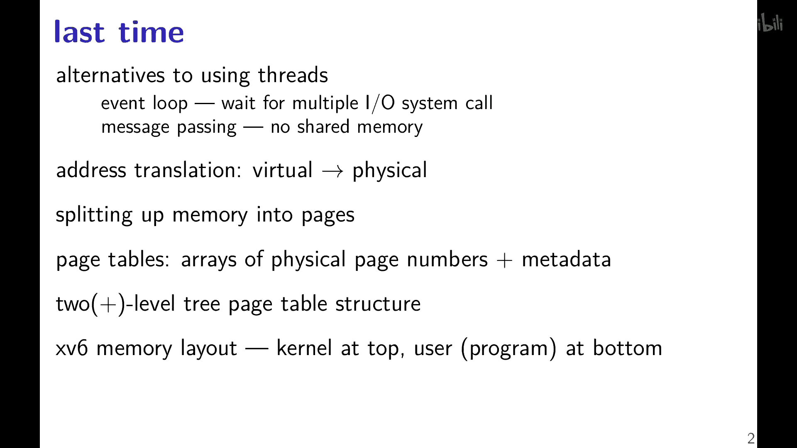
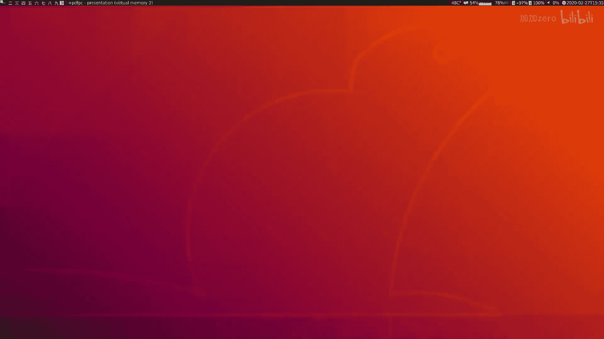
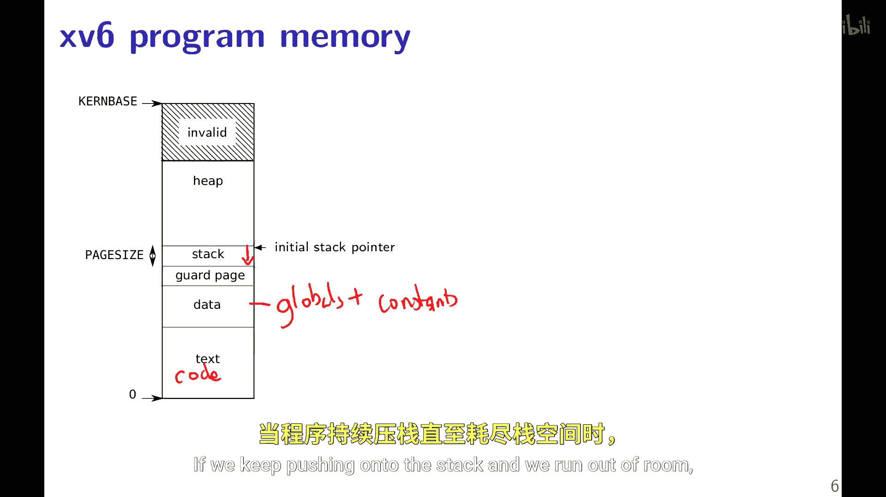

# 弗吉尼亚大学【中英⚡操作系统｜CS4414 2020 Operating System】 p14 P14 Virtual Memory 2 -BV1mjePzoESb_p14-

Good afternoonnoon。So last time。We talked about。A bunch of alternatives to using threads。

He mentioned that。If you were using threads because you thought， oh。

 I need to read from multiple files of one file descriptors at once。

 how do I do that without having multiple threads calling read？There are。Into a basis where we have。

A system call that will tell you， hey， this is the file descriptor you should read for next giving you what we call an event。

 and you write in a loop that handles those events and you would have one thread handle all these file descriptors together。

 so for example， if you' were making a web server， you could have one thread handle multiple web clients that are all talking to you via file descriptors。

And we also said that， well， you could have。One big task be computed cooperatively by multiple processes that don't need to share memory using this message passing model that we send messages between the processes rather than having the actual data they're computing on being shared。

 so when they want to share something， they send a message rather than reading from something another。

😡，Thread wrote。And both of these allow you to do many of the things you'd want to accomplish with threads without them and without needing to worry nearly as much about things like deadlock or blocking or race conditions as a result。

Then we looked at virtual memory。 So this is how we would。

Allow the operating system to establish a mapping from。第一。

Addres the program used to real addresses and this allowed isolation so we could have two programs that couldn't access each other's memory and could have different values at the same address so we could give the programs their preferred land and we talked about the most common scheme for doing this or this virtual memory。

 which is focused on this idea of splitting out memory。

 both the virtual memory that the program thinks it's using and the physical memory that that gets mapped to into these fixed- sized units called pagess。

And then to manage that， we have a table saying for each virtual page。

 what is the physical page number and also some metadata like we could say， hey。

 when the program accesses this page， it should only be able to read， not write。😡。

And we put these in。An array basically， which we call a page table。

And we looked at that structure and realized that， well， that works。

 It's a nice solution to our problem。 and this is something the hardware could deal with， but。

It's pretty expensive for the sort of size of memory you want。

 like even with just 32 Bits address space like X8 V6 has。

It seems like we need many megabytes to store this for every process and that quickly becomes unrealing。

 so we had a more efficient data structure where we'd use this same page table idea。

 We have these arrays of physical page number and metadata， but we'd have two levels of them。

And we'd split up the virtual page number that we previously used to look up in our flat table as just the index into two pieces。

 we used the first piece。And the first level to look up the next。Page table。

 So we'd have several second level page tables and one master first level page table for each process that points to those second level page tables。

And this would save space because sometimes we wouldn't need a second level page table for a range of addresses。

 And in that case， we just store。APage table entry saying， hey， there's nothing here。

After looking at that structure and how we navigated that structure。

 how we figured out where things were。We started looking at what the memory layout that XV6 uses。啊。

And we mentioned that XV6 has this idea where all the application stuff。

 the stuff that's different between processes is going to be in the bottom half of memory。

 and we have this top half， which is used by the kernel， which we map always the same。

And in this way， which is very consistent with physical memory。

 and we're going to see that that's really useful for the code in XV6 that needs to create page tables and manipulate page tables so we can give processes the memory they expect。

Whilst still having the kernel be able to easily deal with those physical addresses that the processor understands。

 even though the kernel runs with virtual memory enabled。

 that means that when the kernel accesses an address， it uses a page table。😡。

It has to use virtual addresses， and can't just directly access a physical address。

So questions about what we covered last time。

So。

So last time， we were looking at。This。Sort of mapping。So mentioned that。

We have this kernel part of memory。And there's some division point。

 which is halfway between memory and everything in this blue region is going to be set in the page tables with a metadata bit saying。

 hey， only let this allow be accessed in kernel mode。Meaning that when the processor。

Looks at the page table， and if a program tries to use that blue region and it's running in user mode。

 it's going to trigger an exception when're going kill the program。😡。

So this is how we ensure that even though we have a mapping for all the addresses。

 and that means that。The kernel， when we're running in kernel Mo can read and write any program's memory via that blue region。

 none of the other programs running can do that and access other programs data。😡。

It's important for protecting programs from each other。And this also means that。

We have thisSince we have this static mapping that we said address。

At this boundaries at physical page 0， then one， then  two， then three then 4。

 And that's just how we set up the page tables when we start a process and that boot， that means。

That because we allocate programs pages that we're going to have two mappings。

For most of the addresses programs are using， we're going to have the one for the program to use and one for the kernel to use that the kernel can easily compute based on the physical address。

So questions。About this mapping。So。The reason to have this mapping partly is that we choose to layout out for the green part the programs expect based on how programs are built。

😡，And as an operating system designer， we want to just provide whatever layout is useful to the programs。

 we don't want to dictate that based on how you built ROS and。😡，But for the kernel stuff。

 we want easy access to all memory because it's going to be convenient if our system calls can access whatever memory they need。

And this is one convenient design for doing that。That we don't have to do anything special to access any particular part of physical memory and having this one to one mapping in the kernel region means that we can easily take a physical address。

And convert it to a virtual address that we can use。

 It's not going to be necessarily the virtual address a program would use。

 but it's going to be one that lets us in the kernel access some particular part of physical memory。

 So this means for example， if I read the program's page table and want to figure out what's at that location。

 the page table points too， I can easily read the physical address from the page table and access that memory。

 even if it's not the currently active page table。😡。

that's going to be useful when we want to set up a page table。

 now we can easily look at a partially set up page table and add things to it or remove things and know what's going on and access that map。

So。S you through the overall layout， let's talk about how XV6 is chosen to lay out the memory of each program。

😡，And there are some things about this you might find。So we have at the bottom here。

 the area labeled text。 This is where the code is。 textex is just a bad old name for the code area of memory。

We have data， this is where globals。啊。And constants R generally。

Then we have this thing called the guard page， I'll get to that later。

 and we have the stack you may be used to from how Linux or Windows works。

 the stack being above the Heap， XV6 has made a different decision so the stack is below the heap。😡。

So we have our initial stack pointer at the highest address of the stack and the stack grows towards lower addresses。

And XV6 has chosen that the stack that we give to programs is always one page， that's four kilobytes。

 if you went more， well too bad。And below the stack is this guard page。

 So the guard page is a page that if we keep using stackspace。It's probably where we access next。😡。

