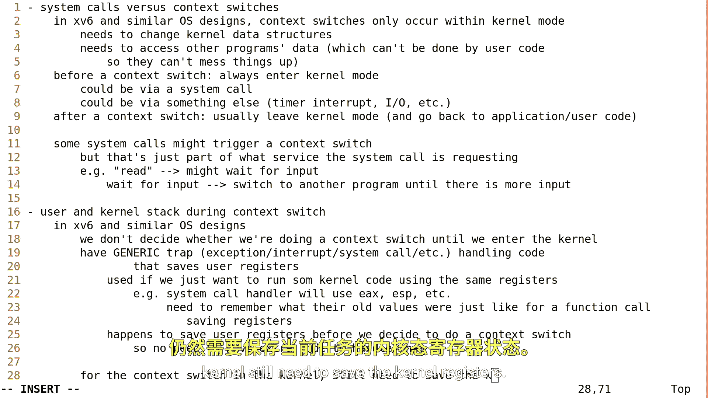
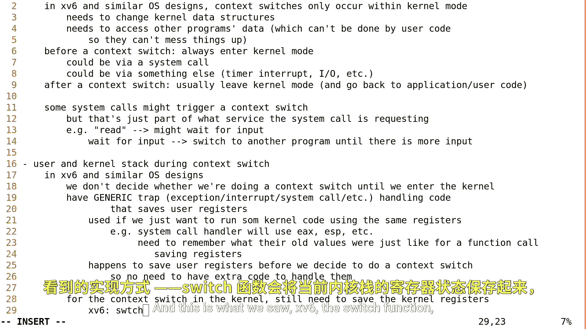
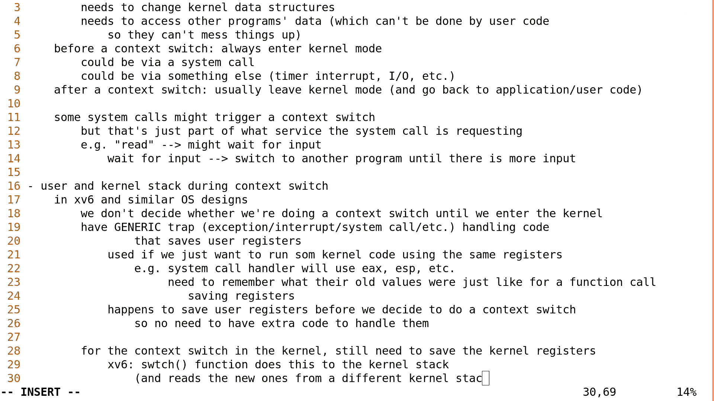
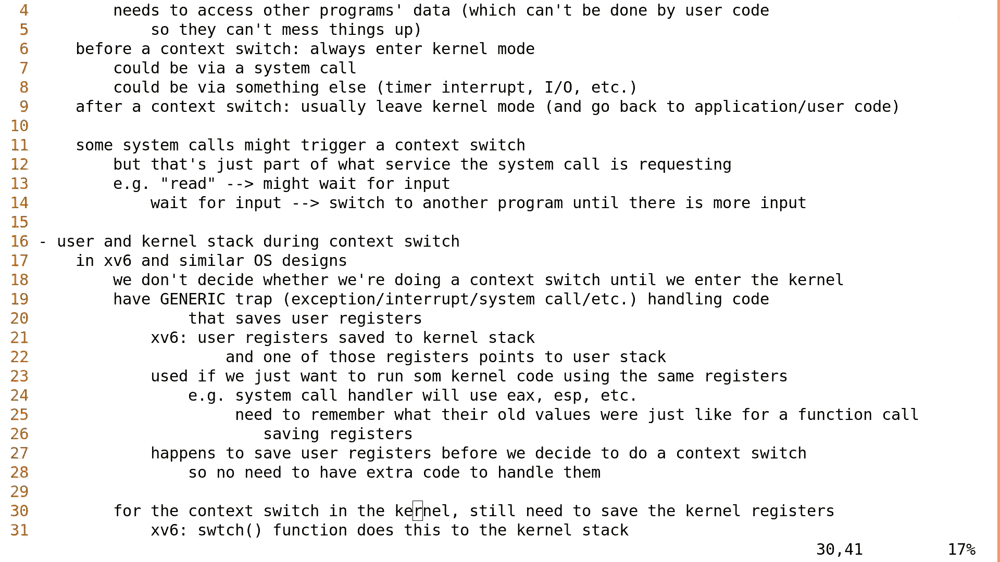
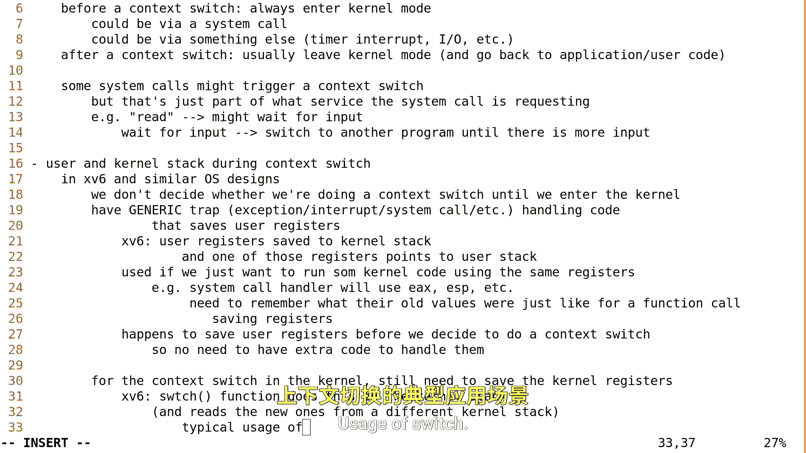
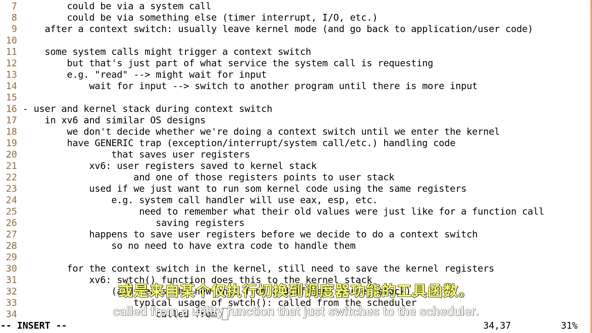

# 弗吉尼亚大学【中英⚡操作系统｜CS4414 2020 Operating System】 p15 P15 Midterm Review screencapture -BV1mjePzoESb_p15-

Good afternoon。So I'm going to do exam review the way that's going to work is I'm going to take。

Your things you want me to talk about， I'm going to get a list of those then we're going to go through them if we finish that I'll get a second list if you don't give me anything to talk about。

 we'll leave early。So what would you like me to talk about？Here yes。Okay， anything more specific？なだか。

ばあが。Okay。你得。看。Anything else。いや。Re。Okay。What happens to the user second or stack？Yeah。啊。Yeah。

Perhapss some split， sorry。Scheduling， okay。Just generally。Scheduling。这个不是欢。Anything else？

Maybe goes to a problem on how。There are some events to minimize turnout。这。嗯。我。

You York are sending up process page tables。So， setting up。いやそれで。ち大阪。我 exciting。Anything else？Okay。

So。So first question was system calls versus context switches。 So I think the confusion here。

Is because。And OS Xb6 and similar OS designs， context which is only occur。Within curl note。啊。

And there are， so before a context switch。Always enter curl mode。Could be。

Yeah a system call could be。Yeah。Something else。to。Oh， etcter。So before。

 since we always enter before。Maybe I can make this a little bigger。嗯。For and after。A context switch。

S。Usually leave curl mode。Not guaranteed。No。And go back。这是。

So I think that's where the confusion comes in。 So a system call is just one of the ways that the kernel does things。

 and it happens that。Ening the kernel as a prerac in the context， which。

Because only the kernel has access to the things you need to do is you do a conduct which like information from the other program。

 because we don't allow programs to just access that directly。You know， remote mode。

 needs access needs to。Change kernel data structures needs to access other programs， data。

 which can't be done。Can't read it。By user code。Since so， they can。知ってくさい。

I think that's where that confusion comes in so。Some system calls。Might trigger a context switch。

But that's just part， just part。Of what， what service a system。Call is requesting。E G read。

Weaiights for night wait for input， wait for input。Wait for input implies， switch to another program。

And Taylor。There is more input。It's just part of the service the system calls providing。

 it's not because system calls have an inherent relationship to context switches。Okay。

 so the user internal kernel Saster in context switch。 So in X V 6 and similar less designs。

 we do to。啊。We don't decide。Whetherer。We're doing a contact switch。Until we enter kernel。

And we have generic。Trop， exception and drop system。Handling code。That saves user registers。啊。

And this is used regardless， and this is used if we just want to run some kernel code。

Using the same registers， same registers。So like when we just have a system call， for example。

 we want to use the registers that we usually use like EAX。We save those。 So you know。

 EG system call， handler。We'll use EAX， ESP， et。Stack pointer。Etera。Need to remember。

 remember what their old values were。Just like for a function call。

 like function call saving rate function call saving register。

 So like if you think of a function call， you save registers for a function call and restore them afterwards。

 Sam sort of idea applies to running anything in the current。So this is generic in the sense that no。

Yeah。You know， happens to save， happens to save user registers before we decide。

To do a context switch。So no need to have extra code to handle that。

Because we always decided to do a context which after we enter the kernel and done this register saving。

 there's no need for extra special case code。For saving user registers。So now for the。

 for the context， which。In the kernel。Colonel still need to save。

 Still need to save the kernel registers。

And this is what we saw， XB6， the switch function。

Does this to the kernel stack。And read the new one， the new ones。From a different kernel stock。

Just because we needed to save those somewhere and they haven't been saved yet。

 the user registers is already saved。And our generic track on the link code happens to say if the user register saved to kernel stack。

Just because it runs in the kernel stack， we don't want to mess with the user stack。

So that's where they've chosen to save those。 Like this is the decision XB6 made。

 we're going to save things like you could imagine like deciding to save things elsewhere。

But this design is pretty typical。Because you need a stack when you're running in the kernel anyways。

 you probably want one for every process because you want to switch away and remember like where you are in a system call。

That's an natural way of doing it。So does that answer people's。Questions about user and kernel stack。

I guess I didn't mention the user stack。Yes， and one of those， one of those registers。

Points to user stack。That's where the user stack gets built for this process。Other questions yeah。

どち国。Where a switch called from， this is the contact switch in the kernel。

So this is the the switches the。This is thevollo function。

 which you've sent seen typically used to switch to the scheduler and from the scheduler to a program。

Does that answer your question？So is it called from F indirectly？So anything。

 so typical usage or switch。Usage of switch。

Is。Called from functions that。Call from the scheduler call。

