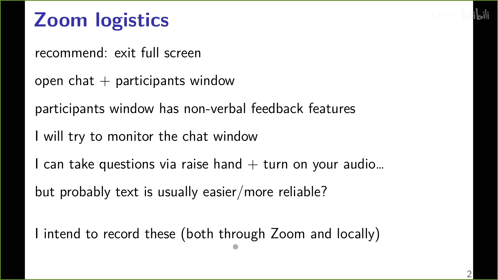
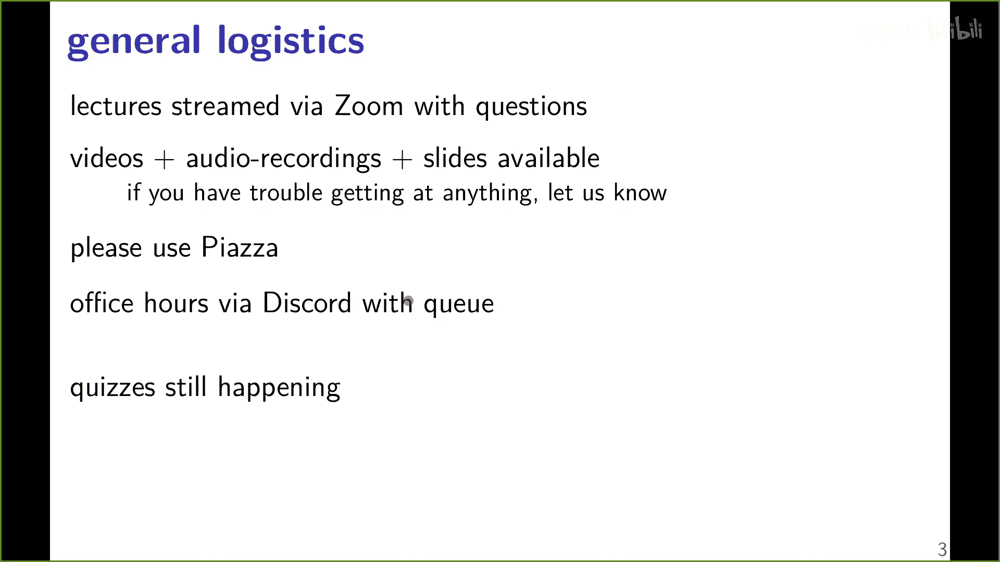
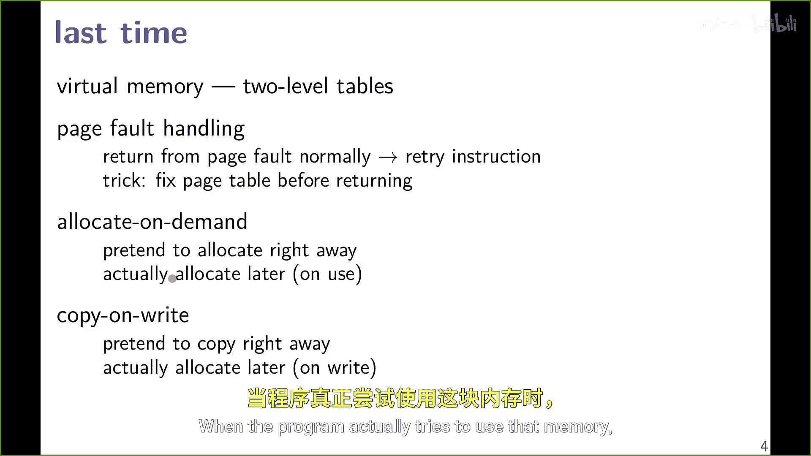
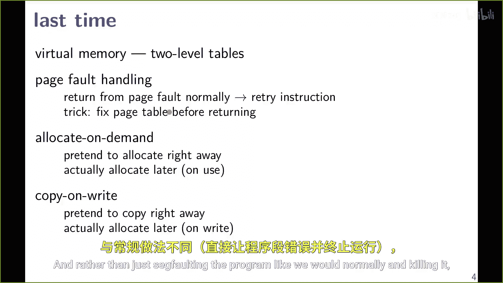
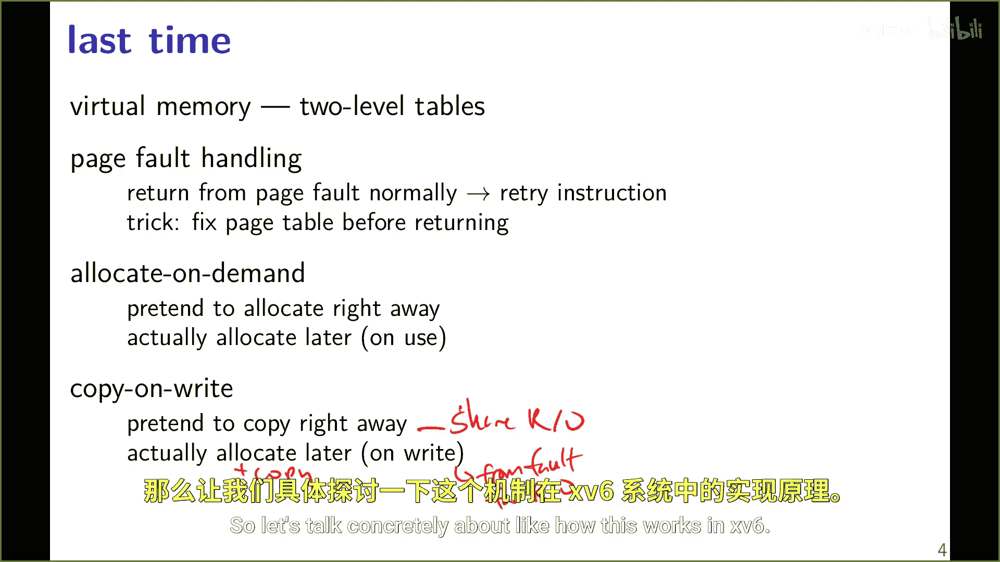
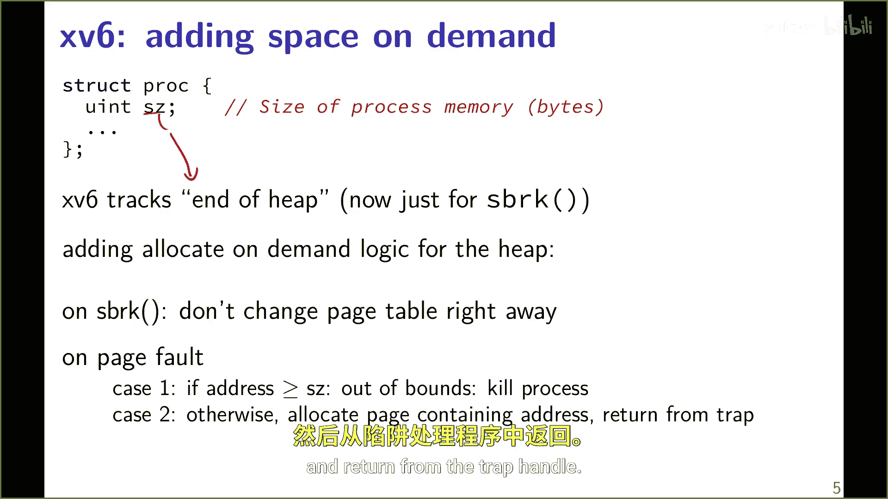
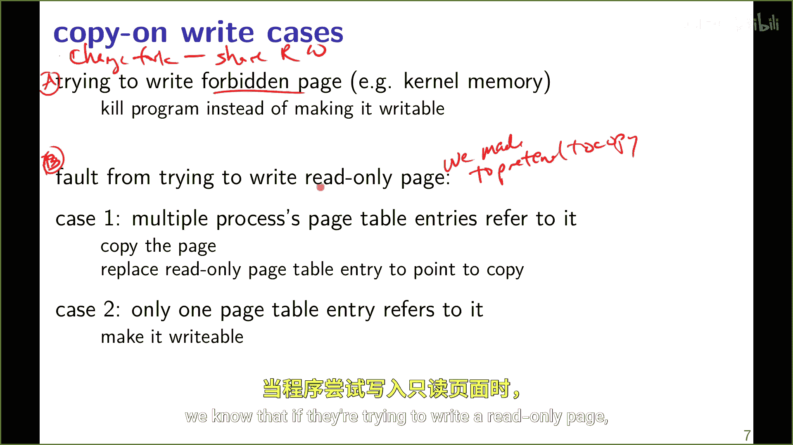

# 弗吉尼亚大学【中英⚡操作系统｜CS4414 2020 Operating System】 p16 P16 Virtual Memory 3- mmap, page cache (intro) -BV1mjePzoESb_p16-

Okay。Good afternoon and welcome to our grand experiment in。😊，Teaching this course online。

 So we have this stream using Zoom。 I did this earlier， this。Afternoon。

 so we kind of know what works。So I recommend exiting full screen and you can open up the chat and the participant window。

 Partip window has nonverbal feedback features。So like there's a yes， no and so on， you can press。

 I see total counts of number of people selecting those。I if I。

 I'd have to like scroll through a list to see if you in particular did it。

There's also a raise hand if you do that， it will like tell me who you are and put you at the top of the list of people。

I could take questions that way， but I know some of you like have。

KNonow or crappy audio or have like some siblings fighting in the background。

 So probably usually it's just lower overhead and easier to take text questions in the chat。

 which I will try them on there。 And that's the primary place。

 I'll look and expect questionstion not seem to work。Kyya reasonably w earlier today。

These should be recorded， I am actually recording， I do not forget to do that。嗯。

And both through Zoom and locally。 So you'll have the usual recording and the Zoom recording。

Of the lecture。啊。

So general course logistics。 So we have our lectures streamed via Zoom， you know。

 with live questions。 We'll have video and audio recordings and slides available。 Please use Piazza。

 Like this is probably one of the better fits to。嗯。The you know。

 everyone in different time zones working at different times。

 not meeting up to you know get help and so on， just try to use that and as you saw from emails we'll be doing office hours via discord with a queue。

 which seems to work。Reasonably well， so far， though we haven't really had to scale way up yet。

And quizzes are still happening， obviously this week's quiz will have less material on it than I was originally planning。

啊。But that will still be a thing。So are there any questions about logistics？About the final。

 I haven't decided yet。 my idea is probably to do a take home final where you upload a text file to kittoos with your answers。

 but I still have to think about that。Other questions。Okay。

So doesn't seem to be any obvious other questions。 So let's move on to talking。

question a second question， will the fact we're working from home impact the curve at the end？嗯。

I don't expect to grade differently than a normal semesterBeyond that a lot of you will have credit。

 no credit。 and I'll wait to hear what the provost says about。How I should do that。

 I usually have done a。C minus as the。Credit， no credit boundary。

 which maybe is what the provost meant when they said see or better， but I'm not sure。嗯。

No I't anticipated changing much beyond that the you know， assignments will be different。

 So the final will be different。 So， of course。I'll be grading。

 assigning final grade for two percentages differently based on that。Other logistics questions。

Okay， so。Way before our midchm and all this craziness， we talked about virtual memory。

 We went through how the。Two level table structure we saw that XV6 used worked。And。

After figuring out how we just set up a mapping， we mentioned that well。

When we don't have a mapping set up。We can actually do something about the page fault。

 The page fault was what the processor would do if it looked for a mapping in those two level tables didn't find anything。

And。If we return from the fault handleduular normally， like without killing the process or anything。

 it rets the instruction so we can do this trick where instead of just killing the process， we just。

Fix up the page table during the instruction during the pagevol handler。 then rerun that instruction。

 and it works the second time。嗯。And。This allows us to。You know do something like allocate on demand。

 we can pretend to allocate right away So memory， but we don't actually have to set up the page table to really allocate that memory。

 we just tell the program yep， got it done and why， but it's okay。

 we'll fix that later when the program actually tries to use that memory。

 it will get a page fault because we didn't allocate it and rather than just sec faulting the program like we would normally killing it。

 we can just fix the page table entry at the last possible moment。

Returned from R H fold handler。 The processor runs the instruction。 This time。

 it finds a page table entry， and it works。And for copy and write。

 rather than allocating and making copies right away， we can pretend to copy right away。

 actually make things read only and。有。Copyright away。 So， you know， share。

Read only initially and actually allocate， you know， and copy later on right， you know。From fault。

For it being read onlying。And as hopefully most of you are aware。

 we have our assignment where you're going to be adding to these two things to XV6。

 So let's talk concretely about like how this works in XV6。

So for allocating space on demand， Xb6 already tracks the end of the heat。 That's what this size is。

It's the end of the heat。So if we want to allocate on demand， we have to do that。

 let's pretend to allocate the memory， so in SP we're going to update where the end of your heap is。

 but we're not actually going to handle allocating the memory。Then on a page fault we have two cases。

 so one case is we can look at the page fault and say， well。

 this still would have happened if we actually allocated that memory we pretended to in that case。

 we went to do what we were doing before and just kill the process。The other case is you know。

 where we figure out， oh， this page fault only happened because we pretended to allocate the memory。

So in that， case want to actually do the allocation， update the page table。

 and return from the track。

And for copy on write， you， so our setup here is that for copy onr， we're going to。You know。

 so they change。Fork2。Share， read only。 And then after we do that， yet。

 we're going to get a fault from trying to write it。A。Forbidden page friend I to read only page。

 and we need to have these two different cases， so。You know， if the page is forbidden。

 like if it's kernel memory， well， when we per were were not pretending to copy and actually copying it。

 it still would have been a page fault。 So we still want to kill the program in the， you know。

 our B case here， if it's a read only page we made， you know， we made。To pretend a copy。

Then we have two cases。 So one case is if there's multiple things that are using that。

 we actually definitely need a copy。 We don't want to up。

 you know interfere with those other things that are trying to use the original version。

 So we'll copy it and update the page table entry that was read only。 If there's only one copy。

 we could。Do the thing where we say okay， we're still going to copy it and replace it and delete the original。

 but a shortcut you can take is that you could just make it writeable and say， well。

 I don't need to make a copy and delete the original。 I can just use the original now。

So these are sort of the high level overview of how we would do。嗯。Copy on rightal can demand and。

We saw with these that we have this sort of very simple model of how we're tracking what memory is allocated to a program。

 so we have a single thing indicating the end of the heap and in the case of copy on right。

