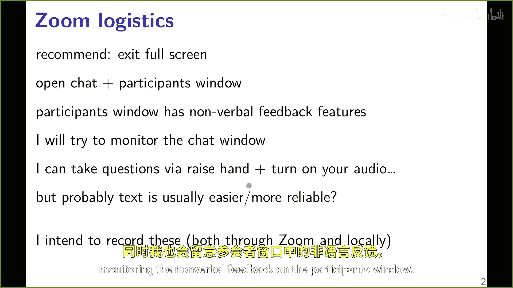
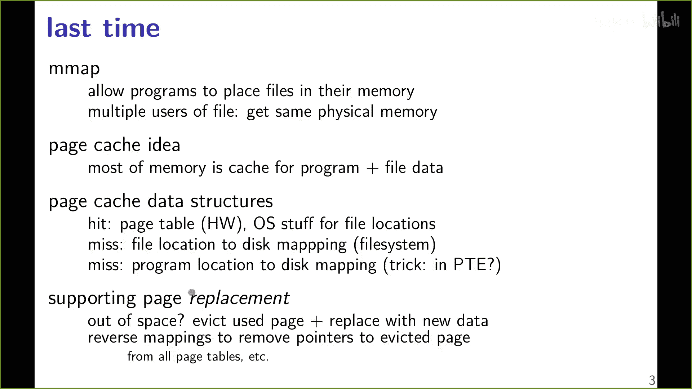
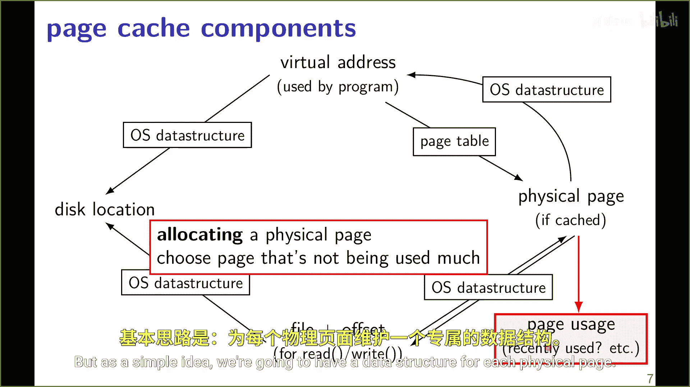
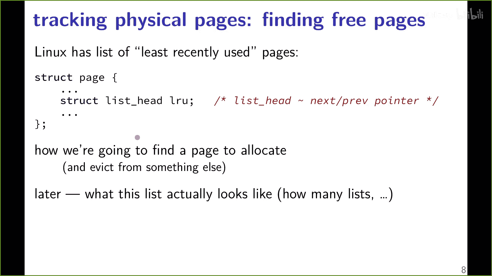
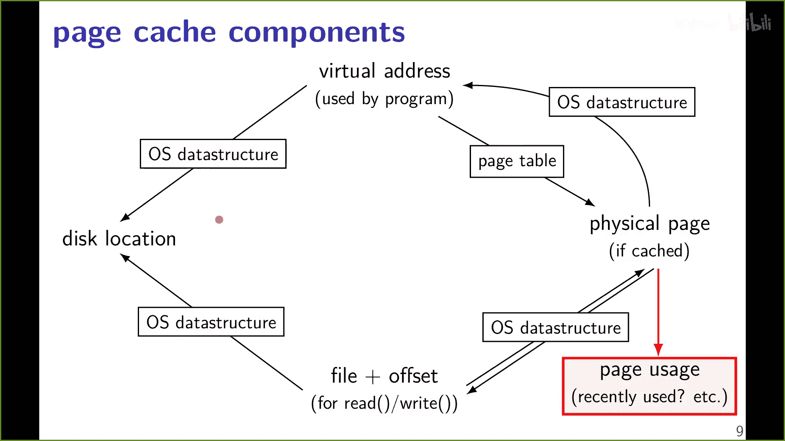
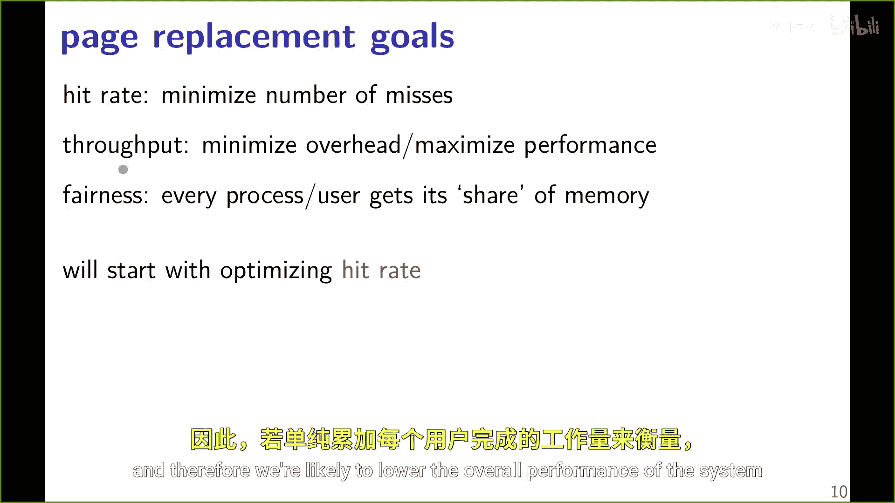

# 弗吉尼亚大学【中英⚡操作系统｜CS4414 2020 Operating System】 p17 P17 Virtual 4 -BV1mjePzoESb_p17-

Good， good afternoon。 Welcome to our second aid。Doing lectures this way， hopefully like before。

I'll probably take most questions via the chat window。

 which I'll be able to monitor on my second screen。

 There's also a raise hand feature in a cururing audio， and it's probably a little awkward。To use。

Will be monitoringing the nonverbal feedback on the participants window？

So last time we。Talked about。So in interfaces the operating system could guide taking advantage of virtual memory that you know。

 let us do fancy things with memory。 one of those things was that we had this idea of MAP where program could place we said map a file into their memory。

And this would act like the file。 You read from that memory。 It reads from the file。

 You write to that memory。 It writes to the file。 If you， if someone else modifies the file。

 it's immediately reflected in that memory。 And if multiple people are using the same file。

 they get the exact same memory。And expanding on this， we saw this idea that， well。

 we could kind of manage a program's memory as a list of these mappings。

And we could treat sort of all the memory that programs are using as what we called a P cache。

The idea is that there would be programme data and file data。

 and we just have a home for those on hard drives or solid statuss for other persistent storage。

For program data like the HeEap， we just make up a place and for file data。

 well we had a file that belonged to。And we use memory as sort of a temporary home。

Where we keep recently frequently used likely to use thing parts of that。In our fast memory。

And we called this the page cache because the unit we were loading and unloading was pages。

And we talked about the data structures we used to manage the page cache。 We had our page table。

 the one that the hardware uses。Where we told the hardware， hey。

 this virtual address the wants to access， here's the physical address it's at。

And we also have other ways of accessing this cache。

 like the read and write system calls opening a file。 So the O would have its own sort of。

Data structure saying， hey， here's a file， where is the data for that file which we use to handle reads and write and also to implement things like the MAP call。

Then we have to worry about， well， what about on a cache M， that is。

 what about when we try to read something from a file or access part of our file mapped into memory and it's not in memory yet。

😡，Well， one thing we needed is we need a way of figuring out where is that data actually on disk。

And for files， we're going to go into that topic in a couple of weeks about， well。

 we have this idea of a file system where we're going to have a way of deciding where do we put different parts of a file on disk。

 We also have to worry about data， which wasn't in file。 like I had part of the he and memory。

 I decided， oh， you're probably not using the heap。 I showed that back to disk。

 And I might need to bring it back later。 How do we store where I put that on disk。

 We saw one trick we could use for that was using unused parts of the page table entry to store that information。

And。That was one part of handling a miss。 When we had a cache miss。

 We need to bring in the data into memory that wasn't in memory。

 But the other part is that have to replace something that， well， whenever we're just starting up。

 it's going to be the case。 We'll have。Empty physical memory will have places where don't have anything。

 We put it there。 But eventually we're going to run out。And when we ran out。

That means that we need to figure out how to replace something that's already there。

And we talked last time about the mechanical part of this， mechanical part is well， you know。

 we're going to put data in a page which already has data。But the problem is that that page。

 which has data， you know， we want to make sure that， you know， if it's some file fo。

 if we read from F later， we don't get the new data we put in there。

 we actually go back to disk for F。 You know if I have part of Fo match into my memory and I read from it later。

 we go back to disk for that。 I don't access whatever got got replaced with。

 So we need these reverse mappings where once we choose where we're putting the data。

We can undo all the ac quaints to that old data so we don't get confused about what's there。

And today we're going to talk a bunch about the other half of the replacement decision。

 which is what do we replace， which is going to be more of a policy decision。So before I move on。

 questions about this topics from last time。Okay。

So I said， we're going to talk about our。Replacement decision。

 And the big thing is we need to allocate a page。And our intuition we're going to find out is that we want to allocate a page that's not being used。

😡，The reason for that is simple that if it's being used， well。

 if we're replacing whatever's in there， we're going to pay for that pretty soon if it's still being used。

 so we don't want it to be used。And。As a preview， you know， our idea of if it's not being used。

 just that things that haven't been used recently。And。Generally， to support this。

 we're going to keep track of information about every page。So， we can do this。And。

We're going to talk about exactly what form that takes and have to go through like more of a theoretical decision about discussion about like what is the right way to choose it。

But as a simple idea， we're going to have a data structure for each physical page。

And one thing we could store in there is a list。 So in Linux there's a list called LRU for at least recently used。

That stores an ordered list of physical pages， and this is how we find the one we want。

 As we'll learn， this isn't actually going to be the least recently used page。For a bunch of reasons。

嗯。We'll talk about what that looks like more later today。那。

When thinking about this policy question of like what page should we choose？

We should go back a sta and think about what are our goals in making this decision about where do I bring in data from disk。

 what do I replace？😡。

And there are a bunch of different types of goals we could have。

 and you should think of this a sign like very similar to processor scheduling that we have different goals and depending on those goals。

 we might get different algorithms that might look very different。And。

One goal that we're going to talk a lot about is this idea of hit rate。

 So a miss is when we have to bring something in from disk。And to optimize the hit rate。

 that means we're going to have the least times in the future。

 we're going to have to bring something in from disk into member。And that's a very sensible goal。

 And we're going to have some nice results about how we。

Either get the optimized out or approximate that， but that's not actually what we care about。

 If you were asking me to make an Os for you， you're not going to tell me， hey。

 I want the best hit rate that's not actually what you care about， you probably。

 if you're asking for hit rate。 really wanted to ask for best throughput that you wanted the best performance so that we get the most work done per unit time。

And that's not quite the same thing as optimizing the hit， rate。 It kind of sounds like it is。

 And it's close because while bringing something in from disk into memory is slow。

 It is one of the slowest things our operating systems will ever do。

But we'll talk about it's not the same。Now， you might also have goals which are completely different。

So for example， we talked about fairness with processor scheduling。

 you could have the same idea for memory that your idea could be that I have like 50 users。

 every user gets the same amount of memory and our page replacement that optimizes for that is not going to achieve the best throughput because we're going to make someone run slower in order to make sure that the other users don't get really disappointing performance。

And therefore， we're likely to lower。

