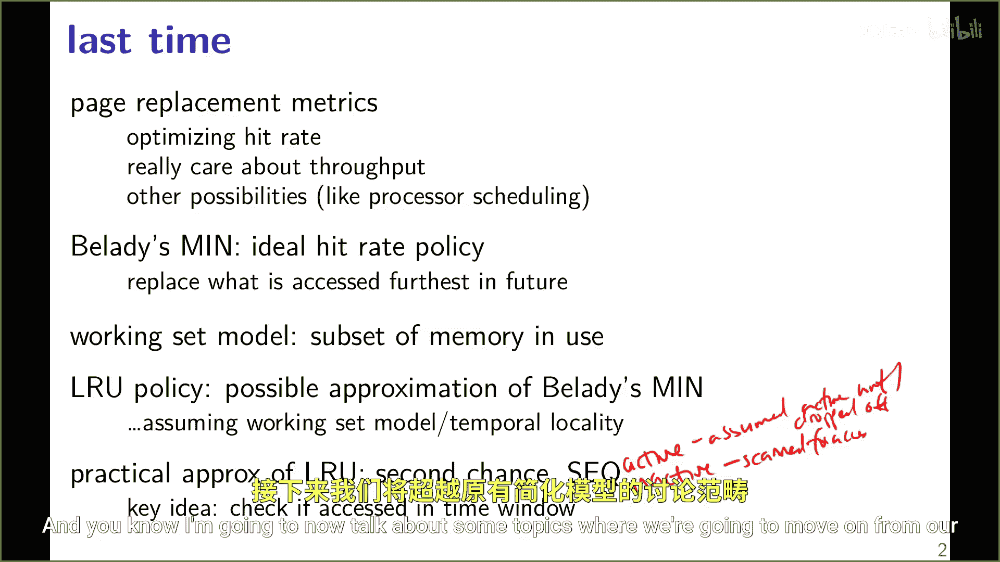
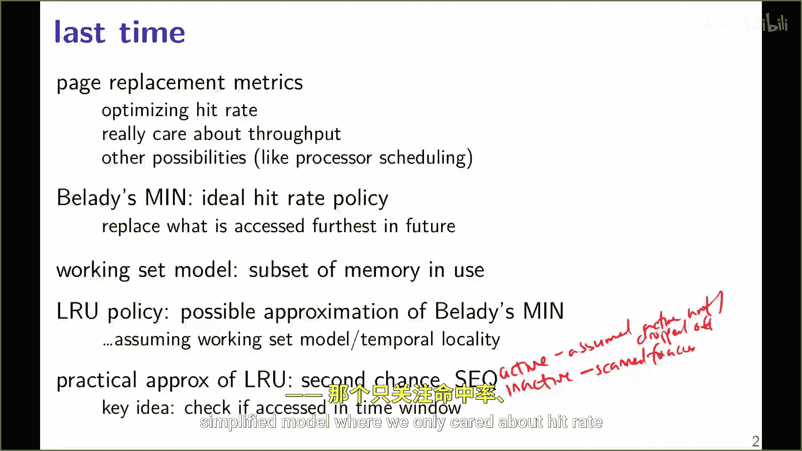
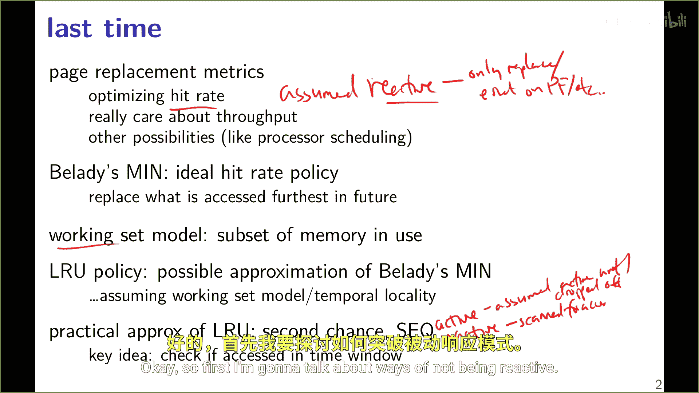
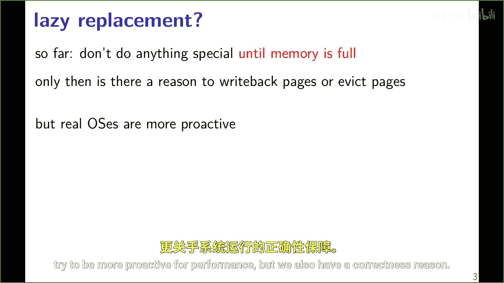
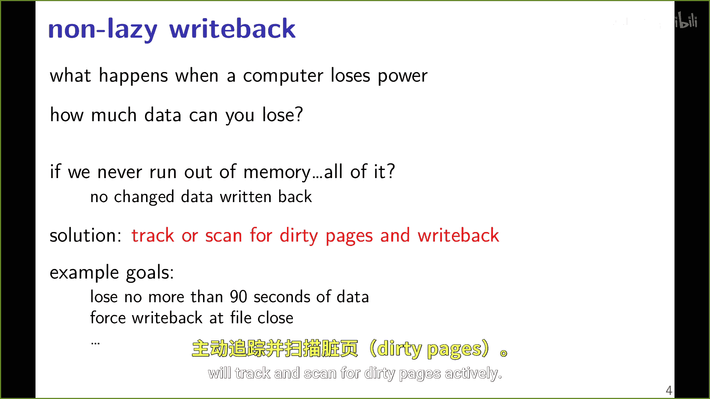

# 弗吉尼亚大学【中英⚡操作系统｜CS4414 2020 Operating System】 p18 P18 Virtual 5 I-O 1 -BV1mjePzoESb_p18-

St up recording okay。し。Last time。Wei。Talked about me。Policy half of page replacement。 So before that。

 we had gone over the mechanics of， well， I know I need to bring in a new page。

 so I need to take out a page。 How do I do that by finding all the page tables and modifying it。

 And then we need to say， well， what page do we take out。And that choice depends on our metrics。

 So we've settled on starting by optimizing hit rate。 And we learned that， well。

 we didn't actually care about hit rate。 hit rates， just how often something we。

Something needs to be replaced。And it has a relationship to what we probably really cared about。

 which was throughput because doing those replacements is expensive。

 but not every replacement was equal。We'll start looking at some of those issues today。And also。

 this ignores other priorities we might have。 So like when we talked about processor scheduling。

 we saw that， oh， not only do I care about getting the most work on my system， but I care about。

 for example， all the users getting a。Quote reasonableaable share of the system and。

We took those into account。 We might have sort of a different algorithm。Typically。

 you'd have that by sort of layering the algorithms we talked about with something to like decide between users。

 for example。We also。Looked then at this optimizing hit rate。 and we talked about the ideal solution。

 So unlike many problems， we had a perfect answer。Except we couldn't implement it。

 so the ideal policy is every time we need to choose something to evict。

 we evict the thing that's accessed furthest in the future。

And this is great for hit rate and not implementable because our operating system， well。

 it could arrange to figure out what the program is accessing。

Though we learned that that was actually a little tricky。

 it certainly can't arrange to figure out what the program is definitely going to access。

 We can make some guesses， but。Really figure it out。

So we knew that this was the ideal and we receded along the path of saying， well。

 we're going to have to make guesses， that's the best we can do， can't do better than making guesses。

And our key idea for making guesses was based on this working set model that we realized that programs naturally just aren't using all the memory they can access。

 And generally， there's some sort of concrete set of their memory they're using based on what the code that they're in the middle of needs。

And basically， what we want to do is identify what that set is。

 Ca that and don't care about anything else。 So when we do replacement。

 we want to choose things that aren't in any programs working set。And a way of doing this。

Approximating this was LRU。 Things are on the working set there' being used in sort of a short time span。

 So if we look at things that are recently used and keep those。

And take the least recently used things and don't keep them。 That is a victim。

 This sort of approximate belate is made under the working set bottle because it not being used recently is a good reason that gas it's going to be accessed for this in the future。

This also is the same sort of intuition we had if you took a course about processor caches and they talked about temporal locality。

 the idea that things that are used now are likely to be used in the near future。Now， LRU， well。

 at least we could implement it。But it's actually very expensive to actually track what's least recently used。

So we don't do that。 And you might think， oh， well， we're going to do these approximations。

 which turn out to be very crude as far as when we detect axises。

 But that's fine because we were already starting with an approximation。 This was a。

Approxiation based on this guesses to program behavior， Of course， it's not going to be exact。

 So we don't need to exactly figure out when things are used， you know。

 and possibly don't even need to do that to get sort of the best performance we can get。

And we talked about two sort of practical approximations。 One was the second chance idea。

 and one was the Sik idea。 Remember Sik was this idea where we had an active。And an inactive list。

And the idea is the inactive list we scanned for axises。The activists， we assumed active until。

Until dropped off， until something dropped off the list。And in both of these。

 sort of the intuition you can have is that we're not checking for every access to get the exact order。

 We're checking for accesses in a time window。 In both of these cases。

 the time window isn't determined by like looking at a clock。

 but it's determined based on how quickly we're churn through pages looking for more things to replace。

 but it effectively chooses a time window in the case of second chance。

 it's based on sort of the size of memory In the case of the seat policy we're being more precise about the time window by adjusting the number of pages we consider inactive。

So。That's sort of our usual pageri replacement and。You know。

 I'm going to now talk about some topics where we're going to move on from our simplified model where we only cared about hit rate and where we assumed。

sortrt of reactive。That is only replace。A。On a page fault。Or， you know。

 another or read or whatever would trigger us to bring in something into the cache。

 So we were assuming that was reactive and we optimize a hit rate。

 So I'm going to optimize some hit rate based on this working set model。

 I'm going to look at relaxing this sort of reactive assumption and this idea of assuming we're dealing with the working set model next。

 But before I move on， any questions about these things we covered last time。好看。

So first I'm going to talk about ways of not being reactive。

You know， what you can think of that our cur you know set up， we were being lazy。

 we didn't do anything until memory was full and you know， we needed more。

And only then that we do that， But real o is。Typically don't do this。 They're more proactive。

And there's a bunch of reasons for this， but one big reason is that you know we we have time earlier on to do stuff on a typical like desktop system。

 you know before I like launch a program that might need a bunch of memory。

 I probably leaving the system kind of idle and it would be good to take advantage of that and the other is that we're you know doing relatively expensive operations and we want to do them early。

Now， I'm going to start by talking about probably a case where not only do we have a reason to sort of。

You know， try to be more proactive for performance， but we also have a correctness reason。

 And this is with write back。 So we mentioned that we want to track whether pages are what we called dirty0。

 meaning that they've been modified。 so we need to asend them back to disk。

In order to not lose doubt。 and for data and files。

 this is actually a problem which isn't just about performance。About when you do that so like yes。

 we could say okay， so I'm right have a Word document， for example。

 I'm editing it and I'm saving it and if we use our policy that I'm only going to actually do anything about my cache data when I have to evict it and therefore I'm not going to write it back right away。

 we'd be really disappointed if my computer loses power or crashes because well that word document is cache。

And of course， it's going to stay in my cache because I am actively editing it。

And even though I'm saving it， while I'm saving to the cash。嗯。

And thered probably never be a reason to save it， and if I never run out of memory。

 there might never be a reason to save it even after I'm done editing。

But this is typically not acceptable。 So just from a point of view of losing data。

 like we want to actually be more proactive than， you know， we have to be for correctness。

You knowBecause people would really complain if saving a document didn't actually send it to disk for you know。

 days or until you shut down。So typically OS is primarily based on this concern about not losing data will track and scan。

