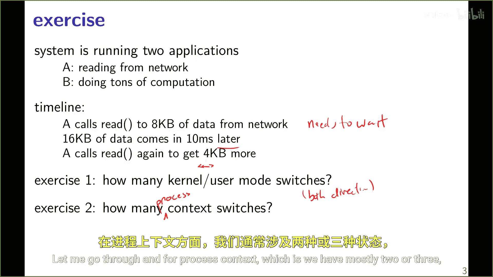
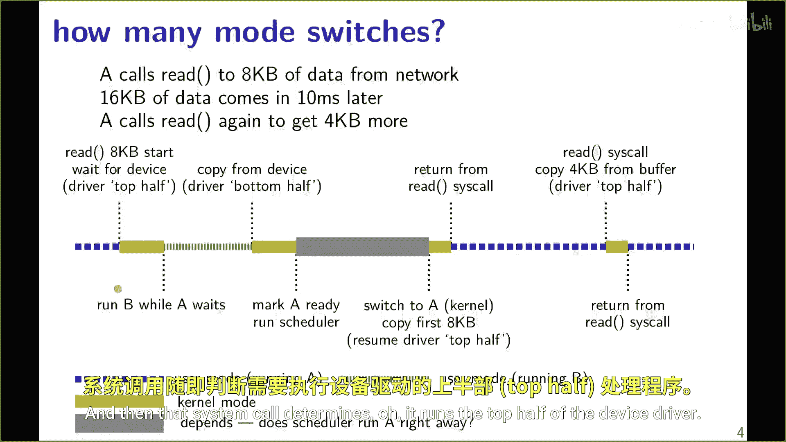
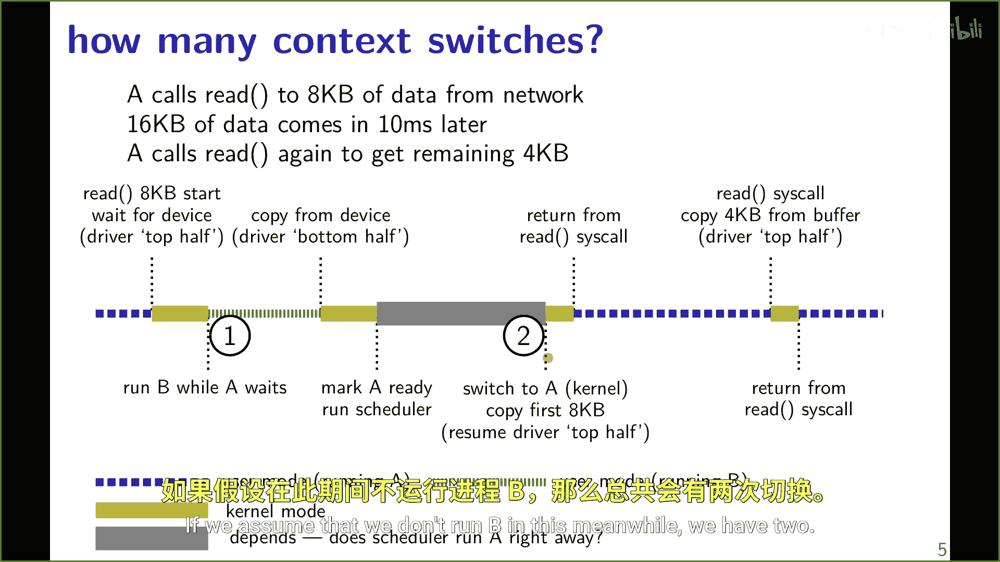

# 弗吉尼亚大学【中英⚡操作系统｜CS4414 2020 Operating System】 p19 P19 I-O 2 Filesystems 1 -BV1mjePzoESb_p19-

Good afternoon。 So I'm going to start with this question here。

 So we're saying I have a system we're running two applications。

 And A wants to read from the network。 B does a lot of computation。

 So we can always run it if we have anything else to do。😊。

And I'm saying that we start out where A calls read to get。Ask for 8 kb Gava， and it needs to wait。

Needs to wait for that data。 So the data is not available right now。 So later， 16 k of data comes in。

 that read gets 8 k of that。 And then a process is that 8 k and says， oh。

 there's more and calls read again to get 4K more。嗯。And are asking when this happens。How many。

Colonnel user mode switches so in either direction，This is both directions。 Are there going to be。

And how many contact switches are there going to be。

 This is process contact switches to be completely。Cl， hopefully。

So I'll give you some time to think about that。Remember to think about how our device drivers work。

 we talked that we had part of the device driver that ran from the read or other IO request。

And part that man from the interruptoptangular。 and they sort of have the shared buffer。

 The re would check that buffer。 The interoptangular would typically fill that buffer。

Or drain the buffer in the case of rights。I'll give another。30 seconds or so。

 maybe a little more because。that's great。 sell little low so far。Guess I'll close it last chance。

Like who more people to be。That。嗯。Okay， so。Don't have consensus here。

So a lot of people like three by six， not really consensus。 Let me go through。

And for process context， which is we have mostly two or three， sometimes4。

 Let me go through sort of how I work out this scenario。 So initially， as running is my assumption。

Then we have its read happens， and that has a system call。 So that goes from user to curl mode。

And then。That system call determines， oh， it runs the top half of the device driver。

 It looks at the buffer。 It says， oh， there's not a cave stuff here。 So it starts waiting。

 And when we're waiting， we're not just going to waste time， We're going do something with the CPU。

So assuming we wait a reasonable amount of time， we're going to end up running B and doing its computation in user mode。

And then at some point， the guide is going to come on the network。

 and that's going to trigger and interrupt from the device， which will in our trap handler。

 which will run the bottom half of the device driver。

 So that's going to be in kernel mode and interrupting B。

And it's going to process the data from the device。 And it's going to realize， oh， this program A。

 it was writing previously。 I should mark it as。Ready now。 And multiple things could happen here。

 So one option is that we could say， have the scheduler decide， oh， A is more important than B。

 because a is like。Ha't been using the C U for a while and it might run A immediately or alternately。

 it might decide to wait for a while and not switch to A right away。

 in which case maybe B would run here。And that's why I have this in gray。

 So either like we just switch A and do this stuff right away or we were in B for a while before the scheduler decides。

 okay， now it's time turning。So we think of Xb6 as scheduler， it would wait for a timer interrupt。

 so this。Gy portion would be filled with B。Whenever we decide to run A， we're going to switch to A。

 we're going to be in kernel mode， and we're going to execute the rest of this top half of the device driver。

 So this top half it' stopped to pause the process。 It's going to start running again。

 and it's going to check， okay， I have the data in the buffer。

 Now I can finish copying it and returning a value to the application giving its first 8 k of data。

 Then a is going to process that data。 decide to make its second system call。

 And this time our top half is going to check， okay， is the data in the buffer answer is yes。

And it's just going to get returned without needing to have a start waiting again。So if we count。

The mode， switch is here。We have。1， to start。Running the system call for read a second to start a waiting and run B。

In user mode， then a third to run the trap handler to handle the I O。

 And if we assume that we switched to a right away a fourth for returning from that system call and a fifth and a sixth for starting and returning from。

System call。The second read system called。If we assume we run B in the middle。

 we have two extra context switches sorry， two extra mode switches。We're going to switch。

Mootes switch to run B in user mode and then tap to kernel mode to finish running the system call for a。

So questions on how I did this logic and the answer I came up with。

And I think most of you did three were only counting。

 I would guess we're only counting the switches in one direction， which makes sense， but。

That's not quite what the question was asking。So for context switches。

 we can use the same diagram if we assume that we。Don't run。B。

