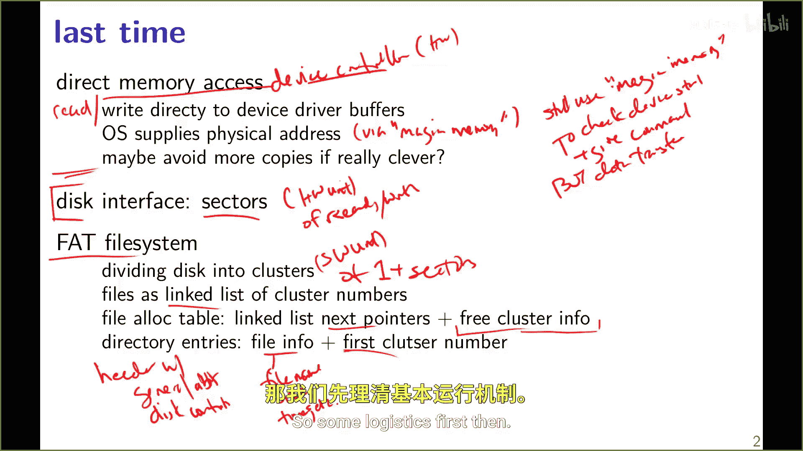
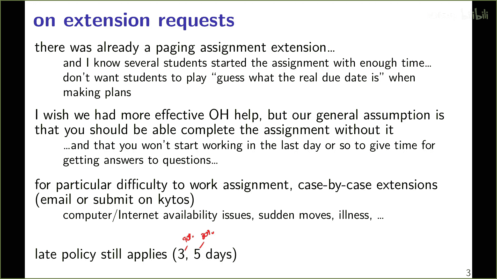
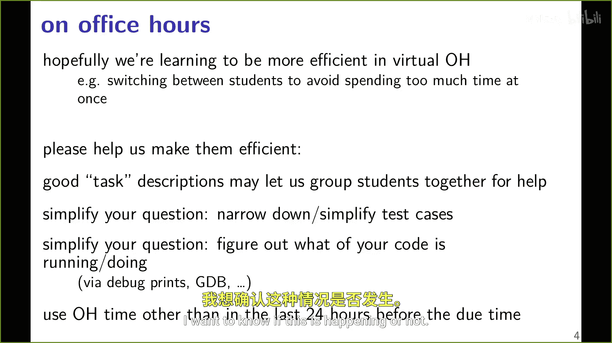

# 弗吉尼亚大学【中英⚡操作系统｜CS4414 2020 Operating System】 p20 P20 Filesystems 2 -BV1mjePzoESb_p20-

Good afternoon。So last time。We finished up talking about how the operating system communicate device by talking about。

Something called direct。Memory access。 And then this scheme， the。The device controller。

Could read or write directly to device driver offers。

So the Os would supply the physical lettersers of the buffer know via the magic memory scheme we mentioned before。

And would still use that magic memory scheme to communicate with the device in order to figure out like had it ran or written things correctly what was happening know。

So， we still。Use， you know， sort of magic memory。To check device status。And give commands generally。

 But the， but data transfer。Works differently。A we actually that this。

know avoided some extra copying， it was generally a lot faster because the CPU wasn't doing copying for devices where we have to move a lot of data like hard drives and networks。

 or other devices， not so worthwhile。So， and we also mentioned that， well。

 we could maybe if we're really clever with the scheme， we could tell the device controller。

 which remembers the hardware to write directly where the application wants。

And I said we have to be really clever because it turns out there's a lot of obstacles to doing this in practice。

 but maybe we can achieve them。Then we started talking about file systems and we talk about file systems。

 we need to have some notion of how do we communicate with a hard drive or an SSD。

 We mentioned the interface with these sectors， so this is the hardware unit。

That we can read or write。Reads write and we have to read or write whole sectors。

 and this is going to constrain how we can organize our data on the disk when we're talking about our file systems that divide up the disk into files。

And we looked at one simple file system design。Fap， so fatAP divided the disk into clusters。

 and this was the software units。You know， of one or more sectors。So you're obeying the constraint。

 we decided we didn't want to necessarily to do what the hardware did， we had a separate unit。

And we needed to get the files data， we really to represent that somehow。

 and our choice was that we have files via a link list。Of cluster numbers。

 that would be where the data is。 so you need to store that linked list somewhere。

And that means we needed a bunch of next pointers。 So we storedd that in the file allocation table。

 which was this big array with one entry for every cluster。And that had the next pointers。

 And we also use this for some other purposes。 For example， we used to the what clusters were free。

Now， this got us the data for the files， but we also needed sort of metadata， sort of like。File name。

The exact size， we don know how many clusters it is。

 but like that doesn't tell us how much of the last clusters used。No times。Et cetera。And where。

The file started given some sort of name， and we stored these in directory entries。

 So our directories， we stored like files， but they contained a list of these directory entries。

 and that's how we actually took a name from a user and converted it into something which we could usefully look up as a file。

So today， after some logistics， I'm going to talk about this disk interface more。

 sort of how do hard drives work， what's the interface the OS gets to them。

 and also how do SSDs work。嗯。But before I do that， any questions and out things we covered last time。

The question is， how does the O mount a file system at boot or during run time。

So if it so we haven't talked about mounting yet， which。Is perhaps a rather of than a mission。

 so the U is going to need to have some table what file systems are active during runtime。

 we're just adding to that table and that table is going to have to be used somehow when an application calls open。

And we mentioned， in fact， we had a header。With general information about the。

 about what's on the disk。Dis contents。 and that's going to be a common thing in most most file systems。

 So that's how we'll get the inver， you know， the setup info about like。

 where's the route directory and so。As for at boot time。

 that's usually kind of special because something has to load the OS and。

That is something that I don't have the details I've memorized， but that's sort of a special case。

It something guys loaded the O and has to communicate to the US。

 Here's where the first file system is。 so the O can。Actually。

 what does that answer your question kind of okay。So some logistics first then。

 so a lot of people have been asking for a paging assignment extension。

So generally， I don't like giving late extensions for assignments like this because I don't want students to be playing a guess what the real due date is game。

 with the due dates I have listed and we already gave an extension earlier you know and maybe I consider doing something like this we had some notice。

 I think in retrospect， probably when I gave my extension after spring break。

 I probably should have done it until Friday， even though that kind of puts the paging and fat assignments close together。

 which is why I didn't do that， but I don't think it makes sense to try to change that you know this late because you know I。

Stents started the assignment time， I don't want you to sort of play a guessing game when you're planning。

 when does the assignment really do？I certainly do wish。

 and this was the cause of request for this is that we had more efficient and effective office hour help。

We were， you know， we're kind of used to how do we do office hours virtually and we're trying。

To get R Ts on board and some of them have real life things that have come up and made them less available than they used to be。

So， yes， we have been kind of struggling with that。 hopefully we're going to be improving。

 but our general assumption for assignments is that you should be able to complete the assignment without office hour help。

 and if you are getting office hour help that，You don't wait till the last day for your first set of questions。

 which some people seem to be doing。Because you should expect that it might take a bit of time to get answers。

 even with in person office hours。When everyone's doinging the assignment at the same time and you have。

There's going to be stuff to do to resolve your problem。啊。

If you had some particularly difficult to work on the difficulty to work on the assignment。

 for example， I know some people have had like computer or internet availability issues needed to suddenly move illness and so on。

I do case by case extensions。Contacting credit。Like that's a very reasonable thing Also the light policy still applies I know some of you may have not looked at the light policy basically you should check the webpage for like the firm description it's something like 90% after three days。

80% up to five days， which I think is pretty generous。

 and given that we have a little bit of a buffer before the file assignment。

 I would encourage you to take advantage of。If you have not completed the As。

And speaking of office hours generally， hopefully we're getting more efficient like we're learning to like switch between students rather than when to avoid spending so much time with one student without helping others and other things like that will which would make us more efficient。

 though things you can do that will hopefully help us make office hour more efficient。

 so one thing is we have a place for you to write a task description。

It would be great if something useful isn't there， not like paging or help。

So we can potentially group students with related problems together。And save some time for everyone。

If when you're talking to one of us， it would be nice if before we talk to you。

 you've done some work that will make our time with you more efficient。

 like simplifying the test cases that you can cause the failure。

 like figuring out what's the simplest thing I can do to make this fail and working on figuring out like at least you know what part of your code is running。

 so we don't have to as sometimes happened， go to you and say okay， I see it's failing。

 I want to know if you're you know if this is happening or not。

