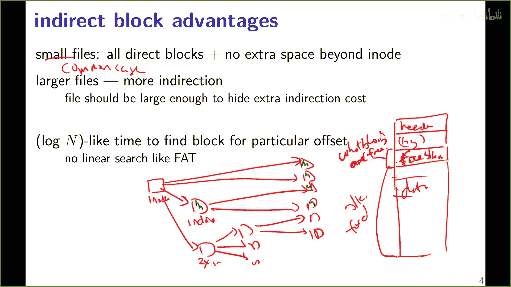
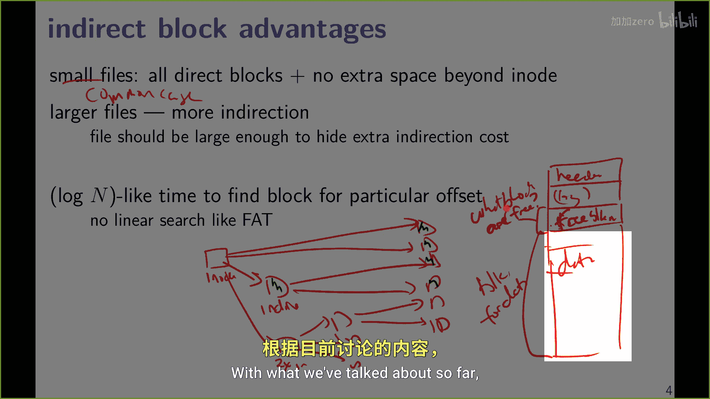
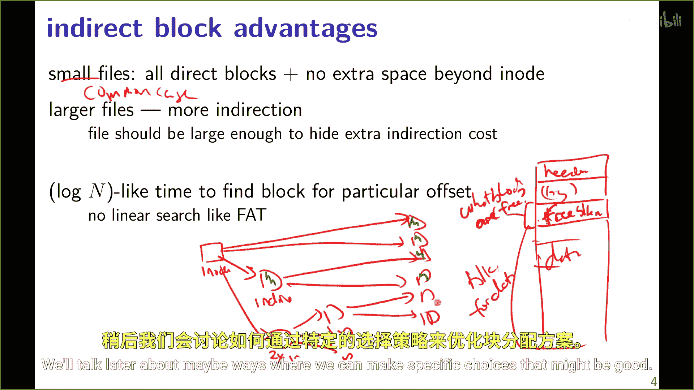

# 弗吉尼亚大学【中英⚡操作系统｜CS4414 2020 Operating System】 p21 P21 Filesystems 4 -BV1mjePzoESb_p21-

Good afternoon。 So last time we started out by talking about hard drives。

Which we're talking about because they're sort of what our file systems are based on unit if they're no longer the most popular technology。

 we mentioned that hard drives， these are physical things where we have disk that actually spin and we need to get the physical component that reads from part of the disk to the right location。

哦。We have these physical limitations， we have to worry about seek time and rotational latency。

 you know， this just how long physically does it take us to get。To the right part of the disc。

And that meant that we'd have these concerns later on when we're thinking about performance about where do I put my data。

 I want to lower that physical movement time。And we mentioned that although usually the hard drive keeps things that have close sector numbers together that。

The physical media is kind of unreliable。 And one of the ways that hard drives deal with this is that the disk controllerroller without telling the O moves data around on the disk to avoid regions of the disk。

 that physically become bad that can no longer store magnetic signal。

Then we talked about solid state disks and solid state disks are providing this hard drive interface。

 but doing it。On top of a very different technology。

 this flash technology didn't have any moving parts。 So that makes it more reliable。

 but it had some peculiar features。 And the big one was this idea of asure blocks on a hard drive。

 We could just overwrite any part of the disk。 Yes。

 we have to pay the cost of getting the head to the right place with a solid say disk If we want to overwrite part of the disk。

 We need to erase all the data around it first。And these relatively big blocks。And worse。

 we can only do that so many times per block before it starts failing。

 so we can't do what we're used to on a hard drive where we overwrite part of the hard drive many。

 many times。 if you think of the fat， we have this file allocation table， know。

 the beginning of the disk。 we're going to overwrite that a whole lot。

 and on the hard drive that's fine on the solid state disk that wouldn't actually work。

 So what the controller for the solid state disk does is it does its own block remapping。

Where every time we overwrite data， it actually writes it to a new location where the idea is that we spread out the load among all the erasure blocks and also deal with。

The fact that we can only overwrite a whole era block at a time， which is relatively big。

So we do this to hide these erasure blocks and let our operating system treat this like a faster hard drive。

So then we talked about inode based file system。 So this was this traditional UniX based file system design。

 and the big change was we put kept all the data about a file， so accept the name。In one place。

 we called an iode， and we had an array array of i nodes。You know。

 so which we store in one place on the disk and each iode would have sort of our metadata about the file。

And have some pointers to the blocks of the file。 And well。

 we couldn't always keep all those blocks in the id because it's fixed size。

 So instead we'd have some after we ran out of these pointers directly to the blocks。

 we'd have an indirect pointer， So we'd allocate an extra block to store extra block numbers and sometimes we'd allocate blocks that point to blocks。

But we have this extradirect only for larger files， for smaller files， we fit everything in the item。

And with this scheme， we stored this array of Is on disk。

 We still needed to track what blocks were free。 And in fact， that was kind of。

Group together with our tracking of next pointers。Here we're going to have a separate tracking because we can't put it in the i nodes。

 so we just have a separate free block map。And after we're done with this， rather than like fat。

 scattering the data between the directory entry and all sorts of parts of the fat。

 we basically have one place to look to see the information about a file and update it。

 and our directory just has an index into the array of inots rather than having some of the information about the file。

 but not all of it。😡，So we're going to finish up talking aboutdirect blocks just very briefly today and then look at。

Sort of things that we still don't do very well in the XB6 file system or things we haven't explained。

 But so before I move on to that， So questions about these things we covered last time。O。So。

I've looked at we've had these the scheme of having direct and indirect blocks。

 So you know the picture from before， we had this picture。knowSo we first use these direct blocks。

 but then rather than doing some sort of blinkless scheme。

 we have a pointer to an array of more block numbers than a pointer， if that's not enough。

 then a pointer to an array of more pointers to arrays of block numbers and so on。And。

You can talk about like why would we want to do this？

You know why would we do that sort of split scheme？And a key observation is that for small files。

We're going to use only direct blocks。And we're not going to allocate any space beyond the item。

 And the key reason why this is good is that this is the common case， as we'll learn later。

Most files are pretty small， so usually we're not going to be allocating in direct blocks。

 we're not going to deal with it， it doesn't mean they're not important because you know I do care that I can read large files and store large files and read them efficiently。

 but we only have this extra interactiondirect for larger files and that's the reason why we kind of have this tiered structure where use direct blocks for small files and not。

😡，And the overall result is because we use more and more in direction。

 the larger the file is you can think of what we have as kind of a。A slanted tree。Structure。

So we have。Interect， we have a。2 x indirect。 that points to。More。Dects that points to blocks。

And we fill out the tree sort of starting， you know， we first use this then this and this。

 And we keep going down and end up needing to outfit more and more of these layers of indirect。

 And what we end up with at any point is sort of a slanted tree。 If we like， tilt this。嗯。

So we don't have a linear search to find things。 And if you want to think of sort of what the complexity of accessing this is。

 it's kind of。Like a tree， it is a tree just a。 So we get something like a login time to access things。

 not linear like we had in the fat。And we do that sort of， regardless of the size of the file。

 we can build this up。So questions。 so this is we're going to leave off on indirect blocks with questions about this before move on。

 so I know this is a point of a lot of confusion。So the question is。

 how does the O know where it should put the file。You mean put the data so。

If you remember our XV6 file system， we had our header。We had a log， which we'll talk about later。

 We had our free block map。And we had our data， and the OS is going to use this is stores what blocks are free。

Are free。 And this is the blocks for Gaa。And how does the US is going to choose。

I should write this out for real。

Is going to choose based on this free block information， you know， some set of blocks in here。

 and with what we've talked about so far， it's correct to choose any subset of those to put。

Any of these blocks where the actual files data is and any of these indirect or double indirect or triple indirect blocks it needs to allocate。

We'll talk Lee。

