# 弗吉尼亚大学【中英⚡操作系统｜CS4414 2020 Operating System】 p22 P22 Sockets ⧸ Distributed Systems 1 -BV1mjePzoESb_p22-

Good afternoon。So。Last time。We went beyond our sort of simple idea of an Iode based file system and first we fixed some performance issues or。

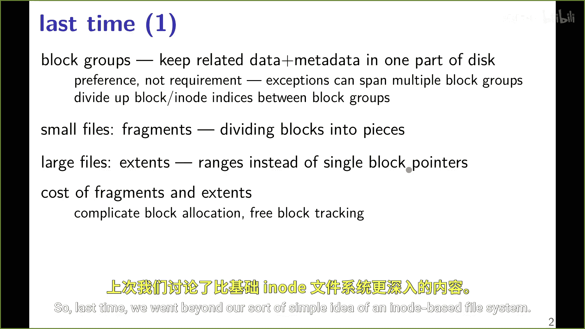

Did something about Maybe we didn't actually fix the performance problems， but we made it better。

 And one issue was that， you know， I based file system。 we had our。

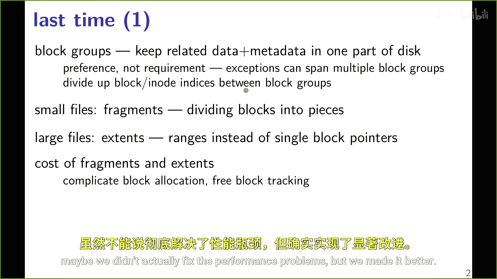

Metaadata about files， like its directory entry， its iode would often not be close on the disk to the file。

 And this is kind of inevitable because we had the iodes in one part of the disk and the data and another。

 And if we're using the data。

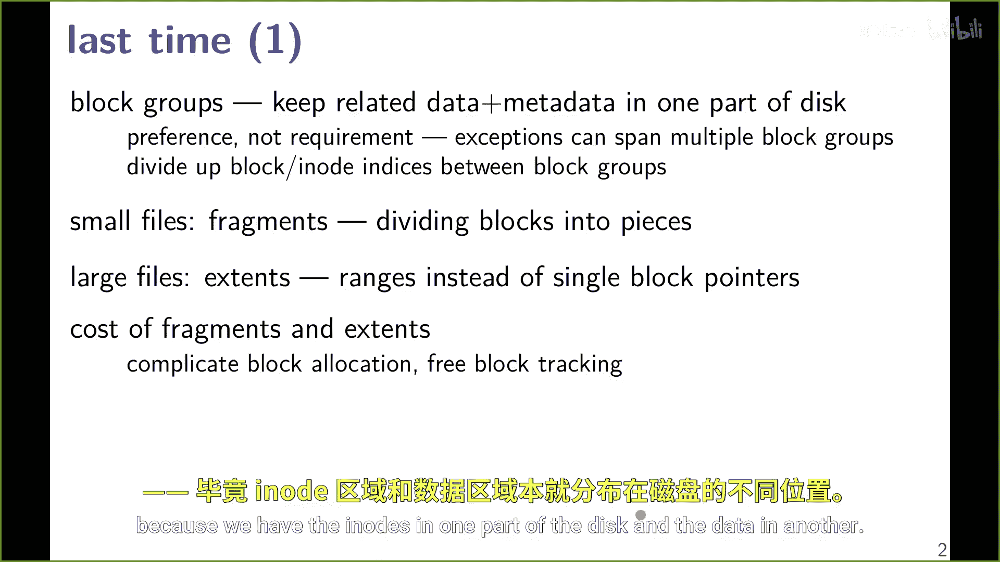

Some part of that region， it's caused to be far away from the ionodes。

And that means when we want to get the information for a one file， it's going to be far apart。And。

You think about the fat file system， The fat file system has the same kind of problem that we have。

Data in directory entries about files。 We have the data and the fat about where blocks are and the actual blocks。

 and inevitably， some of the blocks are going to be far away from the fat。

 which means that if we want to read or write to a file。

 we're going to have to update things that are far apart in the disk。

 And if we have a spinning hard drive we're not going to have。Dn close together。

 so we're going to spend lots of time seeking。To got the head into the right place to write it。

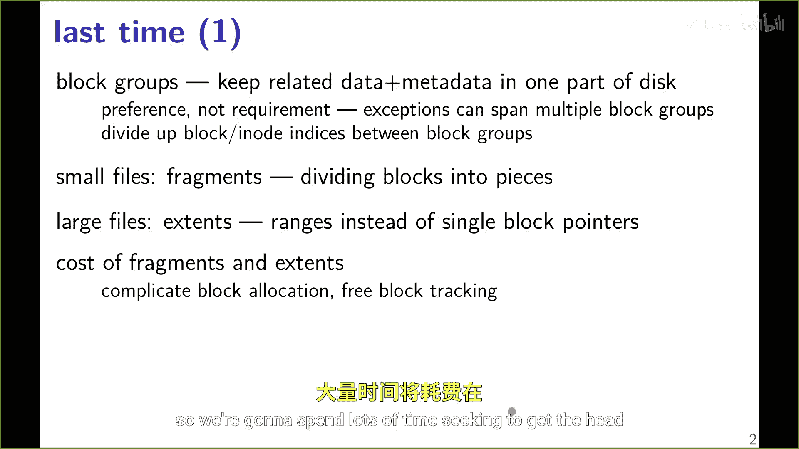

And the solution that the Berkeley fast file system proposed for this problem was something known as block groups。

So basically， they've decided， okay， we're going to divide up the disk into these what we call block groups。

And we're going to try to keep all the data for a file， including its metadata。

 like its directory entry。😡。

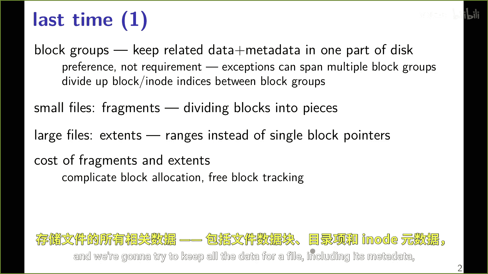

It's Iodeode all in that part of the disk， so each of these block groups would have their own set of IOs。

 their own portion of the list， the free block map， and their own portion of the data。And， you know。

 this idea， you know， is basically like dividing up the disk into many little disks。

 But if we did that， we'd run into this issue like， what if。You know。

 I arrived space in my block group or whatever if I put too much stuff in it， you know。

 it seems like we would have to like rearrange things a lot in order to make that work out。

 but we had a better。least in terms of being easy to deal with solution。

 which is that this was a preference， not a requirement， So things within one block group。

 they can point to things in another block group， sort of kind of an iode in a block group which has some block data of blocks in that block group and some outside and the way we make that work is we divide up our iode indices and our block indices among the block group。

 So when we saw that an iode was pointing to block 3000 we'd know what block group that was in based on the number 3000。

 not based on where the iode was stored。And our hope would be that usually would end up being in the same block group。

 but we know we would have always succeed at that and that's okay。😡，As long as we usually do that。

 we still get the advantage of keeping things in one place on the disc， lowering seat times。

 but we have this backup option if we can't do that。So that Lord our seat times。You know。

 the disc kept things close together so we were able to take advantage of hard drives。Actually。

 storing things in one place。 So then we have sort of different types of efficiency concerns related to。

How we store and retrieve information about where files are located。😡。

So one problem we had is that in our I based file systems。

 we divided up the places where you put data into big size blocks。

 that does the same thing they use clusters， and we have to store information about each of these blocks or each of these clusters。

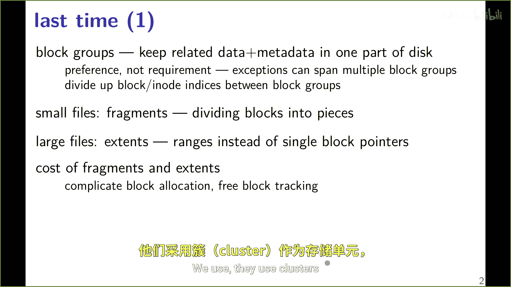

And we have to store like the list of each of these blocks and clusters。And。So that has some costs。

 so we really have this push for NA to make the blocks bigger。 but when we do that。

 we run into a problem with small files。And the big problem we run into with small files is well when we make the blocks as big as we want to make them。

 it's going to turn out that the way people typically use file systems。

 they turns like so so many small files， and when I say small。

 these are smaller than the size we want to make blocks， so we're going to waste space。

 even though we're only allocating one block to a file because we're not going to be able to use all of most of those blocks。

So one solution where we use smaller blocks but then we're paying more cost in terms of tracking all those blocks and having pointers to all those blocks and so on。

So the Berkeley f file system had kind of a compromise。

 They would divide the blocks up into these pieces， called fragments。

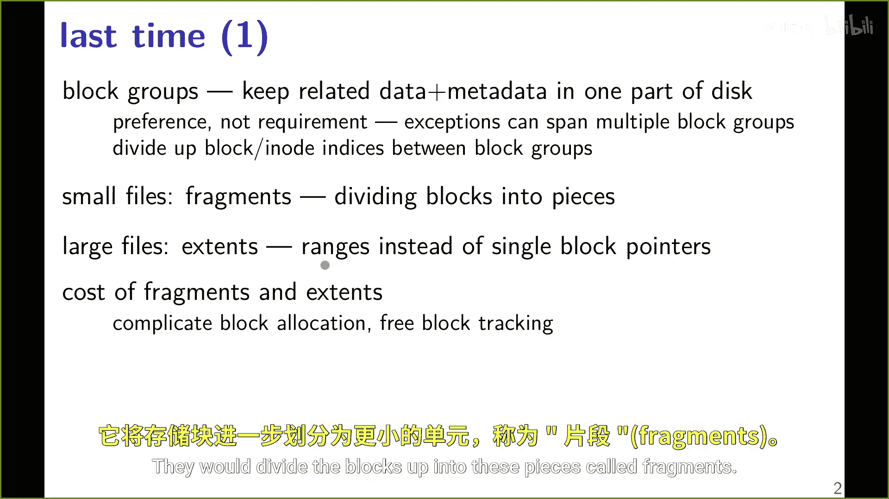

有。And you know， so for small files。Fileles only， we point to these。

Subsetss of a block called a fragment。And but for bigger files。We'd work with whole blocks。

 so we wouldn't pay most of the cost of having our block size smaller because usually we were still work for big files。

 we were still working in terms of whole blocks， but we have support for allocating smaller parts of the disk。

😡。

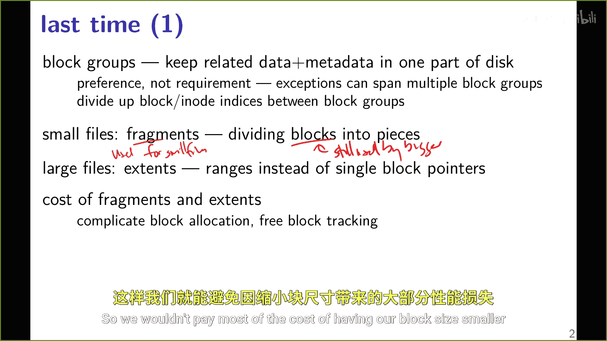

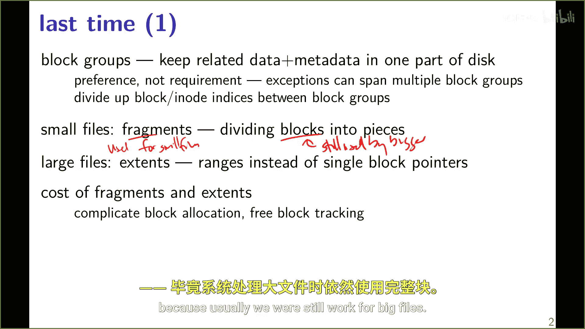

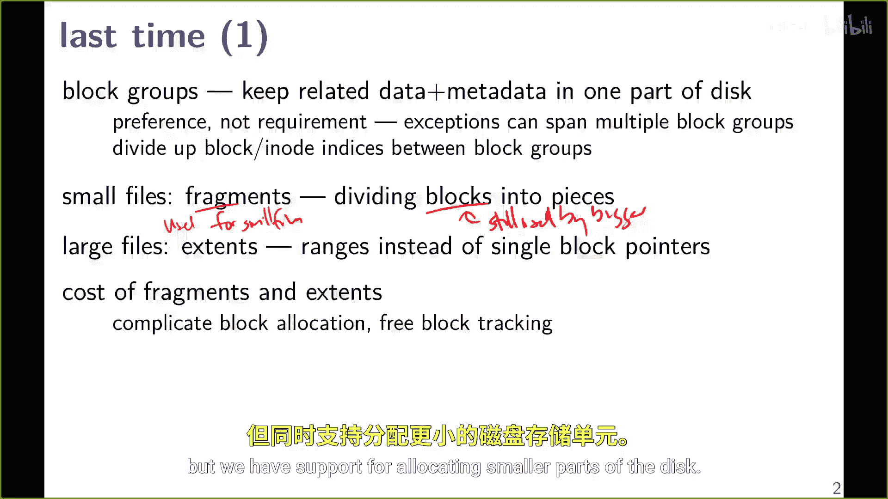

And that would let us， you know， not waste nearly so much space on small files。

 but still make our effective block size for large files be。

Now big enough that we would be a lot less concerned about。Rating space。 Now。

 this is where the Berkeley fast file system was happy leading off。

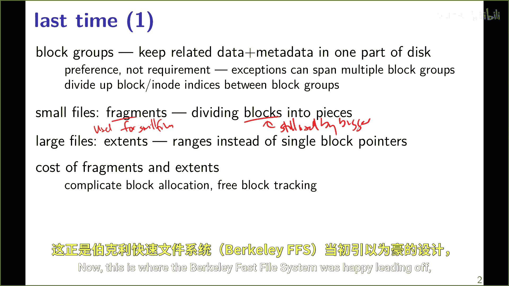

But。More recent file systems have not been happy with a solution when thinking about large files。

 so yes， making the block size bigger makes large files work better。You know。

 in the sense that we we're tracking less block numbers for them or in the case of that。

 we're tracking。

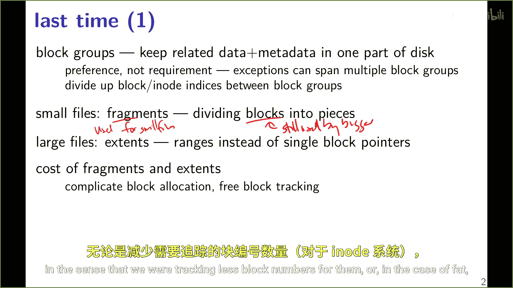

A shorter list of block numbers， length list of block numbers。对。

For any reasonable size you don't like to set， know， for big files。

 like if you think of like a multi gigabyte movie file。

 we're going to have a giant list of f numbers。

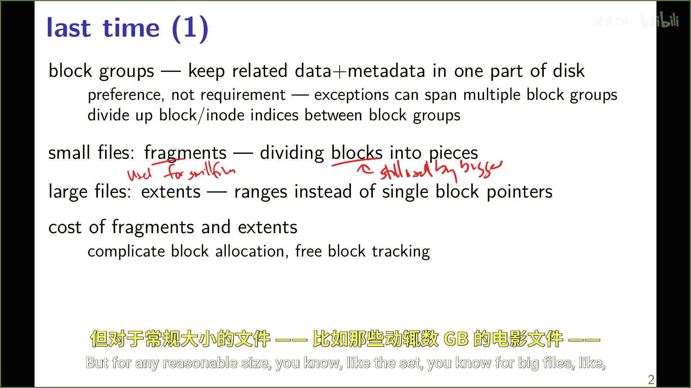

YouRe big and that's going to be take a lot of time to write if we're reading the file。

 we have to read that whole list。And。You know， that's a lot of overhead and that's going to happen pretty much no matter what we set the block size to。

 because we're not going to tolerate setting the block size to like a megabyte。

Because then that means that we have either a lot of bookkeeping or we waste space for a megabyte of space for each file that doesn't fit in the fragment。

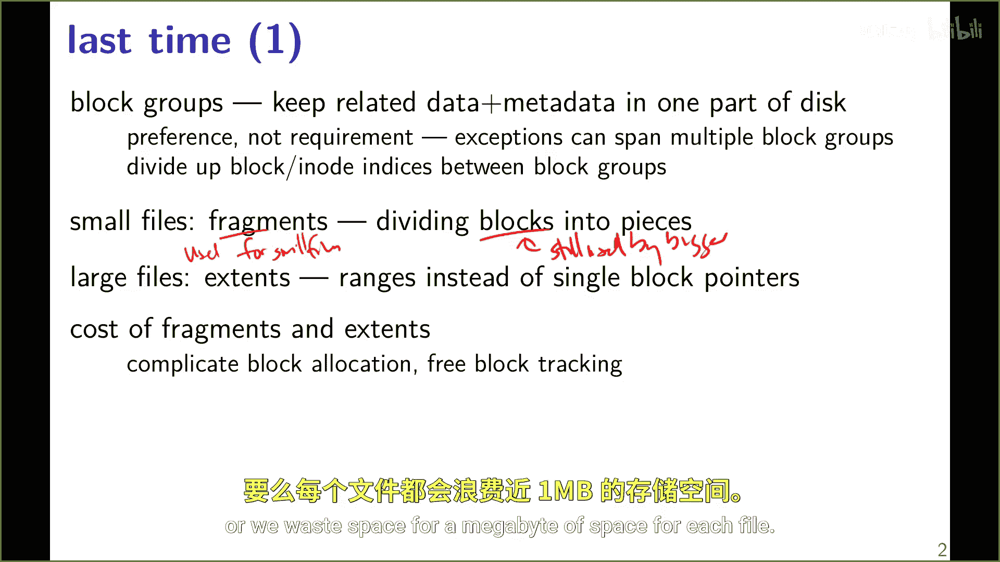

So what we're going to。Now do instead is try to store this list of block numbers in a different way for large files。

And。To make this work， we need to have large files use block numbers in a particular way。

 So with our original scheme of having block pointers and just a list of them。

 we had total flexibility about。

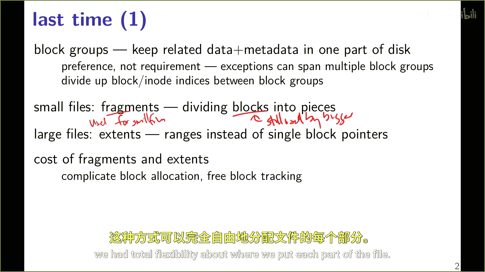

Where we put each part of the file？And。To store that more compactly， we're going to want to you know。

 not take advantage of that full flexibility。 So we can store instead this idea of extents where we store ranges。

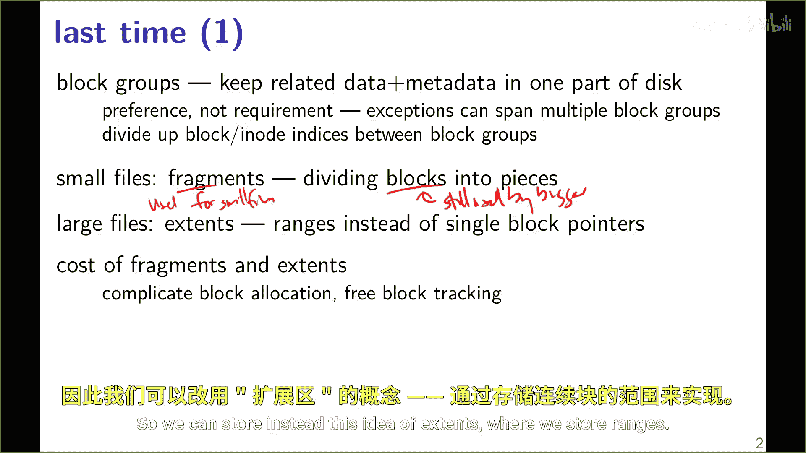

And as long as we do something where we try to allocate a large file to either one contiguous range of block numbers or a small number of them。

 this will work out if we， if we like assign each block。

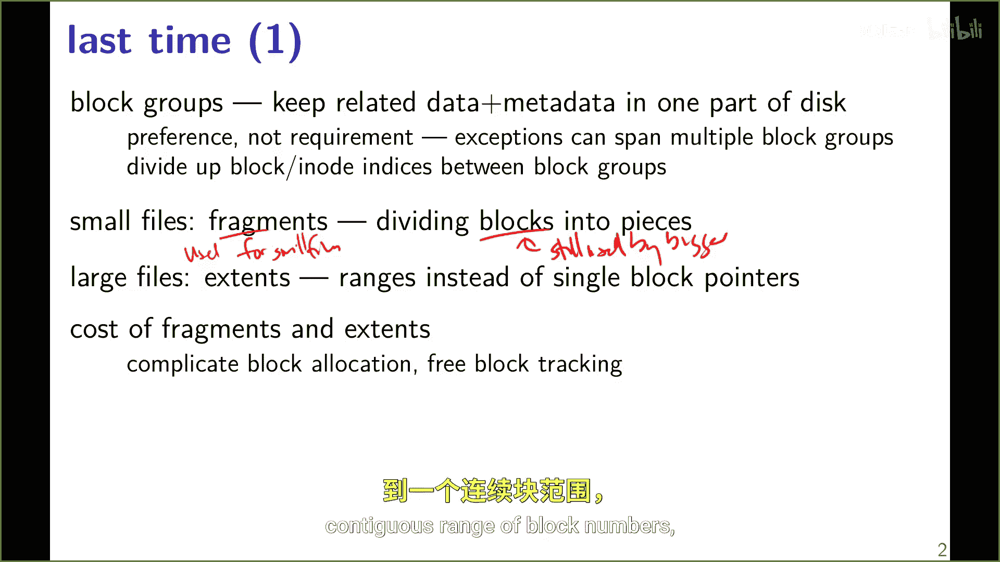

Trend in locations and oh， that's not going to work。

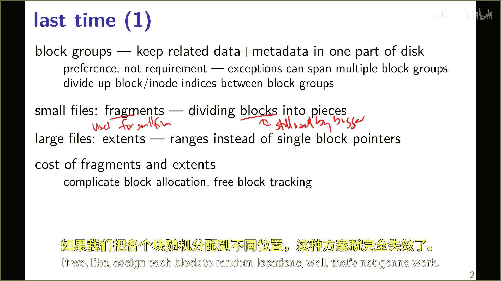

So。This is for large files， so ideally。One range， one extent a file。

 but sometimes that might not work， we might not find a big enough range。

Now both of these you know make things generally better as far as a bookcaaving for small and large filess。

 but they have a real cost and the big cost is that we're complicating our block allocation。

 so we have to have a way of allocating whole blocks and parts of blocks for fragments and tracking whether they're free for extents whereas previously we kind of could just know get away with allocating blocks wherever and that would be fine。

 know we're not going to be able to make extents actually useful unless we're much more careful trying to allocate contiguous ranges so we're actually using less space to store what blocks are for。

So before I move on to finish up talking about redologing。

 questions on these things we covered from last time。Question is are we covering rate。

 I am not planning on doing that， so we're going to just our only reliability topic we're going to cover in detail is redo logging for time reasons unless we have time at the end of the class。

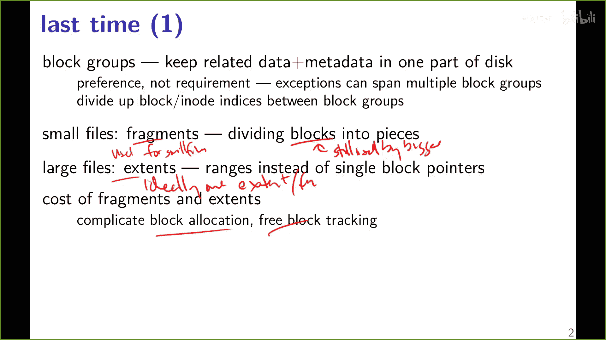