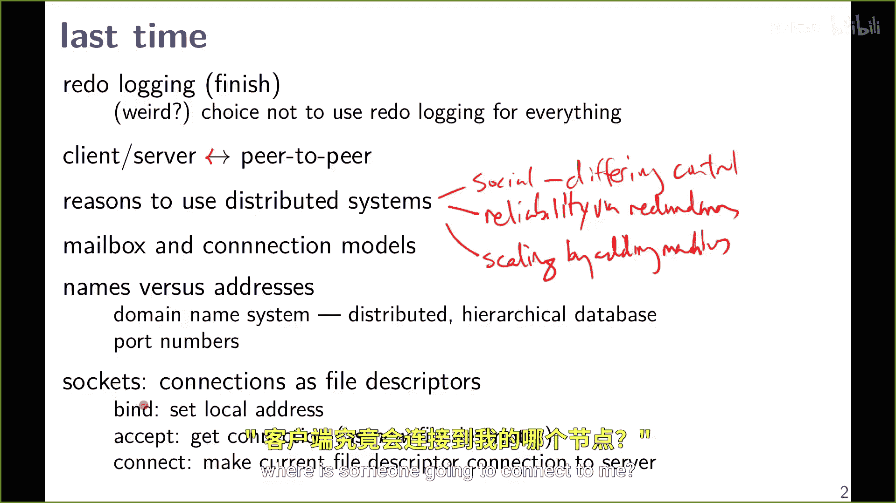
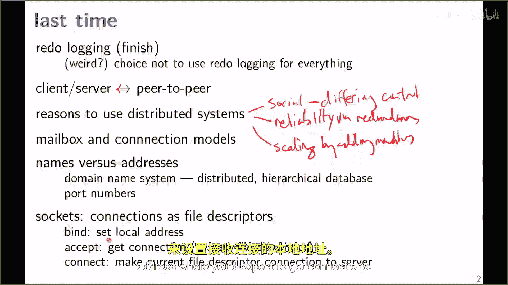
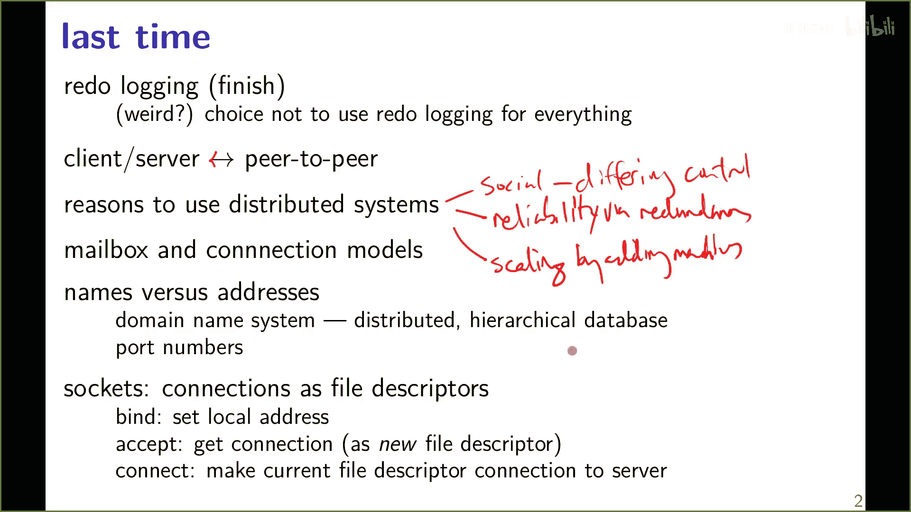
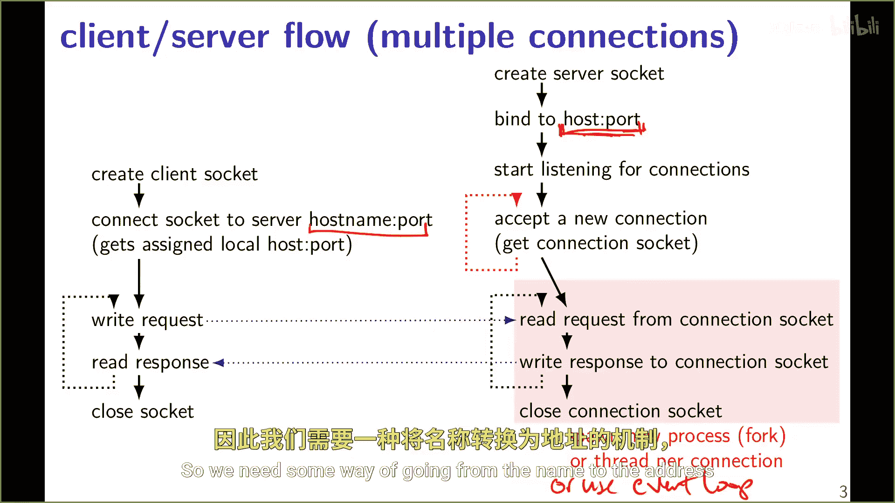

# 弗吉尼亚大学【中英⚡操作系统｜CS4414 2020 Operating System】 p23 P23 Distributed Systems 2： RPC ⧸ Failure -BV1mjePzoESb_p23-

Good afternoon。So last time we finished up talking about redo logging and file system。Everyone one。

Kind of important thing we mentioned when we were finishing up was that we had redo logging like glass make everything consistent in the sense that if we had some abnormal shutdown that we wouldn't have something weird about the state of our file system。

 but some file systems make the choice not to do this for everything because they're worried about the performance cost。

 So， for example， they might leave the data in files， not consistent in this manner。

 but keep everything else with redo logging。Then we moved on to our second topic of distributed systems and the idea of distributed systems is that we had sort of one common problem that a bunch of machines would work on together。

 and we looked at sort of two very different models for organizing distributed systems kind of extremes。

 So we had the client server model where we had these servers that would。You know。

 get requests from clients and send responses， the clients would kind of you know。

Not be contacted directly。 we'd only go to talk to the server versus this peer to peer model where everyone does everything。

 Everyone's kind of equal。And these seem like two extremes。 We mentioned that in reality。

 we often sort of have something in between or we have a mix or sort of a combination of multiple instances of these models。

 So we mentioned with the client server， we often have a server。That's a client for something else。

 so you have the sort of layers of a client server model。

After looking at this high level organization， we went back to our high level question of well。

 why would I use a distributed system， Like， why would I want to have multiple machines doing things together。

 We had sort of a bunch of very different categories of breach。

 We mentioned that it might just be because we have multiple machines that are owned by different people。

Because different people have like different data that we need to keep together and we want to handle that differing control。

Or it might be for technical reasons， like we might want to get better reliability by having redundancy when you're going to scale up a system by adding machines。

Then we looked at， well， what are ways that machines communicate。

 We had these high levell models of how they would communicate。

 but we didn't talk about what the mechanics were of actually sending messages from one machine to the other。

 and we had these sort of two high level models。 We had this mailbox model and the idea of the mailbox models。

 Each machine has sort of conceptual mailbox and any machine could send。

We'll say a letter addressed to a machine would go in their mailbox。

 a program on that machine could pull it out of their mail。And each letter was kind of independent。

That's enough。 But we wanted something a little more convenient。

 sort of our first step of more convenient was this idea of connections。

That rather than sending single letters， we'd want to arrange to have a connection。

 which you can think of kind of like a phone call between programs on two machines where they could send messages。

 get replies back that are kind of tied to that connection and send multiple messages in a row and have them all be tied together。

 And we mentioned though we won't go into details that you can implement the connection idea on top of the mailbox model。

So once we had this connection abstraction， we wanted to look at like。

 how would we actually use that？And we had two sorts of problems。

 so one was what the API was going to be to that next。First problem was， well。

 how do we actually like say， I want to go to that machine？

And we talked about the idea of names versus addresses for this。

 so we want to name a machine and we've seen machine names on the web。

 so do CSsW Virginia I is a machine name， but the actual underlying sort of mailbox model wants to use what we called addresses。

 which let us find the machine。And we learned that there was a mapping from names to addresses for the internet。

And thus for machine names， this work that we had this domain name system。

 which was a distributeded system itself， that got us from a name to an address so we could actually talk to the right machine and have our routers which only know about addresses because that's what's convenient for finding a particular machine。

Let them work with them。And we also had other ideas of names versus addresses。

 you mentioned sort of examples from before， like a variable name versus a variable address。

 and we also had this with identifying a program on a machine that we needed to specify， you know。

 I was go and get into this machine do I want to talk to the web server or the SSH server。

And we had port numbers for this to identify programs。Important numbers are kind of an address。

 the corresponding name would be like HtDP or SSH。And we say with port numbers。

 we just had sort of a conventional mapping。Rather than a distributed database。

So now that we had a way of identifying who we want to talk to with connections。

 we needed to have an actual interface for connections and we mentioned the one that Posss like operating systems provide。

 which is sockets where our connections would be file descriptors。

 sort of everything you've seen with Poss， when in doubt make something a file， that's what they did。

And there'd be followscriptors， but we'd have some extra operations。

So one of these operations was for servers， they need to say。

 you know where is someone going to connect to me so there was a special call bind to set a local address where you'd expect to get connections and with servers。

 we had a separate socket for getting connections to start versus actually using a connection。

 so there was a separate accept operation which would get a new connection but get a new file descriptor for it。

The idea would be that every single connection had its own file descriptor and a server could serve multiple clients。

 so we would call accept multiple times get new file descriptors each time on the client side。

We needed a way to do the。Oppossite of connect in a sense， though actually。

Contacting a server and say， I'd like to make a new connection and that call was called Connect。

Where instead of making a new file descriptor， this would take our current file descriptor and transform it into something that was connected to the server。

Once we did this setup， either accepting a connection or connecting from a client。

 we'd end up with a connection file descriptor that we could use like a two directional pipe。

 You could just read and write from。So I'm going to finish up talking about sockets very quickly。

 and then we're going to look at a more abstract model of communication known as remote procedure pulse。

But before I do that， questions about things we covered last time。

Okay。So at the end last time， we had this sort of high level view of how clients and servers act。

 And here's a version of that。 but we've made a fix so we can have the server handle multiple connections at times。

 First， look up the client side for review。 So on the client side。

 we're going to create a socket for the client。 We're going to have to call。

 make this connect call to specify， hey， I know where the server is。

 I've been given the host name in port。And say to connect to it， and once that finishes。

 we can read and write until we're done。And on the server end。

 we're going to have to create what we call a server socket。

 which is kind of just a factory for connection sockets。

And we'd set it up by saying here's the host important number clients are going to use by using this bind operation。

 and then we'd accept connections and on the diagram I showed you last time we accepted a connection。

 then reader wrote that accepted the next connection。

 but really we'd like to handle multiple connections at once。So what we can do。

 so probably the simplest thing is we could accept a connection and then read and write from that connection。

 but we could do that in a new process or threat。And we could have one thread for connection。

 do this。And this way we can handle multiple clients at a time， we could also use an event loop。

As we briefly the answer when we talked about it。To handle reading and writing from multiple connection sockets at once。

And so that's sort of part of the reason why our accept operation gives us a new file descriptor so we could have multiple active connections at once。

And have our server not be limited to one client at a time for the client side doesn't make so much sense for Connect to give us a new file descriptor because we probably just want to talk to one server at a time。

Some questions about。This picture。So one thing we're kind of missing is how do we specify？

The host and port name。 And remember， we talked about names and addresses and the Pos connect and bind operations actually expect an address。

 So we need some way of going from the name to the address。

