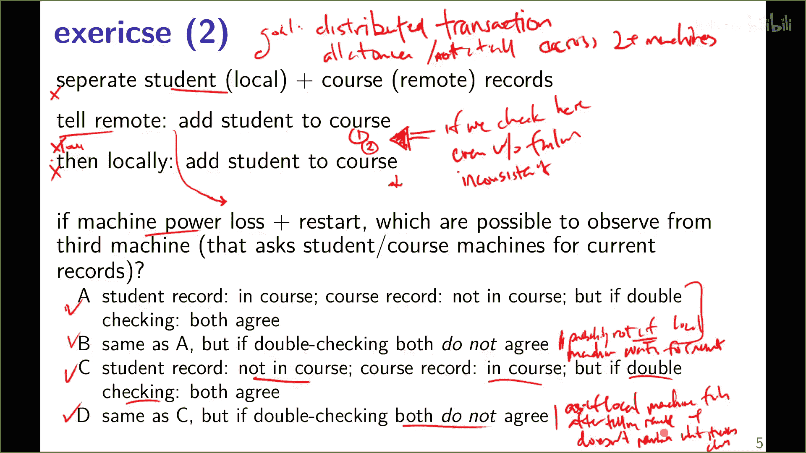
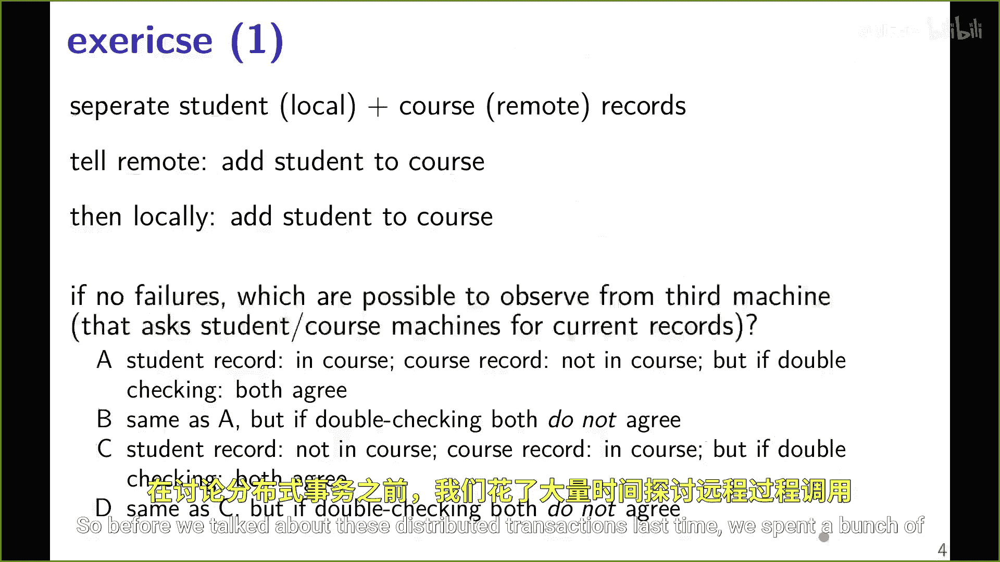
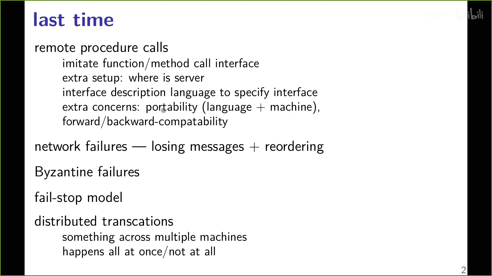

# 弗吉尼亚大学【中英⚡操作系统｜CS4414 2020 Operating System】 p24 P24 Distributed Systems 3： Failure -BV1mjePzoESb_p24-

Okay。Good afternoon。 So last time。When we were finishing up。

 we were talking about this idea of distributed transactions。

And where we'd have something split across multiple machines for some reason。

 and we'd do some change or an operation all at once or not at all。

 same kind of idea we had when we were talking about redo logging and file systems。

We're going to somehow make this operation happen。你好。On both machines， on neither。

 we didn't want inconsistent results of having part of the operation our partner up。And。On。

We learned that sort of the naive solution for this maybe doesn't work so we have this idea of an example situation where we have student and course records on different machines and the student records have a list of what courses the student then the course records plus what students are in that course and if we wanted to add a student to a course without inconsistency sort of our naive may might be so run some code where the student records are short。

 tell the course machine to add the student then add the student and if we do this。

 even without failures， we actually have this issue that there's no。If we check here。

Even without failures。Now， we could find out that， you know。

 we have inconsistent answers about is the student in the course depending on whether I looks checking the student or the course records。

Now， things get worse for the sort of naive scheme here。When we think about failures。

So I'd like you to think about， okay， so this is what we're doing。Yeah， what is。You。

 goinging to be possible if we have failures。 And let's assume this fail stop。

 Let's assume that machines aren't going to like write the wrong value to the course records。

 They're going to like lose power， restart。And you know， what sort of things are possible。

 and we're not going to have sort of a precise answer for this because。

It might depend on some of the details about how does this tell remote operation work？

Give you little time。To think about that。What inconsistencies could we observe？Give another。

15 seconds or so。Okay， so we have。A lot less consensus here than in the morning or earlier afternoon。

So let me go through these order。So first of all， I mentioned this inconsistency here that if we check right after we've told the remote remote machine to add the student。

 assuming they've done so。And before the local machine does， that will get an inconsistent answer。

But of course， that sort of gets resolved right afterwards。

And that would be a case where we check the student， the local machine。

 it's not in the course and is in the course later if we check。

 and when we have a failure that's still possible because maybe the failure occurs here or here on the remote machine。

Or even on the local machine。 And it isn't relevant to this sort of this this operation。

So this is still possible。Now。One subtle thing here is that if we're double checking。

 I didn't actually guarantee that we double check like maybe we check once here and we check again before the local operation happens。

So， you know， it could not agree for that reason if we double check。

But we could have an actual permanent difference。 Let's say the local machine fails here。

 assuming we don't remember。Yao。Now， if local machine。Fails。After telling remote。

And doesn't remember what it was doing。Then that could happen indefinitely。

 even if we triple you why or how much we check like。

 we'll be in a left and in a completely inconsistent state。

So then we have a question about the other way around。 and I think that is possible， too。

 depending on what the details of this。Teling remote operation R。 So， you know， so this。This is。

 you know， probably not。Yeah。😊，The local machine。Waits for the remote to say it's okay。

But we didn't say that we're doing that。 We just said we told the remote。Cat。Please do this。

 And if that's all we're doing， if we aren't checking whether it actually does it， then well。

 maybe it doesn't。 maybe this message got lost。Here that to the remote machine or maybe the remote machine did the operation in its memory。

 but didn't write it to persistent storage， so it forgot about it when it lost power and restarted。

And by saying order logic， we could have it if we're just telling it。And then doing it locally。

 if we don't wait for the machine to do it， we could have things going the other way around where we tell the machine。

 and yeah， it does it， but it does it like sometime later。

Because the message took a while to get to it， remember were talking about messages being delayed。

So I think all of these are possible with this sort of naive scheme， depending on the details。

And we're going to try to think of a way of avoiding these problems and we've kind of seen some hints of things we're going do。

 we want to like verify what the machines do thing or actually do things when we tell them to do them and we want to have you know machines remember what they were doing when they crash。

Which we haven't sort of made provisions for yet。So that's going to be our main topic for today。😡。

But first before I get to that， I'm going to like do a little review of other things we covered last time。

 but before I do that questions on sort of this scenario。

Okay， so before we talk it out。

These distributed transactions last time。 we spent a bunch of time talking about remote procedure calls。

 And this was an arguably more useful。Or at least alternate way of providing an interface to access a remote machine。

 And this would look like a normal function call。 but not quite。

 we had some things which were different。 So one thing which we kind of could definitely couldn't avoid was we need to specify where the server is。

And then we had some extra concerns that like are strictly necessary。

 but we probably wanted to deal with。 So one was that we needed to make sure we were。You know。

 dealing with things like pointers and our arguments。

 So we needed more information than you'd provide， say， in a library's header file。

 we also often wanted portability between different programming languages and machines。

And to have a very concrete answer about what happens if I update the server where to which I'm sending the procedure calls。

😡，And don't update the client or vice versa， we want to talk about compatibility。

For all these reasons。We ended up with this interface description language。

