# 弗吉尼亚大学【中英⚡操作系统｜CS4414 2020 Operating System】 p25 P25 Distributed Systesm 4： NFS ⧸ Access Control 1 -BV1mjePzoESb_p25-

Good afternoon。So last time we talked about two phase commit。

 the idea with two phase commit was that this was a way in which we could provide distributed transactions。

 namely we'd have multiple machines across which some operation needed to be split。

And we'd have them perform the operation altogether。

 and we make sure we've had consensus on what was going to happen and that it happened。

 either happened or did'， not something in between。

And our key idea is that before we did the operation。

 the worker and the coordinator everyone involved would agree that yes， we're doing this。

And there'd be no take backs， and we need' enforce that by requiring the machines to have some sort of vging where even if they had a failure。

That decision would be recorded in their log so they wouldn't go back from it。Now。

 because we required everyone to do the thing together。

 two this commit had what I call blocking on failure。

 meaning that if things failed in the wrong time， we'd have to wait to figure out what happened。

 we couldn't just make progress without everyone else。😡。

W makes sense because our kind of assumption was that each worker machine was kind of critical to the operation。

We also mentioned briefly， but didn't go into the details on how you implement the idea that we can take this idea of voting on whether we agree to do the operation。

But not require everyone to be involved and have some sort of majority be required。

 And this doesn't work in our two face commit scenario where everyone's kind of integral to the transaction we want to do。

 But if everyone had duplicates the data， we could have a system that keeps working when we have enough machines working。

 and this is something that's。Commonly used in practice。

 we're not going to go through the details this semester。

 know the trickiest thing that we didn't mention is like what do we do when the equivalent of the coordinator stops working？

啊。That's what we discussed last time and for the rest of the day I intend to go over one last distributed systems talk to talk about network file systems and then talk a bit about security。

But before I move on， any questions about things we covered last time？

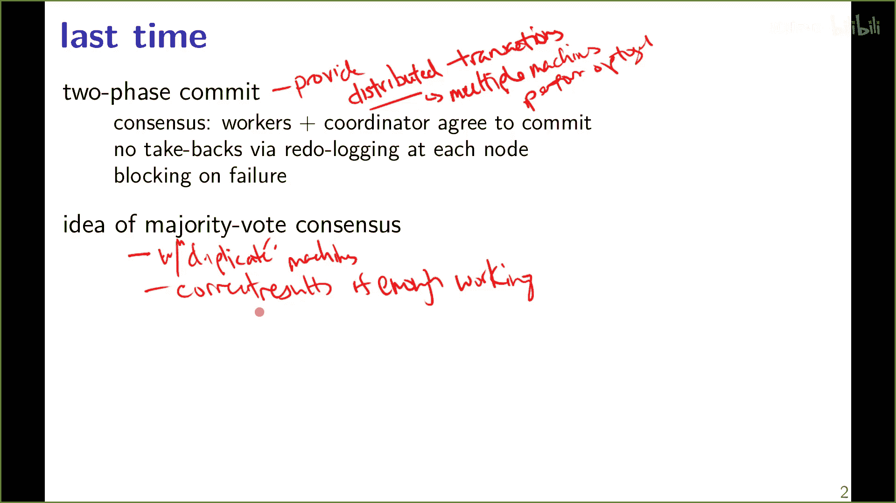

Okay， so logistics note last week's post quiz is due Thursday， so Thursday， this is Thursday。12。

 15 PMm before the first lecture time。And two phase is due next Monday as per announcement you got for both of these in email。

2， that。 So our new topic， I mentioned network file systems。

 So what I mean what is a network file system。 So one example is that。

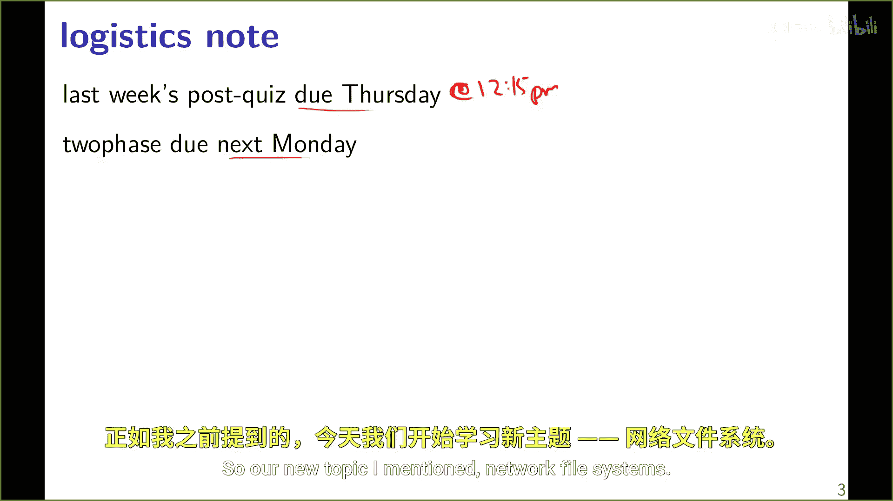

The department has a bunch of machines and when they're working， you can SSH into them。

 and there's actually like more than one machine backing SSH or you know remote desktop that the department offers。

 But on all of them you have the same files。 how does that work Well。

 the multiple machines youSH into are each talking to a。Network file server。As a client。

 and that's where your files are actually stored。And this is where the actual file system is。

 and we're going to talk today about how we design this communication protocol。

And we're going to start by thinking about sort of a sample idea for doing this， which is based on。

RPC， so we're going to think about doing this with remote procedure calls and。

AndYou know that when to think about， well， what， what procedure calls do we make to actually access files normally。

 And if you think about those， those are our system calls。

 Our system calls like our function calls when we use them from C programs and。

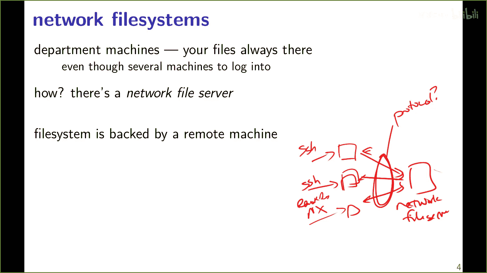

We could just take those and turn them into。Remote procedure calls。

So we could just say when you call open， well， rather than just processing that in a local kernel。

 since the files on another machine will just send that over with the remote procedure call to another machine。

 we'll just convert our system calls into remote procedure calls。

And this seems like a reasonable sort of idea， but we're going to see that it has some problems where we're going to want sort of a different design philosophy。

And。This problem， we'm going to start coming up with， well。

 what does it require the server to do and our second issue。

 which is we going to be actually more pressing is what do we want to do in the case of failures？

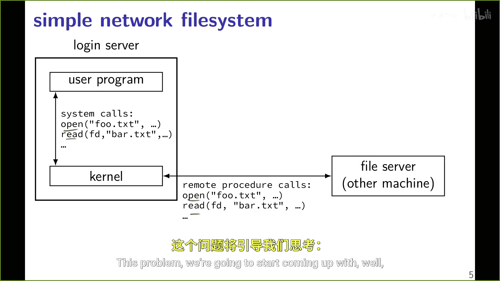

So for what does it require the server to do， well， we need to store stuff on the server。

 So what are we storing on the server well。

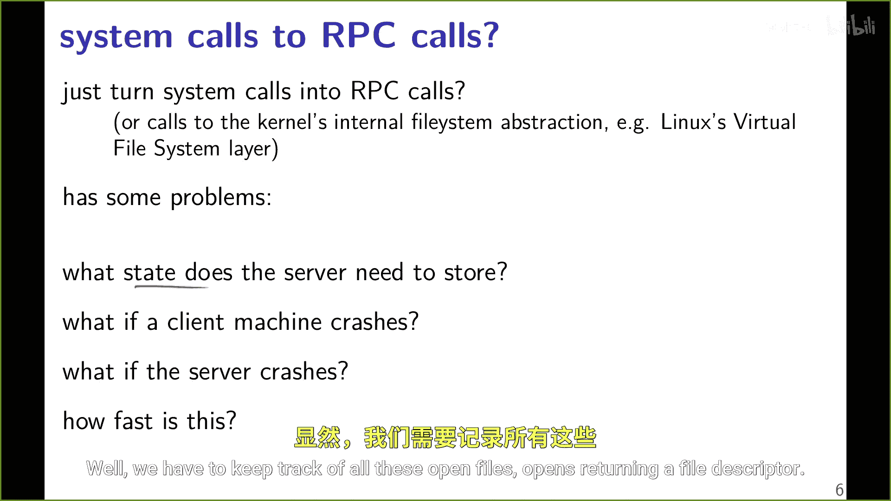

We have to keep track of all these open files， opens returning a file descriptor。

 we have to correlate those two things together， so we need to remember for each client process。

 so each process on a client machine， you know what file it has opened for each file descriptor and information about that。

 like offset and file， you know read， write。

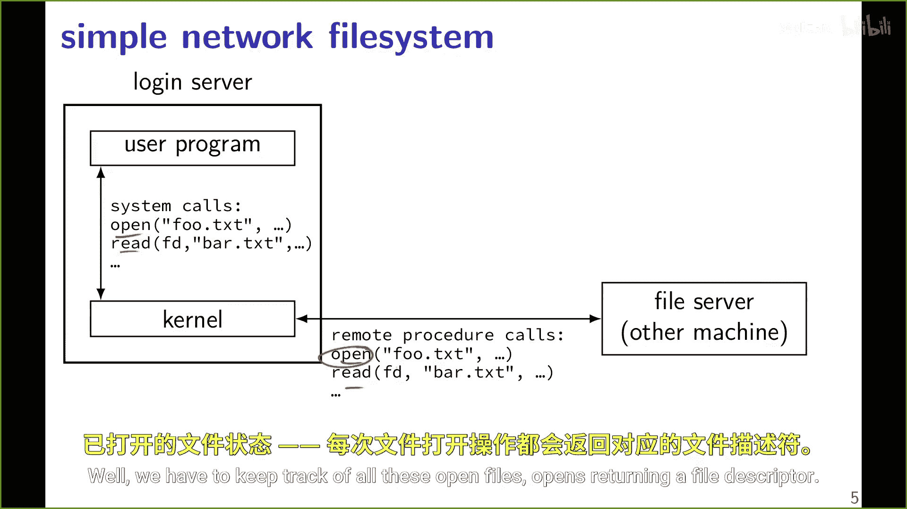

And so everything， know。What we stored locally。Locally。In the PCV。Bs list of files， open files。

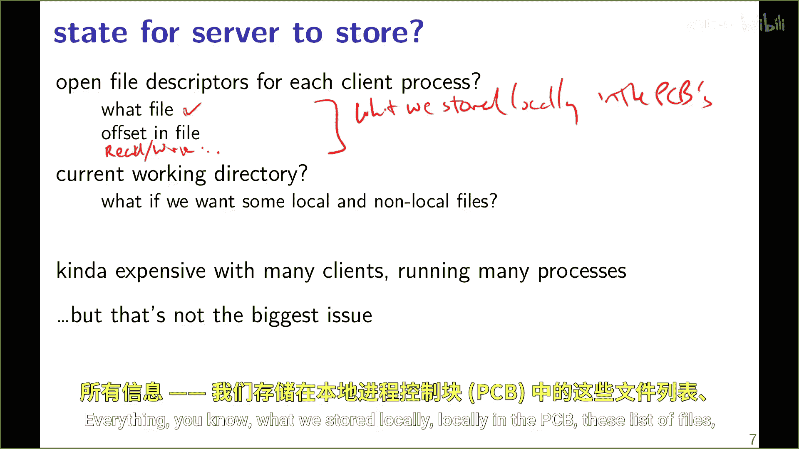

That all needs to be stored on the server。

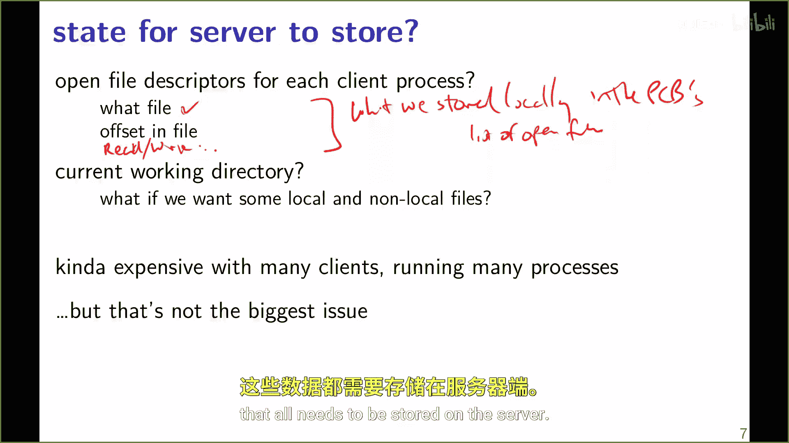

There's also something about the current working directory that's something we need to know to ensure for it' open and we when we think about this。

 this has a bit of a problem， namely that。We think about screwing these。

 we have a problem where we have this this mix of local and non local files。Typically。

 so on if you SSH into Port， like your home directory， so you comp ID D。

 this is on the network file server。Versus。Say slash1 will be local and it makes sense to have s temp be local because that's going to be a lot faster。

And commonly， we'll have this mix of local and non local files。😡。

So this is kind of one reason why we're not going to do everything on the server and for example。

 the current working directory know that doesn't make sense to store on the server for that reason because we want you know when it's when we're in/ temp。

 we want that to be kind of so we want some indirect here。But it seems like this。 Well。

 this is a bunch of stuff the store， but maybe it's not so bad。 Now， this is isn't great。

 but it's manageable。 So let's say， let's say many clients， how many clients could we have。

 So let's say we have a company with hundreds of employees all with this setup。

 So let's say we have like 1000 employee laptop， employee desktops。

And let's say you just running 100。Mchine 100 processes。 and let's say each has 10 open files。

 so that would be， you know10。So that would be sorry， that would be 1 million。

Million open file descriptors。That's manageable。 It's not great looking up something in a table of a million things。

 not going to be the fastest operation， but it's probably， you know。

 pretty reasonable to do one one machine。 But this is isn't ideal， but our big。

Questions with this scheme are going to come from sort of going to come from how we deal with failures。

 Like if we only have to worry about storing this information， you know。

 that's not going to be so bad。 We're going to have to do some special stuff to manage what about local files。

 but。You know， we could imagine having something that's based on this idea of let's just use open Read。

Wite， that's what we send over to the network。

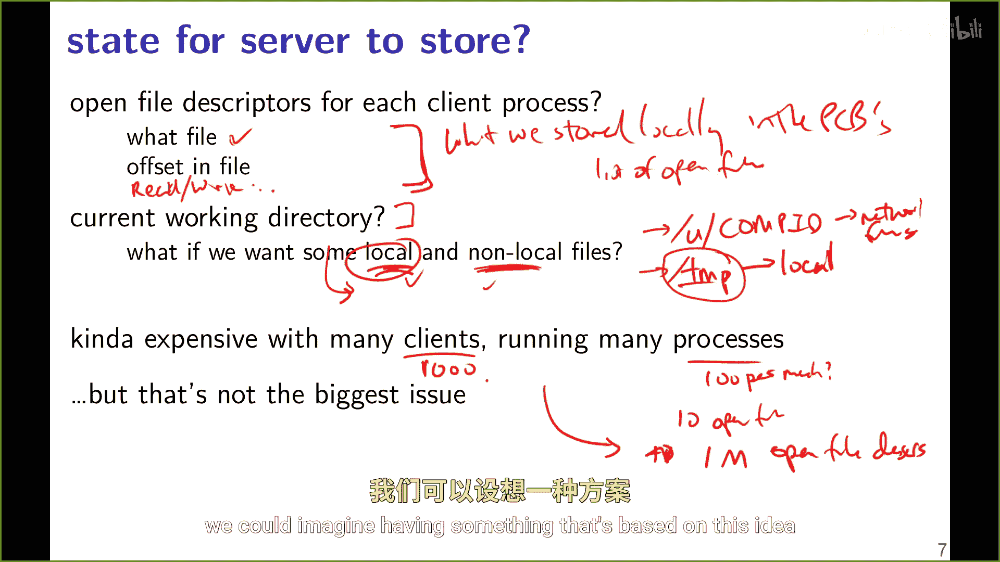

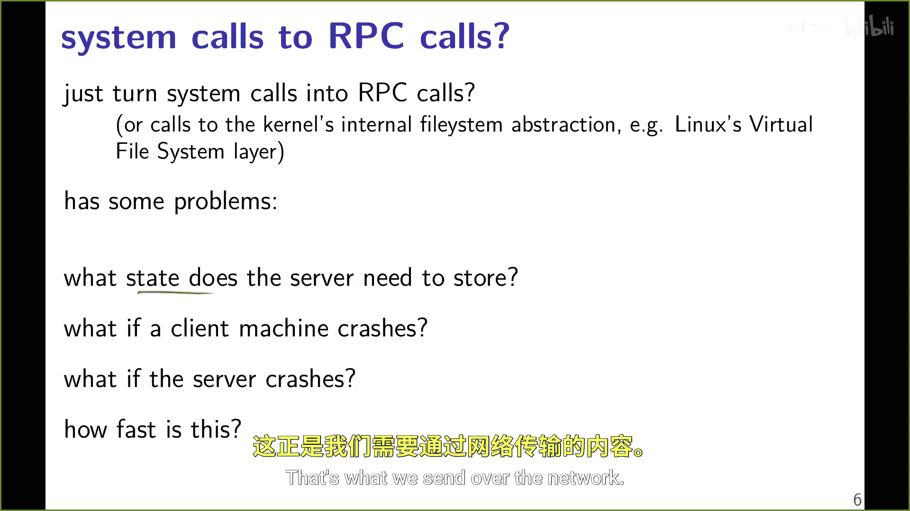

Where this gets tricky is when we think about failures。

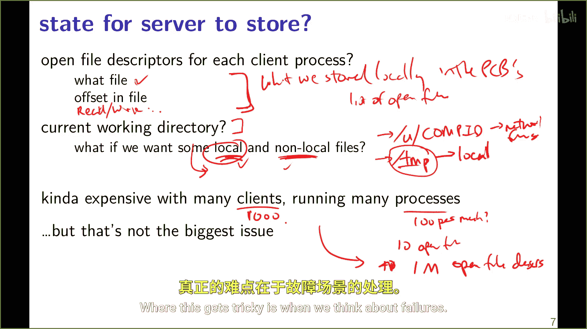

So let's have this example here， so let's say I have a client that hasn't sent anything to the file server in an hour。

😡，And our question is， well， can the server delete its open file information yet？😡，So the answer。

 as you can guess by me asking the question is maybe not。

So can someone give me their most plausible reason why the server wouldn't be able to do this？

And there's a hint。Think about what if the clients own a laptop？He volunteers。Client is offline。

 yeah so。Client temporarily offline。 So why would the client offline？But has file open them。

So one example would be you know， walked out of life range。

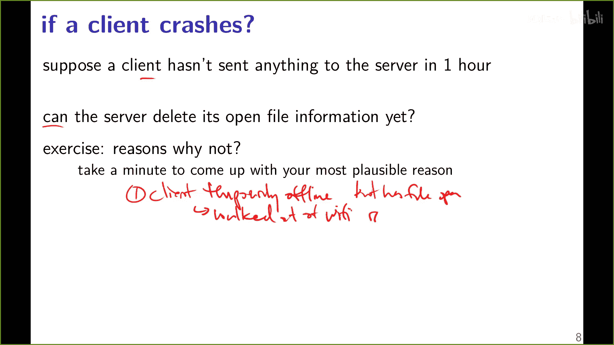