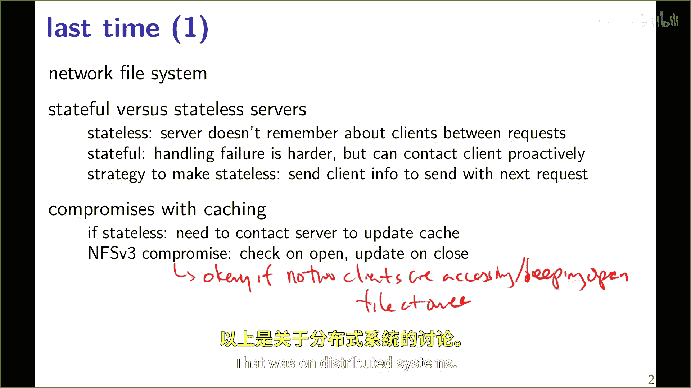
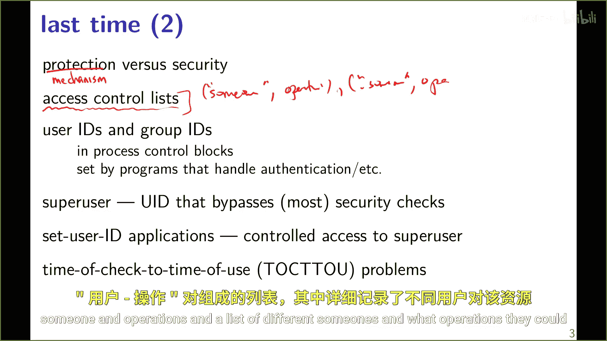
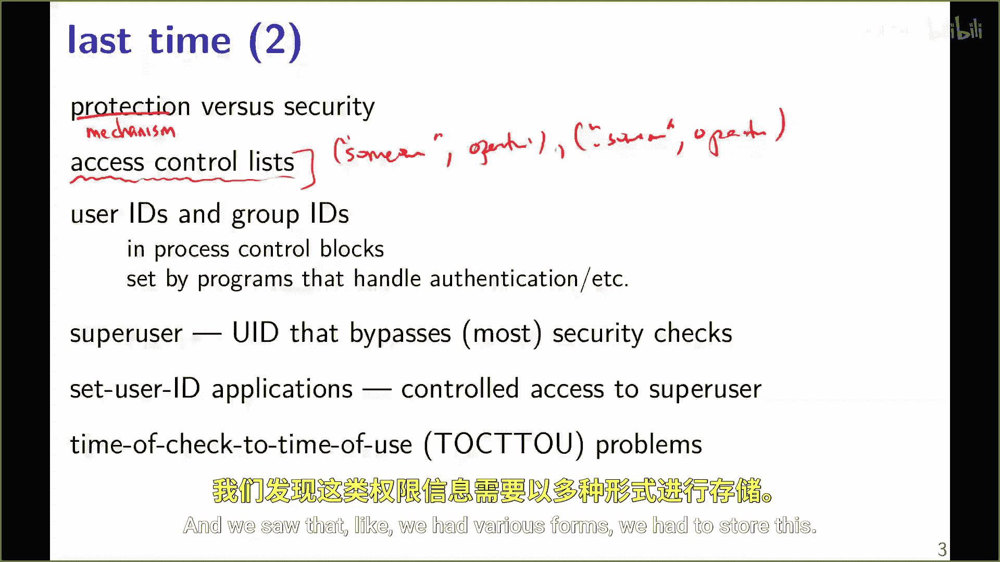
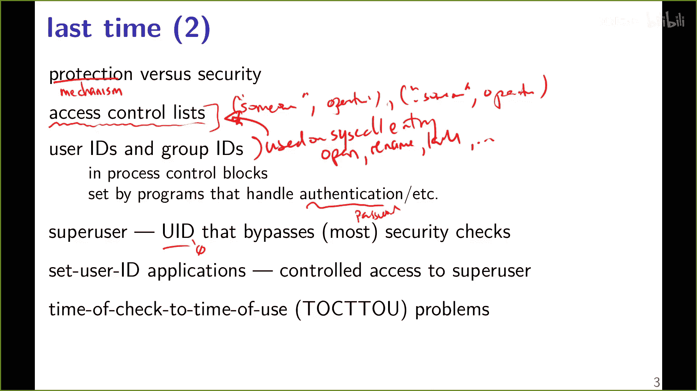

# 弗吉尼亚大学【中英⚡操作系统｜CS4414 2020 Operating System】 p26 P26 Virtual Machines -BV1mjePzoESb_p26-

Good afternoon。So last time we finished up talking about distributed systems by looking at this idea of a network file system that we wanted multiple machines。

To share the same files in a way we could achieve that using the client server model is by having a server for those files。

And rather than accessing a local file system， we'd access a remote file system。

And we kind of built that using remote procedure calls。

 but we saw that we had some choices in designing the protocol for that where。

We wanted to make considerations about。Having an interface that makes it more convenient for the servers and our clients。

And a key choice we had there was whether the server would be stateless or stateful。

So when we say a server is stateless， meaning the server isn't remembering things about the clients between its requests。

 So， for example， we said in our stateless network file system protocol， we'd want to have。

The clients remember everything about file descriptors and what files applications have opened。

 so the servers wouldn't have remember that， and this made some things easier。Like。

 you know handling failure， like when a client went away。

 the server didn't need to actually track that sort of information， if the server crashed。

 we just care about the data in the file system， we didn't need to have some extra data that we needed to restore in order to make clients not all need to be rebooted。

We also solve this general pattern， which is useful in a lot of other problems。

For taking something that's stateful where we're having the server do a lot of work and it's kind of complicated and making it stateless。

 which is that we can send to the client the info to send with the next request。Yeah。

Rather than storing that on the server， that even though the client might not understand or care about specifically about what that information is for。

 we can still have the client do the job of storing it。

 And that's often much more convenient for implementing the server。

 especially if we want to handle failures， kind of elegantly。

We also saw that there were some trade offs and for the network file system。

 this really occurred with catchching that if we were stateless。

 if we aren't remembering anything about what the clients are doing in between their requests。

Then the clients can't usefully cache something and expect to know if the value they have cash is't got。

And one solution to this that is a real solution is that we can say， well。

 that's really not worth it and use a more stateful protocol some systems do that。

 if we want to keep things stateless， we have to make some sort of compromise because it's not going to be practical the cache if still have to check with the server every time it's mostly going to defeat the point of caching。

 yeah， we'll send that stuff over the network， but most of our cost of caching especially for small files。

 is that we have to talk to the server at all， not that we have to send and get back you know a couple bytes from the server saying nothing's changed versus the whole kilobyte file。

And in NFS version  three， they have this compromise where they check。The cash。

Is valid of open and update the server on close and the idea here is this is okay。If。

No two clients open are。Accessing the file。Accessing， you know。

 keeping open the file at the same time。Once， even though this gets rid of the sort of an notion of transparency that if in cases where two F clients have the file open at the same time。

 they're really going to notice that this is not like a local file system。

That was on creative systems。 And our topic after that was a bit about security。

 And to introduced that， I introduced this idea of。

Protection， our main thing we're concerned about， which is mechanisms for controlling access to resources generally。

And mentioned that we're going to achieve security sort of that we have some goals about what things can happen。

 that we're going to hopefully achieve with these protection mechanisms。 And in this class。

 we're primarily concerned with what mechanisms can we provide and。

hope the goal is that system administrators and standard programs can configure these mechanisms to achieve actual security goals。

And nurse。Sort of general idea for controlling access to resources is that we need to specify what things can access the resource。

And our key way of doing this was an access controlist。

 where there the idea is we have a resource or a file or a process， and alongside it。

 wed store what things are allowed to access it。And our typical notion is that for a file。

 like these things。Which would actually be processes trying to access the file。

 would have some correlation to like people。😡，And we need some way of representing that and concretely representing these lists of who can do what with each resource。

😡，So， you know， these lists were basically， you know， someone。And operations。

And a list of different some ones and what operations they could perform in that resource。

And we saw that like we had various forms we already store this。

But that was the key idea and what were these some ones？And。In the sort of Pos model。

 we had two ways of representing that， we'd have these user ID and these group IDs and conceptually these could correspond to users and groups of people。

 though that's not required。And these ideas would just be numbers。 So from the kernel's perspective。

 it doesn't actually care if the user I or the group I is a person or a group of people。

 It just stores a number in the process control block and。These are used。On。This is call entry。

 so like when we do an open or a rename or kill or so on。

Versus the to check the access controller list。 So these were how we would identify things in the access control list。

And we store these in the process control block to know what the current process is allowed to do with each resource。

So these would just be IDs， and they'd be set by some other programs that would handle things like authentication。

 namely like passwords and so on with set these for the kernel。

Now we couldn't just allow any program to set these user IDs and we needed some way of setting up that sort of those sort of initial states when I log into the system。

 how do the user IDs of my programs get set？And to help support this。

 we have this idea of a super user that there be a special user ID that bypasses most security checks in Possics。

 this is Uid 0， just arbitrary choice。And we run the initial program with that user ID。

 it would figure out things like what password and user ID I entered in and then set a different user ID。

 and because of this， we don't have to have every program be able to su any user ID。

 we didn't have to have the kernel need to worry about how do I verify a password。

 you know that would all be handled by this initial program that ran with these extra privileges。😡。

Now， we saw that we had cases where。We still wanted me to be logged in as you know， my user I D。

 But I wanted to do operations that normally my user I couldn't do。 So one example we saw was Suu。

 we had other examples like， I want to mount。USB sticks， and often we don't code into the kernel。

 you know， really good rules about what's the difference between mounting the USB stick and mounting。

 you， say， the disk in a way which lets me damage its files。

So we had this idea where we could provide controlled access to super user functionality so we could implement programs like SuUU or that mount USB stick program。

 where the system administrator would set up some application that did something that required extra privileges。

Like change to a different user， reboot the system， mount that USB stick。And。

They'd write this program that would do that。 They'd set this special bit in the file system to say this program is special and should run with extra privileges。

 And because they controlled what that program could do， this wouldn't let me do anything I wanted。

 It would just let me do what that program Let me do。

And this would be a way of adding sort of functionality。😡。

You know that I could do in spite of my user ID being set quote unquote。

 wrongron without modifying the kernel to add all these cases。😡。

Now we saw that those say user ID programs were a very flexible mechanism。

