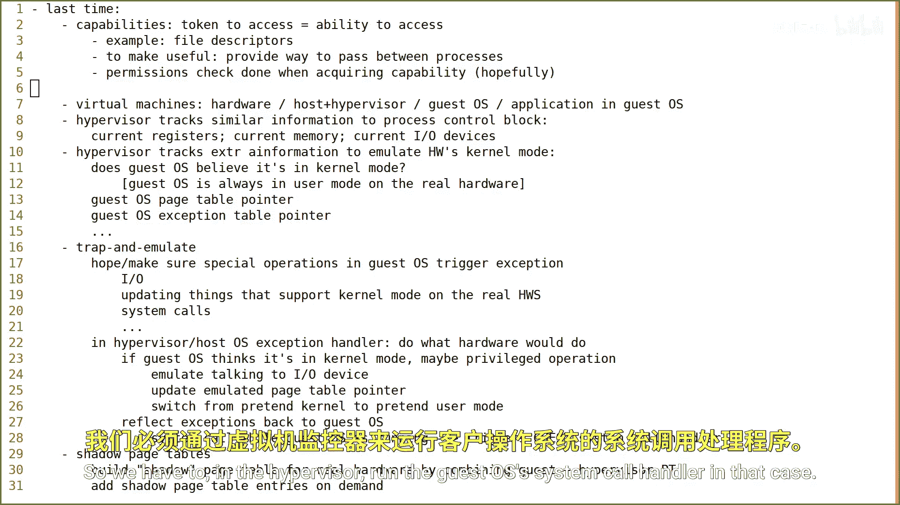
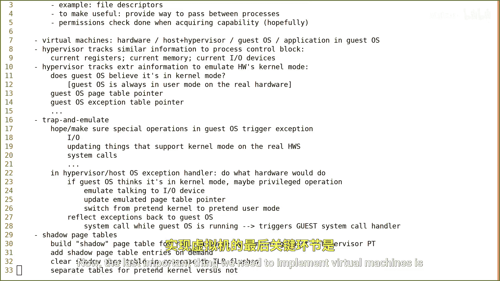
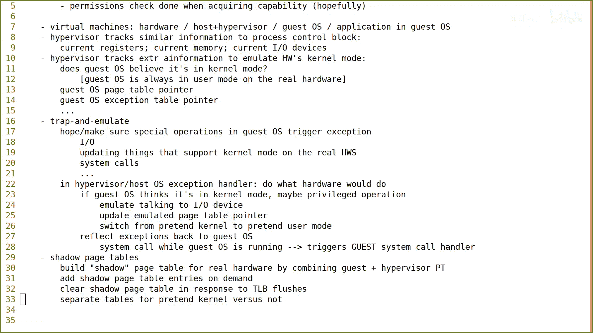
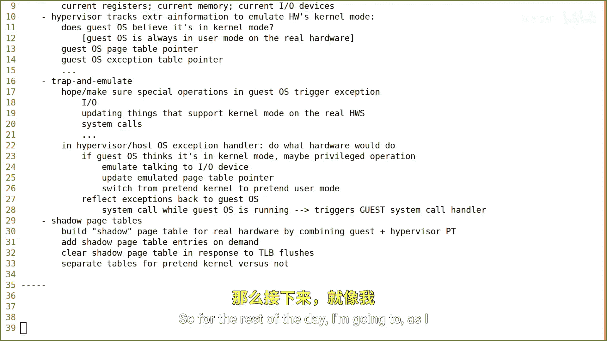
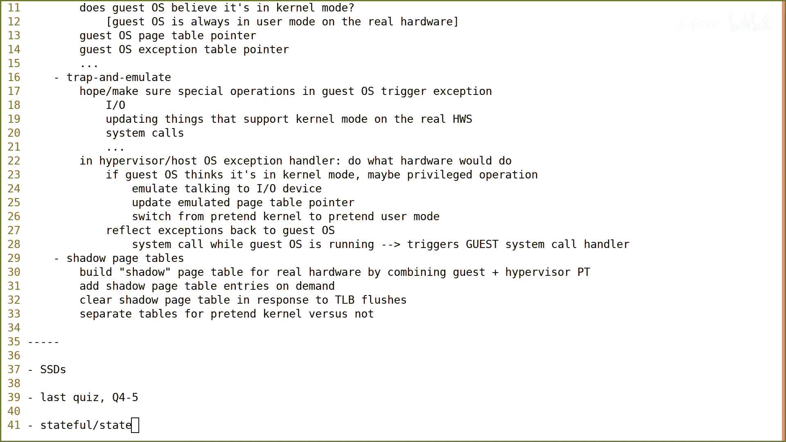
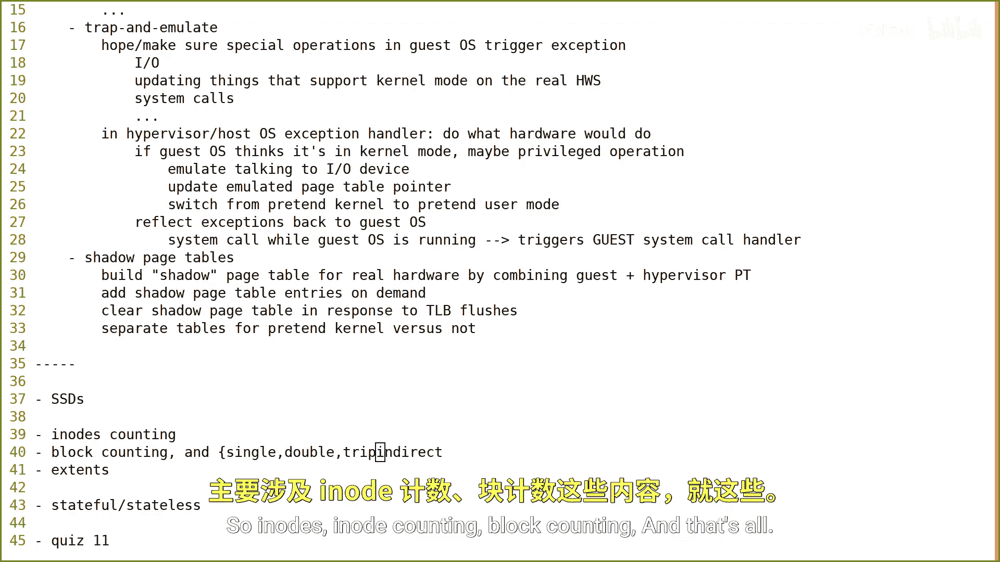
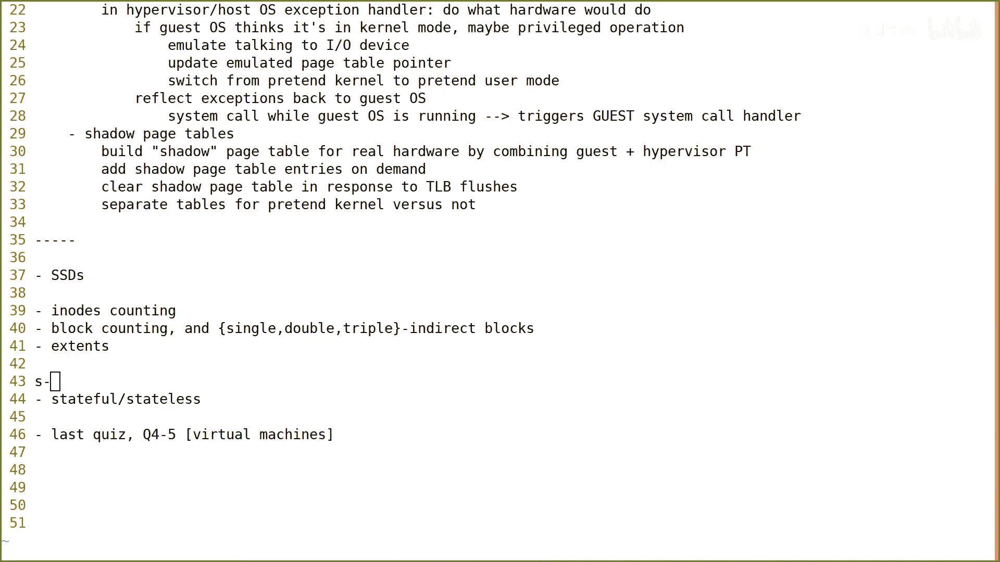

# 弗吉尼亚大学【中英⚡操作系统｜CS4414 2020 Operating System】 p27 P27 Final Exam Review screencapture -BV1mjePzoESb_p27-

Good afternoon。So last time we finished up talking about security by talking about approach that's kind of an alternative to access control。

This is we call capabilities。 And this is the idea that， rather than。

Accessing something via some global name and then having to check some information in the side about whether we were allowed to access it work。

reably the kernel or something else would do that checking。

That the way we tell the kernel or something else what we want to access would be some sort of token。

 And us having that token would let the kernel know that， yes， we were allowed to access this。

 And an example of this。Mechanism you can see with file descriptors。

 when you create a file descriptor by opening a file， at that point the check is done。

 can you access it？And when you actually read or write or do other operations on the file descriptor。

 there's no reason to do any more checking against access control list。

 it's stored with that file descriptor that yes， you could access the file。

So then we moved on to our bigger topic last time， which was virtual machines。

 We had this layering where we had some real hardware。 We had a hypervisor and a host Os。

 which were running a guest Os， which ran applications as usual。

And a lot of how the hypervisor around the gastos kind of looked like a normal O running an application that it would track in a。

Some equivalent to a process control block， things like the current registers。

 the current layout of memory for the guest to us， the current Io devices the guestto us has access to。

It would also need to track some extra information because it was going to provide the guestto us some services that。

Eulated kernel mode for the Gu to us。 The guess to us at some points is going to think it's in kernel mode。

 but it's not actually going to be。 And to make all that work。

 we need to track the sort of things that a processor would track for kernel mode。

 So we need to track whether the guest to us thinks it's in kernel mode or not。

 We need to track things like the page table pointer and the exception table pointer。

 things that are set in on real hardware in the hardware for the kernel since we're emulating that hardware。

 we need to track that for the guest to us。And the big strategy that we mentioned for implementing virtual machines。

😡，Was based on this trap and emulate approach that we'd either hope or make sure that special operations were by special。

 I mean， things that we want to not do the thing they would normally do when we were writing code in user mode。

In our hypervisor， think you wanted to do something else。 We'd hope they trigger an exception。

 This should include things like Io， updating the things that support kernel mode。

 like the page table pointer。System calls and so on。

 any sort of operation which is going to need not behave in quite the same way。

In our virtual machine， we hope triggers an exception。

 and the exception handler can do what the hardware would have done if the guesttos were running directly on it。

So for example， if the S2 us thinks it's in kernel mode。

 we want to do what would have happened if the guest2OS really was in kernel mode on real hardware。

 So if it thinks it's in kernel mode talking to an IO device。

 we want to emulate talking to an IO device， maybe we won't talk to quite the same kind of I device。

 like maybe we'll read from the network instead of a keyboard。

 but we're going emulate that operation from the real hardware。

 if it's setting a page table point or we want to update our。😡。

Our notion of what its page table pointer is， if it's switching from kernel to user mode。

 we'll update our information about what mode it's in and so。Another case where。

We have a disagreement between what's going to happen on the real hardware and what the guest to us would expect if we're running directly。

 not in a virtual machine， is that when something happens in the guess to us that triggers would normally trigger an exception。

We want to still trigger an exception in the Gutos， not in the hosts is going to happen。

 So we need to， well， I'll say， reflect the exception back to the guesttos。 For example。

 if there's a system call that occurs while the guesttos is running， well， on real hardware。

 that would run the guestto us， a system call handler。

 So we have to in the hypervisor run the Gustos， a system call handler in that case。

Now the last important thing we needed to implement virtual machines is we need to handle memory and we have this difficulty that the page table the GusOSOS set is not what the hardware expects。

 the hardware expected the mapping from the ad virtual addresses the gueststoOS is using to the addresses after we did the guestsOSss page table translation and whatever the hypervisors page table for the guestSOSOS was。

So a solution to that is to provide the real hardware with a page table that does that whole translation by building what we call a shadow page table。

 the name shadow is because we kind of get it by projecting the guest to us's page table through the hypervisors mapping。

😡，And that's what we provide to the hardware。 And we mentioned that we could update this on demand that we could just fill it in as the guesttoOS accesses things and we could clear out parts of it in response to TLB flashes。

 and that's how we could deal with what happens when the guesttoOS changes its page table Well。

 because the guesttoOS has to deal with fleshing the TLB。

 it's going to have a way to inform the hypervisor。

When it's trying to inform the real hardware to clear the TLB。

A little detail that we had with this scheme was that the page tables don't support all natively support all the features we kind of want。

 like we wanted it to have different pages accessible when it gets to us think it's in kernel mode versus when it。

Thinks it's in user mode。But all the controls we have on the real hardware page tables only control what can be accessed or not。

😡，We can't use the kernel Mobo in the real hardware because the guest to us never runs in kernelel mode。

 so to emulate that， we needed to do this thing where we had two copies of the page tables or something like that。

Okay。So。For the rest of the day， I'm going to， as I mentioned last time。

 take your questions on things you want me to review。

 They can be about things we covered last time or other topics from earlier in the semester。

 and I'll just take questions ideally in text chat because I think it would be too awkward to try to do it via voice。

And we'll put them in some order and go through them。For the rest of the lecture guide。

And if you don't have any questions， this will be very quick。Okay， SSD。Any other topics？Okay。

I。か便。But was is 11 on。说话呗。Nam。Quiz 11 was on， okay， right， calculating。

Number of blocks and things light。Mostly。Okay。window。So I know。I not count it。

Okay， and that's all， hopefully that's the part of quiz 11 you care about because there's also question five。

And block groups， if you care about those topics， should you should ask for them separately if it's not in。

第意思。And sockets。

