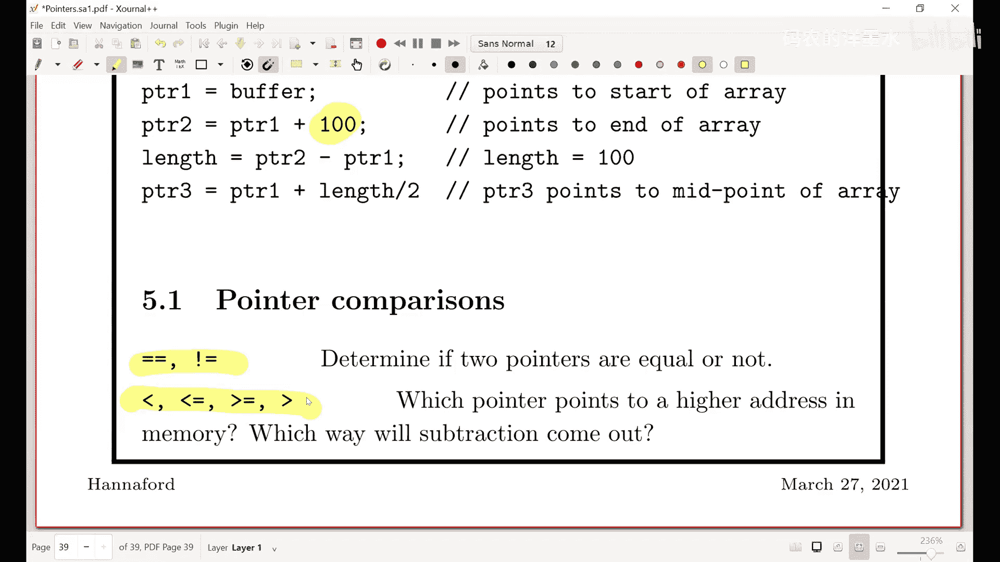
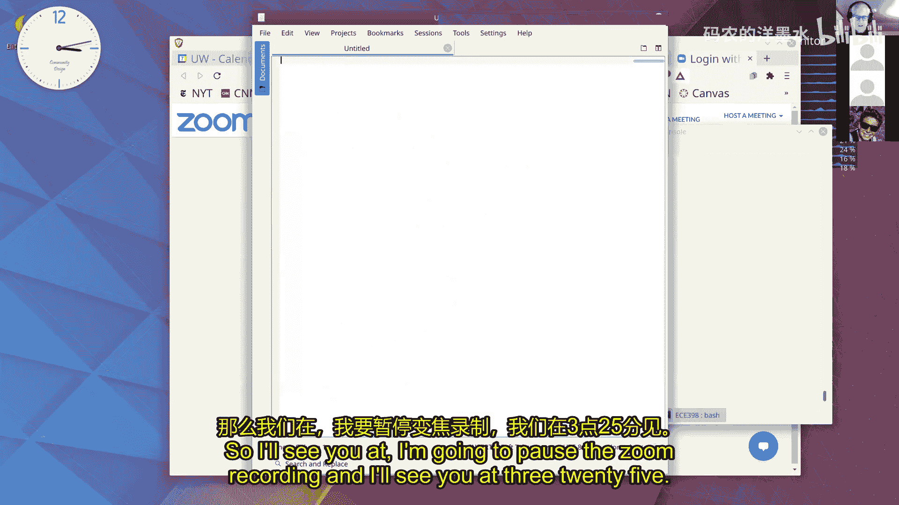
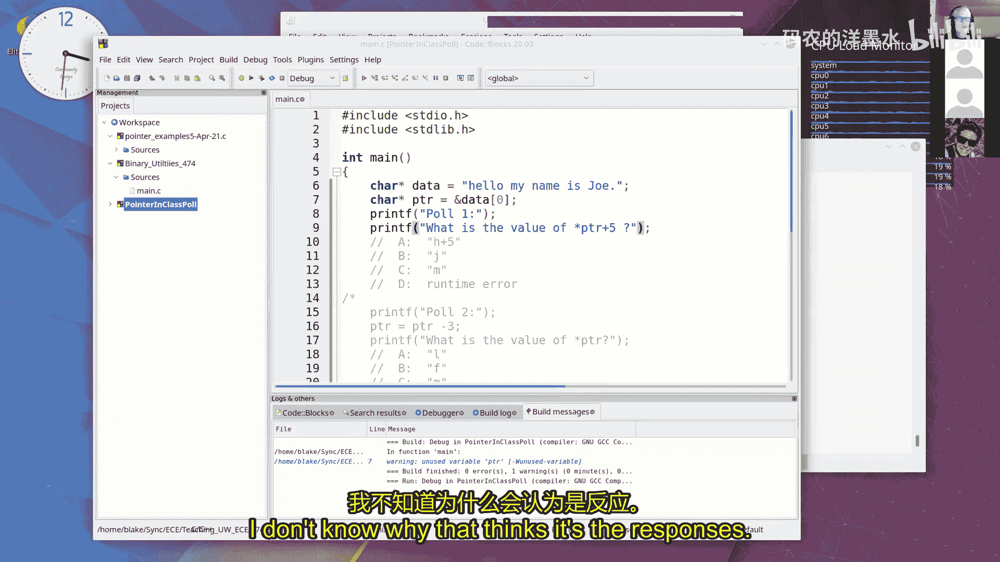
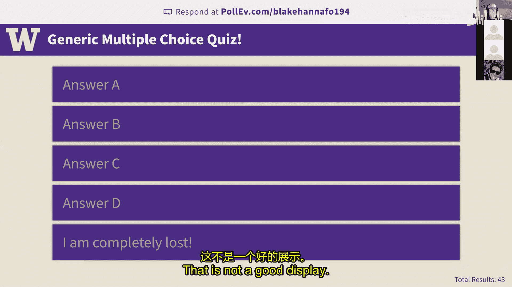
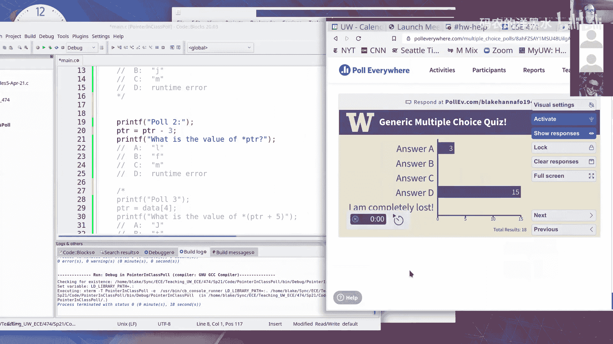
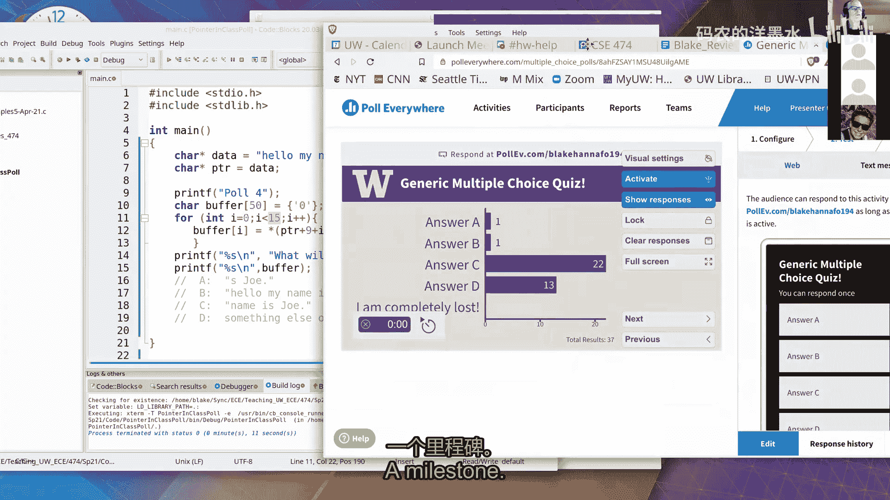
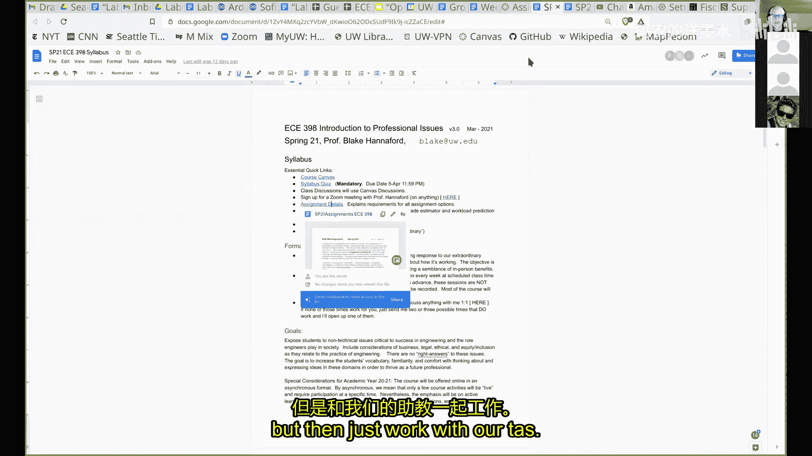
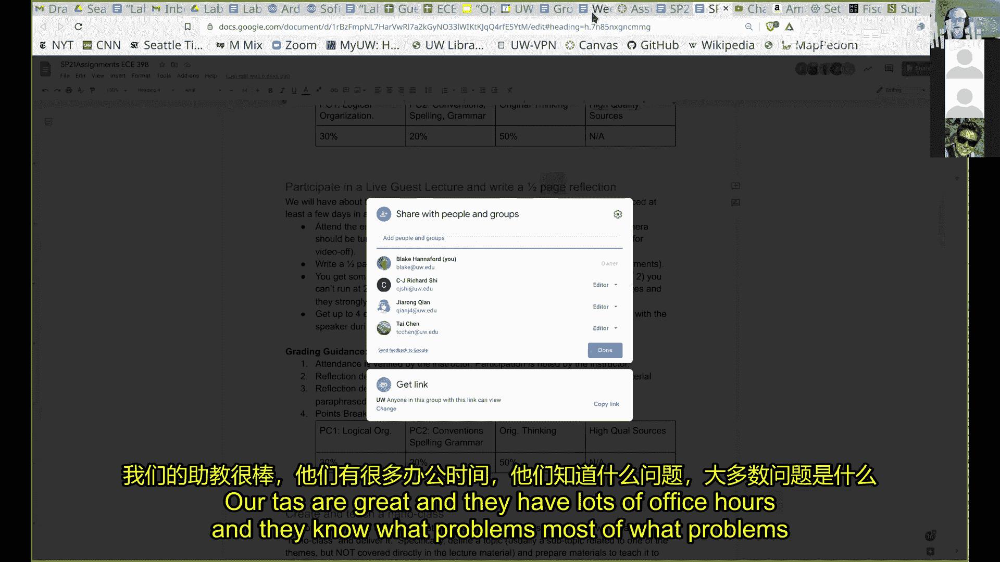
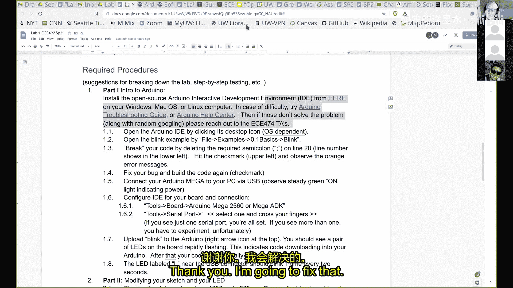
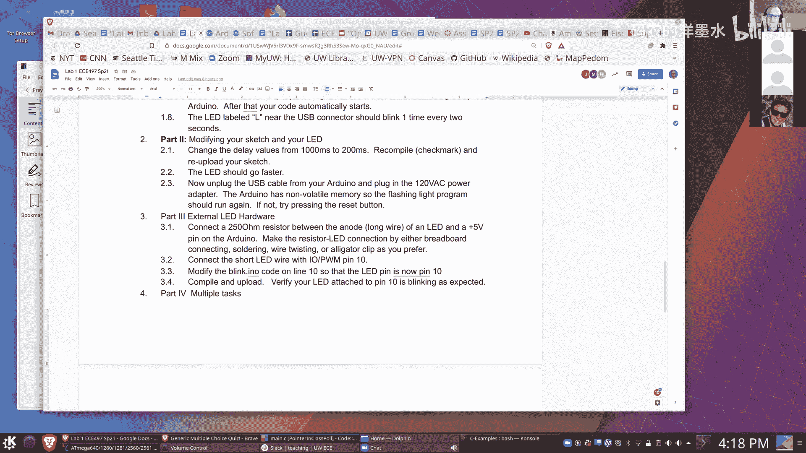

# 003：C语言中的指针


在本节课中，我们将深入学习C语言中一个核心且强大的概念：指针。我们将探讨指针的声明、赋值、算术运算，并通过代码示例来巩固理解。

## 概述

指针是C语言中用于存储内存地址的变量。理解指针对于高效地进行内存操作、数组处理和函数调用至关重要。本节我们将从基础概念开始，逐步深入到指针算术和函数指针等高级主题。



## 指针声明与赋值


指针的声明需要指定它所指向的数据类型。例如，`int *ptr;` 声明了一个指向整数的指针。指针的赋值则是将一个内存地址赋给它。

以下是声明和赋值指针的示例：
```c
int *intPtr = NULL; // 声明一个整数指针并初始化为NULL
int value = 10;
intPtr = &value; // 将value的地址赋给intPtr
```

## 函数指针

上一节我们介绍了普通指针，本节中我们来看看一种特殊的指针：函数指针。函数指针指向一个函数，其声明包含了函数的返回类型和参数列表。

声明一个函数指针的语法如下：
```c
int (*funcPtr)(); // 指向返回int且无参数的函数的指针
double (*anotherPtr)(int, char); // 指向返回double，参数为(int, char)的函数的指针
```

以下是函数指针的赋值和调用示例：
```c
int realFunction() {
    return 42;
}
int (*funcPtr)() = NULL; // 初始化为NULL
funcPtr = &realFunction; // 赋值
int result = (*funcPtr)(); // 调用函数，等价于 result = funcPtr();
```

## 指针算术




指针算术允许我们对指针地址进行加减运算，这在遍历数组时非常有用。允许的操作包括：
*   给指针加/减一个整数。
*   两个指针相减（得到它们之间的元素距离）。





不允许的操作包括：
*   两个指针相加。
*   指针与指针相乘或相除。
*   指针与浮点数进行算术运算。

以下是一个使用指针算术寻找数组中点的例子：
```c
#define SIZE 100
int buffer[SIZE];
int *start = buffer; // 指向数组起始
int *end = buffer + SIZE; // 指向数组末尾（最后一个元素之后）
int length = end - start; // 数组长度（元素个数）
int *midpoint = start + (length / 2); // 指向数组中点
```




## 指针比较

我们可以使用比较运算符（如 `==`, `!=`, `<`, `>`）来比较两个指针。这通常用于判断两个指针是否指向同一内存位置，或者比较它们在内存中的相对位置（地址高低）。

## 代码实验与互动

为了加深理解，我们将通过一些实际的代码片段进行实验。以下是几个关键概念的演示：

### 字符数组与字符指针的等价性




在C语言中，字符数组和字符指针在初始化字符串时常常可以互换使用。
```c
char *name1 = "Blake Hanford";
char name2[] = "Blake Hanford";
// 上述两种方式在效果上通常是等价的
```

### 字符串复制与缓冲区操作





以下代码演示了如何手动将一个字符串复制到缓冲区，并强调了字符串以空字符`\0`结尾的重要性。
```c
char buffer[100] = {0}; // 初始化缓冲区为0
char *source = "Kamala H.";
int i;
for (i = 0; source[i] != '\0'; i++) {
    buffer[i] = source[i];
}
buffer[i] = '\0'; // 手动添加字符串终止符
printf("%s\n", buffer); // 正确打印 "Kamala H."
```




### 指针算术实践

通过以下互动问题，我们可以测试对指针算术的理解：
```c
char data[] = "hello, my name is Joe";
char *ptr = &data[0];
// 问题1: *(ptr + 5) 的值是什么？
// 答案：',' (因为从'h'开始，向后移动5个字符)
// 问题2: *(ptr + 6) 的值是什么？
// 答案：' ' (空格字符)
```

## 实验一介绍

在课程的后半部分，我们简要介绍了第一个实验（Lab 1）的目标。该实验要求你：
1.  安装并设置Arduino IDE开发环境。
2.  构建并运行一个基本的示例程序（如让板载LED闪烁的Blink程序）。
3.  修改该程序（例如改变LED闪烁的频率），并演示其功能。



实验的重点是熟悉嵌入式开发的基本流程和工具链。

## 总结


本节课我们一起深入学习了C语言中的指针。我们从指针的基本声明和赋值开始，探讨了函数指针的用法，并详细讲解了指针算术的规则与限制。通过实际的代码示例和互动练习，我们巩固了如何通过指针操作数组和字符串。理解这些概念是进行高效C语言编程和后续嵌入式系统开发的重要基础。