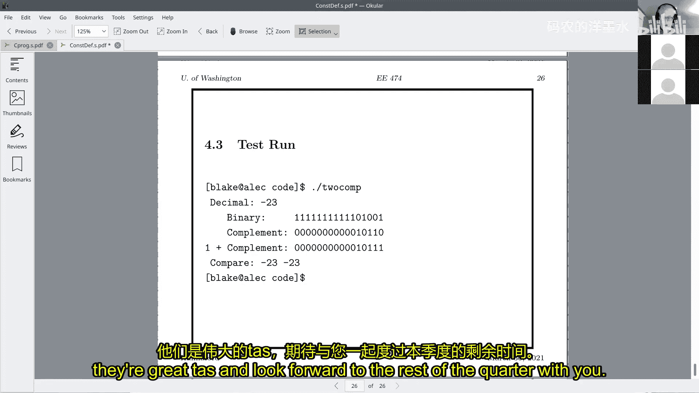

# 004：数字表示与位运算符


在本节课中，我们将学习C语言中数字的表示方法，以及如何使用位运算符直接操作数据的二进制位。这对于嵌入式系统编程至关重要，因为我们需要与硬件寄存器进行精确的交互。

## 概述：数字表示基础

上一节我们介绍了C语言的基本结构，本节中我们来看看计算机如何表示数字。计算机内部使用二进制（0和1）来存储和处理所有数据。为了便于人类阅读和编写，我们通常使用十六进制或八进制来表示这些二进制数。

*   **二进制**：基数为2，每位是0或1。例如，`1011`₂。
*   **十六进制**：基数为16，用数字0-9和字母A-F表示。在C语言中，以`0x`为前缀，例如 `0x2DA`。
*   **八进制**：基数为8，用数字0-7表示。在C语言中，以`0`为前缀，例如 `023`。

**转换示例**：`0x2F` 的十进制值为 `2 * 16 + 15 = 47`。

## 使用符号常量提高代码可读性

在代码中直接使用“魔数”（如 `0x2DA`）会降低可读性和可维护性。专业的做法是使用 `#define` 预处理器指令定义符号常量。

**代码示例**：
```c
#define CDROM_CONTROL_REG 0x2DA
#define CDROM_DOOR_OPEN 0x10
io_reg_set(CDROM_CONTROL_REG, CDROM_DOOR_OPEN);
```
这种方式使代码意图更清晰。如果硬件地址改变，只需修改 `#define` 一处即可。

## 位运算符

C语言提供了直接操作整数中各个二进制位的运算符，这对于控制硬件寄存器中的特定位非常有用。

以下是主要的位运算符：

*   **按位与 (`&`)**：两个操作数对应位都为1时，结果位才为1。常用于“掩码”操作，检查或清除特定位。
    *   **公式**：`result_bit = a_bit & b_bit`
*   **按位或 (`|`)**：两个操作数对应位有一个为1时，结果位就为1。常用于设置特定位。
    *   **公式**：`result_bit = a_bit | b_bit`
*   **按位取反 (`~`)**：将操作数的每一位取反（0变1，1变0）。
*   **按位异或 (`^`)**：两个操作数对应位不同时，结果位为1。
*   **左移 (`<<`)**：将操作数的所有位向左移动指定的位数，右侧空位补0。左移n位相当于乘以2ⁿ。
    *   **示例**：`x << 2` 将 `x` 的二进制位左移两位。
*   **右移 (`>>`)**：将操作数的所有位向右移动指定的位数。对于无符号数，左侧空位补0；对于有符号数，行为可能依赖于编译器（算术右移或逻辑右移）。右移n位通常相当于除以2ⁿ（向下取整）。

**代码示例**：
```c
unsigned int x = 0x0B; // 二进制 1011
unsigned int y = 011;  // 八进制，二进制 1001
unsigned int bit3 = 0x08; // 二进制 1000

unsigned int z = x << 2;   // z = 101100 (二进制)
unsigned int check_bit = y & bit3; // check_bit = 0 (检查y的bit3是否为1)
z = z | 0x10; // 设置z的bit4为1
```

**注意**：区分逻辑运算符（`&&`, `||`, `!`）和位运算符（`&`, `|`, `~`）。逻辑运算符用于布尔表达式，返回真（1）或假（0）；位运算符对整数的每一位进行运算，返回一个新的整数。

## 整数类型：有符号与无符号

在C语言中，整数类型的大小（位数）取决于编译目标平台。例如，在Arduino上，`int` 通常是16位，而在现代PC上是32位或64位。

*   **无符号整数 (`unsigned int`)**：所有位都用于表示数值大小。范围是 **0 到 2ⁿ - 1**（n为位数）。例如，16位无符号整数的范围是0到65535。
*   **有符号整数 (`int`)**：最高位（最左侧的位）用作符号位（0表示正，1表示负），其余位表示数值大小。范围是 **-2ⁿ⁻¹ 到 2ⁿ⁻¹ - 1**。例如，16位有符号整数的范围是-32768到32767。

选择正确的类型很重要，它影响数值范围、溢出行为以及某些位运算的结果。

## 二进制补码表示法

计算机使用**二进制补码**来表示有符号整数。这种方式使加法和减法运算可以使用同一套硬件电路。

将一个数转换为它的二进制补码（即取其负数）的规则是：
1.  按位取反所有位。
2.  将结果加1。

**公式**：`-x = ~x + 1`

**示例**：用8位表示 -23。
1.  +23的二进制：`00010111`
2.  按位取反：`11101000`
3.  加1：`11101001` 这就是 -23 的二进制补码表示。

这种表示法的优点是，`x + (-x)` 会自然溢出为0（在有限的位数内），并且减法 `a - b` 可以计算为 `a + (-b)`。

## 打印二进制值的函数

C标准库的 `printf` 没有直接打印二进制的格式符。我们可以自己编写一个函数，利用位运算符来逐位检查并打印。

**代码示例**：
```c
void bin_display(unsigned int x) {
    int i, j;
    for (i = 0; i < 16; i++) { // 假设处理16位
        j = 1 << (15 - i); // 创建一个只在第(15-i)位为1的掩码
        if (x & j) {
            printf("1");
        } else {
            printf("0");
        }
    }
    printf("\n");
}
```
这个函数从最高位到最低位，依次检查并打印每一位是0还是1。

## 总结




本节课中我们一起学习了C语言中数字的底层表示和操作。我们回顾了二进制、十六进制和八进制系统，强调了使用 `#define` 定义符号常量以提高代码质量的重要性。我们深入探讨了强大的位运算符（`&`, `|`, `~`, `<<`, `>>`），它们允许我们直接操控数据的特定位，这是嵌入式系统编程的核心技能。我们还区分了有符号和无符号整数类型，并解释了计算机如何使用二进制补码高效地表示和处理负数。最后，我们了解了如何编写函数来显示整数的二进制形式。掌握这些概念是进行底层硬件编程和优化性能的关键基础。