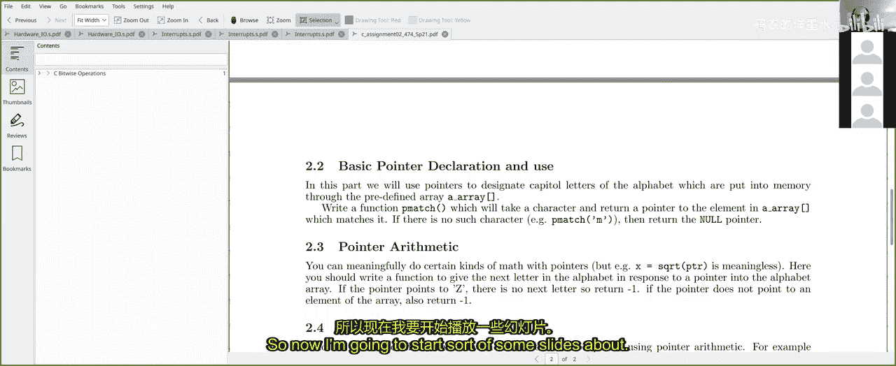
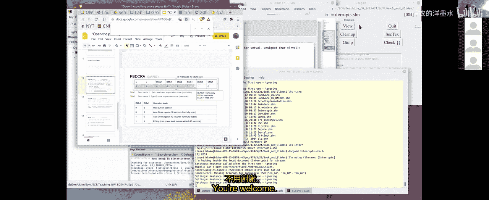

# 005：硬件与机器组织 🖥️


在本节课中，我们将要学习计算机硬件的基本组织架构，特别是冯·诺依曼架构的核心组件。我们将了解CPU、寄存器、总线如何协同工作，并通过一个有趣的“修复《2001太空漫游》中舱门故障”的编程示例，学习如何通过C语言直接操作硬件寄存器。




## 计算机基本组织架构

上一节我们介绍了嵌入式系统的基本概念，本节中我们来看看计算机硬件的核心组织方式。

### 寄存器与总线

寄存器是用于存储一组比特的硬件单元。与内存不同，寄存器通常与系统其他部分有直接的硬件连接，其值可以直接控制或反映硬件状态。一个寄存器可以由多个D触发器构成，在时钟信号触发时，输入值被锁存到输出端。

**公式示例：** 一个D触发器的行为可以描述为：`Q(t+1) = D(t)`，其中`Q`是输出，`D`是输入，`t`代表时钟周期。

总线是CPU内部或CPU与外部设备之间传输数据的通道。一个典型的系统包含三种总线：

1.  **地址总线**：由CPU驱动，指定要访问的内存或设备位置。
2.  **数据总线**：双向传输，用于在CPU和选定位置之间传递数据。
3.  **控制总线**：传输同步和控制信号，协调读写操作。

地址比较器是总线系统中的关键组件。它持续监控地址总线上的值，当该值与预设的设备地址匹配时，会输出一个信号，从而“选中”该设备进行后续的数据读写操作。

### 总线时序与三态逻辑

CPU通过精确的时序与设备通信。在一个**写周期**中，CPU先将地址和数据放到总线上，待信号稳定后，发出一个控制脉冲（如写使能信号）。地址匹配的设备会在此脉冲下锁存数据总线上的值。

在一个**读周期**中，CPU先发出地址和读脉冲。被选中的设备随后将数据放到数据总线上，供CPU读取。

多个设备共享同一条数据总线时，需要解决输出冲突问题。这通过**三态逻辑门**实现。除了输出高电平（1）和低电平（0），三态门还有第三种状态：**高阻抗状态（High-Z）**。在此状态下，输出端相当于断开连接，不会影响总线。通过控制逻辑确保同一时刻只有一个设备输出有效数据，其他设备处于高阻态，即可实现总线的共享。

**代码示例：** 在C语言中，我们通过读写特定内存地址来模拟对硬件寄存器的操作，这背后就是通过总线周期实现的。

## 中央处理器内部结构

了解了外部通信方式，现在我们深入CPU内部，看看指令是如何被执行的。

一个简化的CPU包含以下核心部件：
*   **算术逻辑单元**：执行加、减、比较、移位等运算。
*   **参数寄存器**：为ALU提供操作数。
*   **结果寄存器**：存储ALU运算的结果。
*   **通用寄存器**：用于高速存储中间计算结果。
*   **程序计数器**：指向下一条要执行的指令地址。
*   **指令寄存器**：存放当前正在执行的机器指令。
*   **解码与控制单元**：解析指令，生成控制信号来协调所有部件工作。

执行一条简单的C语句 `c = a + b;` 需要多个步骤：CPU先从内存中读取变量`a`和`b`的值到参数寄存器，然后ALU执行加法，结果存回内存中变量`c`的位置。每一步都对应着特定的机器指令。

### 机器指令与汇编语言

机器指令是二进制代码，由**操作码**和**操作数**组成。操作码指定要执行的操作（如加、减、移动数据），操作数指定操作涉及的数据或数据位置。

汇编语言是机器指令的文本助记符形式，比二进制更易于人类编写和阅读。不同的**寻址模式**（如直接寻址、间接寻址、变址寻址）提供了灵活的数据访问方式。

**代码示例：** 实现 `c = a + b` 的汇编伪代码可能如下：
```
MOVE [address_of_a], A1  ; 将内存中a的值移到ALU参数寄存器1
MOVE [address_of_b], A2  ; 将内存中b的值移到ALU参数寄存器2
ADD                      ; ALU执行加法
MOVE R, [address_of_c]   ; 将结果寄存器的值存回内存c的位置
```

## 输入/输出编程模型

CPU需要与外部世界交互。主要有两种I/O编程模型：

1.  **独立I/O**：拥有独立的I/O地址空间和专用的`IN`/`OUT`指令。Intel处理器常用此模型。
2.  **内存映射I/O**：将硬件设备的寄存器映射到内存地址空间中。读写这些特定地址就相当于操作硬件寄存器。**Arduino采用的正是这种模型**，它简化了编程，在C语言中可以通过指针直接访问设备寄存器。

## 实战：操作硬件寄存器

现在，我们将运用所学知识，为一个虚构的“太空舱舱门控制系统”编写驱动代码。假设我们有三个8位硬件寄存器来控制舱门A、B、C。

以下是控制寄存器A的位定义示例：
| 位 | 名称 | 功能 |
| :--- | :--- | :--- |
| 1:0 | DMode_A | 设置舱门A模式 (00:保持, 01:自动关闭, 10:自动开启, 11:紧急停止) |
| 3:2 | DMode_B | 设置舱门B模式 |
| 5:4 | DMode_C | 设置舱门C模式 |

我们的任务是编写一个函数，可靠地打开指定舱门并返回。关键在于不能影响寄存器中其他控制其他舱门或功能的位。

### 位操作技巧

直接给寄存器赋值（如 `PBD_CR = 0x02;`）会覆盖所有位，这是错误的。正确的方法是使用位操作，只修改目标位。

我们需要编写一个辅助函数，用于安全地设置和清除特定位：

**代码示例：** 一个安全的位设置/清除函数
```c
unsigned char bit_set_clear_8(unsigned char hw_register, unsigned char set_val, unsigned char clear_val) {
    unsigned char temp_val = hw_register; // 读取当前值
    temp_val |= set_val;                  // 设置set_val中为1的位
    temp_val &= ~clear_val;               // 清除clear_val中为1的位
    // 注意：此处set_val和clear_val中用1标记要操作的位
    return temp_val; // 返回新值，需要写回寄存器
}
```

使用这个函数，我们可以精确地设置舱门A为“自动开启”模式（设置bit1，清除bit0），而不影响其他位。

打开舱门函数的逻辑步骤如下：
1.  使用`bit_set_clear_8`函数，将目标舱门的模式位设置为“自动开启”。
2.  设置对应舱门的“启动”位，触发动作。
3.  循环读取舱门状态寄存器，等待“正在移动”位变为0（表示移动停止）。
4.  检查舱门密封状态位，确认已完全打开并密封。
5.  返回成功代码。如果等待超时，则返回错误代码。

## 总结



本节课中我们一起学习了计算机硬件的核心组织架构，包括寄存器、总线和CPU的基本工作原理。我们重点掌握了**内存映射I/O**模型，并学习了如何通过C语言进行精确的**位操作**来安全地控制硬件寄存器，而不影响其他无关位。这是嵌入式系统编程的基础技能，在后续课程中操作定时器、串口等具体硬件时将会反复运用。通过修复“舱门故障”的趣味示例，我们将抽象的理论与实践联系了起来。