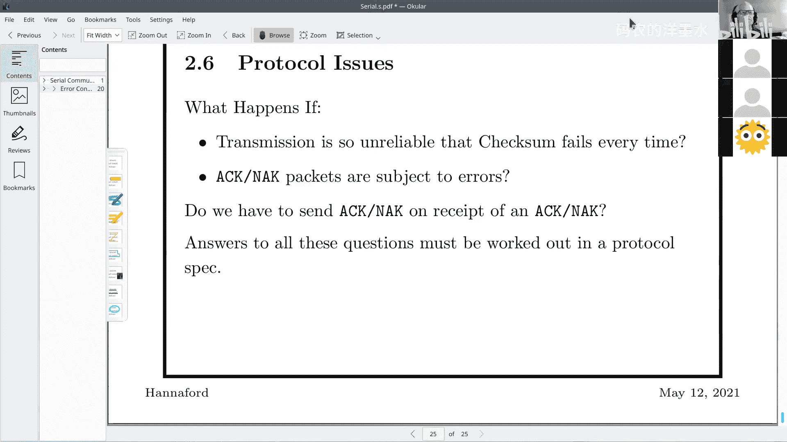
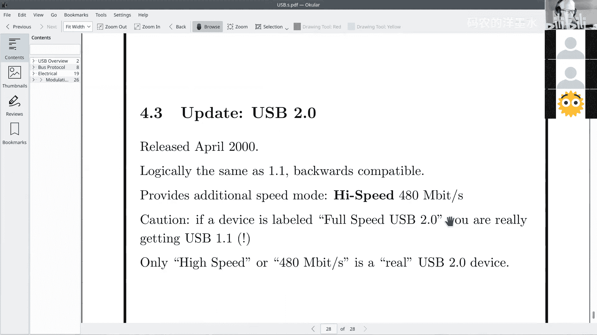

# 006：第6讲 - 串行通信与USB

在本节课中，我们将学习嵌入式系统中两种关键的通信方式：传统的串行通信（RS-232）和现代的通用串行总线（USB）。我们将了解它们的工作原理、协议细节以及在实际应用中的差异。

## 概述：从比特到字节的旅程

通信是嵌入式系统的核心。系统很少孤立运行，通常需要与其他设备交换数据。我们将从最基本的一位一位发送数据的串行通信开始，逐步深入到更复杂、更高效的USB协议。

## 串行通信基础：RS-232标准

上一节我们概述了通信的重要性，本节中我们来看看最经典的串行通信标准——RS-232。它虽然古老，但其核心思想影响了后续许多通信协议。

RS-232通过改变导线上的电压来发送信号。逻辑0和逻辑1由特定的电压范围定义：
*   **逻辑0（Space）**：+3V 至 +15V
*   **逻辑1（Mark）**：-3V 至 -15V

这种较大的电压摆幅提供了良好的抗噪声能力。线路空闲时，保持在Mark状态（负电压）。

### 数据帧格式

一个完整的数据帧包含以下部分，按顺序发送：
1.  **起始位**：一个逻辑0（Space）位，标志数据传输开始。
2.  **数据位**：通常是8位数据，从最低有效位（LSB）开始发送。
3.  **奇偶校验位**：一个用于错误检测的位（可选）。
4.  **停止位**：1或2个逻辑1（Mark）位，标志帧结束。

接收器检测到起始位的边沿后，会等待半个时钟周期，然后在每个位时间的中心进行采样，以确保读取的稳定性。这种通信是**异步**的，意味着数据帧可以在任何时间开始，接收端需要自行同步时钟。

### 奇偶校验：简单的错误检测

奇偶校验位用于检测传输过程中的单比特错误。发送端计算数据位中“1”的个数：
*   如果“1”的个数为奇数，则奇偶校验位设置为 **1**（奇校验）。
*   如果“1”的个数为偶数，则奇偶校验位设置为 **0**（偶校验）。

接收端重新计算接收到的数据位的奇偶性，并与接收到的奇偶校验位比较。如果不匹配，则表明传输过程中可能发生了错误。其核心是一个对数据位进行**异或**运算的过程。

**公式**：`Parity = D0 XOR D1 XOR D2 ... XOR D7`

奇偶校验只能检测奇数个比特错误，无法纠正错误，也无法检测偶数个比特错误。

### 通信参数与模式

以下是配置串行通信时需要协商的几个关键参数：
*   **波特率**：数据传输速率，单位是比特每秒（bps）。例如，9600波特率意味着每秒传输9600比特。
*   **通信模式**：
    *   **单工**：数据只能单向传输。
    *   **半双工**：数据可以双向传输，但不能同时进行。
    *   **全双工**：数据可以同时双向传输。

传统的RS-232使用DB-9或DB-25连接器，涉及许多控制信号线（如RTS、CTS用于硬件流控制），配置复杂。现代系统通常简化为只使用TX（发送）、RX（接收）和GND（地）三根线。

### 高级错误控制与数据包

对于更可靠的数据传输，仅靠奇偶校验是不够的。通常会将多个字节组合成**数据包**，并采用更强大的错误检测方法：
*   **校验和**：将数据包中所有字节的值相加，取结果的低8位或低16位作为校验值。
*   **循环冗余校验**：一种基于多项式除法的更强大的错误检测码。

一个典型的数据包结构包括：
1.  包起始标识符
2.  地址/类型字段
3.  数据长度字段
4.  数据载荷
5.  错误校验码（如CRC）

为了确保数据可靠送达，通常使用**自动重传请求**协议：接收方校验数据包后，会向发送方回复**ACK**（确认）或**NAK**（否认）。发送方只有在收到ACK后才会发送下一个数据包，如果收到NAK或超时未收到回复，则会重传当前数据包。

## 现代标准：通用串行总线

了解了串行通信的基础后，我们来看看为解决RS-232复杂性问题而设计的现代标准——USB。USB的设计目标是易于使用、低成本、高速度且高度标准化。

### USB系统架构

USB采用**主机-设备**的树形拓扑结构：
*   **主机**：通常是计算机的CPU，负责管理整个USB总线。
*   **集线器**：用于扩展USB端口。
*   **功能设备**：提供具体功能的设备，如鼠标、键盘、打印机。

一个**功能设备**可以包含多个**端点**，每个端点是设备上一个独立的数据发送或接收点。例如，一个鼠标可能有分别传输X轴移动、Y轴移动和按钮状态的端点。

### USB通信协议

USB通信是基于时间片的。主机以**1毫秒**为周期发送**帧起始包**，来同步总线上的所有设备。通信由主机完全控制，采用**轮询**机制。主机向特定设备的特定端点发送包含PID（包标识符）、地址和端点号的请求包，然后设备响应数据。

USB定义了四种数据传输类型，以适应不同需求：
*   **控制传输**：用于设备配置、命令和状态查询。优先级最高。
*   **批量传输**：用于大容量、非实时数据（如打印机、扫描仪）。无带宽和延迟保证，但数据可靠。
*   **中断传输**：用于需要保证延迟的小数据量传输（如键盘、鼠标）。保证在指定时间内得到服务。
*   **等时传输**：用于需要恒定带宽和低延迟的实时数据（如音频、视频流）。有带宽保证，但数据出错不重传。

### USB的物理与电气特性

USB连接非常简单，仅使用4根线：
*   **VBUS**：+5V电源
*   **D+**：差分数据线正极
*   **D-**：差分数据线负极
*   **GND**：地线

数据采用**差分信号**传输，即D+和D-线上的电压相反。这种方式抗共模噪声能力极强。USB使用**NRZI编码**和**比特填充**技术来确保数据流中有足够的电平跳变，以便接收端能够恢复时钟信号。

### 设备枚举与驱动

USB的一大优点是**即插即用**。当设备插入时，会触发以下过程：
1.  主机检测到新设备，并为其复位。
2.  主机为设备分配一个唯一的地址。
3.  主机读取设备的**描述符**信息，包括厂商ID、产品ID、设备类、端点配置等。
4.  主机根据设备类信息，加载或提示安装相应的驱动程序。
5.  设备进入配置状态，可以开始正常工作。

USB设备采用分层**类**结构，同一类设备（如“大容量存储设备”、“人机接口设备”）使用标准化的驱动接口，大大简化了驱动开发。

### USB的发展：USB 2.0/3.0

*   **USB 2.0**：将速度提升至480 Mbps（高速模式），并保持对USB 1.1的向后兼容。
*   **USB 3.0及以后**：速度进一步提升（如5 Gbps、10 Gbps），采用额外的数据线对实现全双工通信，并大幅提高了供电能力。

## 总结

本节课中我们一起学习了嵌入式系统的两种核心通信技术。我们从经典的**RS-232串行通信**开始，理解了其异步通信、帧结构、奇偶校验等基本原理，也看到了它在配置复杂性和速度上的局限性。随后，我们深入探讨了**USB**，了解了其基于主机控制的轮询架构、四种数据传输类型、差分信号物理层以及即插即用的设备枚举过程。USB通过高度的标准化和复杂的协议设计，在易用性、速度和可靠性上实现了巨大飞跃，成为现代嵌入式系统和计算机外设互联的基石。理解这些通信协议的工作原理，对于设计和调试嵌入式系统至关重要。