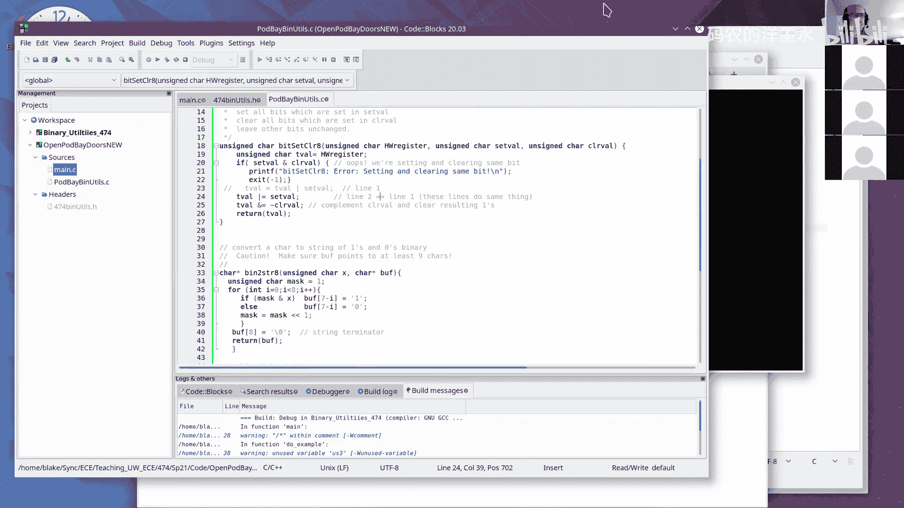
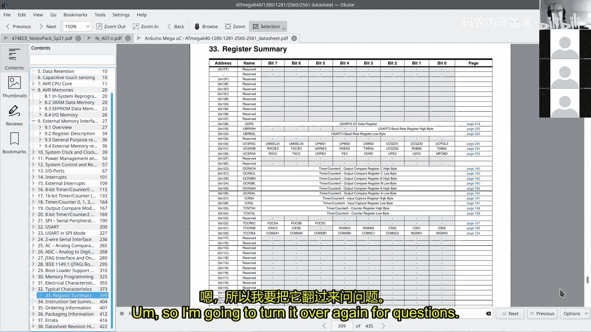

# 007：ATMega入门与位操作实践


在本节课中，我们将深入学习嵌入式系统中的位操作，并开始探索ATmega2560微控制器的官方文档。我们将通过具体的代码示例来巩固位设置和位清除的概念，并了解如何组织一个专业的C语言项目。

---

## 项目结构与代码组织

上一节我们介绍了位操作的基本概念。本节中，我们来看看如何在一个结构化的C语言项目中实现这些功能。

一个专业的C语言项目通常会将代码分离到不同的文件中，以提高可读性和可维护性。标准做法是使用头文件（.h）来声明函数原型，而将函数的具体实现放在源文件（.c）中。

以下是项目文件结构的一个示例：
*   **main.c**: 包含程序的入口点 `main()` 函数，用于测试和演示其他功能。
*   **binary_utils.h**: 头文件，包含所有工具函数的声明（函数原型）。
*   **binary_utils.c**: 源文件，包含工具函数的具体实现。

在 `main.c` 中，我们通过 `#include "binary_utils.h"` 来包含头文件。C预处理器会将该文件的内容复制到此处，这样编译器就知道这些函数的存在及其参数类型。链接器随后会在 `binary_utils.c` 中找到这些函数的实际定义。

尖括号 `< >` 用于包含系统库的头文件（如 `stdio.h`），编译器会在标准路径中查找。引号 `" "` 用于包含项目自定义的头文件，编译器首先在当前目录中查找。

## 二进制工具函数

为了更方便地处理二进制数，我们编写了几个工具函数。以下是这些函数的简要介绍：

*   **`string_binary_to_char`**: 将一个8位的二进制字符串（如 `"11001010"`）转换成一个对应的 `unsigned char` 数值。
*   **`binary_to_string8`**: 将一个8位的 `unsigned char` 数值转换回其二进制字符串表示，便于打印输出。
*   **`bitset_and_clear8`**: 核心函数，用于对给定的8位数值执行位设置和位清除操作。




## 位设置与清除函数详解

现在，让我们深入看看 `bitset_and_clear8` 函数是如何工作的。该函数接收三个参数：原始数据、设置掩码和清除掩码。

**函数逻辑如下：**
1.  **错误检查**：首先检查设置掩码和清除掩码是否有重叠位（即同一位上都是1）。这是无意义的操作，通常意味着程序有逻辑错误。如果发现重叠，函数会报错并退出。
2.  **设置位**：使用按位或操作符 `|=` 将设置掩码中为1的位在原始数据中设为1。公式为：`temp |= set_mask`。
3.  **清除位**：使用按位与操作符 `&=` 将清除掩码中为1的位在原始数据中设为0。这里需要先将清除掩码取反。公式为：`temp &= ~clear_mask`。
4.  **返回结果**：返回处理后的数值。

以下是一个函数调用示例：
```c
unsigned char result = bitset_and_clear8(input_byte, set_mask, set_mask);
```
通过这个函数，我们可以精确地控制寄存器中的特定位，而不影响其他位，这是控制硬件外设的关键。

## ATmega2560 微控制器概览

掌握了位操作这一核心技能后，我们转向本节课的另一个重点：了解我们使用的硬件——ATmega2560微控制器。其官方文档虽然庞大，但包含了我们所需的一切信息。

ATmega2560是一款功能丰富的8位AVR微控制器，以下是其主要特性：
*   **丰富的I/O引脚**：提供54至86个可编程I/O引脚，具体数量因封装而异。
*   **大容量存储器**：相比常见的Arduino Uno，它具有更大的Flash和SRAM。
*   **多个定时器/计数器**：包括8位和16位定时器，用于精确计时和产生PWM信号。
*   **模数转换器(ADC)**：用于将模拟信号（如传感器读数）转换为数字值。
*   **多种通信接口**：如UART（通用异步收发器）、SPI（串行外设接口）和TWI（I²C）。
*   **看门狗定时器**：一个独立的硬件计时器，可在软件崩溃时自动重启系统，提高系统可靠性。
*   **低功耗特性**：支持多种睡眠模式，适用于电池供电设备。

## I/O端口内部结构

微控制器的每个I/O引脚都不是一个简单的开关，其内部结构相当复杂。理解其简化原理图对正确使用至关重要。

一个典型的I/O引脚内部包含以下部分：
*   **保护二极管**：防止引脚电压过高或过低而损坏内部电路。
*   **可编程上拉电阻**：当引脚配置为输入时，可以通过软件启用内部上拉电阻。这在连接按钮或开关时非常有用：开关断开时，引脚通过上拉电阻读到高电平(1)；开关闭合到地时，引脚读到低电平(0)。
*   **数据方向寄存器(DDR)**：决定引脚是输入（读取外部信号）还是输出（驱动外部电路）。
*   **数据寄存器(PORT)**：当引脚为输出时，向此寄存器写入值可以控制引脚输出高电平或低电平。当引脚为输入且上拉电阻启用时，向此寄存器写1可启用上拉。
*   **输入引脚寄存器(PIN)**：读取此寄存器可以获取引脚当前的逻辑电平值。

在C语言中，操作这些寄存器非常简单。例如，读取B端口所有引脚的状态只需：`i = PINB;`。

## 定时器/计数器简介

定时器/计数器是嵌入式系统的核心部件之一。ATmega2560拥有多个8位和16位定时器。

一个定时器的基本组成部分包括：
*   **时钟源**：可以是微控制器内部系统时钟（如16MHz），也可以是外部引脚输入的信号。
*   **预分频器**：将时钟源分频，以降低计数速度，获取更长的定时周期。
*   **计数器寄存器(TCNT)**：其值随着每个时钟脉冲递增（或递减）。
*   **输出比较寄存器(OCR)**：用户可以设置一个比较值。
*   **比较匹配逻辑**：当计数器值(TCNT)与比较寄存器值(OCR)相等时，触发“比较匹配”事件。
*   **控制逻辑**：根据配置，比较匹配事件可以自动清零计数器、改变计数方向、触发中断，或者控制一个输出引脚的电平翻转。

通过灵活配置定时器的工作模式，我们可以实现精确延时、测量脉冲宽度、生成PWM（脉冲宽度调制）信号以控制电机速度或LED亮度等多种功能。16位定时器相比8位定时器，提供了更宽的计数范围（0-65535），可以实现更精确或更长时间的定时。

## 使用芯片文档的技巧

ATmega2560的数据手册长达数百页，但无需通读。以下是一些高效使用文档的技巧：
1.  **善用目录和搜索**：PDF阅读器的目录和搜索（Ctrl+F）功能是找到特定寄存器或功能说明的最快方式。
2.  **关注寄存器摘要**：文档末尾的寄存器摘要列出了所有寄存器及其每一位的含义，是编程时的速查手册。
3.  **理解引脚复用**：芯片引脚通常具有多种功能（如GPIO、ADC输入、定时器输出等）。数据手册中的引脚说明表会列出所有替代功能，设计电路时需要根据需求选择。
4.  **由需求驱动阅读**：根据项目需要（例如，要使用ADC），直接定位到相关章节进行精读，而不是从头开始浏览。

---




本节课中我们一起学习了如何通过结构化的C代码进行精确的位操作，这是底层硬件编程的基石。同时，我们也初步探索了ATmega2560微控制器的强大功能和其官方文档的结构，为后续具体的实验（如控制定时器、读取ADC）打下了坚实的基础。记住，在面对复杂硬件时，数据手册是你最好的朋友。