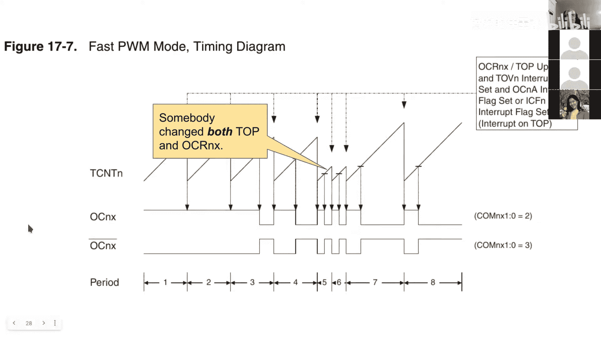
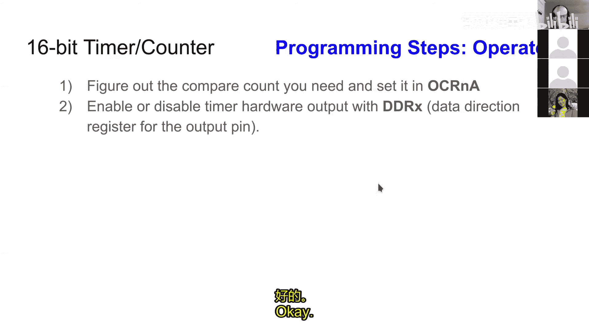
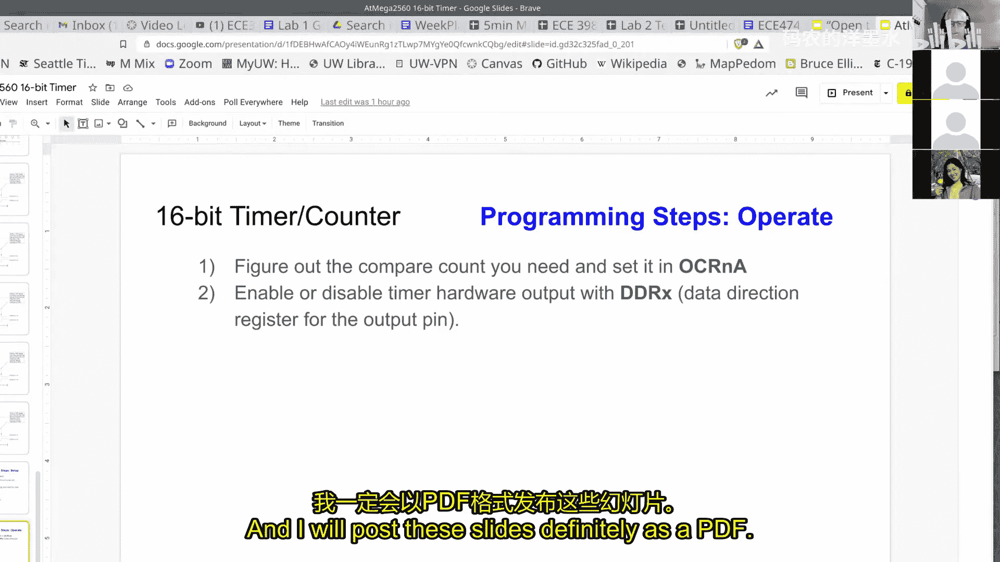
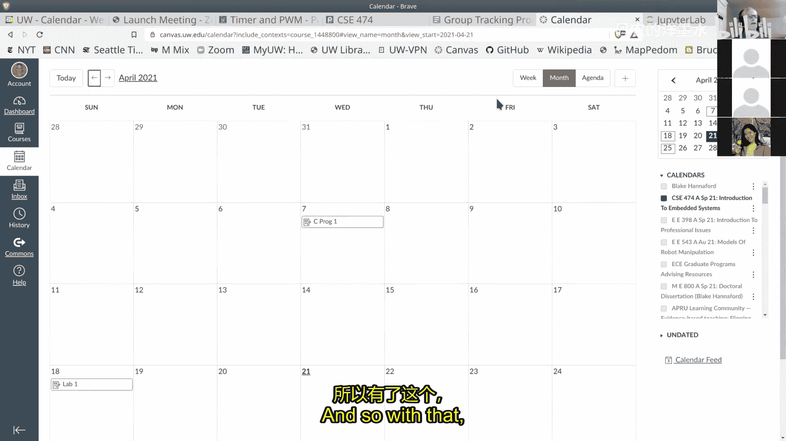

# 008：16位定时器详解 ⏱️

在本节课中，我们将深入学习Arduino系统（实际上是ATmega芯片）中用于下一个实验的16位定时器。我们将深入硬件细节，学习如何通过配置控制寄存器来操作定时器，以生成恒定频率的信号。


## 概述

我们将从定时器的基本结构开始，介绍其核心组件，如计数器、比较器和波形发生器。接着，我们会探讨不同的工作模式，特别是我们将要使用的CTC（比较匹配时清零定时器）模式和快速PWM（脉冲宽度调制）模式。最后，我们将讲解如何通过编写代码来初始化和配置定时器，以生成所需的波形。

## 定时器核心结构

上一节我们介绍了定时器的基本概念，本节中我们来看看16位定时器的具体硬件结构。

定时器包含一个16位计数器、多个输出比较通道（A、B、C）以及相关的控制逻辑。每个通道几乎是相同的，这意味着你可以用同一个定时器基准生成最多三个独立的波形。

**核心公式**：
*   **计数器范围**：从 `0`（底部）到 `65535`（`0xFFFF`，最大值）。
*   **TOP值**：一个可设置在 `0` 到 `65535` 之间的值，用于定义计数器的上限。

定时器的工作由三个8位控制寄存器（`TCCRnA`， `TCCRnB`， `TCCRnC`）管理。对于本实验，我们推荐使用**定时器4**（Timer 4），因此在代码中 `n` 应替换为 `4`。

输出比较引脚（如 `OC4A`， `OC4B`， `OC4C`）直接连接到芯片的特定引脚，进而连接到Arduino的引脚。当发生“输出比较匹配”事件（即计数器值与比较寄存器值相等）时，可以控制这些引脚的电平变化（置位、清零或翻转）。

## 时钟与预分频器

定时器的计数时钟可以来自内部CPU时钟（16 MHz）或外部信号。为了获得更灵活的计数频率，我们可以对内部时钟进行“预分频”。

以下是可用的预分频因子及其对16位定时器的影响：

| 预分频因子 | 计数频率 | 计数周期 | 最大计数时间（到65535） | 备注 |
| :--- | :--- | :--- | :--- | :--- |
| 1 (无分频) | 16 MHz | 62.5 ns | ~4.1 ms | 最高频率，最精细分辨率 |
| 8 | 2 MHz | 500 ns | ~32.8 ms | |
| 64 | 250 kHz | 4 µs | ~262.1 ms | |
| 256 | 62.5 kHz | 16 µs | ~1.05 s | |
| 1024 | 15.625 kHz | 64 µs | ~4.2 s | 最低频率，最长周期 |

**核心概念**：
*   时钟越快，能输出的**最低频率**越高（因为计数器更快达到最大值）。
*   预分频让你能够用同一个定时器生成频率范围更广的信号。
*   在生成音调时，需要根据目标频率选择合适的预分频值。

## 定时器工作模式

定时器有多种模式，由波形生成模式位（`WGMn3:0`）控制。以下是两种最常用且与本实验相关的模式。

### 普通模式（Normal Mode）

这是最简单的模式。计数器从0向上计数，达到最大值（65535）后溢出归零，并重新开始。你可以通过读取计数器值来测量时间，但需要处理溢出以计算更长时间。

### CTC模式（Clear Timer on Compare Match）🎯

在CTC模式下，计数器向上计数，但达到我们设定的`TOP`值（存储在输出比较寄存器`OCRnA`中）时，立即清零并重新开始。同时会触发“比较匹配”事件。

**工作流程**：
1.  计数器从0开始递增。
2.  当 `TCNTn` == `OCRnA` (TOP) 时，发生比较匹配。
3.  计数器 `TCNTn` 自动复位为0。
4.  如果输出比较模式设置为“翻转”（Toggle），则对应的输出引脚 `OCnA` 电平会在此事件发生时翻转（1变0或0变1）。

**核心公式**：
输出信号的频率由以下因素决定：
`输出频率 = (CPU时钟频率 / 预分频因子) / (2 * (1 + OCRnA))`
*   **`OCRnx`**： 输出比较寄存器的值（即TOP值）。
*   **除以2**： 因为在“翻转”模式下，一个完整的波形周期需要两次比较匹配事件（一次从低到高，一次从高到低）。

通过改变 `OCRnA` 的值，可以改变输出信号的频率，而无需改变时钟基准。

### 快速PWM模式（Fast PWM）📈

PWM是一种通过快速开关来模拟模拟信号的技术。在快速PWM模式下，计数器从0计数到最大值（或某个TOP值），然后复位。

**工作流程**：
1.  在计数器复位时（周期开始），输出引脚置为高电平（1）。
2.  当计数器值与输出比较寄存器 `OCRnx` 匹配时，输出引脚清零为低电平（0）。
3.  计数器继续计数到TOP后复位，输出再次置高，开始下一个周期。

**核心概念**：
*   **周期**： 由计数器的TOP值决定，固定不变。
*   **占空比**： 高电平时间占整个周期的百分比，由比较寄存器 `OCRnx` 的值决定。`OCRnx` 值越大，高电平时间越长，占空比越大。
*   **应用**： 常用于LED调光、电机速度控制、简单的数模转换等。

## 编程配置步骤



了解了理论之后，本节我们来看看如何通过代码配置定时器。


以下是配置定时器（以Timer 4， CTC模式， 翻转输出为例）的一般步骤：

1.  **设置引脚为输出模式**：
    首先，需要将你计划使用的输出比较引脚（如 `OC4A` 对应的Arduino引脚）配置为输出模式。这通过数据方向寄存器（如 `DDRx`）完成。

2.  **配置波形生成模式（WGM）**：
    需要设置 `TCCR4A` 和 `TCCR4B` 寄存器中的 `WGM43:0` 位，以选择CTC模式。具体的位组合需要查阅数据手册。

3.  **配置比较输出模式（COM）**：
    在 `TCCR4A` 寄存器中，设置对应通道（如 `COM4A1:0`）的模式。对于生成方波音调，通常设置为“翻转”模式。

4.  **配置时钟预分频（CS）**：
    在 `TCCR4B` 寄存器中，设置 `CS42:0` 位，以选择所需的预分频因子（如8， 64， 256， 1024）。

5.  **设置输出比较寄存器（OCR）**：
    向 `OCR4A` 寄存器写入一个16位的值，这个值决定了CTC模式下的TOP值，从而决定了输出频率。

6.  **（可选）中断设置**：
    如果需要，可以启用比较匹配中断，并编写中断服务例程（ISR）。本实验初期可能不需要。

**示例代码框架**：
```c
void setupTimer4() {
    // 1. 设置 OC4A 引脚为输出 (例如 Arduino Pin 6)
    DDRD |= (1 << DDD6); // 假设OC4A对应PD6

    // 2. & 3. 设置模式为 CTC， 输出比较A模式为翻转
    TCCR4A = (1 << COM4A0); // 翻转 OC4A
    // WGM42 位在 TCCR4B 中设置

    // 4. 设置预分频因子为 64， 并确认WGM模式为CTC (WGM42=1)
    TCCR4B = (1 << WGM42) | (1 << CS41) | (1 << CS40); // 分频64

    // 5. 设置初始频率， 例如 1000 Hz (需根据公式计算OCR4A值)
    OCR4A = 124; // 示例值， 16MHz/64/2/(1+124) ≈ 1000Hz
}






// 在loop中可以通过改变OCR4A来改变频率
void changeFrequency(unsigned int ocrValue) {
    OCR4A = ocrValue;
}
```

## 总结


本节课中我们一起深入学习了ATmega微控制器的16位定时器。
*   我们了解了定时器的核心结构，包括计数器、输出比较单元和波形发生器。
*   我们探讨了时钟预分频的原理及其对定时范围的影响。
*   我们重点学习了**CTC模式**和**快速PWM模式**的工作原理与应用场景。
*   最后，我们梳理了通过C代码配置定时器以生成特定频率波形或PWM信号的关键步骤。




掌握这些硬件级编程知识，将使你能够更高效、更精确地控制嵌入式系统的时间相关功能，为后续更复杂的实验和应用打下坚实基础。