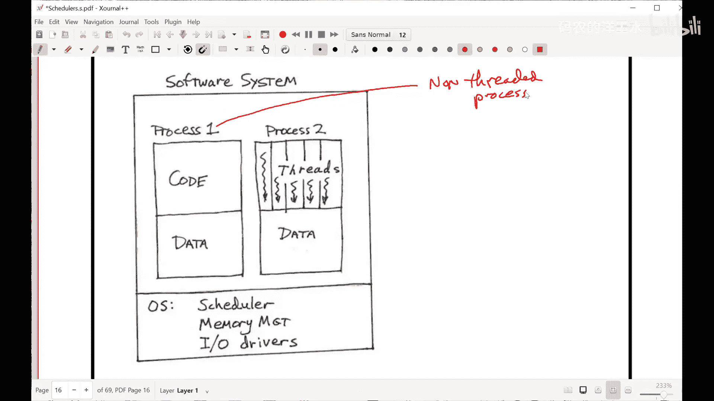
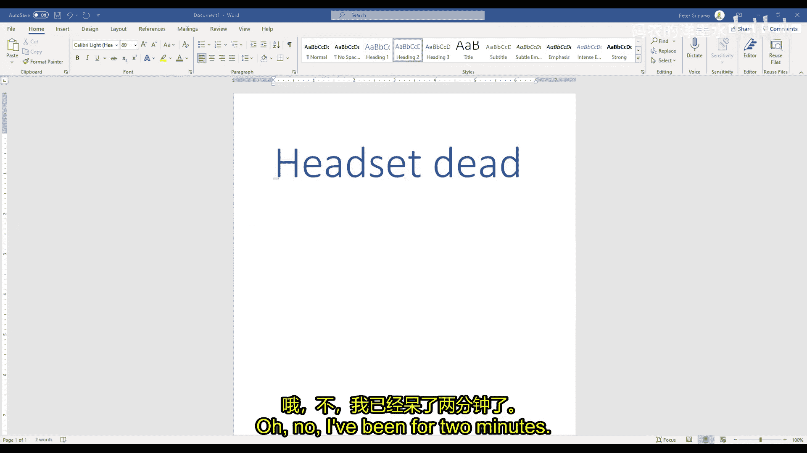
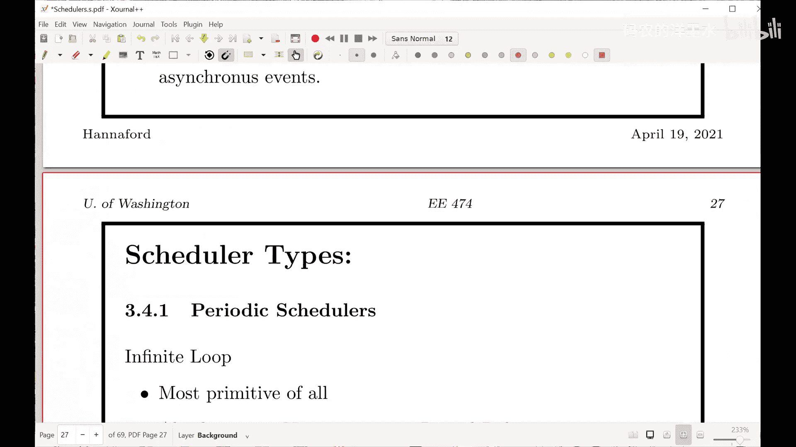
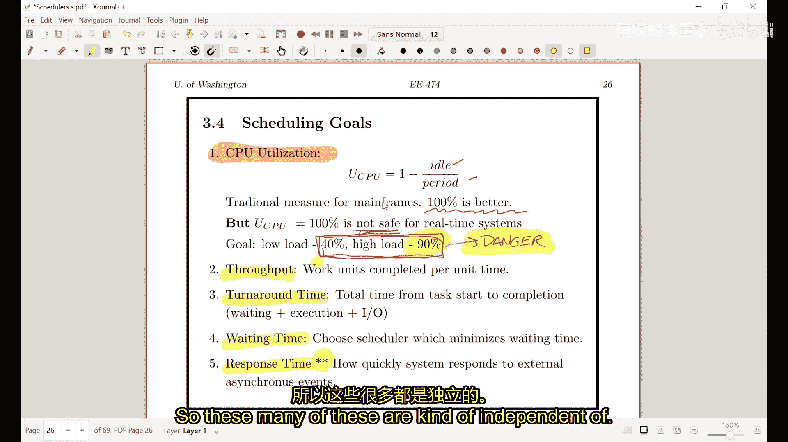
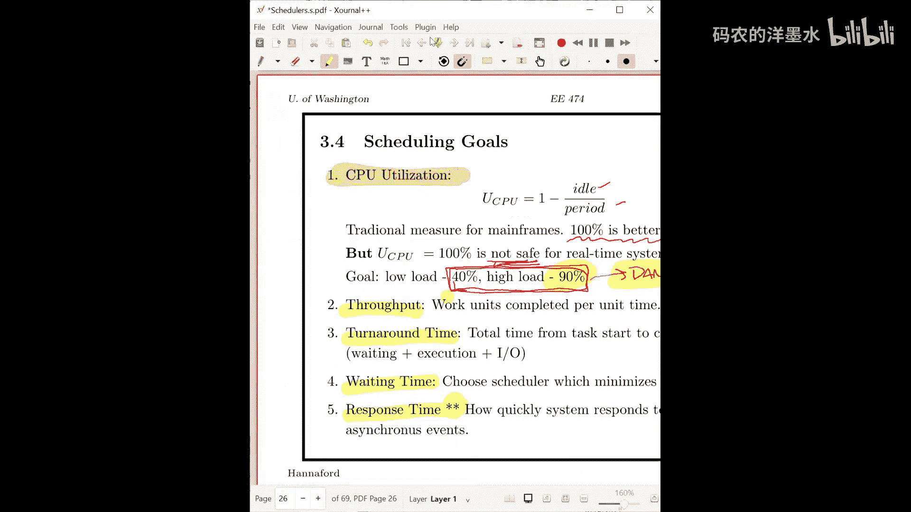
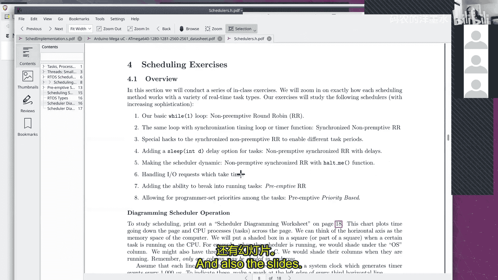
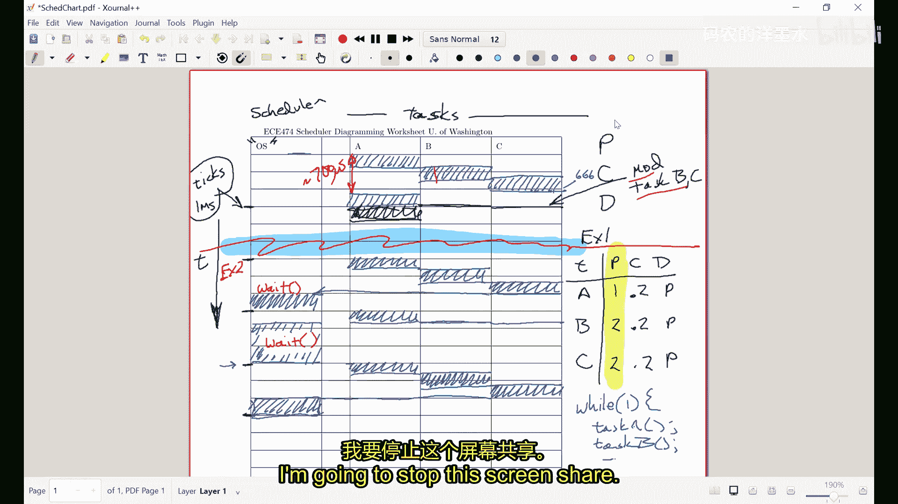
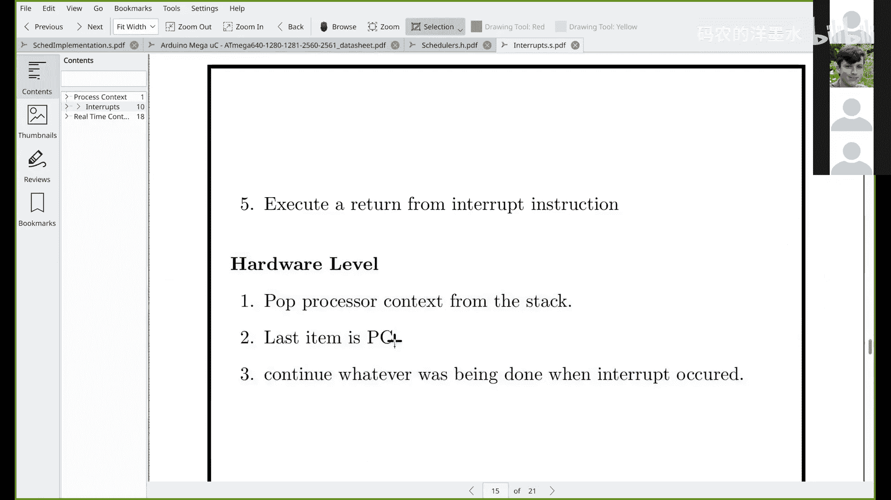
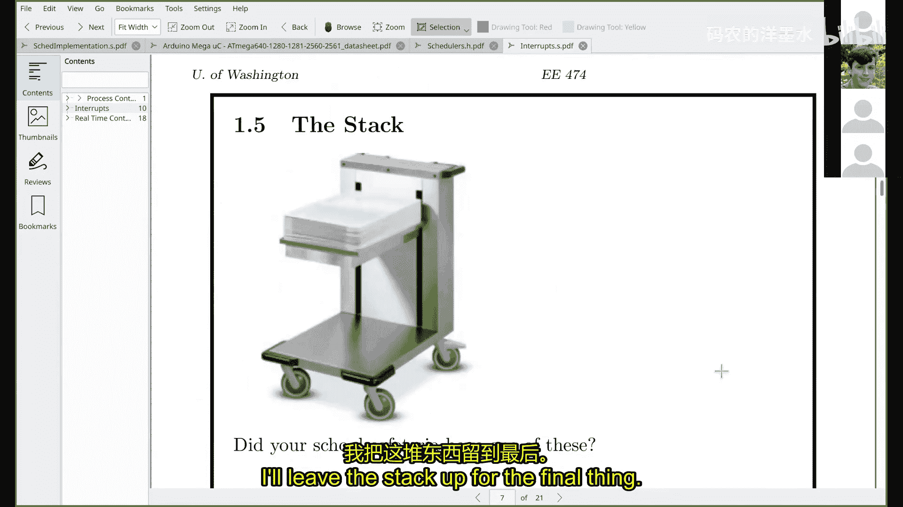

# 009：任务、线程、调度与中断


在本节课中，我们将学习嵌入式系统中的核心概念：任务、线程、调度和中断。我们将探讨如何高效地管理CPU资源，让多个程序片段（任务）能够看似同时运行，并理解硬件中断如何使系统能够及时响应外部事件。

## 概述：从简单循环到任务调度

到目前为止，在实验一中，我们主要编写了基于循环的程序，就像标准的Arduino `loop()` 函数那样。这种方式虽然简单，但效率不高。例如，当使用 `delay(50)` 等待50毫秒时，CPU在这段时间内完全空闲，无法执行其他工作。为了构建能够执行复杂任务（如控制火星直升机或医疗设备）的实时嵌入式系统，我们需要更系统的方法来利用CPU。这就是调度器的作用。

调度器就像制定课程表或安排教室一样，它将CPU这个资源随时间进行分配。我们将要放入“课程表”的“课程”就是任务、进程和线程。

## 任务、进程与线程

任务、进程和线程是相似但有关键区别的概念。它们都代表需要CPU执行的工作单元。

### 处理器状态（上下文）

理解这些概念，首先要理解处理器的**状态**或**上下文**。这就像一架飞机的状态（速度、高度、航向）决定了它未来的行为。处理器的状态是数字化的，主要包括：
*   **程序计数器**：指向下一条要执行的指令地址。
*   **CPU寄存器**：存储当前计算中的临时数据。
*   **处理器状态标志**：记录上一条操作的结果（如是否为负、是否溢出）。
*   **栈指针**：指向内存中栈的当前位置，用于保存临时数据和上下文。

**上下文切换**是指从一个任务切换到另一个任务的过程，包含三个步骤：
1.  保存当前任务的上下文。
2.  恢复要运行的任务的先前保存的上下文。
3.  开始运行新任务。

### 任务的定义与类型

一个**任务**（或**进程**）是一段代码及其相关数据的集合，由一个处理器状态来描述。例如，“通过通信链路发送一个字节”或“每分钟从热敏电阻读取并校准温度”都可以是一个任务。



根据时间特性，任务可以分为几类：





**1. 周期性任务**
这类任务在确定的时间周期内重复运行，常见于硬实时控制系统（如核电站控制、汽车巡航控制）和多媒体处理（如音频采样）。我们用以下参数描述一个周期性任务：
*   **周期**：任务重复执行的时间间隔。
*   **计算时间**：任务每次执行所需的CPU时间。
*   **截止时间**：任务必须在周期开始后的某个时间点前完成。

**公式表示**：对于一个任务，其计算时间 **C** 必须小于或等于其截止时间 **D**，而 **D** 通常小于或等于其周期 **P**。

**2. 间歇性任务**
这类任务偶尔发生，时间不可预测。例如，检测到电源故障时保存数据并关机，或系统启动时校准一次传感器。它们也有计算时间和截止时间的要求。




**3. 后台任务**
这类任务没有严格的时间要求，只在CPU空闲时运行。例如，在火星着陆器上，高优先级的实时控制任务运行时，后台任务可以处理压缩图片。它们只需要知道计算时间。

### 线程

**线程**是比任务更小的执行单元。一个进程（如一个Web服务器程序）内部可以包含多个线程（如每个用户连接由一个线程处理）。这些线程共享进程的代码和大部分数据，但各自拥有独立的执行上下文（如程序计数器、寄存器）。这种设计使得上下文切换更快，并能更好地利用I/O等待时间，提高CPU利用率。

## CPU调度

调度是操作系统的核心工作：当有多个任务就绪时，决定接下来运行哪一个。





### 调度指标

在讨论调度算法前，我们先了解几个关键指标：
*   **CPU利用率**：CPU忙碌时间占总时间的比例。实时系统通常不会追求100%利用率，以留出安全余量应对突发情况。
*   **响应时间**：从任务就绪到开始执行的时间。这对交互式系统和实时系统至关重要。
*   **截止时间满足率**：对于实时系统，能否始终满足任务的截止时间是衡量调度算法好坏的关键。

### 调度算法示例

我们将通过一个例子来图解几种简单的调度策略。假设有三个任务：
*   任务A：周期=1ms， 计算时间=0.2ms
*   任务B：周期=2ms， 计算时间=0.2ms
*   任务C：周期=2ms， 计算时间=0.2ms



**1. 简单循环调度**
就像最初的Arduino `loop()`，依次执行任务A、B、C，然后重复。这种方法无法满足不同任务的周期要求，任务B和C会被执行得过快。


**2. 同步循环调度**
在每轮循环结束后，等待下一个时钟“滴答”再开始新一轮。任务内部通过逻辑判断是否到了自己的执行周期。这种方法能更好地满足周期要求，但编程复杂，且依赖任务主动“让出”CPU（合作式调度）。

**3. 抢占式调度**
这是更强大和常用的方式。操作系统可以主动中断正在运行的任务（**抢占**），保存其上下文，然后切换到另一个任务。这使得编写任务代码更简单（开发者无需操心何时让出CPU），并且调度器能更精确地控制执行时序，保证实时性。

## 中断

**中断**是实现抢占和及时响应外部事件的关键硬件机制。



### 中断的概念

中断是由外部硬件事件（如按钮按下、网络数据包到达、定时器到期）触发的一种特殊上下文切换。当中断发生时，CPU会：
1.  自动保存当前执行环境的上下文（通常是压入栈中）。
2.  根据**中断向量表**跳转到对应的**中断服务程序**执行。
3.  ISR执行完毕后，恢复之前保存的上下文，继续执行被中断的程序。

### 栈

上下文保存和恢复依赖于**栈**这种数据结构。栈是一种“后进先出”的存储区，有两个基本操作：
*   **压栈**：将数据放入栈顶。
*   **出栈**：从栈顶取出数据。

**代码示例**：在汇编或底层C中，栈操作可能如下所示（假设栈向下增长）：
```c
// 压栈操作：将寄存器R1的值存入栈顶，然后栈指针SP递减
*SP = R1;
SP--;


// 出栈操作：先递增栈指针SP，然后从栈顶取出值到寄存器R1
SP++;
R1 = *SP;
```
函数调用和中断处理都隐式地使用了栈来保存返回地址和寄存器状态。

### 中断处理流程

1.  **硬件中断发生**：外部设备发出信号。
2.  **保存上下文**：CPU硬件自动将程序计数器、状态寄存器等压入当前任务的栈中。
3.  **获取ISR地址**：CPU根据中断号查询中断向量表，找到对应的中断服务程序入口地址。
4.  **执行ISR**：跳转到ISR代码执行，处理中断事件（如读取设备数据）。
5.  **恢复上下文**：ISR执行完毕后，通过特定指令（如`RETI`）恢复之前保存的上下文，CPU返回到被中断的任务继续执行。

## 总结

本节课我们一起学习了嵌入式系统多任务管理的核心概念。
*   我们首先区分了**任务**、**进程**和**线程**，理解了**处理器上下文**是任务切换的基础。
*   接着，我们探讨了不同类型的任务（周期性、间歇性、后台任务）及其时间参数。
*   然后，我们介绍了**CPU调度**的概念，并通过示例比较了简单循环、同步循环和抢占式调度的区别，认识到抢占式调度的优越性。
*   最后，我们深入了解了**中断**机制，它是实现抢占和实时响应的硬件基础，并学习了**栈**在上下文保存和函数调用中的关键作用。







理解这些概念是设计复杂、高效且可靠的嵌入式系统的基石。在接下来的课程和实验中，我们将实际应用这些知识来构建我们自己的调度系统。