# 010：调度II


## 概述

在本节课中，我们将深入探讨如何构建一个更高级的任务调度器。我们将学习如何使用函数指针、任务控制块（TCB）来管理多个并发任务，并实现非阻塞延迟和任务状态控制。此外，我们还将通过一个可视化练习来理解任务调度的时序分析。

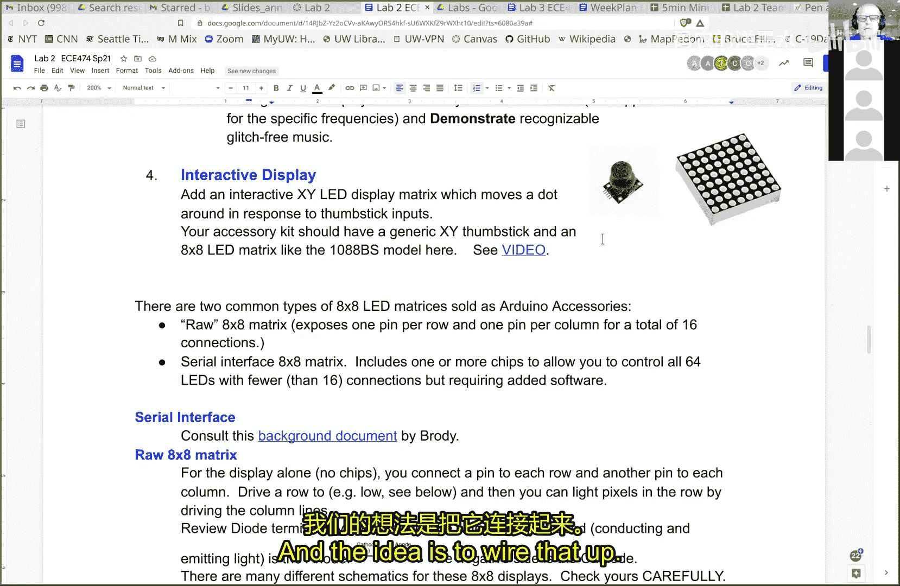

---

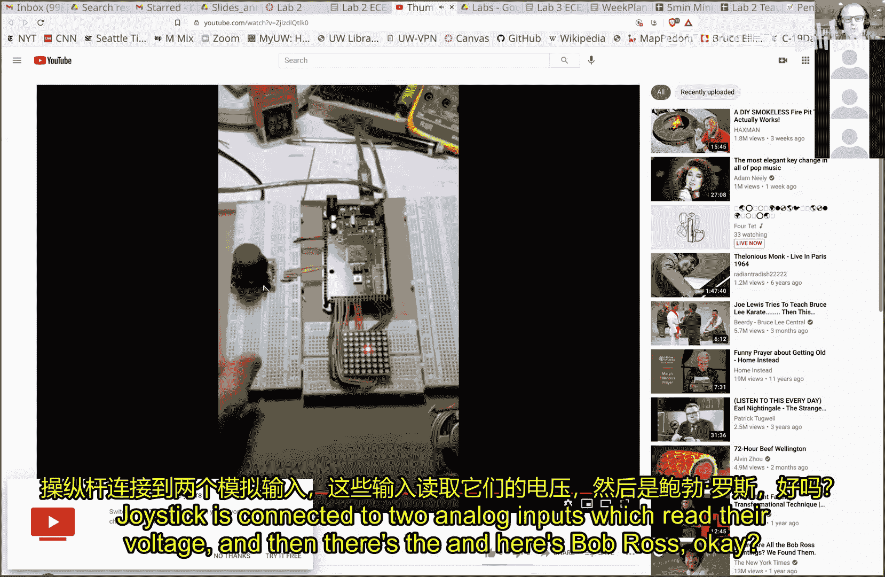

## 实验二回顾与硬件操作

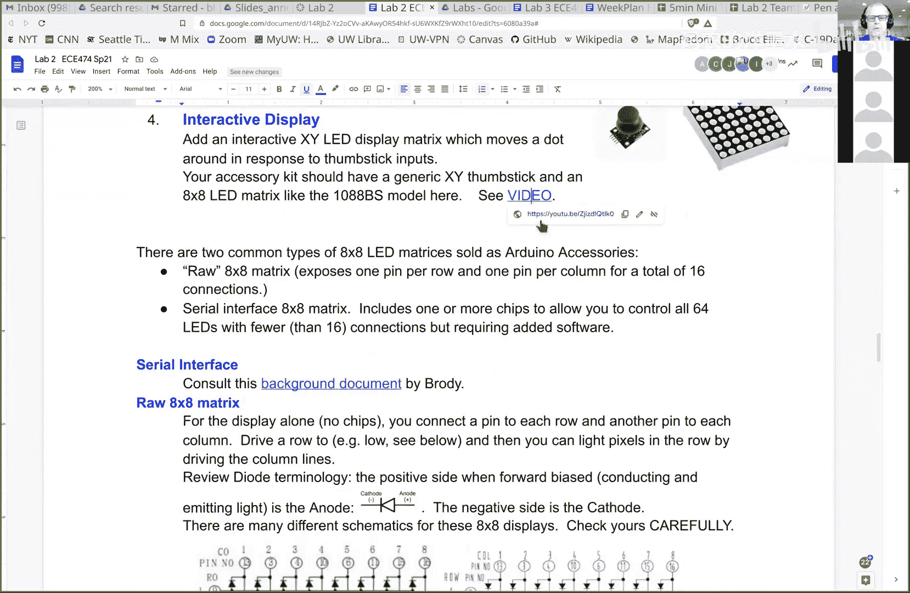

上一节我们介绍了任务调度的基本概念。本节中，我们首先回顾实验二的核心内容，并学习如何直接操作硬件寄存器。

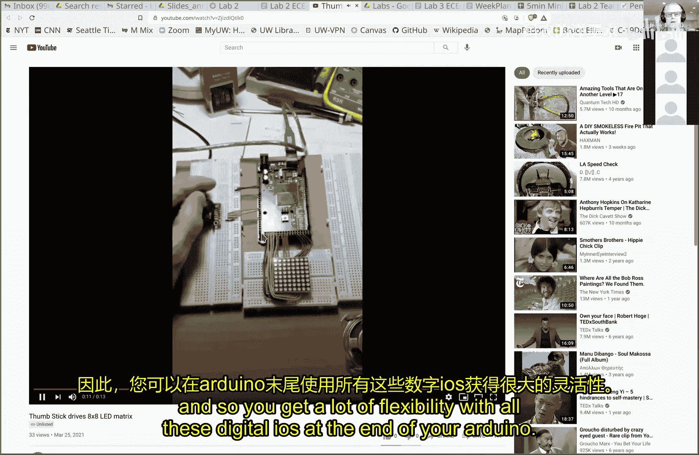

实验二的目标是将多个功能整合并使其同时运行。我们需要学习如何直接操作输出位，而不是使用Arduino的 `pinMode` 和 `digitalWrite` 函数。虽然这些函数很好用，但理解其底层工作原理很重要。

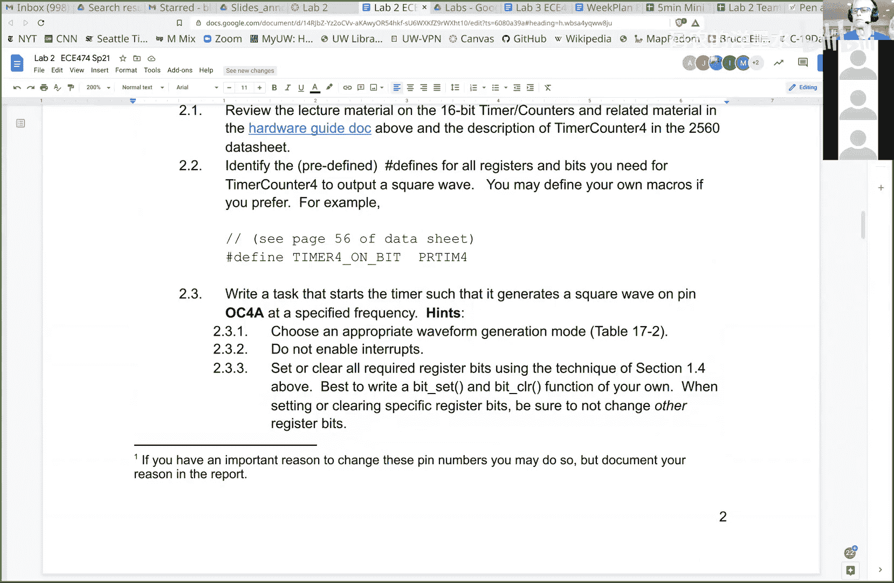


以下是实现这一目标的关键步骤：

1.  **引脚映射**：需要将Arduino板上的连接器引脚映射到微控制器芯片上的具体引脚。这通常需要参考原理图和数据手册来完成。
2.  **直接寄存器操作**：通过直接设置或清除微控制器端口寄存器中的特定位来控制引脚，这比调用库函数更高效、更直接。
3.  **定时器配置**：设置硬件定时器以自动生成特定频率的信号，例如用于驱动扬声器播放音符。

关于实验中的扬声器驱动，建议在扬声器回路中串联一个电阻（例如几百欧姆）。这有三个好处：防止过电流损坏扬声器、减少方波谐波使音色更平滑、以及避免因驱动过强而产生杂音。

实验二包含四个主要部分：
*   **任务A**：控制三个LED依次闪烁，形成流水灯效果。
*   **任务B**：使用定时器产生音频输出（如播放《玛丽有只小羊羔》的旋律）。
*   **任务C**：一个控制任务，负责按特定模式（如运行A任务2秒，B任务4秒）启停任务A和B。
*   **交互式显示**：使用摇杆控制一个8x8 LED点阵。需要读取摇杆的两个模拟输入值，将其映射到点阵的行和列坐标，并点亮对应的LED。

对于8x8 LED点阵，有两种常见类型：共阳极和共阴极。必须根据型号确定其原理图，并使用万用表验证引脚排列。部分点阵模块集成了驱动芯片以减少连线。接线时，合理规划Arduino的I/O引脚以保持布线整洁。

摇杆本质上是一个双轴电位器。使用 `analogRead()` 函数读取其电压值（范围0-1023），然后将其映射到点阵的行列索引（如0-7）。

实验的附加挑战是在点阵保持快速响应的同时，使用调度器让音乐播放任务也同步运行。

---

## 构建高级调度器

现在，让我们深入探讨如何构建一个功能更完善的调度器，以支持非阻塞延迟和动态任务管理。

### 从简单循环到基于定时器的调度

在实验一中，我们可能使用了类似以下的简单循环：
```c
void loop() {
  taskA();
  taskB();
  taskC();
  delay(someInterval); // 阻塞延迟
}
```
这种方法的问题是 `delay()` 会阻塞所有其他任务。为了精确控制时间间隔并避免阻塞，我们可以使用硬件定时器。例如，设置一个16位定时器，使其每1毫秒（即操作系统“滴答”）产生一次溢出中断。这样，我们可以用一个等待定时器溢出的函数替代 `delay()`，从而确保循环周期严格为1毫秒，且任务执行时间的微小差异不会影响整体节奏。

### 引入函数指针

为了动态管理任务（如启动、停止），我们需要使用函数指针。函数指针允许我们将函数作为参数传递或存储在数组中。

函数指针的声明语法如下：
```c
returnType (*pointerName)(argumentTypes);
```
例如，一个指向无参数、无返回值函数的指针：
```c
void (*taskPtr)(void);
```
我们可以创建一个函数指针数组来管理我们的任务列表。

### 任务状态与列表管理

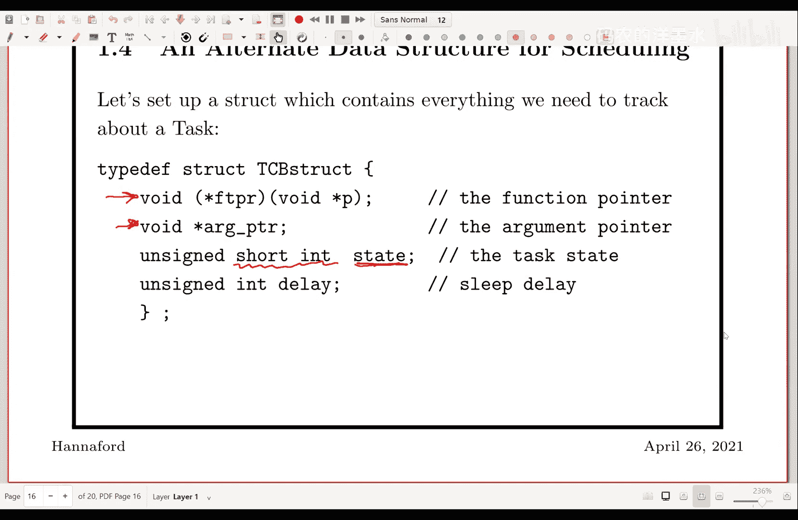


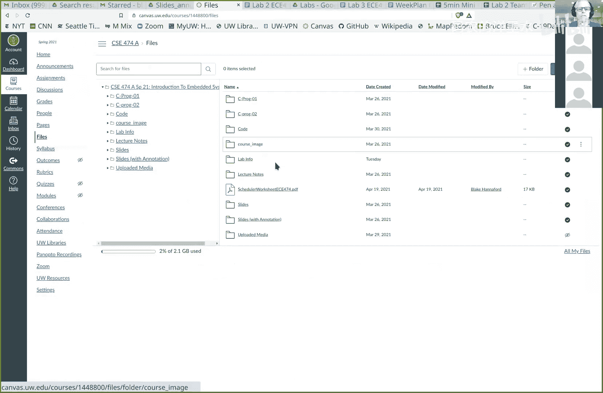

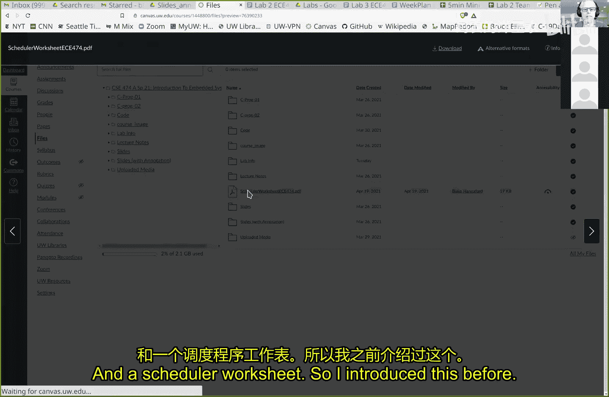

一个任务可以有多种状态，例如：就绪（READY）、运行（RUNNING）、等待/睡眠（WAITING）、停止（INACTIVE）。我们可以维护不同的列表（数组）来存放处于不同状态的任务函数指针。

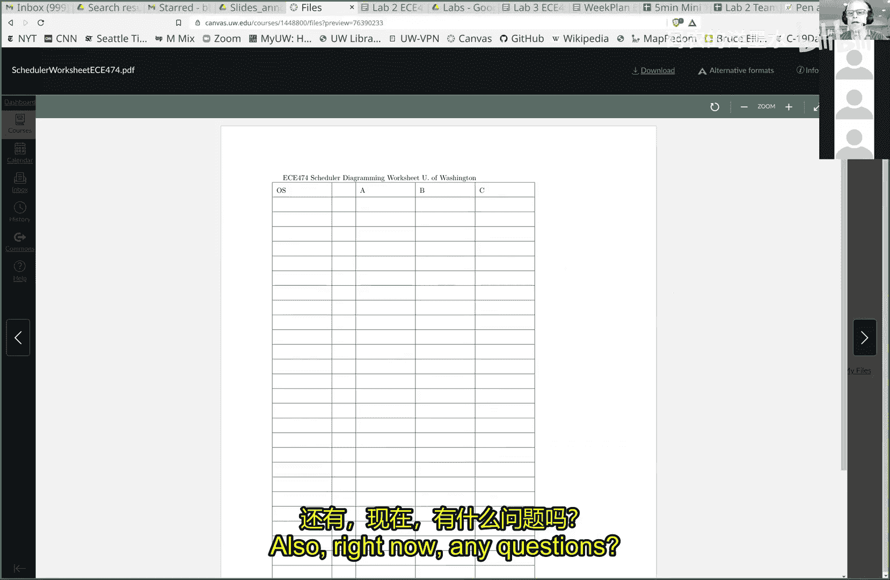


一种简单的设计是维护三个列表：`readyTasks`（就绪）、`waitingTasks`（等待）、`haltedTasks`（停止）。调度器只执行 `readyTasks` 列表中的任务。当任务调用 `haltMe()` 时，将其从 `readyTasks` 移到 `haltedTasks`。当任务调用 `sleep(delay)` 时，将其从 `readyTasks` 移到 `waitingTasks`，并记录其剩余的延迟时间。每个系统滴答，调度器会减少所有 `waitingTasks` 的延迟值，当延迟为零时，再将任务移回 `readyTasks`。

### 任务控制块（TCB）方法

更常用的方法是使用任务控制块（TCB）。TCB是一个结构体，包含一个任务的所有相关信息。

一个TCB的伪代码定义如下：
```c
typedef struct {
    void (*taskPtr)(void*); // 函数指针
    void* argPtr;           // 任务参数指针（通用类型）
    short state;            // 任务状态（如READY, WAITING, INACTIVE）
    unsigned int delay;     // 剩余延迟时间（若在等待状态）
} TCB;
```
然后，我们可以创建一个TCB数组 `taskList[MAX_TASKS]` 来管理所有任务。这种方法将所有数据封装在一起，比维护多个独立数组更清晰。

以下是使用TCB初始化任务的伪代码示例：
```c
TCB taskList[10];
int j = 0;

// 初始化任务A
taskList[j].taskPtr = &taskA;
taskList[j].argPtr = NULL; // 无参数
taskList[j].state = INACTIVE;
taskList[j].delay = 0;
j++;

// 初始化任务B（假设需要一个整数参数）
int period = 56;
taskList[j].taskPtr = &taskB;
taskList[j].argPtr = (void*)&period; // 将int指针转换为void指针
taskList[j].state = READY;
taskList[j].delay = 0;
j++;

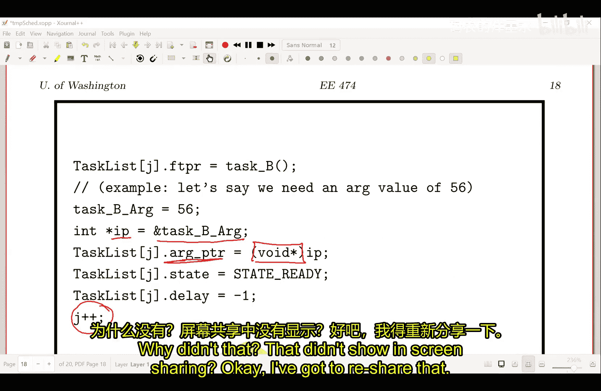


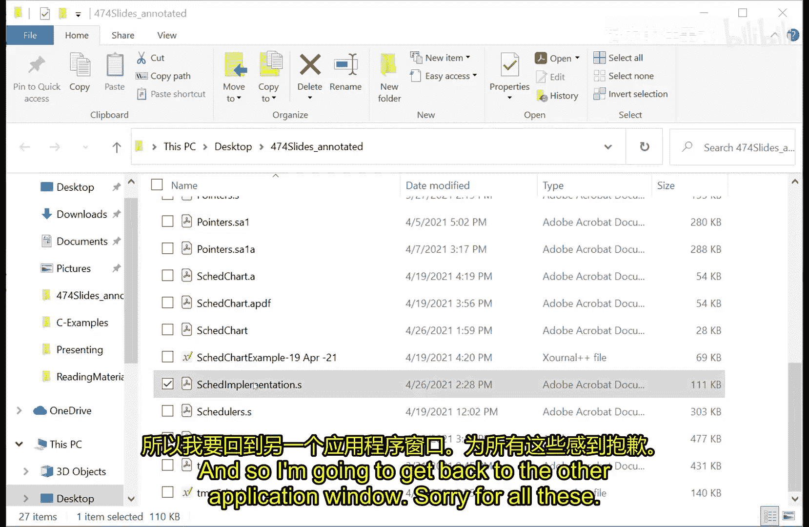


// 标记列表结束
taskList[j].taskPtr = NULL;
```
基于TCB的调度器伪代码框架如下：
```c
void scheduler() {
    for (int i = 0; i < MAX_TASKS && taskList[i].taskPtr != NULL; i++) {
        if (taskList[i].state == READY) {
            // 执行任务
            taskList[i].taskPtr(taskList[i].argPtr);
        } else if (taskList[i].state == WAITING) {
            // 减少延迟，如果为0则唤醒（状态改为READY）
            if (taskList[i].delay > 0) {
                taskList[i].delay--;
                if (taskList[i].delay == 0) {
                    taskList[i].state = READY;
                }
            }
        }
        // INACTIVE状态的任务被跳过
    }
}
```
关键函数伪代码：
*   `haltMe()`: 将当前任务的TCB状态设置为 `INACTIVE`。调用该函数的任务应立即返回，确保其停止执行。
*   `startTask(int taskID)`: 将 `taskList[taskID]` 的状态设置为 `READY`。
*   `sleep(unsigned int d)`: 将当前任务的TCB状态设置为 `WAITING`，并将 `delay` 字段设置为 `d`。调用该函数的任务也应立即返回。

---

## 调度时序分析

理解调度器行为的一个有效方法是进行时序图表分析。这有助于验证一组任务在给定的时间约束下是否可调度。

假设系统滴答为1毫秒。我们定义三个任务：
*   **任务A**: 计算时间C=0.3ms，周期P=1ms。
*   **任务B**: C=0.3ms，P=1ms。
*   **任务C**: C=0.15ms，P=3ms（即运行一次后睡眠2ms）。

我们可以绘制一个时间线，以毫秒为单位，展示每个任务何时执行、何时睡眠。通过这种分析，我们可以直观地看到CPU时间是否被充分利用，以及所有任务的截止时间是否都能得到满足。这种分析在硬实时系统中至关重要。

---

## 总结

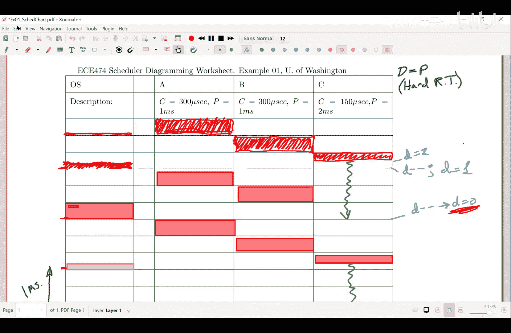

本节课我们一起学习了构建嵌入式系统调度器的进阶知识。我们从回顾直接硬件操作和实验二开始，然后深入探讨了如何利用函数指针和任务控制块来实现一个支持非阻塞延迟和动态任务管理的调度器。我们比较了多列表和TCB两种管理方式，并了解了关键函数（`haltMe`, `startTask`, `sleep`）的实现思路。最后，我们介绍了通过时序图表分析任务调度可行性的方法。掌握这些概念对于设计高效、可靠的并发嵌入式系统至关重要。