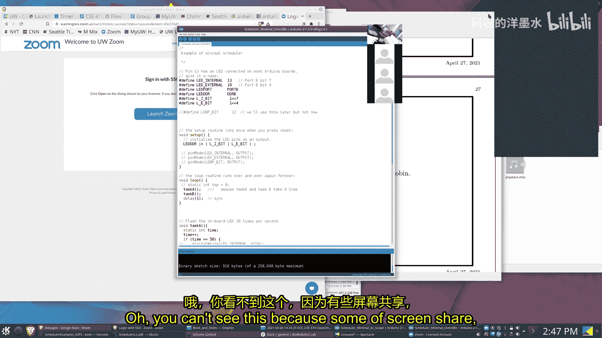
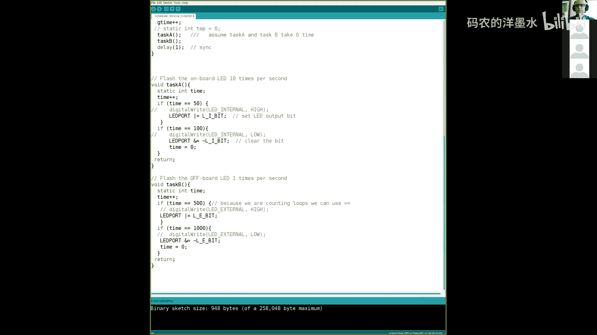
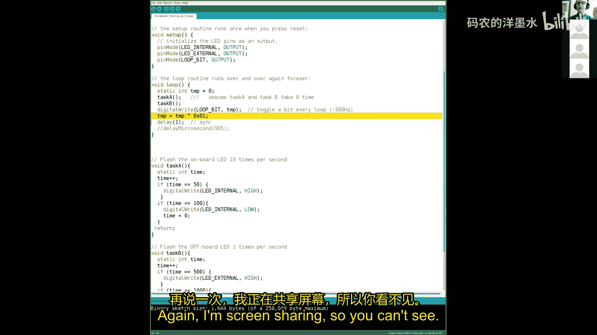
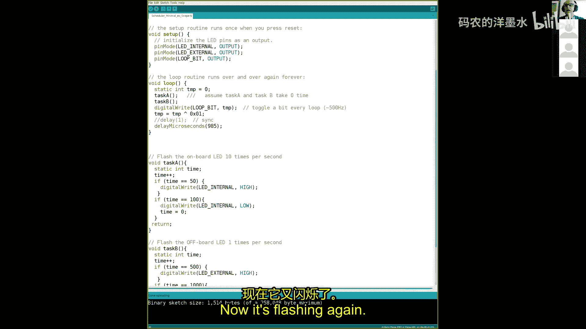
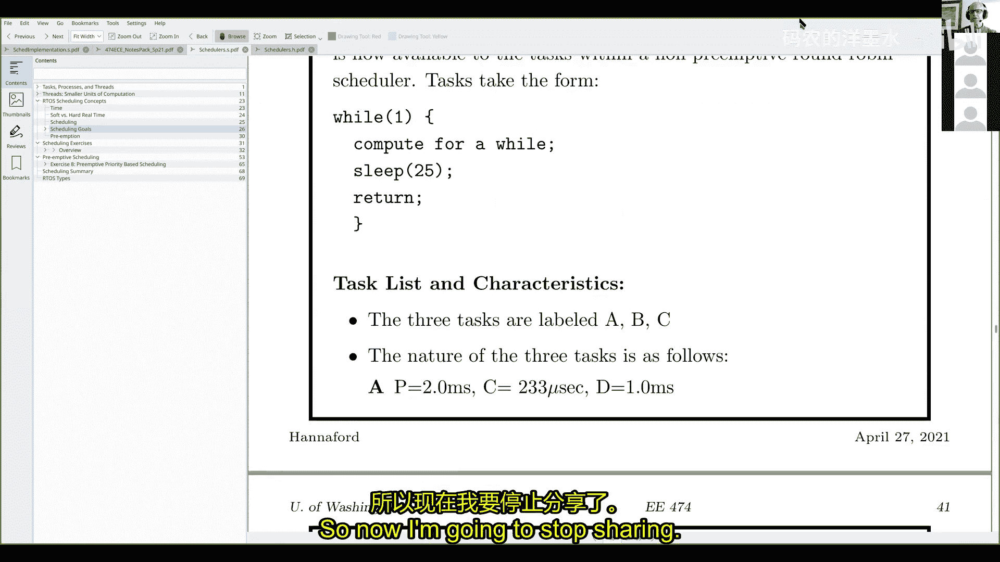
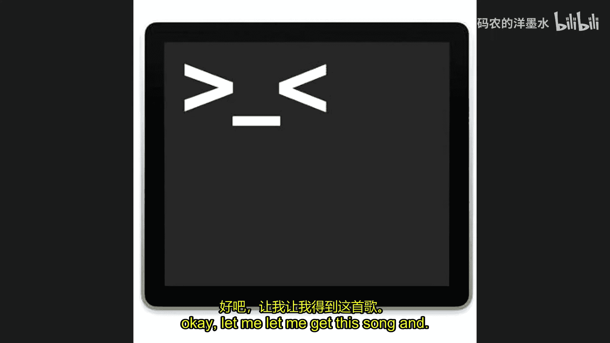

# 011：调度III


在本节课中，我们将通过一个实际的Arduino示例，学习如何实现一个简单的多任务调度系统。我们将编写代码让两个LED以不同频率闪烁，并探讨如何测量和调整任务执行时间，以确保调度的准确性。最后，我们会讨论更高级的调度概念，如抢占式调度和任务休眠。

## 概述与演示准备

上一节我们介绍了多种调度概念。本节中，我们来看看如何将这些概念付诸实践。我们将从一个简单的双任务调度示例开始。

首先，教授强调了在Piazza上提问的重要性，并鼓励大家将问题设为公开，以便整个班级都能从问答中受益。接着，他提到为了帮助那些仍在为多任务协同运行而困惑的同学，将展示一个具体的Arduino示例。

## 简单的双任务调度示例

我们将创建两个简单的任务：一个以10Hz频率闪烁板载LED，另一个以1Hz频率闪烁外部LED。目标是演示如何在不使用复杂操作系统的情况下，让多个任务“同时”运行。

以下是代码的核心部分，包括定义和设置：




```cpp
// 引脚定义
#define INTERNAL_LED_PIN 13 // 板载LED对应引脚
#define EXTERNAL_LED_PIN 10 // 外部LED对应引脚

// 寄存器定义（针对ATmega328P）
#define LED_PORT PORTB
#define LED_DDR DDRB
#define INTERNAL_LED_BIT 7 // PORTB bit 7
#define EXTERNAL_LED_BIT 4 // PORTB bit 4

void setup() {
    // 设置LED引脚为输出模式
    LED_DDR |= (1 << INTERNAL_LED_BIT) | (1 << EXTERNAL_LED_BIT);
}
```




在`loop`函数中，我们将依次调用两个任务函数，然后延迟1毫秒。这构成了我们调度器的基本周期。

```cpp
void loop() {
    taskA(); // 执行任务A
    taskB(); // 执行任务B
    delay(1); // 延迟1毫秒，构成调度周期
}
```



每个任务函数内部使用`static`变量来在多次调用之间保持状态，从而模拟一个独立运行的计时器。


```cpp
void taskA() {
    static unsigned long time = 0; // 静态变量，在调用间保持值
    time++; // 每次调用增加1，代表时间流逝

    if (time == 50) {
        // 50毫秒后点亮LED（10Hz周期的一半）
        LED_PORT |= (1 << INTERNAL_LED_BIT);
    }
    if (time == 100) {
        // 100毫秒后熄灭LED，并重置计时器
        LED_PORT &= ~(1 << INTERNAL_LED_BIT);
        time = 0;
    }
}



void taskB() {
    static unsigned long time = 0;
    time++;

    if (time == 500) {
        // 500毫秒后点亮LED（1Hz周期的一半）
        LED_PORT |= (1 << EXTERNAL_LED_BIT);
    }
    if (time == 1000) {
        // 1000毫秒后熄灭LED，并重置计时器
        LED_PORT &= ~(1 << EXTERNAL_LED_BIT);
        time = 0;
    }
}
```

这个方案基于一个关键假设：`taskA`和`taskB`的执行时间接近于零。如果任务执行时间过长，会破坏整个调度周期。

## 测量与调整任务执行时间

为了验证我们的假设并提高调度精度，我们需要测量循环的实际执行时间。

我们添加一个“循环位”到引脚12，并在每次循环中翻转它。通过示波器测量该引脚输出的方波频率，可以推算出循环的实际周期。

```cpp
#define LOOP_BIT_PIN 12
#define LOOP_DDR DDRB
#define LOOP_BIT 4 // 假设使用PORTB bit 4，需根据实际连接调整

void setup() {
    // ... 其他设置 ...
    LOOP_DDR |= (1 << LOOP_BIT); // 设置循环位引脚为输出
}

void loop() {
    static uint8_t temp = 0;
    taskA();
    taskB();
    // 翻转循环位
    temp ^= 1; // 使用异或操作翻转最低位
    digitalWrite(LOOP_BIT_PIN, temp & 0x01);
    delayMicroseconds(985); // 调整后的延迟，使总周期接近1ms
}
```

初始测量显示频率约为488Hz，而非理想的500Hz（对应1ms周期）。这表明`taskA`、`taskB`和位翻转操作总共消耗了约15微秒。因此，我们将延迟从1000微秒减少到985微秒，使总循环时间接近1毫秒，测量频率随之改善到约498Hz。


这个调整过程揭示了简单调度器的局限性：它依赖于对任务执行时间的精确估计，并且对代码变更非常敏感。

## 关于全局变量与局部静态变量的讨论



有同学提问为何不使用全局变量来跟踪时间。教授指出，虽然使用全局变量（如`unsigned long globalTime`）并让所有任务参考它是可行的，但这会引入复杂性。

每个任务需要计算相对于自身上次动作的时间差，而不是简单地检查一个本地计数器是否达到特定值。使用局部静态变量让每个任务管理自己的周期计时器，逻辑更清晰、更独立。全局变量更适用于需要绝对时间同步的复杂场景，但在本例中，本地计时已足够。

## 从协作式调度到抢占式调度

我们目前实现的是一种“协作式”调度。每个任务必须主动、快速地返回控制权给调度器。任务不能调用像`delay()`这样的阻塞函数，否则会冻结整个系统。

更先进的调度方式是“抢占式”调度。在这种模式下，操作系统（或调度器）使用硬件中断强制暂停正在运行的任务，保存其状态，然后恢复运行另一个任务。这使得程序员可以编写更自然、可能包含阻塞调用的代码，而不会影响其他任务。现代桌面和移动操作系统都使用抢占式调度。

## 实现任务休眠（Sleep）

为了向更实用的系统迈进，我们可以实现一个非阻塞的`sleep`函数。任务可以调用`sleep(ms)`来请求暂停一段时间，在此期间调度器可以运行其他就绪的任务。




这通常通过为每个任务维护一个软件计数器来实现。调度器在每个时钟节拍递减所有休眠任务的计数器，当某个任务的计数器减到零时，就将其状态设置为就绪。

以下是这种模式的任务示例：

```cpp
// 假设存在一个非阻塞的 sleep_ms 函数
void taskB_new() {
    doComputation(); // 执行一些计算，耗时233微秒
    sleep_ms(3000);  // 休眠3000毫秒，但不会阻塞其他任务
    // 任务醒来后，周期性地重复此过程
}
```

在这种模型下，任务的周期由自身的“计算 + 休眠”逻辑决定，并且通常是调度器时钟周期的整数倍。这更贴近实际嵌入式系统的编程模式，例如一个电机控制器可能每20毫秒（50Hz）更新一次。

## 实际系统的调度考量

在实际的实时系统中，设计者非常关注“可调度性”分析。即，在给定的任务集（每个任务有计算时间C、周期P、截止时间D）和调度算法下，是否能保证所有任务总能满足其截止时间。

任务的实际执行时间可能会有波动。因此，将调度表安排得过于紧凑是危险的。需要留出一定的空闲时间或“余量”，以应对最坏情况下的执行时间，确保系统在最繁忙时也能满足所有实时要求。

## 总结与实验室建议

本节课我们一起学习了如何实现一个简单的协作式多任务调度器。我们从让两个LED闪烁的示例开始，演示了如何使用静态变量管理任务状态，以及如何测量和调整调度周期以提高精度。

我们讨论了全局变量与局部变量的选择，并引出了更强大的抢占式调度概念。最后，我们探讨了实现非阻塞任务休眠的方法，以及在实际嵌入式系统设计中考虑可调度性和时间余量的重要性。

对于正在进行的实验，请记住：
1.  从简单的任务开始测试你的调度器。
2.  避免在任务中使用阻塞式`delay()`。
3.  利用示波器（如果有）或通过听觉（对于发声任务）来验证定时是否大致正确。
4.  仔细查阅硬件（如LED点阵）的数据手册，并使用万用表的二极管测试档来验证引脚连接。


通过Piazza继续提问和讨论，并尽量将问题公开以惠及全班。