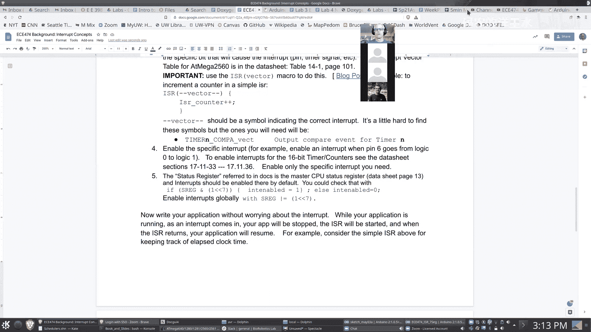
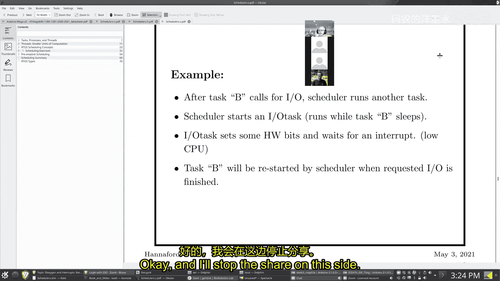
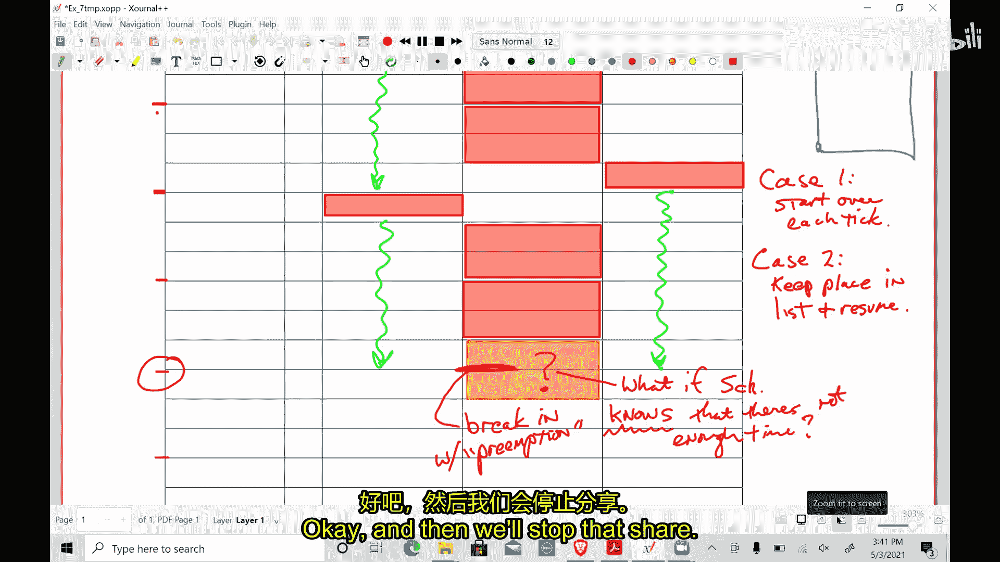

# 012：读取模拟数据及中断入门


在本节课中，我们将要学习中断服务程序（ISR）的基本概念与设置方法，并介绍一个用于自动生成代码文档的专业工具 Doxygen。我们还将回顾任务调度的核心概念，为后续的编程实践打下基础。


## 概述：中断与文档工具

上一节我们介绍了定时器和任务调度的基础。本节中，我们来看看如何利用硬件中断来实现更精确的定时控制，并引入 Doxygen 工具来规范我们的代码文档。

首先，我们介绍一个在 Lab 3 和 Lab 4 中需要使用的专业文档工具：Doxygen。

## Doxygen 工具介绍

Doxygen 是一个广泛使用的软件工程工具，它能自动分析你的代码和特定格式的注释，并生成结构清晰的 HTML 文档。这消除了手动编写详细描述代码的重复工作。

以下是使用 Doxygen 的基本步骤：

1.  **安装 Doxygen**：根据你的操作系统（Windows、Mac 或 Linux）进行标准安装。
2.  **编写带标签的注释**：在你的 C 代码中，使用特定的 Doxygen 标签来注释函数、参数和返回值。
3.  **运行 Doxygen**：对源代码运行 Doxygen，它将自动生成一个包含所有文档的 HTML 文件夹。
4.  **提交文档**：将这个生成的文件夹包含在你的作业压缩文件中一并提交。

Doxygen 生成的文档包含模块列表、函数详细说明、参数描述，并且可以直接链接到源代码，非常便于管理和阅读。

## 中断核心概念详解

现在，让我们回到嵌入式系统的核心话题：中断。中断是让 CPU 暂停当前任务，转去处理紧急事件，之后再恢复原任务的一种机制。

以下是中断相关的核心概念：

*   **中断服务程序**：这是当中断发生时，CPU 要去执行的那段特定代码。
*   **中断使能与禁止**：可以通过设置特定的控制位来全局或局部地开启或关闭中断响应。
*   **内部与外部中断**：
    *   内部中断源自芯片内部，如定时器溢出。
    *   外部中断由芯片引脚上的电平变化触发。
*   **中断优先级**：当多个中断同时发生时，高优先级的中断可以打断低优先级中断的服务程序。
*   **中断向量表**：这是内存中一个固定的区域，存放着各个中断对应的服务程序的入口地址。当中断发生时，硬件会根据中断号查找这个表并跳转到相应的地址。

在我们的 Arduino (ATmega2560) 芯片中，中断向量表定义在数据手册的特定位置。例如，定时器1的比较匹配 A 中断对应向量表中的特定槽位。

## 设置中断服务程序的步骤

为了使用中断，我们需要按照特定顺序进行软件设置。以下是主要步骤：



1.  **配置外设**：例如，设置定时器的控制寄存器，使其在特定条件（如比较匹配）下产生中断请求。
2.  **编写 ISR**：使用 `ISR()` 宏来定义你的中断服务程序。这个宏能确保在进入和退出你的代码时，正确处理上下文保存与恢复。
    ```c
    ISR(TIMER1_COMPA_vect) {
        // 你的中断处理代码放在这里
    }
    ```
3.  **使能中断**：
    *   在外设级别使能特定中断（如定时器的比较匹配中断使能位）。
    *   在系统级别，通过设置状态寄存器（SREG）中的全局中断使能位来开启中断。
    ```c
    sei(); // 设置全局中断使能位
    ```
4.  **保持 ISR 简洁**：中断服务程序应尽可能短小高效，避免执行复杂操作或长时间阻塞，以免影响其他中断或系统功能。





## 任务调度深入分析

接下来，我们再次审视任务调度，通过图示分析来理解调度器在不同情况下的决策逻辑。

考虑一个包含三个任务（A, B, C）的系统，我们使用非抢占式调度器。通过绘制时间线图，我们可以分析：
*   当任务执行时间接近或超过系统节拍时会发生什么。
*   调度器指针移动策略（每拍从头开始 vs. 继续循环）对任务执行的影响。
*   如何判断一个任务是否应该在当前节拍执行，以避免错过其他任务的关键唤醒时机。

这种分析揭示了编写健壮调度器时必须考虑的边界情况，例如计算任务最坏执行时间、处理所有任务都处于“休眠”的状态等。这也引出了**抢占式调度**的优势：它允许高优先级任务立即打断低优先级任务，从而更灵活地满足实时性要求。

## I/O 请求与调度

最后，我们简要介绍涉及 I/O 操作的任务调度。当任务需要访问慢速外设（如磁盘、网络）时，它需要等待 I/O 操作完成。



在这种情况下，调度器可以将该任务置为“等待”状态，并切换到其他就绪任务去执行。当 I/O 操作完成后（通常通过中断通知），原来的任务可以再次被标记为就绪状态。这种机制极大地提高了 CPU 的利用率。

## 总结

本节课中我们一起学习了以下内容：
1.  如何使用 Doxygen 工具自动生成专业的代码文档。
2.  中断机制的核心概念，包括 ISR、向量表、优先级和使能控制。
3.  设置定时器中断服务程序的具体步骤和最佳实践。
4.  通过图表深入分析了非抢占式任务调度中的复杂情况和设计考量。
5.  了解了在任务中进行 I/O 操作时的调度策略。


掌握中断是嵌入式编程从入门到精通的关键一步，它将帮助你构建出时序更精确、响应更及时的系统。请务必仔细阅读提供的文档，并在实验中进行实践。