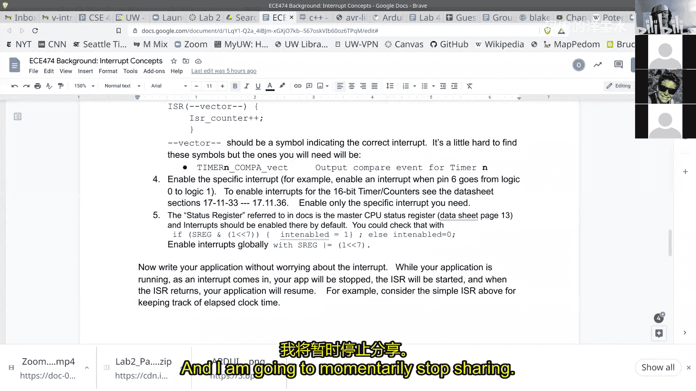
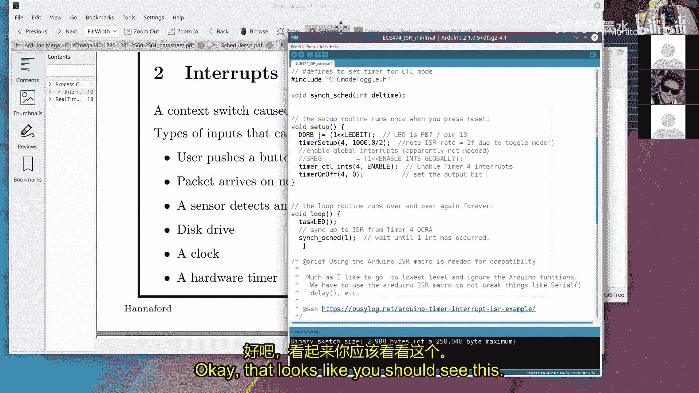
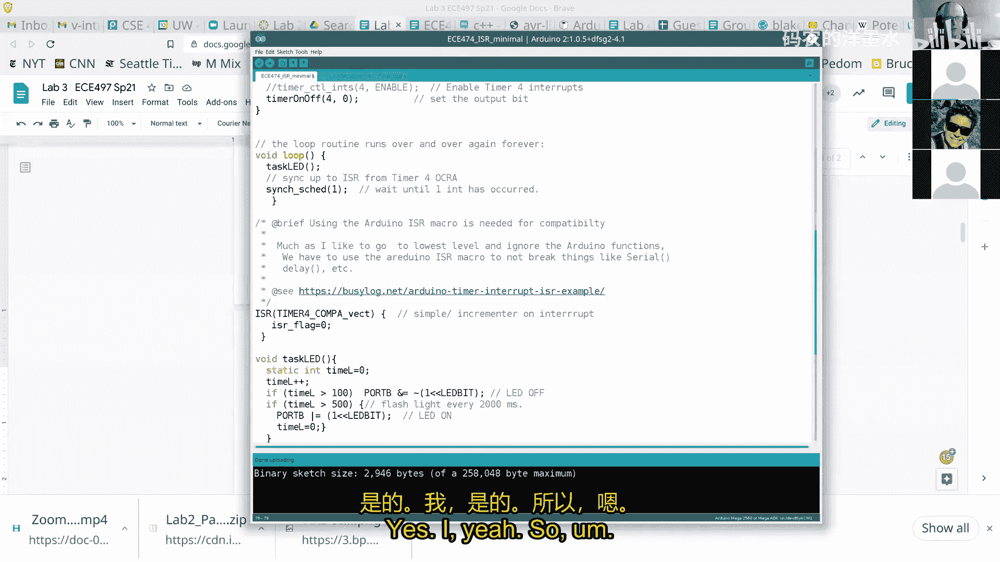
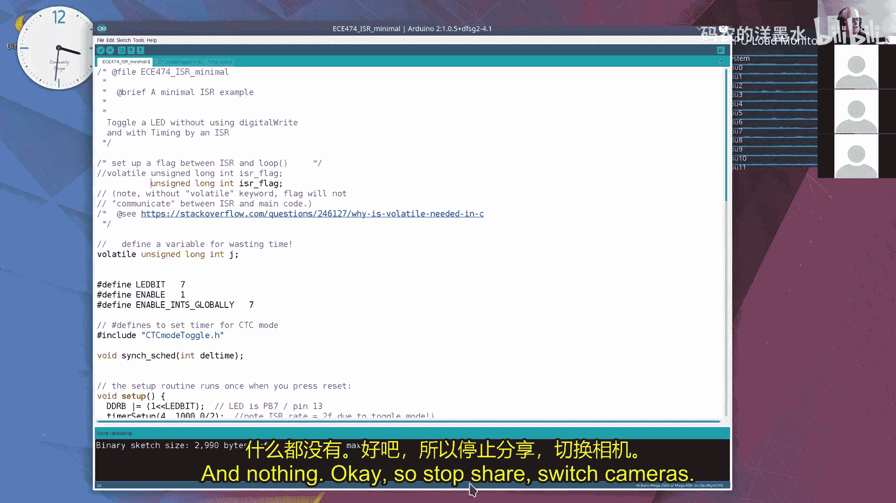

# 014：期中复习


在本节课中，我们将深入学习中断和中断服务程序（ISR）的核心概念。这是本课程最重要的内容之一，也是完成实验三的关键。我们将通过理论回顾和实际代码演示，帮助你掌握如何配置和使用中断。

## 概述：中断与ISR基础

上一节我们介绍了中断的基本理论。本节中，我们将通过实际代码示例，看看如何配置硬件定时器来产生中断，并编写相应的ISR来响应这些中断。

中断是嵌入式系统中实现异步事件处理的核心机制。它允许处理器在执行主程序的同时，响应来自硬件（如定时器、传感器）的即时请求。

## 中断配置与ISR编写



要使用中断，我们的软件必须按顺序完成以下步骤。以下是具体流程：




1.  **配置设备**：首先，我们需要配置一个硬件设备（如定时器）来在特定条件下（例如，每毫秒）产生中断。
2.  **编写ISR**：接着，我们需要编写中断服务程序（ISR），即当中断发生时自动执行的代码块。
3.  **启用中断**：最后，我们需要启用该设备的中断功能，并确保全局中断使能位已打开。

在Arduino环境（使用AVR-GCC编译器）中，我们使用一个特殊的宏来定义ISR。这不是一个普通的函数，因为编译器会自动在它的开头和结尾插入保存和恢复处理器状态的汇编代码。

**代码示例：定义一个简单的ISR**
```c
ISR(TIMER4_COMPA_vect) {
    // 当中断发生时，这里面的代码会被执行
    isr_flag = 0; // 例如，清除一个标志位
}
```
其中，`TIMER4_COMPA_vect` 是“中断向量”，它告诉系统这个ISR对应的是定时器4的“比较匹配A”事件。

## 关键概念：volatile关键字

在中断编程中，`volatile` 关键字至关重要。它告诉编译器，某个变量的值可能会被程序本身以外的因素（如ISR）改变，因此编译器不应对该变量的访问进行优化。

**公式/概念**：`volatile` 修饰的变量，编译器每次都会从内存中读取其值，而不是使用寄存器中可能已过期的缓存值。

例如，如果主循环在等待一个由ISR清除的标志位，而这个标志位没有用 `volatile` 声明，编译器可能会优化掉循环中的检查，导致程序永远等待下去。

## 编写高效ISR的最佳实践


为了确保系统稳定可靠，编写ISR时应遵循以下原则。以下是核心要点：

*   **保持简短**：ISR应尽可能短小精悍，只完成最必要的操作（如设置标志、更新计数），复杂的逻辑应放到主循环中处理。
*   **避免阻塞调用**：**绝对不要**在ISR中使用 `delay()`、`Serial.print()` 等函数。这些函数执行时间很长或可能自身产生中断，会导致系统混乱甚至崩溃。
*   **使用硬件调试**：使用LED闪烁是调试ISR是否触发的简单有效方法。也可以配置中断以较慢的速率触发，以便肉眼观察。
*   **注意临界区**：如果主循环和ISR会访问共享的全局变量，需要考虑通过暂时关闭中断等方式来保护这些“临界区”，防止数据竞争（本节课暂不深入）。



## 实战演示：一个简单的中断调度器

现在，我们来看一个将中断用于任务调度的最小示例。目标是创建一个精确的1毫秒调度节拍。

**核心思路**：
1.  配置一个定时器（如Timer4），使其每1毫秒产生一次中断。
2.  ISR中仅清除一个全局标志位（`isr_flag`）。
3.  主循环中，任务执行完毕后，会等待这个标志位被ISR清除，从而实现与1毫秒时钟的同步。


**代码框架示意**：
```c
volatile int isr_flag = 1; // 必须声明为volatile



ISR(TIMER4_COMPA_vect) {
    isr_flag = 0; // 每毫秒清除一次标志
}

void sync_with_scheduler() {
    while (isr_flag == 1) {
        // 空循环，等待中断
    }
    isr_flag = 1; // 为下一次等待重置标志
}

void loop() {
    run_task_a(); // 运行任务A
    run_task_b(); // 运行任务B
    sync_with_scheduler(); // 等待下一个1毫秒周期
}
```
通过这种方式，只要所有任务的总执行时间小于1毫秒，`loop()` 就能以精确的1毫秒周期循环执行。

## 总结


本节课中我们一起学习了嵌入式系统的中断编程。我们回顾了中断的配置流程，学习了如何使用 `ISR()` 宏编写中断服务程序，并理解了 `volatile` 关键字在共享变量中的关键作用。通过实际演示，我们看到了一个基于中断的简单调度器如何工作，也了解了编写高效、稳定ISR的最佳实践（保持简短、避免阻塞）。掌握这些知识，是完成后续实验和构建复杂嵌入式系统的坚实基础。