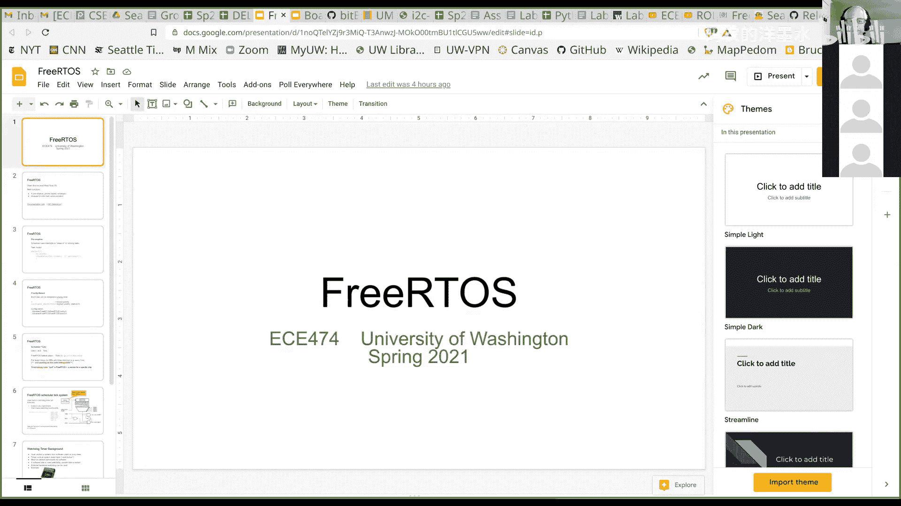
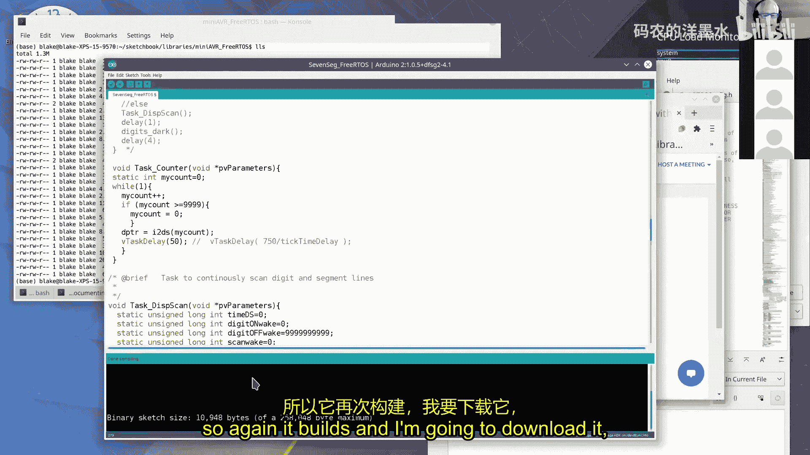
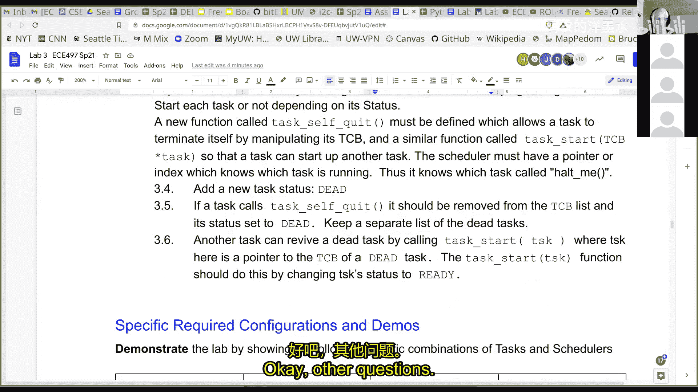

# 015：实验3导论


在本节课中，我们将学习两种关键的串行通信协议（I²C和SPI），并介绍一个用于嵌入式系统的实时操作系统（FreeRTOS）。这些知识对于理解现代嵌入式设备如何高效通信和管理任务至关重要。

## 串行通信协议：I²C与SPI

上一节我们介绍了串行数据传输的基本概念。本节中，我们来看看两种在现代嵌入式系统中广泛应用的串行总线协议：I²C和SPI。

### I²C总线

I²C（Inter-Integrated Circuit）总线由飞利浦公司（现NXP）开发，仅使用两根线进行通信：
*   **SCL**：串行时钟线
*   **SDA**：串行数据线

这种设计极大地减少了芯片引脚数量和电路板布线空间。在I²C通信中，一个设备作为**协调者**（原称Master），其他设备作为**响应者**（原称Slave）。总线空闲时，两条线均为高电平。

通信以一个**起始条件**开始：当SCL为高电平时，SDA线产生一个从高到低的跳变。随后，协调者发送7位设备地址和1位读写方向位。地址匹配的响应者会回复一个确认（ACK）信号。之后，数据字节在协调者和响应者之间传输，最后由协调者发出**停止条件**（SCL为高时，SDA从低跳变到高）结束通信。

I²C的一个限制是只有128个（7位）地址。为了解决地址冲突，通常使用额外的使能引脚来选择不同的设备。

### SPI总线

SPI（Serial Peripheral Interface）总线由摩托罗拉公司开发，使用四根线：
*   **SCK**：串行时钟
*   **MOSI**：协调者输出，响应者输入
*   **MISO**：协调者输入，响应者输出
*   **SS**：片选信号

SPI没有地址概念，它通过**片选信号**来选择特定的响应者设备。数据通过移位寄存器在协调者和被选中的响应者之间同时进行全双工传输。SPI的另一种连接方式是**菊花链**，所有设备共用一根片选线，数据依次通过每个设备。这种方式节省引脚，但要求软件清楚了解拓扑结构，并且访问单个设备可能变慢。

在我们的Arduino Mega 2560开发板上，有专门的硬件模块支持SPI和I²C（在数据手册中称为TWI，即两线接口），可以自动处理数据传输，减轻CPU负担。

除了使用硬件模块，也可以通过**位敲击**的方式，用普通GPIO引脚模拟这些总线协议。这种方式具有更好的移植性，但速度较慢且会完全占用CPU。




## 实时操作系统：FreeRTOS

理解了任务调度器的工作原理后，本节我们来看一个功能更强大的实时操作系统——FreeRTOS。这是一个开源的、专为微控制器设计的小型操作系统。

### FreeRTOS概述

FreeRTOS的核心是一个**基于优先级的抢占式调度器**。这意味着高优先级任务可以中断正在运行的低优先级任务。这与我们之前编写的协作式调度器有本质区别，允许程序员更自然地编写任务代码（例如使用 `while(1)` 循环）。

FreeRTOS还提供了用于任务间通信的**队列**等机制，可以安全地传递数据块。

FreeRTOS的调度器节拍默认最快为15毫秒，它通常使用芯片的**看门狗定时器**来产生周期性中断，而不是占用用户可用的通用定时器。

### 看门狗定时器

看门狗定时器是嵌入式系统中一个重要的可靠性组件。其原理是：软件需要定期“喂狗”（即重置定时器），如果软件因故障（如死循环）未能按时喂狗，看门狗定时器将超时并触发系统复位。这可以防止系统因软件错误而永久挂起，在汽车、医疗等安全关键系统中广泛应用。

### FreeRTOS任务示例

以下是使用FreeRTOS创建和运行任务的基本代码结构：

```c
#include <Arduino_FreeRTOS.h>

// 任务函数1：闪烁LED
void TaskBlink(void *pvParameters) {
    pinMode(LED_BUILTIN, OUTPUT);
    while(1) {
        digitalWrite(LED_BUILTIN, HIGH);
        vTaskDelay(200 / portTICK_PERIOD_MS); // 延迟约200毫秒
        digitalWrite(LED_BUILTIN, LOW);
        vTaskDelay(200 / portTICK_PERIOD_MS);
    }
}

// 任务函数2：计数器
void TaskCounter(void *pvParameters) {
    static int count = 0;
    while(1) {
        count++;
        if(count > 9999) count = 0;
        // 此处可添加更新显示的代码
        vTaskDelay(50); // 延迟50个调度节拍（约750毫秒）
    }
}



void setup() {
    // 创建任务
    xTaskCreate(TaskBlink, "Blink", 128, NULL, 3, NULL);
    xTaskCreate(TaskCounter, "Counter", 128, NULL, 2, NULL);
    // 启动调度器
    vTaskStartScheduler();
}

void loop() {
    // FreeRTOS运行时，loop函数应保持为空
}
```

在 `xTaskCreate` 函数中，我们需要指定任务函数指针、任务名、堆栈大小、参数指针、优先级和任务句柄。启动调度器后，任务将根据其优先级自动运行。


## 实验3任务说明

关于实验3中的任务5，其核心是作为一个控制任务，管理其他任务的启动和停止。它需要按照特定顺序和时序来调度任务1、2、4。请注意，任务5专为DDS（动态截止期调度器）设计，应利用该调度器提供的特性（如 `task_delay`、`kill_self`）来实现控制逻辑，而不是在任务5内部再实现一个调度循环。

## 总结



本节课中我们一起学习了：
1.  **I²C和SPI串行总线协议**：它们如何用极少的连线实现芯片间通信，以及各自的优缺点和典型应用。
2.  **FreeRTOS实时操作系统**：其抢占式、基于优先级的调度模型，以及看门狗定时器的原理和重要性。
3.  **实验3的要点澄清**：特别是任务5的实现思路，应充分利用DDS调度器的功能进行任务管理。


掌握这些通信和系统管理的基础，对于构建复杂的嵌入式应用至关重要。