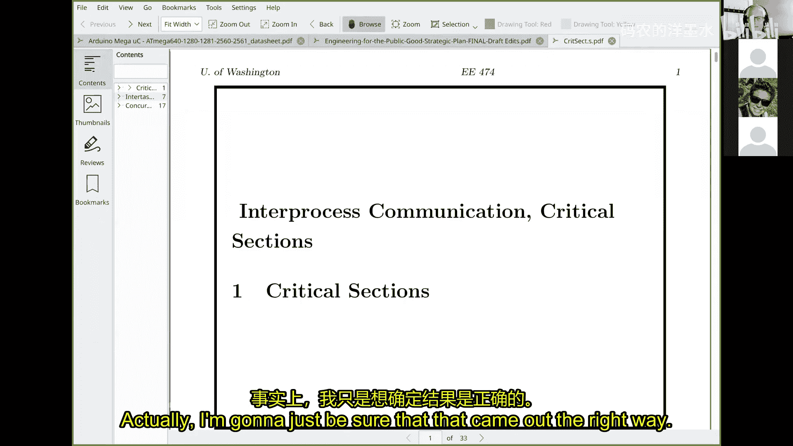
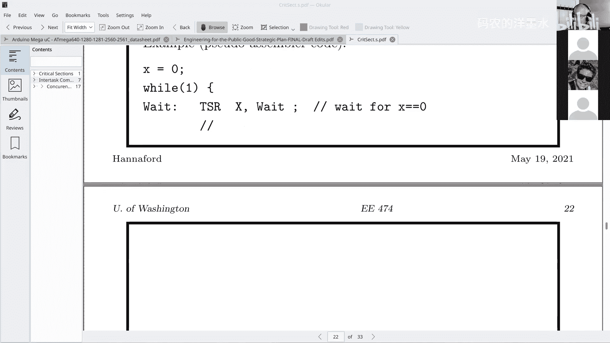
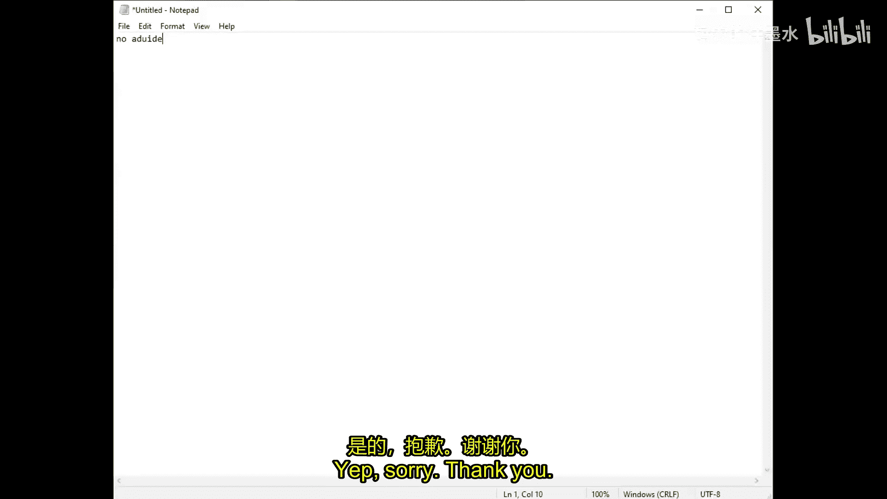
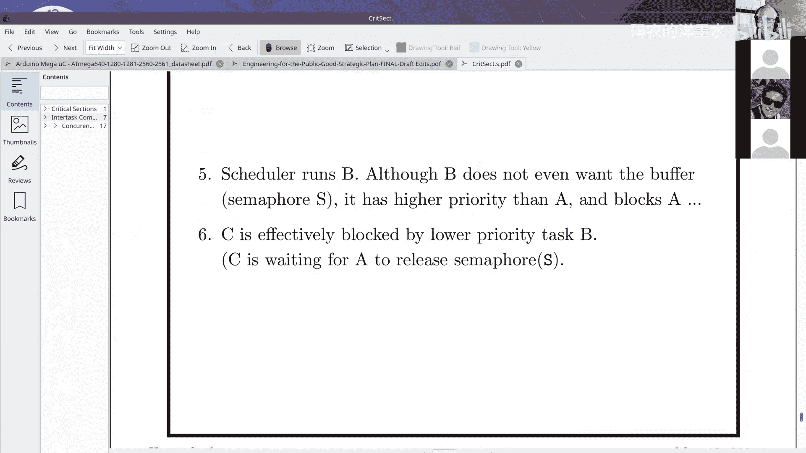
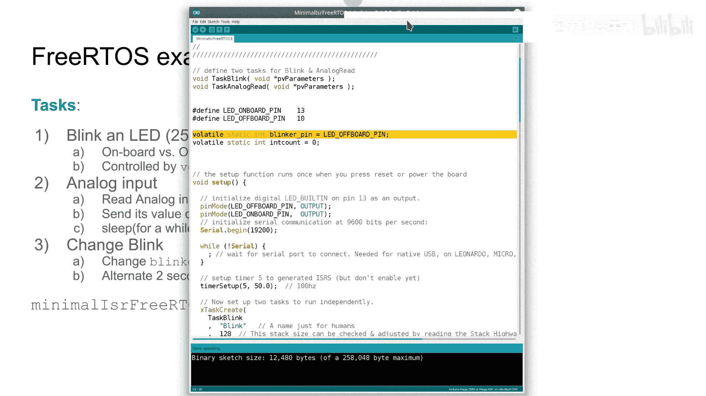
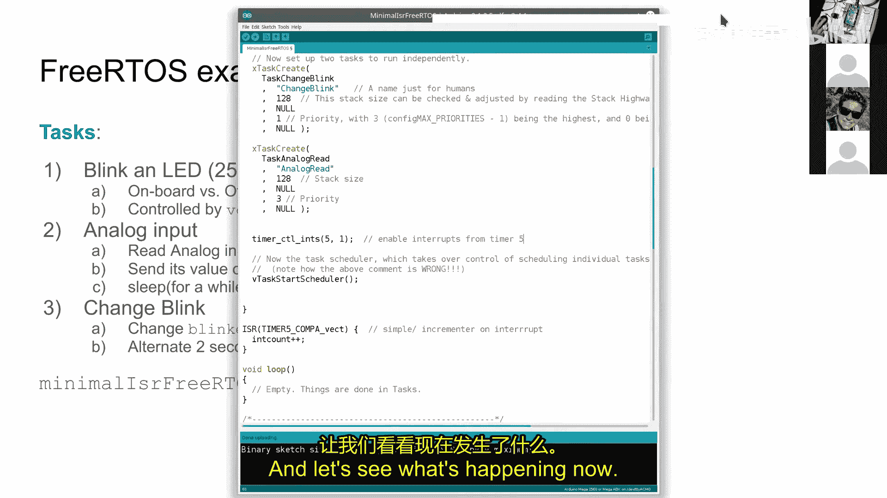
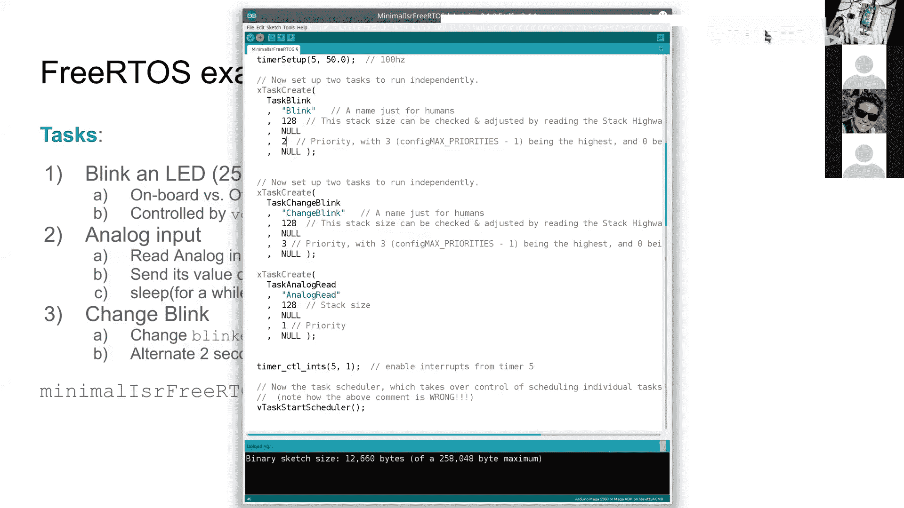
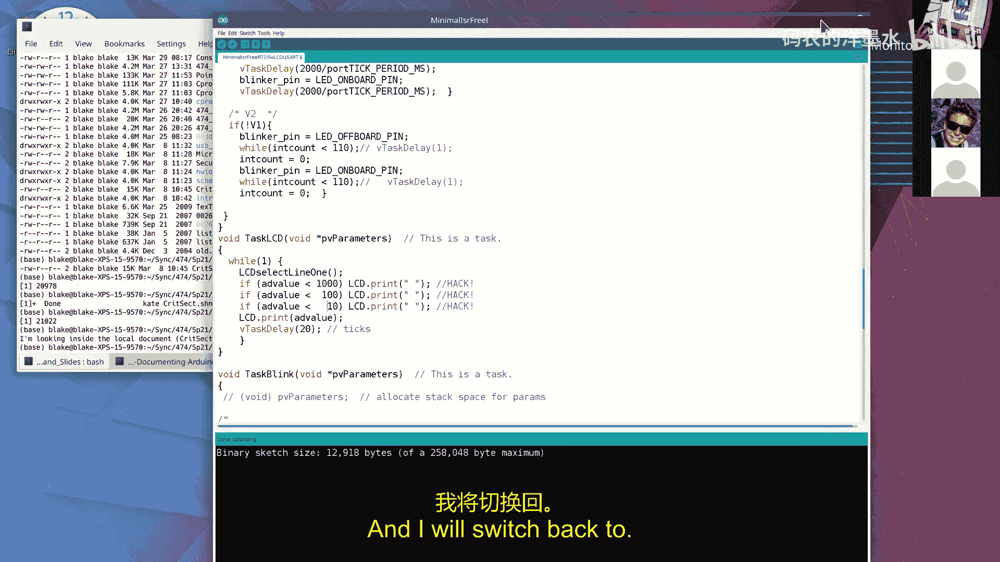

# 016：UART串行通信与RTOS进程间通信


在本节课中，我们将学习实时操作系统（RTOS）中进程间通信（IPC）的核心概念，特别是生产者-消费者模型、共享资源保护以及临界区。我们将探讨如何使用信号量等机制来安全地在任务间传递数据，并了解相关的潜在问题，如优先级反转。

---





## 概述：生产者-消费者模型与数据传递

上一节我们介绍了RTOS的任务调度。本节中，我们来看看任务之间如何安全、高效地共享数据。一个经典的模式是**生产者-消费者模型**：一个任务（生产者）生成数据，另一个任务（消费者）使用这些数据。

### 共享缓冲区实现

以下是实现该模型的一种简单伪代码，使用一个环形缓冲区（大小=5）来暂存数据。

```c
#define BUFFER_SIZE 5
Item buffer[BUFFER_SIZE];
int in = 0; // 生产者指针
int out = 0; // 消费者指针
int count = 0; // 缓冲区中当前项目数

// 生产者任务
void producer() {
    while (1) {
        while (count >= BUFFER_SIZE) {
            ; // 等待，直到缓冲区有空间
        }
        // 生产一个项目
        Item new_item = produce_item();
        buffer[in] = new_item;
        in = (in + 1) % BUFFER_SIZE;
        count++;
    }
}

// 消费者任务
void consumer() {
    while (1) {
        while (count == 0) {
            ; // 等待，直到缓冲区有数据
        }
        // 消费一个项目
        Item consumed_item = buffer[out];
        out = (out + 1) % BUFFER_SIZE;
        count--;
        consume_item(consumed_item);
    }
}
```

**核心思想**：生产者检查缓冲区是否有空间（`count < BUFFER_SIZE`），有则放入数据并移动指针。消费者检查缓冲区是否有数据（`count > 0`），有则取出数据并移动指针。指针到达末尾后回绕到开头，形成环形缓冲区。

---

## 进程间通信机制

除了直接共享内存（如全局变量或缓冲区），操作系统通常提供更高级、更安全的通信机制。

以下是几种常见的IPC方式：

*   **消息传递**：任务通过操作系统提供的API（如`send_message(process_id, message)`）直接发送消息给另一个任务。接收方通过类似`receive_message()`的调用等待并获取消息。
*   **邮箱**：可以看作一个命名的消息队列。发送方`post_message(mailbox_name, data)`，接收方`pend_on_mailbox(mailbox_name)`等待数据到达。
*   **队列**：FreeRTOS中的核心机制。允许消息按顺序排队，发送方和接收方通过队列句柄进行操作。当队列满时，发送方可能被阻塞；当队列空时，接收方被阻塞。

这些机制的优势在于，操作系统负责底层的同步和缓冲区管理，应用程序代码更简洁，且减少了因直接操作共享数据而引入错误的风险。

---

## 临界区与资源保护

在**抢占式**RTOS中，当一个任务正在检查并准备操作共享资源（如上述的`count`变量）时，它可能被高优先级任务打断。如果另一个任务也操作同一资源，就会导致数据不一致或逻辑错误。






**临界区**的定义是：一段**必须原子化执行**（即不可被中断）的**简短**代码。例如，上面伪代码中`count++`或`count--`及其前后的检查操作，共同构成了临界区。

### 保护临界区的方案


有多种方法可以保护临界区，防止因任务切换导致的问题。

#### 方案一：全局中断屏蔽

最直接的方法是进入临界区前关闭所有中断，退出时再打开。

```c
void access_shared_resource() {
    OS_interrupt_mask(); // 屏蔽所有中断
    // 临界区代码开始
    if (data_available) {
        process_buffer();
        set_flags();
    }
    // 临界区代码结束
    OS_interrupt_enable(); // 启用中断
}
```

*   **优点**：实现简单、快速。
*   **缺点**：过于粗暴。它会阻塞所有中断，即使那些与当前共享资源无关的中断（如定时器、串口）也被延迟，严重影响系统实时性。

#### 方案二：测试与置位指令

某些处理器提供特殊的**原子指令**，如`Test-and-Set`。它在一条指令内完成“测试变量值”和“设置变量值”两个操作，中间不可中断。

```assembly
; 伪汇编代码示例
TAS X ; 测试并设置变量X
JNZ WAIT ; 如果X不为0，跳转到WAIT循环等待
; 否则，进入临界区
... ; 临界区代码
MOV X, #0 ; 退出临界区，释放资源
```

*   **优点**：非常高效，只针对特定资源进行保护。
*   **缺点**：依赖硬件特性，编程较底层。

#### 方案三：信号量

**信号量**是操作系统提供的一种同步原语，是保护临界区和实现任务同步的**标准且推荐**的方法。可以将其理解为一个资源的计数器或一把钥匙。

在FreeRTOS中，常用的二进制信号量操作如下：



```c
SemaphoreHandle_t xSemaphore;


// 任务A（获取资源）
void taskA(void *pvParameters) {
    while (1) {
        // 尝试获取信号量（等待钥匙）
        if (xSemaphoreTake(xSemaphore, portMAX_DELAY) == pdTRUE) {
            // 进入临界区，安全地访问共享资源
            access_shared_resource();
            // 离开临界区，释放信号量（归还钥匙）
            xSemaphoreGive(xSemaphore);
        }
    }
}

// 任务B（获取资源）
void taskB(void *pvParameters) {
    while (1) {
        if (xSemaphoreTake(xSemaphore, portMAX_DELAY) == pdTRUE) {
            access_shared_resource();
            xSemaphoreGive(xSemaphore);
        }
    }
}
```

*   **优点**：
    *   **专业化**：为每个共享资源创建独立的信号量，阻塞粒度小。
    *   **高效**：操作系统仅在管理信号量队列的极短时间内屏蔽中断。
    *   **标准化**：广泛使用，可读性和可维护性强。
*   **缺点**：使用不当可能引发**优先级反转**。

---

## 优先级反转问题

优先级反转是使用信号量时可能遇到的一个经典问题。

**问题描述**：
1.  低优先级任务C获取了某个共享资源的信号量。
2.  高优先级任务A尝试获取同一信号量，但必须等待C释放，因此A被阻塞。
3.  此时，中优先级任务B（不需求该资源）就绪。由于B优先级高于C，它开始运行。
4.  结果：**中优先级任务B实际上阻塞了高优先级任务A**，因为B阻止了C运行，而C不运行就无法释放信号量，A也就无法继续。

**解决方案**：
*   **优先级继承**：当低优先级任务持有高优先级任务所需的信号量时，操作系统临时将低优先级任务的优先级提升到与等待它的最高优先级任务相同。这样，它就能尽快执行并释放资源。
*   **优先级天花板协议**：为信号量设置一个“天花板优先级”，任何获取该信号量的任务都将自动提升到此优先级。




---


## 实践示例：FreeRTOS多任务与LCD显示

我们将创建一个FreeRTOS示例，包含多个任务，并演示如何安全共享数据。

以下是核心任务框架：

```c
// 共享变量
volatile int adc_value = 0;
volatile int blinker_pin = OFFBOARD_LED_PIN;



// 任务1：闪烁LED
void blink_task(void *pvParameters) {
    pinMode(blinker_pin, OUTPUT);
    while (1) {
        digitalWrite(blinker_pin, HIGH);
        vTaskDelay(250 / portTICK_PERIOD_MS);
        digitalWrite(blinker_pin, LOW);
        vTaskDelay(100 / portTICK_PERIOD_MS);
    }
}




// 任务2：读取模拟输入并更新共享变量
void analog_read_task(void *pvParameters) {
    while (1) {
        adc_value = analogRead(ANALOG_PIN); // 写入共享变量
        Serial.println(adc_value); // 通过串口打印
        vTaskDelay(500 / portTICK_PERIOD_MS);
    }
}

// 任务3：在LCD上显示ADC值
void lcd_display_task(void *pvParameters) {
    lcd_init(); // 初始化LCD
    while (1) {
        lcd_clear();
        lcd_set_cursor(0, 0);
        lcd_print("ADC: ");
        lcd_print(adc_value); // 读取共享变量
        vTaskDelay(300 / portTICK_PERIOD_MS);
    }
}

// 任务4：通过中断计数切换LED引脚
volatile int isr_count = 0;
void change_blink_task(void *pvParameters) {
    while (1) {
        while (isr_count < 110) {
            vTaskDelay(1); // 等待中断发生
        }
        isr_count = 0;
        // 切换LED引脚
        blinker_pin = (blinker_pin == ONBOARD_LED_PIN) ? OFFBOARD_LED_PIN : ONBOARD_LED_PIN;
    }
}

// 定时器中断服务程序
ISR(TIMER5_OVF_vect) {
    isr_count++; // 在ISR中更新计数
}
```


**关键点**：
1.  **共享变量**：`adc_value`和`blinker_pin`被多个任务访问。对于在ISR中修改的变量（如`isr_count`），必须声明为`volatile`。
2.  **任务优先级**：需要谨慎设置。不合理的优先级可能导致任务饥饿或系统死锁（如之前演示的优先级反转现象）。
3.  **串口通信**：对于Arduino Mega等拥有多个硬件串口的设备，驱动外设（如串口LCD）时应优先使用硬件串口（如`Serial1`、`Serial2`、`Serial3`），其效率远高于软件模拟的`SoftwareSerial`库。

---

## 总结

本节课中我们一起学习了RTOS中进程间通信的核心知识。

我们首先分析了**生产者-消费者模型**及其基于环形缓冲区的实现。接着，探讨了操作系统提供的**消息传递、邮箱、队列**等高级IPC机制。然后，我们深入理解了在抢占式RTOS中，共享资源可能因任务切换而被破坏，从而引出了**临界区**的概念。



为了保护临界区，我们介绍了三种方案：简单但影响系统性能的**全局中断屏蔽**、高效的硬件级**测试与置位指令**，以及最通用和推荐的**信号量**机制。同时，我们也指出了信号量可能引发的**优先级反转**问题及其解决方案（优先级继承）。


最后，通过一个多任务FreeRTOS实践示例，我们综合运用了这些概念，演示了如何创建任务、安全共享变量、处理中断，并利用硬件串口驱动外设。请记住，在构建复杂的多任务系统时，合理设计任务优先级和正确使用同步原语（如信号量）是确保系统稳定可靠的关键。