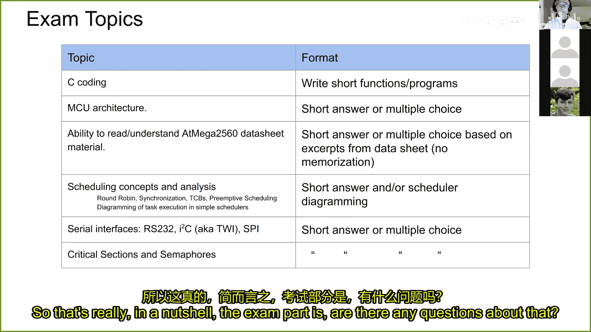
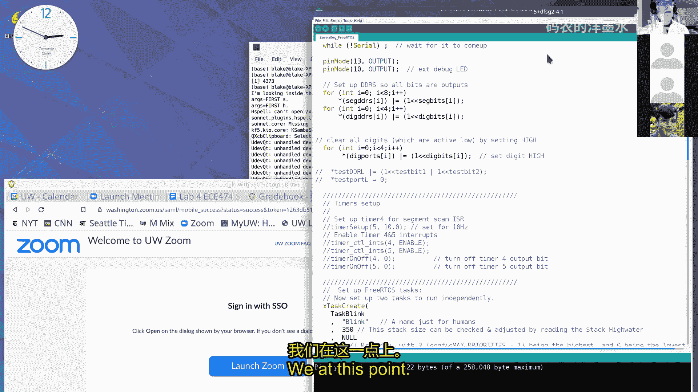
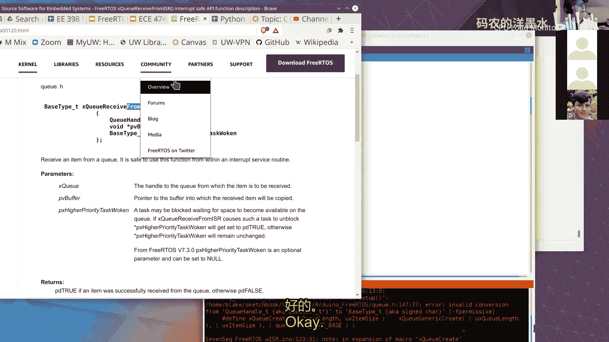

# 017：FreeRTOS 进阶应用与考试说明


在本节课中，我们将学习FreeRTOS中更高级的应用，特别是如何将中断服务程序（ISR）与任务调度结合，以及如何使用队列（Queue）进行任务间通信。同时，我们也会详细介绍期末考试的安排和形式。

## 考试与课程评分更新

首先，我们来更新一下课程评分结构和期末考试的相关信息。

根据本学期的实际情况，我们对评分结构进行了调整。具体变化如下：
*   取消了课堂参与分。
*   实验四（Lab 4）的总分增加到100分。其中，第一部分（4.1）将获得额外的5分，第二部分（4.2）增加了15分，这些分数将用于评估项目实现的创新性和挑战性。
*   期末考试的分值调整为50分。
*   课程总分仍保持为450分不变。

接下来是关于期末考试的详细信息。

考试将在华盛顿大学官方安排的考试时间进行，具体时间请查看MyUW日程表。考试形式为线上进行，大家需要在指定时间登录Zoom。



考试将分为两部分，这两部分会同时开放，你可以按任意顺序完成。
*   考试开始时间为下午2:30，结束时间为下午4:20。
*   第一部分是Canvas平台上的选择题测验，预计占10到15分。
*   第二部分是书面问答题，占总分的其余部分。


对于书面考试，你有多种提交方式：
*   使用白纸手写答案，注明题目编号，然后通过扫描仪或手机扫描应用生成PDF。
*   直接在文档中键入答案并保存为PDF。
*   在平板设备上书写并生成PDF。
*   请注意，我们不接受直接拍摄的照片，因为其质量通常难以保证。我们会推荐一些经过测试的免费手机扫描应用。

考试规则如下：
*   独立完成，禁止查阅互联网。
*   闭卷考试，但允许使用一张“小抄”（crib sheet）。你可以从任何笔记、视频或材料中总结信息并制作这张小抄以供考试时使用。

考试涵盖的主题大致如下：
*   **C语言编程**：可能需要编写小型函数或程序（无需运行）。
*   **微控制器架构**：关于处理器工作原理的简答题或选择题。
*   **数据手册阅读理解**：所有问题都会附上数据手册的摘录，你无需记忆，但需要根据提供的信息回答问题。
*   **调度概念与分析**：涉及轮转调度、同步、任务控制块、抢占式调度等，可能需要绘制调度图。
*   **串行数据通信**：包括USB等主题。
*   **临界区与信号量**：主要是课堂和阅读材料中讨论过的内容。



此外，我会在考试准备就绪后，发布针对性的复习材料。由于课程内容与往年有所不同，我会专门整理贴合本次考试的资料供大家学习。


以上就是关于考试的主要信息。现在，让我们回到FreeRTOS的主题上。

## FreeRTOS任务与中断服务程序（ISR）的整合

上一节我们介绍了FreeRTOS的基本任务创建和调度。本节中，我们来看看如何将硬件中断与FreeRTOS的任务系统优雅地结合。

我们之前有一个驱动七段数码管显示的例子，它作为一个FreeRTOS任务运行。但存在一个问题：显示闪烁严重。这是因为任务中使用了 `vTaskDelay(1)` 进行延时，而FreeRTOS的最小时间片（tick）是15毫秒，这个时间对于扫描显示来说太长了。

解决方案是：将显示扫描的代码移到一个定时器中断服务程序（ISR）中。这样我们就可以以更高的频率（例如1毫秒）来驱动显示，从而消除闪烁。

以下是实现此方案的核心代码结构。首先，我们设置一个定时器以1kHz（每秒1000次）的频率触发中断：

```c
// 设置定时器4，产生1000Hz的中断
setupTimer4For1kHzInterrupt();
// 启用中断
enableTimer4Interrupt();
```

然后，在ISR中实现显示扫描逻辑。我们使用一个静态计数器 `isr_count` 来跟踪时间，而不是依赖操作系统的tick：

```c
ISR(TIMER4_COMPA_vect) {
    static volatile int isr_count = 0;
    static int digit_pos = 0;

    if (isr_count == 0) {
        // 点亮当前位
        turnOnDigit(digit_pos);
        // 获取该位要显示的数字并转换为段码
        lightSegmentsForDigit(digits[digit_pos]);
    } else if (isr_count == DIGIT_ON_MS) { // 例如 3 毫秒后
        // 关闭当前位
        turnOffDigit(digit_pos);
        clearAllSegments();
    } else if (isr_count == (DIGIT_ON_MS + DIGIT_OFF_MS)) { // 例如 4 毫秒后
        // 准备扫描下一位
        digit_pos = (digit_pos + 1) % 4;
        isr_count = -1; // 将在末尾加回0
    }
    isr_count++;
}
```

通过这种方式，每个数字显示3毫秒，关闭1毫秒，整个扫描周期为4毫秒，远快于15毫秒的操作系统tick，从而实现了稳定无闪烁的显示。

**一个重要提示**：在编写ISR时，必须确保中断向量名称的拼写完全正确（包括大小写）。例如，`TIMER4_COMPA_vect` 如果写错，编译器可能不会报错，但中断将无法正常工作，导致程序卡死。

## 使用队列进行任务间通信

在之前的例子中，我们使用了全局变量在任务间共享数据。虽然可行，但这并非最佳实践。FreeRTOS提供了队列（Queue）机制，可以更安全、更高效地在任务与任务、或任务与ISR之间传递消息。

队列就像一个先入先出（FIFO）的缓冲区。一个任务可以发送消息到队列，另一个任务可以从队列中接收消息。如果队列为空，接收任务可以被自动挂起，直到有数据到来，这能有效节省CPU资源。

以下是队列的基本使用方法。

首先，在程序初始化时（例如 `setup()` 函数中）创建队列：

```c
// 创建一个队列，可容纳2个元素，每个元素是一个整数（int）
QueueHandle_t qWhichLed = xQueueCreate(2, sizeof(int));
```

然后，在发送任务中，将数据放入队列：

```c
void taskChangeLed(void *pvParameters) {
    int pinToUse = LED_OFFBOARD_PIN;
    while(1) {
        // 将引脚编号发送到队列尾部
        xQueueSendToBack(qWhichLed, &pinToUse, 0);
        vTaskDelay(2000 / portTICK_PERIOD_MS); // 延迟2秒

        pinToUse = (pinToUse == LED_OFFBOARD_PIN) ? LED_ONBOARD_PIN : LED_OFFBOARD_PIN;
    }
}
```

在接收任务中，从队列中取出数据：

```c
void taskBlink(void *pvParameters) {
    int ledPinMessage;
    while(1) {
        // 尝试从队列接收数据，等待时间为0（不阻塞）
        if(xQueueReceive(qWhichLed, &ledPinMessage, 0) == pdTRUE) {
            // 成功收到新的引脚编号，更新用于闪烁的引脚
            currentBlinkPin = ledPinMessage;
        }
        // 执行闪烁逻辑...
        digitalWrite(currentBlinkPin, HIGH);
        vTaskDelay(350 / portTICK_PERIOD_MS);
        digitalWrite(currentBlinkPin, LOW);
        vTaskDelay(350 / portTICK_PERIOD_MS);
    }
}
```

## 在中断服务程序中使用队列

需要注意的是，在ISR内部不能直接使用普通的队列函数（如 `xQueueSendToBack`），因为ISR需要快速执行，且不能调用可能引起阻塞的函数。FreeRTOS提供了专用于ISR的“FromISR”版本API。

例如，如果要在ISR中向队列发送数据，应使用 `xQueueSendToBackFromISR`：

```c
ISR(SOME_INTERRUPT_VECTOR) {
    int dataToSend = readSomeData();
    BaseType_t xHigherPriorityTaskWoken = pdFALSE;

    // 从ISR内部发送数据到队列
    xQueueSendToBackFromISR(qDataFromIsr, &dataToSend, &xHigherPriorityTaskWoken);

    // 如果发送操作唤醒了更高优先级的任务，可能需要触发一次上下文切换
    portYIELD_FROM_ISR(xHigherPriorityTaskWoken);
}
```

同样，如果要在ISR中从队列接收数据，则应使用 `xQueueReceiveFromISR`。这些 `FromISR` 函数是设计用于中断上下文的安全版本。

## 总结



本节课中我们一起学习了FreeRTOS的两个进阶主题。首先，我们探讨了如何利用中断服务程序（ISR）来处理对时间要求苛刻的操作（如显示扫描），以绕过操作系统调度器的粒度限制。其次，我们介绍了使用队列（Queue）进行任务间通信的最佳实践，它比全局变量更安全、更高效，并了解了在ISR中使用队列的特殊方法。最后，我们详细说明了本学期期末考试的更新安排、形式和内容范围。希望大家能运用这些知识完善实验，并为考试做好准备。