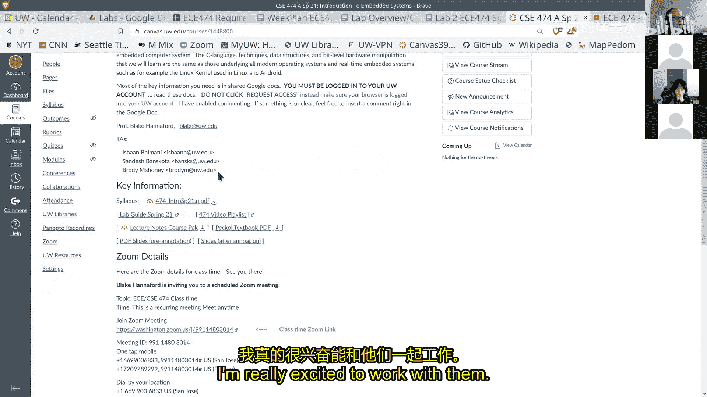
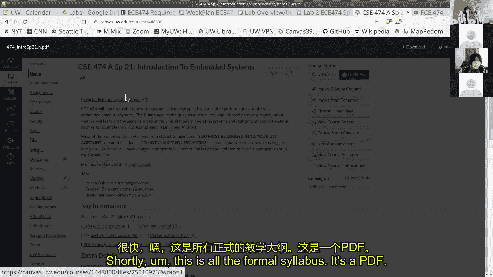
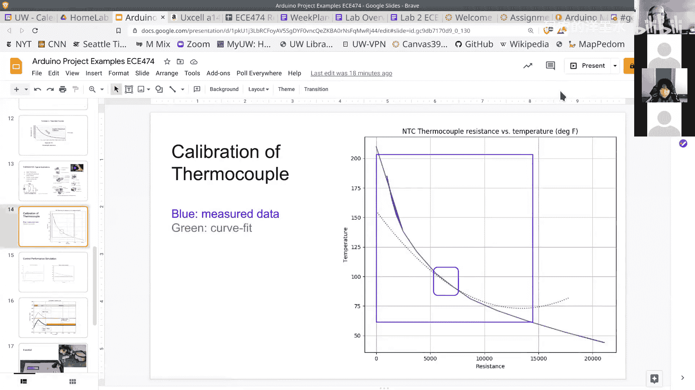

# 【全集 附完整课件】华盛顿大学 嵌入式系统导论 CSE474 中英字幕 p01 Lecture 1 - 课程概述 -BV1ALqnBWEeu_p1-

Now beginning， all right。Well， that was a great way to start spring of 2021。All right。

 so this should go better。So I was planning to share the screen and talk to you guys talk you guys through the。

Canvas site。She's now gone。Yeah。Here we go。And I want to share that。Yeah。Over here， okay。

 do people see the canvasva site now？Yes， oh， I can even see it on my other one。 Great， all right so。

Here we go so first of all you guys all know how to use canvas I do not'm you know some people really put lots of stuff into canvas I try to kind of minimize the use of canvas so I have the key information as links on this page there's PDFfs and Google docs and YouTube playlists and so forth so。

The information is scattered around， but the intention is everything is here on the homepage of CSE ECE474。

And if something is not accessible from this page， please just let me know and I'll fix that situation。

So first of all， I'm Blake Hanford， I'm an ECE faculty， have been for many years。

I've actually taught this course in an earlier form about six or seven times and however that's the good news。

 the bad news is that that was like 12 years ago was the most recent time I taught it and that's a long time。

 but the good news is that this material surprisingly has not changed very much in 12 years in fact。

I would venture it hasn't changed very much in about 50 years and I took a course like this when I was an undergrad。

And it's a little bit surprising how much is the same。

And that's because the underlying architecture of a computer like this。

Is really the same as the underlying architecture of big million dollar computers 50 years ago。

And they solved a few key problems。That we still need to understand today and are still used today。

And of course， this is based on studying the recent the syllabian materials from recent of the class as well as。

From this class。As well as from my old notes。And the second good news is that we're basing this in。

In these times， you guys need to do the labs at home and we're basing this around the Arduino hardware。

In ecosystem。Which I use very， very frequently and intensively， and so I'm very comfortable with it。

And so I'm you know that's just an easy part of it from my point of view in terms of how we're going to manage the course。

 it's also so let me say a little bit about the Arduduino。U。

Probably you've heard of it and probably you know that kind of there's so much support and resources for the Arduino that。

嗯。You know， a high school kid can get a sensor or hook it up to an Arrduino and make something happen。

And that's really good。呃。It's also not the kind of material you expect to learn as an ECE undergraduate trying to become an electrical and computer engineer because you're certainly expecting and rightfully so to learn much more than a high school student would know so the basic workflow of a high school student is by a sensor。

Follow instructions to wire it onto your Arduino， download a piece of code。

About that runs that sensor。And make a few mods and you have an app。And that's great and it works。

But where that starts， that's not a scalable solution that really lets you engineer a product。

And the first thing that the first way that breaks down。

Is when you want the Arduino to do three or four things at the same time。

 which is usually what you want in a real product。So in that case， you wire up three or four sensors。

 you download three or four software drivers， and you merge them together into a Arduino sketch and it doesn't work。

And the reason is that each one is based on different assumptions。

 and then the high school kid is typically in worse shape。

The second thing is that what we're going to focus on here is really squeezing high performance out of a low cost device like an Arduino and making sure we're not wasting time in the。

In our software， for no reason and also making sure that。A task meets deadlines。

 just like you guys are supposed to meet deadlines as undergraduates。

Measured in weeks or days of the embedded system is supposed to meet deadlines measured in。

Even microseconds， but typically milliseconds， and so we're going to place a lot of emphasis on making sure things work fast and work on time。

Okay， so again， quick orientation on the。诶。Pvas page you can always just click right here at the top to get connected at class time so that's easy you can always send me an email with this link and we're going to introduce our great Ts i'm really excited to work with them shortly。

This is the formal syllabus， it's a PDF。

Because I could modify an older one and I'm going to go over this stuff today。Um。And。

Give some details about the class。And it's there for you in PDF form。

This is a general guidance for the labs， the labs will not start for about two and a half weeks。

Because the first thing we'll do is learning about C and we'll do that。Offline non labb。

And then we have our videos where the lecture videos are going to appear here and a few videos are already there。

 which are not particularly important yet for the class。So now I cannot get my。

Canvas back unless I minimize all right。There's Can back。

And then this is lecture notes course pack is the lecture notes。

The slides that I'm going to present throughout the quarter。Often enhanced with more explanation。

 So it's kind of like。On the way to becoming a textbook， but it isn't a textbook。

 it's just slides with explanations。And this one is a textbook。

 Professor Peckel used to teach this course before he retired， he wrote a textbook。

 there's now a third edition or something coming out。But this one's from way back in 2006。As I said。

 a lot of。There's really a lot of。Commonality in this material and but i'm not going to like give you exam questions based on this book or assign homework problems from this book。

I'm offering it as a resource you can。Just if you're uncertain about something。

 you want some additional background or a different explanation。

 look it up in Pekel's book and see if that's helpful for you。Okay。

 so I'm going to be giving slide lectures fairly often and the slides will appear here before the course。

 this is a folder in Canvas and today work we'll get started on these。And。But it doesn't again。

 can I move this， now I can move this， all right。I'll open close these extra windows all right。

Whoops， I wanted to go back and well， I'll just go up here。Yeah。Okay， so。

Theyll'll show up here and some of you might want to。

Print them out and write on them while I'm lecturing or you could put open the PDF in your laptop while I'm lecturing or write on the PDF electronically as you wish。

And I'm going to be marking up the slides to highlight things or add details or work problems。

 and after that I'll save the marked up slides in this folder so you can get those。

Hopefully I can keep that workflow smooth this is all the details of our zoom right now that we're on if you are on this call。

 you know this。So that's the front page， the assignments so far four labs。

 I've only lab one is official， but we're not starting that yet anyway。

We're going to focus more on these see programming assignments。

 so you know part of the the first couple weeks of 474 is the main objective is to。

Move you guys from your previous language， typically Java to C。

There's a lot of overlap between Java and C but there's new concepts， so we'll get those covered。And。

That's what we're going to and then these assignments are going to be due April 7th and April 25th。嗯。

So that I guess so far， any questions？Yes。Yes。Oh。Chat is busy。

I'm going to go over the parts and what you need to get， you have to order stuff。

And but these are widely available and。Often arrive overnight。

And I will definitely go over this in detail today。So don't worry。嗯。Any other questions？Okay。

 before we continue actually， we have our three Ts here and it would be great if each of you could just introduce yourself briefly。

 three or four minutes， maybe your background and。Whether you've taught this。

 whether you've T 474 before and what your career goals are just for fun so。Who wants to start？Ters。

I can go first hi Yeah hi my name is Sun Shibaskota and I'm a first year master's student in the EC department。

And this is going to be the second time I'm teeing this course。

 I tea it with a professoror of ving for Prossor of viing last quarter。

And as for my career aspirations， I think I'm very interested in robotics。

 and I think I want to go into robotics software development as a。As a field。Oh。Alright， I can go。

 Hi everyone。 My name is Ewn。 I am a senior undergraduate。

 This is my last quarter as an undergraduate， and I'll be pursuing my MS E E。😊。

In the VSMS program also at UW coming fall， so it's really not my last year of school anyways。I。

 my intended， oh， I ta this class with Sd for Doctor running last quarter。

 so Im excited to tea it again。 help you all。As far as career goals go。

 I'm really interested in power electronics， that's my current concentration and I'm hoping to do some stuff。

With power electronics， power electronics controls， and ultimately help the environment。

 hopefully with like electrification。In general。That's me at a glance。Yeah， hi。

 my name is Brody Mahoney and I'm in Joshua Smith's Lab， not'm sure if you're familiar with it。

 but I am a PhD candidate now so I should be leaving hopefully my wife hopes I leave pretty soon because she wants me to go get a real job that never ends but basically what I work on in the lab is a lot of implantable wirelessly powered。

 very small systems for like biomedical technology as far as my interests of what I want to actually do probably right now some kind of research and development or you know working for a company that develops these devices。

 whether they're system level or more。You know， more embedded focus or even hardware focused I tend to。

Be interested in lots of different areas of it from power electronics all the way to the coding。

 so I kind of。That's kind of my background， you know， in a nutshell really quickly。Okay。

 thanks so much you guys， i'm really excited to work with you and actually continue。

ThisThese guys have been sanity checking my assignments and stuff， which。

No I do not guarantee that the assignments are perfect。

 so definitely let us know if there's problems with the assignments。

 but they're checked and sanity checked anyway they are not insane assignments so。

This is a really good course in in my experience。 It's one where you guys really learn a。A truerue。

 truly valuable skill set and。you have taken some introductory programming but。

You get to if you master the stuff in this course， you really can think of yourself as a professional。

 embedded software person， in my opinion。So of course。

 there's always more to learn no matter what courses you take， but this one will really。

Get you to a professional level。Okay， so at this point I'm going to go into the overall slides going through an introduction to the course and I'm going to share those on my other computer。

And these are kind of a retro format。But it came through so that's good。

 I can see it on my other login。And。What I you know。

 long time ago I started in latex doing my slides and。

So I still want to leverage that and then I can annotate and you can see that so that's good。

 everything's working。So， you know， contact me here。🎼啊。I do hear somebody's audio in the background。

Like music， so somebody needs to mute。Thank you。😊，Excellent so i'll just highlight this。

 you know there's a lot of details and this one's for reference， but whatever is on canvas rules。

 so if there's an inconsistency between this and what what's on canvas ignore this。Okay， and。

We've already introduced the TAs。You know when the lectures are。你。

Arduwinino megaboard will talk a lot more about that。

 that's a Ardu weino with extra iOos and extra hardware。 In other words。

 it's built built around this A mega 2560 CPU， which has。

more features and peripherals and silicon in it than the chip on a regular Arimino。

 which we will learn to use not necessarily everything。

 just to give you an idea about the power in a board like in a chip like this。

 the data sheet for this chip is like 600 pages long。And it will be linked to the class。Website。

And we will be making selective use of it， and I'm certainly not going to make you read。

600 pages so the course is called embedded microcomputer systems。And so in case， you know。

 just to set some definitions embedded。Means that it's special purpose。It's often inside something。

Many， you know， the examples are are so numerous in today's world that， you know。

 for every cell phone or laptop that exists。You're probably working with100 embedded devices。

All around you， the average car has some ridiculous number now。

 like 1 hundred and 50 embedded computers in it。 And I'm not even talking about a Tesla。

The average car。嗯。This shows you how old these notes originally were。Back in the Stone Age。

 there was a thing called。MP3s and DVDs and Tvos。But antilock breaking that's still a classic example。

 cruise control system， an autopilot on the plane， so it can be it's not all like low cost throw away stuff like。

A talking greeting card。But it can be a。Unfortunately。

 it could be a 787 max attitude control warning system， which。737 max， I apologize。

Sometimes they're life critical many， many medical devices have embedded computing in them。

 so the only computers that aren't embedded are personal computers laptops and you could say cell phones cell phones have many embedded functions sure you' you're checking Facebook on your cell phone。

But the computer in your phone is also doing things like selecting which frequency band your call is going to be placed on and that stuff is invisible to you。

 but very much embedded。And then microcomputer， thats sort of a， that's a moving target used to be。

 oh， you can buy it for1 thousand dollars。That used to be a microcomputer。Then it was $10。Okay， well。

 now it's $1。嗯。But。As I said。That it's kind of like you have the constant complexity computer。

And it's just the dollars that are shrinking。And so a bunch of computer scientists were trying to make efficient use of an IBM 360。

 which takes up a whole room。With special air conditioning and cost millions of dollars。Today。

 the same computer。Logically， and in terms of computing power and memory is a $1 chip。

 but you have to solve those same problems。So you could say in the 60s。

 there's this mainframe and it cost a million dollars and in the 80s it was a PC and it cost $5，000。

 believe it or not when they were new。Especially in today's dollars。And then。

Microcontrollers keep getting cheaper and cheaper and the link here。

 which I think I can not click in this document， but。好似。Yeah， I don't think。Unfortunately。

 this is I'm using this software to annotate， which doesn't follow links。

 but when you look at this slide click that and there's an article。

Of the 20 best microcontrollers that cost a dollar。And there are 0， at least 20 different ones。

 and the article goes into tremendous depth about it。That's how much memory they have。

 what their development environment is like。And so it's a real thing， these $1 chips processors。

 and they're really roughly inside in the guts are really more or less the same thing。

And then systems， you know， you can pick their favorite。Definition of the word system。Okay。

So the key ideas that we're going to learn in this course this quarter。Include。C programming。

Primarily for Java because that's what many of you learned， but for anyone。

 if you learned Python or something。Advanced see programming， things like what's a void pointer。

And then process context， these are kind of operating system fundamentals and we'll spend a lot of effort on schedulers。

Whi means you have a bunch of tasks that the computer has to run simultaneously。

 but in real life at the machine level it's only executing one instruction at a time。

 we're not going to look at multi core and multithreading with multi corere but we're going to look at multi threadreading with a single core and so at at regular intervals the computer has to decide。

What should I be working on now？And that's called scheduler。Interrupt and interrupt service routines。

嗯。Means if you don't know that computer hardware supports the notion that an event that's very rare。

Doesn't have to be checked for explicitly in your software， but rather it can connect。

To hardware input。And when a signal comes in on that pin。嗯。

A certain piece of software can wake up and deal with it。

And the hardware supports that process often it's an IO device like。You tell an Io device。

 I want to read something from this hard drive。But the hard drive is spinning around。And it has to。

The disc has to rotate over to the data and the head has to move to the right track。And that takes。

Quite a bit of time in terms of CPU cycles。So often the computer will。

 the software will initiate the data access and then go off and do other things and when the drive is ready。

 it will interrupt。And we'll talk about that a great deal there's a lot of。

Issues that have to be correct to make that work in software。Yeah。And also significantly。

 we're going to control IO devices。At the lowest level， so the。For example。

 that high school kid who wants to flash an LED。We'll use a function in the Arduino called digital right。

And you just say。Digital right on pin7 and you want it high or you want it low and that's great and it works。

But how does it work and what we're going to understand is from the hardware description of the specific IO ports on this chip。

How set it can we specifically control an individual bit？And the reason。

 and this is the information that the original programmers needed to know to write the function digital right in the first place。

So。There's these are the I don't mean to change the prerequisites from whatever the catalog prerequisites are。

 that's what we're talking about here。And laboratory instrumentation。

 so obviously that is reduced we are not requiring an oscilloscope even though i'm super excited that I just got this oscilloscope。

I don't know if you can see this on my other， yeah， on my other window。This is a cool little。

Hundred megaHz oscilloscope， which I just bought on Amazon for $90。And it even includes a probe。

 some of the cheap scopes like this used like DMM leads， which are not really as accurate。

 especially for higher speeds。So if you want， that would be useful。

 but we're definitely not requiring that and not you're not going to fail the course to not have one or even it's not going to impact your grade if you do not choose to get one。

嗯。O。So definitely we've designed the labs to be doable at home。And practical to do at home。

TheSule we'll go over that a little bit later。Here's what we recommend on how to be successful in 474。

First of all。We're going to master advanced C concepts like pointers and binary bitwise operations。

And first， we'll do that just on your regular PC。But that will directly transfer to programming the Arduino。

And then。Managing your time to keep the labs moving， working in a small team。

 the teams are going to be two people and so you can divide the work up。

 but you have to do that very thoughtfully and I'll have more to say about that。The lab reports。

 we are streamlining those a little bit compared to last quarter。

But we still weight them very heavily because。嗯。I got news to you when you're out there working as an engineer。

 nobody really cares what you know， they only care what you can communicate that you know。

And so these skills will pay off and so put the effort into your lab write ups。

Typical lectures and you know exams in the age of COVID are a different thing。

 I will not wait them nearly as high as I used to and we will we'll see how that's going to work。

When you're stuck， definitely make use of me and our excellent TAs。

 they're experienced in unsticickking you and getting you going and then the reading。

I found this on Reddit like。Two days ago。And it's on the UW Reddit。And。Just read it。

 it's from an engineering student， take a moment to read it。🤧H。Okay， if you have reactions， oops。

Okay， so。Here's another thing to be careful of， the labs。嗯。

Build on each other and so if you really blow off an early lab。

 you're going to struggle in later labs。They are not orthogonal。And that is just。

Fundamental to how this kind of course works。We'll just keep adding things。To the lab's complexity。

So that you have to use the more in。More advanced techniques that we teach you as the quarter goes on。

And so we'll maintain what's called hard real time performance， so what does that mean？

And it means that。嗯。The tasks have a。Deadline。And if the deadline isn't met。

 the task is considered to fail。So。This is a big new thing actually。

 compared to previous programming classes。So in the most intro classes。

 your grade or your success simply depends on the logic of the program it's either correct or it's incorrect。

 so that's good。The next level is performance like if you're。You know。

 working at Google as a software engineer and somebody types in a search term and the answer takes 15 minutes。

That's not acceptable。Nobody's going to stick around， even if it's one minute or 30 seconds。

 nobody's going to stick around。So instead， so you' certainly。

course emphasis on performance and speed， however， if 90% of the time。The search takes one second。

But 10% of the time， it takes three seconds。Yeah， that's probably okay。

 and we users might not even notice that， right？But that's performance that's not real time。

 so real time means。Every search must complete in one second or less。

 And if you fail to do if only 99% of them complete in one second or less。

 that's called soft real time。 It's kind of real time， but it's not a hard deadline。

So in a life critical mission critical piece of software， like for example。Flight control system。

A medical device。You may well have hard real time requirements where a a person's life could be in danger。

If that deadline isn't met， so that's what we're going to look at。

Let me pause now and look at the chat again， if there's any questions。Yeah。Yeah。

 just mostly mute mute requests are there any questions so far on you know。

 really the big picture of what we're going to learn。

You could just save a question or type it in chat。嗯。Okay， well， I'll continue then。Okay， so。Actually。

 I think we're going to do lab one individually to make sure。

That every single student knows how to do the basic development on the Arduino and has a valid working setup oh。

 actually here is a question on chat。Are there any classes at UW that focus on parallel processing seems there platforms？

For even putting GPUs on embedded devices。Yeah， I'm sure there are I don't know the number right now。

 you know course number for parallel computing but more advanced embedded systems， there's a lot。呃。

More to embedded systems than this course， even though I said you'll have a valid professional skill set。

This is not the whole story and I guess I'll try to。嗯。

Yeah I'll address it now because there aren't slides for this what are we not teaching you about embedded systems so I mentioned like you know multi threading multi processor or multi core we're not doing。

And the biggest gap is we're not doing。Functions that are you know。

 that require a full operating system， so the next level would be。

A processing environment where you're running something like a Linux kernel。

 perhaps Android or Linux， a raspberry Pi is a great example of a low cost。

Platform for that or any Android device。And so we just what we're doing here is we're learning the fundamentals that are a level below that。

 so for example， if you wanted to， if you were assigned to write a device driver，Within a。

as a feature of a kernel like the Linux kernel， you need this material from 472。

If you want to send a web page and serve a web page from your device。You work at a higher level。

 and you have to understand how to make system calls。Like。

TCPIP sockets in an operating system and this course isn't going to cover that so。

That's that I hope clarifies that we will， however， towards the end of the quarter， we're going to。

our first couple of labs are going to operate in what's called bare metal。

 that means yourre writing code， which is compiled into machine instructions that just execute on the CPU without any intermediate operating system。

And so then。The next level from that is having a very small lightweight real time kernel。

 and we're going to add， we're going to first write our own。

Very minimal real time schedulers and then write then use in the final lab we're going to use。

A fairly mature。Real time operating system called free RT。

Okay Seth Richards looks like lab one on lab overview doc only links to the materials sheet yeah i'll fix that。

Do you want to。Yeah。Right。Okay， so。Here's a couple of points。In the lab overview doc， there is a。

Bad link， so I will try to fix that。Yeah。Yes， that is totally a mistake。Actually。

 I can even fix it right now。Because I wanted to fix。Yeah。Because you need to read about it。嗯。No。

On the wrong keyboard。No， I have the wrong mouse， the wrong copy paste buffer。Okay。

 let's try that again。Okay。嗯。Yeah。All right， that should work。

 just let me know that will definitely be fixed。And then yeah。

 what we're thinking about is that I know that。There's a variation among the class of according to how much experience you have working on electronics and hardware。

The level， so what I。Would like to do is see if。People could maybe put I didn't have time to make a poll for this。

Let me see if I can get rid of this thing。Okay， anyway。Let's see how many people in the chat。

Why don't you or I got another idea in the reactions， raise your hand。

If you think you would like to have some introductory videos or sessions on just working with electronics with prototyping boards and wiring LEDs and things like that we are we we had some students last quarter who requested that so could I just get people to raise their hands if they feel like they would like。

Basic electronics experience。Or intro。And we have a lot of hands。So that's great。

 we are going to do it， we've already been writing up a little intro document to that。

So watch for that soon as an announcement on canvasvas。Great， you can lower your hands。Good。

And you're going to be all set for that and we'll get it going Okay， so teams now。

In the lab we're going to be working in two person teams and you know， some people worry about teams。

 what if I'm in a team with a loser or equally problematic。

 what if my teammate is rock star and I you know screw everything up and slow them down and they do everything。

 neither of those is good。嗯。But I have a lot of experience working on teams from this class and basically a two person team is the easiest kind of team to work with。

So keep in mind the following things。Learning teamwork is critical for your future success。

And career success。So pay attention to it and put effort in sometimes you get friction tension miscommunication。

 let's see if I I don't know how to get rid of that thing I pasteed in there it's probably a text window。

Yeah， now can I get rid of it？是。Well， I can backsspace it， nope， that's the wrong button。Okay。

 that's better than nothing。诶。Okay， believe that little mark there anyway， you know。

 sometimes you feel that some tensions some miscommunication， some disconnect with your partner。

My experience is it happens in one out of 10 to one out of 20 teams。

Here's the thing when that does happen。You sometimes people tend to just let it go and hope that it gets better and I guarantee you it doesn't okay so when you feel like there's a problem between you and your teammates you have to come to me or the Ts right away。

And we'll try to fix it。And in my experience， at least half the time， I can fix it。

Especially with a small team。But if you're you don't want to wake， make waves and you're trying to。

Just keep quiet and hope that it gets better， it will not work。That's that I guarantee you。All right。

 so you know， consider it something you're responsible for and it won't I won't place blame on the other person。

 I won't place blame on you， we'll just fix it。So with teams。This is what you're going to have。

 so this is the easiest case。When you have a three person team， you have six interactions。

 when you have a fourth person team， you have 12 interactions。

 so these kind of teams are complicated。And the issues are much more so and tougher。

 so considering that our teams are nice and small。I think we won't have a big deal。

We will be able to nominally， everybody gets the same grade in a team。But we can make adjustments。

If there's an obvious asymmetry and we'll give you a chance in the middle of the quarter to find a new partner if you want to。

But that's not going to be required。In each lab report。

 you're going to address who did what and definitely aim for equal contributions。Also。In each lab。

 you're going to do a demo and you're going to be。Ask questions about your。

Work and every member of a team， both team members have to be able to answer questions about any part of the code。

The person who wrote the code and de bugged the code may have a more in depth answer。

But the person who is the teammate has to have at least some answer。Okay。

 and you'll you'll begin to learn how that works once we've got a couple of labs under。

So the first lab is the introduction to the Arduino， the development environmentment。

 flashing and LED， and making a tone。On a speaker。And then La two is hardware。

 digital IO and output timing。We're going to have a total of four， at least that's my goal。诶。

I have to work out the best practice of these demos with the TAs。There are two forms， one is a zoom。

Where you。Demonstrate and answer questions about your project。

The second form is a video where we give you advanced questions and you do the demo on a video that we can watch。

And。We'll be watch for the specific assignment there， it's TBD。Okay。I've gone over this。

We have a report format document， which is in this lab overview guidance document。

 so I won't click to it。25% per day late work penalty because it's really bad to fall behind。Okay。

This is a bit out of date。嗯。呃。Supplement only。Use that as necessary for your understanding。

 but you are responsible for the lecture notes and online line material。

All presented lecture material。That means attend。We are going to use Panopto。For the discussion。

 simply because。I'm told that people like it better and I've used both， I don't care。

I don't we are this is actually not true anymore。But we have lots more ways to do that stuff than we used to。

Okay。So we are going to be here to work interactively with you。😡。

Like a huge part of this class because your real learning is in the labs。

And we want you to be productive in the labs and not be stuck。

Not be sitting there scratching your head for hours。But rather。

Executing your techniques to debug and solve your problems。 So we're going to have office hours。

 interactive times where you can show us your system and。We can go over everything， let me。

This is okay， standard stuff you're not going to be really writing。Esayas with references very much。

 you're mostly going to be just。Reporting on lab assignments。But just standard， don't copy stuff。嗯。

Exams are going to be closed book closed notes unless otherwise， so more importantly。

 how do you get a grade？I've been very successfully using what I call just a flat point system。

Which is， if you。Do perfect work on everything。You'll get 450 points at the end of the quarter。

And I'm going to divide that by 100。And。Max it at4。So you have a little safety margin to get a 4。

0 of 50 points。You don't have to get perfect on everything to get 50 points to get 4。0。There's also。

A fudge factor， so。诶。Is there anything here that I need？Yeah， okay。Yeah。

 so just to pay attention to this。嗯。I found that a rigid system。

Doesn't always work and a couple things can happen。

 we can be a little too harsh on the grading and at the end of the quarter I can feel that the classes learn stuff very well。

 but then I can find that following this rigid system the class average might be only 3。3。

Which I feel would be too low if。The course， if the students demonstrate overall good learning。

 there's a good attitude， there's good achievement of the learning objectives。

So then I'll just move everything up。Conversely， if we were a little too soft on the grading and people were not successfully answering their questions and there's lots of ways we can figure out that people don't understand things。

Or they were not working hard。And yet somehow the numbers came up with a 3。8 GPA。

I'm going to adjust it down， so that's not going to be a big adjustment。

It never is more than a small amount of points。But I do reserve the right to possibly do that。

I may not do it。But that's applied uniformly to everybody。

 moving the whole thing up or down just a little bit to tune the final average。

 but also if you ask out on the street， I'm a pretty generous grader， so the mean will be high。Okay。

You know， we're going to accommodate your religious observations we're going to。

Make it comfortable and safe for everybody i've already。Received a couple of。

Diversity I mean i'm sorry disability accommodations， i'm sure we'll get those。

 although actually I can't remember if they're。One's a 3898 one so that's irrelevant the other one I can't remember which course so at any rate we've got you covered if you need accommodations。

嗯。We do you know。I follow the procedures and I do report stuff to the college when there's plagiarism this is not a plagiarism intense of course anyway there's almost no plagiarism you could perform that would help you in the class so it just isn't a big issue but these are standard things。

嗯。Again， if if you're you know， I welcome those official disability accommodation requests and anything unofficial。

 so just just let me know either through the office or one on one and we'll get you taken care of。

And I believe in this very strongly that we want to have an inclusive and accessible。Environment。

Were zoom we're recording zooms okay， now here's another kind of key thing for the class。

I'm going to go back to my other computer。So yeah， two hours is a long slog。

 it's pretty long in the classroom， it's really long on zoom。I don't want a lecture for two hours。

 You do not want to listen for two hours， most likely。So what we're going to do is break it up。

 we're going to have。I'm going to try not to go this long normally。

 and we're going to have a good solid。15 minute break。 It's going to be 15 minutes。

 but it's going to be exactly 15 minutes。 So rejoin it's 335。 So at 3，50。

Please rejoin and I'll pause the recording。嗯。Yeah。好。Yes。All right， we have a lot of people on。

I guess I should give one more minute but I see plenty of participants so let's just resume and we can get the class done I saw some question activity on the chat about the $50 lab fee I totally agree I don't know what'm going to what i'm doing is pursuing that with the department i'm going to find out what I can about waiving that fee i'll tell you for sure I know this for absolute sure that if you have a financial hardship of any kind。

About that $50 fee， we can send you parts。And so that I would like to hear from you privately。

 I will keep that confidential， but I've already established that with the department you might ask what are you getting for the $50 fee and I think that's a very legit question and I don't know the answer so I'll try to get back get that back to you for Wednesday。

Okay， any other questions？That I see a hand up， how Kun has a hand up。If it's not the $50 lab fee。

 any other questions。All right， well， then what I'm going to do were I'm going to go into more detail about the labs Wednesday and you know what the required equipment is。

You know， if you have absolutely nothing right now。

 it's under 150 bucks and there is no textbook so that's。

ThatI've certainly tried to keep the costs under control。

And I'll go into detail about what what you actually need， what the minimum setup is。

 and so forth on Wednesday。So I'm going to wind up with a。

Little example project and this is an example that I built for myself。

Because I needed a solution to a problem and it illustrates many 474。Many 4，7，8，4。嗯。

You know learnings or things we're going to tackle and it covers some that we aren't。

 but it shows you a specific way you can solve a problem， maybe not a problem you care about。

 but you'll see how I did one to solve my own problem and then。

Well then will'll be done for the day I will stick around for sure until420 for Q&A if necessary。嗯。

All right， here is the screen。And here is my project example。No。Yeah。

And does that show Arduino project example up there， just want to double check。Yep， excellent， okay。

So I make yogurt， especially during the pandemic。And every week I make one gallon of yogurt for us to eat。

And I make it in a slow cooker similar to this one。And。I need to control its temperature。

And before this， I used to he the milk， you have to heat the milk up。And then cool it down。

Before you make the yogurt and that denature some proteins or something。And I used a pot。

But if you heat it in a pot and then cool it in the sink with cold water and ice。It takes a long。

 otherwise it takes a long time。Then you have to clean the pot it's an extra mess。

 I would like it all to take place in this one thing and I can wait longer because it's easier。

So this has to go through three phases of temperature first we cook。At full power。

 which in the case of mine， is 250 Ws。For till we get to a temperature of 195 Fahrenheit。

For the you centigrade people， that's pretty close to 100。

Then we cooled it off because now I want to inoculate it with yogurt culture。But we cannot do that。

At this temperature， because it will kill little bugs。And so we have to cool it passively。

 but I don't have any cooling hardware in here。Like a compressor。

 so we just turn the power off and wait。Until it gets down to 105。

 which is a good fermentation temperature for yogurt。And after that。

 we needed to ferment and stay at this temperature。So we'll control to stay there。

 which is of course， above the ambient temperature。

And so we're using what's called pulse with modulation or duty cycle control This is a thing that we that's。

Very widely used to。Give a proportional output。When you don't want to use a digital to analog converter。

In this case。A digital to analog converter that could put out 250 watts is very expensive。

Unusual piece of hardware。So instead， what we're going to do is turn it on and off。For this example。

 we're talking about 250 watts being on and zero watts when it's off。

But we're going to turn it on and off in these different cycles。

To get an average output which goes up and down proportionally。 So if I have zero duty cycle means。

The percentage of each time cycle that it' turned on。And so 0% means it's turned off all the time。

 100% means it's turned on all the time。So obviously 100% is equivalent to 250 watts if I turn my heater on all the time。

And 0% is 0 wts。Now if I turn it on half the time and off half the time。

That's in terms of the physics， the thermodynamics， it's completely equivalent to 125 watts。

And the key is you want this time period to be a very short time compared to the response time of the system。

 in this case， the thermal response time of one gallon of milk。Which we'll see is very slow。

 So I did all kinds of experiments to measure how long it takes to heat up。

Which is basically like an RC circuit from EE215。And it's quite a long time。

So then we're putting in a controller called a PID controller。If you are interested in this。

 take the course EC E 447， where we learn how to design a variety of controllers， including PID。

 but the short answer is。We have an input command， X。 we have an output y。And we have a subtraction。

 and the difference is the error E of T。And then the PID controller has three terms in its equation。

One is we multiply the error by a constant called KP to positive。Floating point， real numbers。

Second is。K I over S， meaning we integrate the error as a function of time。

And multiply by this other constant and don't worry these details are not part of the class in any way。

 just walking you through an algorithm I used and you can study it and get graded on it in a different course 447。

And finally。KD times the derivative D by Dt of the error。

So we're kind of looking at different parts of this signal， the signal itself。

 the integral of the signal and the derivative of the signal。

 and waiting those to get a signal to drive the plant。And in our example。

 this is the temperature we want coming in。This is an actual temperature on the output。

 and this is the slow cooker。And U of T is going to be this PWM signal。

Which varies the power from zero to 250 watts。And that's how we're going to keep the temperature steady。

But for cooking， we're just going to turn it on and wait and for cooling off。

 we're just going to turn it off and wait。So here's some sketches。

 I want regular electric outlets so I can plug the cooler in heater in。

 I want to switch to turn it on and off。I want to display and I want to plug in a temperature sensor。

And then maybe a knob and some controls， but that's。

I wound up not doing that and then here's a rough schematic。Here's a little more detail。

So we plug it into the wall。Be careful when you wire 120 volts circuits。

We're going to have a five volt external power adapter that can wire in and power the Arduino。

And we're going to have a relay， which can turn on and off the power to the。Heating element。

And then we're going to have an LCD display， so we always know what state it's in and what the temperature is and so forth。

We're going to have a similar one in our lab kits。And then I chose to use。Thermacouple。

 actually this is wrong， it's a thermoister， not a thermocouple。So I'm going to correct that。

And that's because。An existing food grade temperature controller that I have uses these and has a nice silicone。

Wire insulation and a stainless steel tip。And you can buy them。And then a panel jack to plug it in。

So this is what we're using in the lab this quarter， and it's overkill for this job。 And it's big。

 So instead， I used a tiny Arduino called the nano pro。

Which is significantly smaller because I only need like one output， one analog input。And。

The SPI interface。For the display and there's plenty of pins for that here。So。

How does it look well I put it in the CAD system based on that sketch。

And it's basically using household wiring products。

These boxes are metal so they can be grounded and be electrically safe。

And we can take highlight the cover plates and take them off。

 make them disappear so you can see what's inside。And there's the little Arduino。

 there's the power adapter， the one8 inch headphone jack， the display。

 and the thing down here is the relay that turns the power on and off。

And then I just wired it to a three pronged plug。Let's get to the next page here。

So if thermoisters quick quick review， they're just resistors that have a high sensitivity to temperature normally the manufacturer of a regular resistor like。

Like this。Tries to reduce the temperature coefficient。But if you want to use it as a sensor。

 they want to increase it and so they're popular， they're widely used。It's like a resistor。

 but it the resistance is a function of temperature。And here's they're really， really cheap。

 like on Amazon， you can buy these bags or baggo thermoisters。This one's unavailable。

 So let's look at the other ones，5，99 for。2ent0 of them， they're no big deal。Again。

 this is not a lab for the class， it's just something I did。

And this is called a negative temperature coefficient theister， meaning as the temperature goes up。

 the resistance goes down。You can also get positive temperature coefficient。But these are， I think。

 a little more popular。It doesnn't really matter for this application。

But you can see it's a pretty big change， 450 k at near the freezing point and when we get up to 60 degrees。

 it's in the hundreds or low thousands。But it's not and it's not linear。These are really widely used。

 the nests thermostat， rice cookers， microwaves， home heating。Heat pumps。嗯。Used all the time。

They used to be used in sort of analog ways， but they're not so much anymore。

This is data I measured from the ones I'm using and this purple box is the range that I need for yogurt making like from。

Cool room temperature to。About 200 Fahrenheit。And this little box here is the fermentation control range。

And my browser crashed。But it's been doing that。So the recovery should not take long。Okay。

Okay。

Okay， where was I， Yeah， so this is the fermentation range， and I fit a polynomial。

Which was surprisingly difficult actually to this data。

But I optimized it to fit in the fermentation range， I wound up not using the polynomial。

 but instead just interpolating。Between my data points， so I measure some resistance。

Go up to this line and interpolate between these two points to hit the line。Which is more accurate。

this is the actual one that I use， this is my measured calibration data。

And this is a simulation of how the controller will respond with a mathematical model of one gallon of milk。

And so。Here's regulating starting to try and get the temperature to 95 Fahrenheit， starting from 85。

 this is called a step response and it's well behaved and has a small overshoot。

And this is the cooling， which takes at least four hours and that's。Frustratingly slow。

But I don't care because I'm allowing 24 hours for this whole cycle。

this is the simulation of the complete cycle。And so here's the milk temperature starting at room temperature。

Cooking up to this temperature it really needs to denature kind of for this whole time。

And then cooling down。And then it gets to the fermentation temperature of 105。

And so we have these three phases。Fully on， fully off。

 And then this is the pulse with modulation to keep it right at 1，0，5。

 The green thing is the error of the temperature。 We don't care about the error during the cook and cool phase。

 We only care about the error here。 and it's very small。 This is simulation。And it works。

And believe it or not， I don't know if you care， but I'm actually making yogurt right now and this machine。

 this thing is working just like this right now。And right now it shows that it's been running for four hours and 41 minutes on this display。

The temperature is 156 degrees and its set point is 105 and it's in the cooling mode。

So it's cooling down and when it gets to 105， I'll put in some。Live yogurt to inoculate it。

 and then in the morning I'll have fresh yogurt。And roughly that cost about $75 to make the electrical parts are really cheap。

And the Arduino nanono is only 10。Dollars and so forth， so all these little parts。

Now what's in the software， that's what we're going to be spending our most biggest effort in 474。

And so this starts with declarations of。What's called pound defines， we're going to cover these in C。

 you use these， and it's very bad practice to put these numbers in your actual code when it define symbols for all the numbers。

So the PWM。Time is five minutes。And in practice。When this thing is working like so。

 and it's in the fermentation zone。This light will come on for about 90 seconds and off for the rest of the five minutes。

 and that'll keep it just right at 105。The controller automatically figures that out。

And here's my PID controller gains。That were tuned in simulation。

And various yogurt parameters and the hardware this is this you guys are going to use a lot。

 so it's saying well the LED。Is P 13。The i squared C is。Pin 27 in Oal。

There's two rows of the LCD and 16 columns in case I wanted to change that there's the modes and so forth so this is just to give you a flavor。

And the major functions in C that are inside this are reading the resistance。

So the input is a value from the analog to digital converter， which goes from zero to。

1024 and the output is resistance， and this uses the voltage divider equation。

Based on that schematic。Let's go back up just quickly。So here's five volts。

 here's a 10 k resistor and the thermocouple， and this voltage then is based on a voltage divider from theuple thermocouple changes resistance。

I'm sorry， the The mistister。That's terrible， and this changes voltage。And it's not temperature。

 but it's a voltage proportional temperature。And so then resistance temperature， this is where we。

Interpolate through that data set to convert it to a temperature。

And then switching the PWM on and off and doing the PID controller， so these are the major functions。

And that's it。So I just wanted to share that because it's kind of the overview of what a product might look like that would have an Arduino built inside it the difference。

 the biggest difference from a 472 project is that。This one can be very slow because the yogurt。

The milk takes a long time to respond when you start the heat。

And so there's not much time demand or not much need for fast response。With this yogurt maker。

 but we're going to be doing things in 472 that operate on the millisecond scale and so for example。

 I'll ask you to generate a tone on the speaker at a certain frequency and so there your ear is quite sensitive if there's glitches or gaps in the tone then we know that it's not meeting its hard real time deadlines。

Okay， any more questions I am winding it up， we can start back again Wednesday。

 but I'm be glad to answer any questions or comments right now。

This is more like a personalized question， so maybe I'll like wait until。

Like the very end we can go into a break hour maybe if possible。Yeah。这子个。Yeah。

 I kind of got like a personal question also。Okay， also there's sign ups for one on ones that you're welcome to use that should be linked in the。

嗯。Syllabus。Or somewhere， if those are missing， let me know because I have reserved spots for those and you can go into a Google calendar and sign up。

Professor just， I know if you're seeing the chat， but students are asking for you to turn off the entry in exit chimes。

Yeah， I see that I did not know I was even able to do that。 I thought people had to do it， let's see。

嗯。Oh。I guess I have to figure that out for next time。

Should be under a managed participants at the bottom of your two born。Okay。ok。It's gone。

No more times， thank you。Yes。Question professorfe， should we wait to buy parts until after you discuss it on Wednesday or can we just go ahead and spreadsheet now if the spreadsheet is clear enough for you。

 go ahead and order。我靠。If you are comfortable with Amazon， I was getting stuff overnight。

 but there are many sources for all of these， including overseas so this is。

I've really tried to make sure that every part is globally sourced for that matter。

 essentially none of these parts are made in the USA， right？So if you are overseas right now。

 you should really not have any trouble finding these things I can't you know Alibaba Aliex ban good。

Global global websites will have these as you as you well know in every major city in Asia， Seoul。

 Tokyo， Bkok， there are huge electronics markets downtown I don't know if those are open during coVID but they should there's somehow those vendors are making their product available i'm sure so I think you should be able to get everything。

Okay， thank you。Also， could you tell about the participation points and how would the participation be monitored？

Yeah that' that's a great question i'm still working on that is the real answer。

 I just want to incentivize attending class asking questions。

And making comments as they occur to you， so I really want to。

Encourage quote unquote interruptions from all of you and。You know， that includes the chat。But。

I I do want to incentivize participation， so I know that's not a very concrete answer， but willll。

That's what I can give you right now does that help？Yeah thank you you just you know。

 you just participated right then also I'm very welcome to hear suggestions for that。Yeah。

If you have a cool idea for how I can give out participation points， I'm open to that。

A lot of classes use pull everywhere。Use what I'm sorry。Pouhole everywhere。Oh， yeah， yeah， yeah。嗯。😊。

I mean， I used some I've done polls and I like them。And I didn't have a chance to do it this morning。

 but I will。嗯。It's not really a great way to give points， though。Unless you have a better idea。

I mean， if there's a specific way that somebody has used poll everywhere to give their participation points。

 let me know， I like that and I will try to use that as well。Yeah。He first regard。

 I got a question about the， the the the materials。 That's okay。

So if I'm looking at the spreadsheet for the materials。So， okay， so under the tool section。

 it says that。It says required multi needle wall strippers， needle nose pliers。

 So I'm assuming the wire stripper is just so we can strip wire so they can go in the breadboard。

 right。Yeah， so here here's the thing I will。So most of these are do weino kit all of these kits。

Come with wires like this， you may have seen these， you peel them out and。

There's little this is an extender， so it has a male on one end， female on the other。

But often they're male to male and you plug it into your breadboard。

Your solderless breadboard and you make a connection， but when you have a for a lot of these。

 you get a real rat's nest and you also have。Bad high frequency performance。

And's it's generally a lot better to make a little thing like this and you can also buy kits of premade wires like this。

And just stick it in and keep it neat。So I。You know。

' I'm not going to be like making you guys show me your wire strippers or anything like that。

But I really， really recommend you get them。And it's something to just have anyway， I mean， you know。

 if you should have it。The DMM I'm going to really require。

 you know really you just get a cheappo $20 one or even a $5 one。

 but you have to be able to track down why your circuit isn't working and measure your resistors unless you want to memorize the。

Resistor color code。I think you really want a DMM。So we're seeing is it's just。

So with the water strippers， like it's just like we we like I want to imagine how it's used is like just like those like。

 like poles of wires And you just pull them out。 then you cut them when they use stripper。

 And then you just sort of do that， right， No， what I， what I'm。

What I'm really recommending is get a wire striper like this。This is honestly the best kind。

And they're not expensive and then get now what I have is an assortment， okay？This was like 10 bucks。

 but even if you just buy。啊。You know， one of these sols。And they're all the same color， I don't care。

And but what I do really want you to pay attention to， and I'm going to go over this Wednesday too。

 but。22 gauge。Solid wire， okay？It's called AWG 22。And that's line 38 in the spreadsheet that you're looking at。

And you don't have to have all the colors you can can you can do that any way you want。

 but I find it useful to trace things with colors anyway。Just buy this。 and then。Cut it to length。喂噶。

I just cut one and then strip it in the 22 slot。And there is the thing you can plug in and strip the other end。

And。Wirres are often stranded or the wrong diameter The thing about these these plug。You know。

 breadboard strips， solderless breadboard strips is they're really good but。

You really need to use the right wire and like one thing that can happen is if your wire is too big and you jam it in or you jam in like a big resistor lead。

 you can break open the contacts and then from then on you get unreliable contact。

And that can really， you can waste hours trying to track that down。So if you get 22 AWg wire。

It will work nicely forever with your solderless breadboard。Okay。

 so and then number and also also these work， these do not ruin your breadboard。

 so that's that's good for these two。Okay， and then line 45。

 is this alligator cliffs or soldering setup。 I'm not sure what that's for。 Yeah， okay， again。

 I'll go over this on Wednesday， but。Alligator clips are like this， okay。And you can， you know。

 for just a few bucks， you can get a set of these and the point is that sometimes you need to connect to something。

That's not。On your breadboard and won't fit in your breadboard。

And you could solder onto it if you solder， but I'm not we're not requiring anybody to learn how to solder or by soldering the equipment。

Okay， so if you like， for example， I have this recommended，' I'll talk about this a little bit。

 it's a little kit， it's a little way to build yourself a lab bench and it's it holds all this random stuff together so it's much easier。

And what I have in there is a little speaker。And in my case， the leads broke off。So。For the speaker。

To hook it up。I can。Actually， I think I have my second camera round。Yeah， why not。

Classes is actually over。So we can cover this on。Oops， froze my video。That's my bad。Yeah。Okay。Oh。

I'm back。But I lost video momentarily。I'll tell you what i'm going to continue this discussion on Wednesday because we're over time。

 but alligator clips are just a way you can。Hook your speaker up if you don't want to solder。Yes。

 I guess just one last question， so would you say that all of the things okay because。

Would you say that addator clips are like 100% required for discourse？No。

 do you have are you a person with a soldering iron？No。

 I do not have a slaughtering environment somehow you need a way， just buy the six bucks。

For the alligator clips， it might just save you O。Okay， yep。Thank you。Thank you， all right。

We'll continue this especially focused on the lab and the lab parts on Wednesday， thanks a lot。

Thank you。你你。

