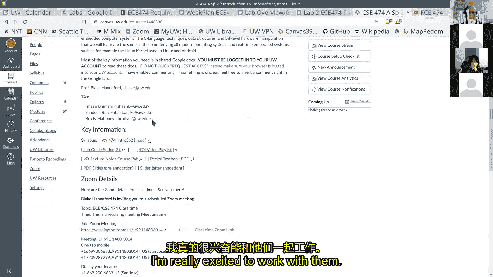
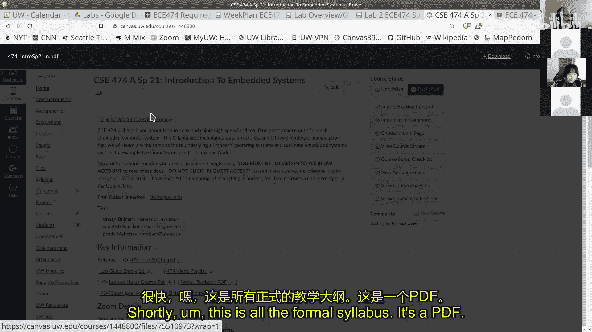
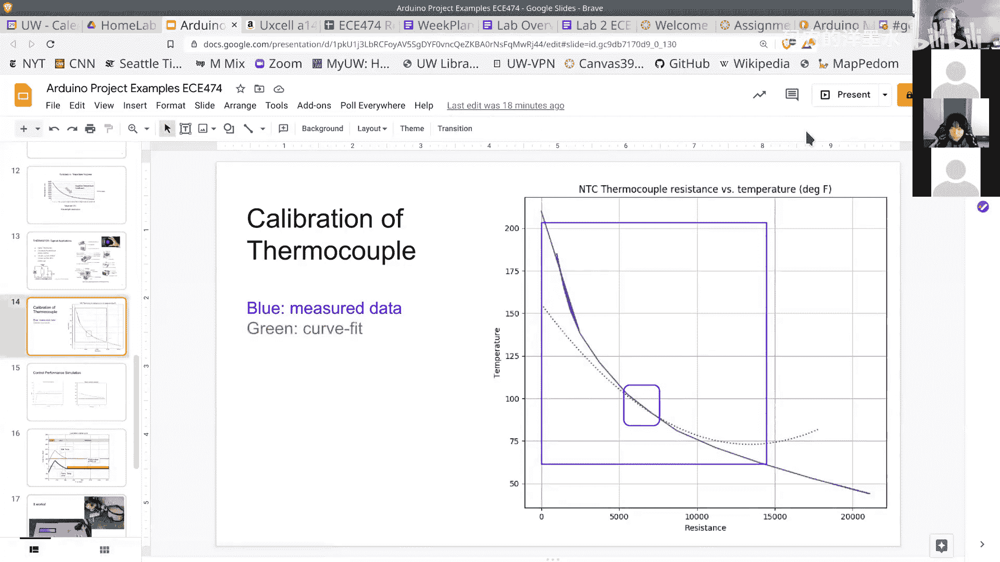

# 嵌入式系统导论：1：课程概述

在本节课中，我们将学习嵌入式系统导论课程的整体框架、学习目标、课程结构以及所需的实验设备。我们将了解嵌入式系统的定义、核心概念，以及如何通过本课程的学习成为一名专业的嵌入式软件工程师。

## 课程简介与目标

我是Blake Hanford，是华盛顿大学电气与计算机工程系的教员。我曾多次教授这门课程的早期版本，虽然最近一次是在大约12年前，但嵌入式系统的核心知识在过去几十年中变化不大。这是因为计算机的基本架构，从几十年前的大型机到今天廉价的微控制器，其底层原理是相通的。

本课程将围绕**Arduino**硬件生态系统展开。虽然Arduino因其易用性而广为人知，甚至高中生也能用它快速搭建项目，但本课程的目标远不止于此。我们将学习如何从低成本设备中榨取高性能，确保软件高效运行，并满足严格的**实时性**要求。

## 课程核心内容

上一节我们介绍了课程的整体目标，本节中我们来看看我们将要学习的核心技能和概念。

以下是本课程将涵盖的关键主题：
*   **C语言编程**：重点是从Java等语言过渡到C，掌握指针等高级概念。
*   **进程与上下文**：理解操作系统的基础，特别是在单核上实现多任务。
*   **调度器**：学习如何让计算机决定在特定时刻应该执行哪个任务。
*   **中断与中断服务例程**：掌握硬件事件如何高效地触发软件响应。
*   **底层I/O设备控制**：超越`digitalWrite()`这样的高级函数，学习如何直接通过硬件寄存器控制特定的I/O引脚。例如，设置端口D的第3位为高电平的代码可能类似于 `PORTD |= (1 << PD3);`。
*   **实验室仪器使用**：虽然不强制要求示波器等设备，但会介绍如何在家完成实验。

## 成功学习指南

了解了核心内容后，掌握正确的学习方法同样重要。本节将提供一些确保你在本课程中取得成功的建议。

以下是成功学习本课程的建议：
*   **掌握高级C语言概念**：如指针和二进制位操作。
*   **合理管理时间**：实验任务具有连续性，前期落后会影响后期进度。
*   **有效团队合作**：实验以两人小组进行，需要明确分工和良好沟通。
*   **重视实验报告**：清晰沟通是工程师的核心技能，请认真完成实验报告。
*   **充分利用资源**：遇到困难时，及时向教师和助教寻求帮助。
*   **坚持阅读与预习**：跟上课程进度，提前准备。

## 实验安排与评分

本课程的学习成果主要通过实验来体现。本节我们将了解实验的具体安排、团队合作方式以及评分标准。

实验部分是本课程的重中之重。我们将完成四个实验，它们会逐步增加复杂度：
1.  **实验一**：Arduino开发环境入门，控制LED和蜂鸣器。（个人完成）
2.  **实验二**：硬件数字I/O与输出时序。
3.  后续实验将引入更复杂的实时调度和系统集成。

实验以两人小组形式进行（实验一除外）。评分基于**扁平积分制**：完美完成所有任务可获得450分，对应4.0的绩点。教师保留根据整体学习情况对最终成绩进行微调的权利，以确保评分公平地反映学习成果。

## 示例项目：酸奶机温度控制器

为了让大家对嵌入式系统的实际应用有一个直观感受，我将分享一个自己构建的项目——酸奶机温度控制器。

我每周需要制作一加仑酸奶。传统方法繁琐，因此我设计了一个基于Arduino的自动温度控制器。该系统需要让牛奶经历三个阶段：
1.  **加热阶段**：全功率（250W）加热至95°C。
2.  **冷却阶段**：关闭加热，自然冷却至40°C。
3.  **发酵阶段**：使用**PID控制器**和**脉宽调制**技术，将温度精确维持在40°C。

PID控制器的输出`u(t)`由误差`e(t)`（设定温度与实际温度之差）决定，其**公式**为：
`u(t) = Kp * e(t) + Ki * ∫e(t)dt + Kd * de(t)/dt`
其中`Kp`、`Ki`、`Kd`是需要调节的参数。系统通过继电器控制加热器通断，利用热敏电阻测量温度，并在LCD屏上显示状态。

这个项目涵盖了本课程的许多核心概念，如底层I/O控制、定时、传感器数据读取和算法实现。虽然其时间尺度较慢（以分钟或小时计），但我们在课程中将处理毫秒甚至微秒级的**硬实时**任务。

## 总结与设备准备

本节课中我们一起学习了嵌入式系统导论课程的概貌、核心学习目标、实验安排以及一个生动的实际应用案例。

我们了解到，本课程旨在培养专业的嵌入式软件开发技能，重点在于底层硬件控制、实时系统设计和高效C语言编程。实验是课程的核心，需要团队协作和持续投入。

关于实验设备，课程将提供详细的物料清单。核心是**Arduino Mega 2560**开发板。此外，建议准备数字万用表、22 AWG实芯导线、剥线钳等工具。如果存在经济困难，可以联系教师获取部件支持。我们将在下节课详细讨论设备清单。

下节课我们将更深入地探讨实验室的具体细节和所需设备。现在，课程结束。