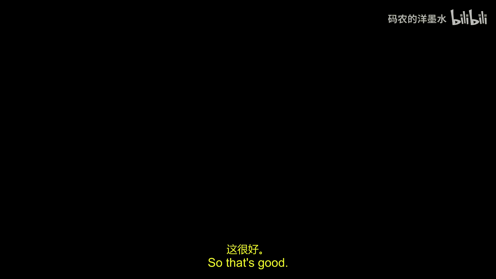
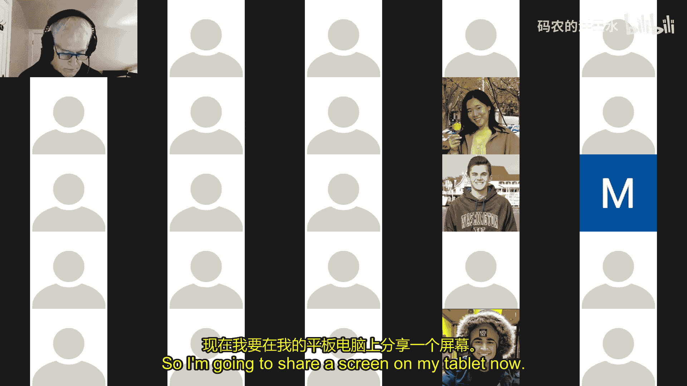
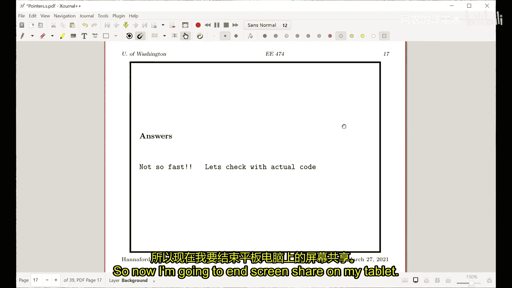
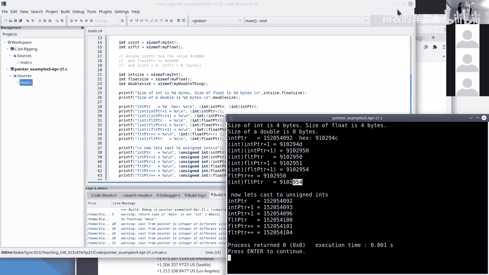
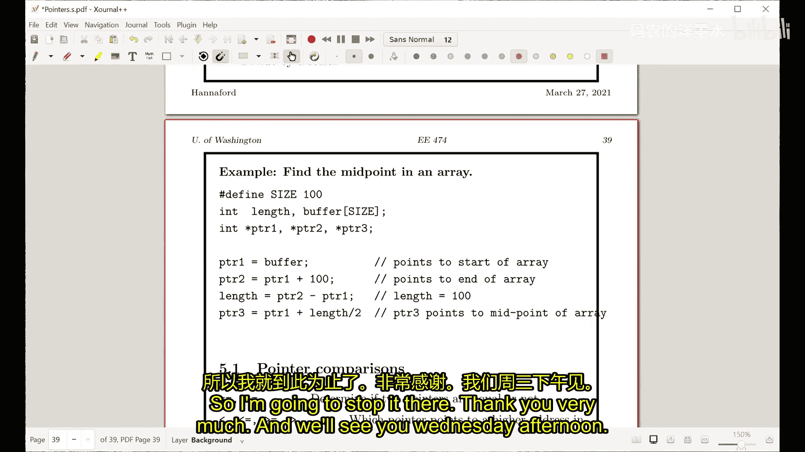

# 【全集 附完整课件】华盛顿大学 嵌入式系统导论 CSE474 中英字幕 p02 Lecture 2 - C编程导论 -BV1ALqnBWEeu_p2-

So that's good， we're now recording for the benefit of those who can't make it or want to go back and check stuff。

 which included me actually， I went back to make sure I knew where we stopped last time and that was helpful。

And people are continuing to sign in， but I think we'll just go ahead and get started before we do that。

Before I start sort of material， is there are there questions or any。

Questions or comments people would like to raise right now。

 Everybody's been good about at least a lot of people have been good on piazza and things like that。

 So I know a lot of progress has been made。 but yeah， I see a hand up， Kevin。Yeah。

 maybe I was hearing wrong， but I think lecture one or two， you were referencing a YouTube playlist。

 I'm wondering if you could， unless I heard it wrong。 But if you could share that playlist。

 I could probably help us with。Some questions you'm going to have it's it's clickable right on the main website way main canvas page if you go below the calendar it's you know。

 we put in the office hours calendar so it's just you have to scroll down but there's a heading called key information and go ahead and click that and make sure that it's prop that it's not a broken link I get it correctly when I。

Click it。 But sometimes that's not correct。Thank you。Okay， great。

Any other stuff like that or content questions。Alright。😊，Well， what last time I had another issue。

With annotating the Pdfs。 And that's because I don't know。 it's。

I had a laptop stolen and as a result， I'm doing new operating system。

 new software and everything for the lecture capture。 And so that was annoying。 But anyway。

 I had to install a new version of Zernal X O U R NAL plus plus which is what I'm using to annotate the slides。

 And I think that's actually working Okay。 so I'm going to share screen on my tablet now。

And I have my my laptop is showing me that the screen share is working does everybody see data in memory？

Yep， yeah， good。All right， and so yeah， so these this is your old PDF slides。

 these are on the canvas for you。 and then once I make little scribbles on them。

Using the pencil tool and a nice color。Once I make scribbles on them。

 I will share that stuff as well。All right。😊，What we're going to talk here， Here's the thing。

 So the key。And。It's really the key to understanding C and let's just say not understanding C。

 but understanding the advanced features of C， the C specific features and the things that make working with C different and more powerful。

Than other languages， sometimes is。That you have to think about what actual ones and zeros actually end up in computer memory when you do specific operations so a language that's interpreted will be a little more a little easier to a little more abstract like you know you just sort of say x equals five。

X equals 5。0 x equals quote。F I V， E unquote you can do all of that sort of freely and not worry about what's really in the computer in terms of ones and zeros。

And when we're when we're doing embedded systems and controlling。Hardware。

 there's an echo some people need to mute， I think。Jin， gin needs to mute。 I can mute G。

 I just muted him。 Okay or her， anyhow。When we're controlling hardware like the Ardu omega。

And specifically inside the registers in the8 mega25，60 chip。

 we're going to have to twiddle ones and zeros， kind of like， imagine a pilot。

With a 747 control panel in front of them and they have a million controls and to actuate something and actually especially a more primitive plane。

 an older plane like the 747 where they are physical controls instead of a bunch of touch screens。

So that pilot is flipping switches left and right to control things in the plane。And similarly。

 we're going to have lots and lots of registers， which are， say like this rectangle down here。

With ones and zeros in it。And we're going to and you can think of that as a row of switches and we' get we're going to be flipping those switches up and down in order to turn on and off hardware features。

Or and also configure hardware features。In the。In the chip。So， but。The same applies to memory。

 So let's say we。Let's say we just write a statement like this in our C code。

So we're declaring it as an integer。And we're giving it a name， a long， wordy name。

And we give it a value of 17。 Okay， fine。 So now we got to know what's at the binary level。

 what's happening。So we're going to assume that an int is only two bytes。

 that's kind of a small computer， but there are computers you can program and see that are that small little microcontrollers。

 I can't remember what the ints are in arc chip， but they may be 32 bits， I think they are 16。

Did someone say。All right， at any rate， let's assume that an int is 16 bits and generally speaking in C。

 you can write the keyword int and declare the type integer and that's fine。

 but what you actually get in memory will depend on your machine。

 what computer you're actually programming。So in PC with a core I7 processor。

 you will get 64 32 for sure， maybe 64 bits。And might in that same exact code on a small machine。

 an ant might only be 16 bits。So once you're paying attention to this。

 we have to figure this out or look in documentation。Okay。

 and then as you recall from binary numbers， make it little smaller and we'll change color just for fun this is。

Of the ones column， This is 2 for。8，16，32， et cetera。 And what we have here is 16 plus 1。Equals 17。

 which is what we wanted， okay。So stuff like this is happening under the hood whenever you're。

Executing C code。Or even before we execute it， this is happening when the code is compiled。

Here's another one。 We're going to say。But we're going to define a character pointer。

 and I'm going to go a lot more into pointers today。

But this is the way we can declare an array this is one of the ways we can declare an array of characters and so I call it。

The name of it is character array abbreviated。 whoops， I need a pen。 Okay， sorry。

That's the name of the variable。And its value， initialized value is okay。And so when it sees this。

 the C compiler is converting those two characters。Into their8 bit。Binary versions。

Using the ASCI code， actually， that's a typo， ASCI has two eyess。And so let's divide it up。

 So the character O is this ASI code or ETFA is a more modern name。

UTF8 is the more modern name for ASCI。And that's what we see here。4，1s，1，2，3，4， that's。

The character O in C， a single quote means character and a double quote means string。And of course。

 this is K。And this UTFA code， you can just type it into Google。

 you can look it up and there's a million tables and reference cards。To。To give you that code。

 thankfully， you don't need to look up the code very often。Okay， so now this is a bank of 16 bits。

 it's two bytes。In a memory somewhere in computer。So let's and we did that up above for the integer 17 into a different bank of memory。

And let's give them addresses， so of course each byte in your computer has got an address。

 just like every house in the world has an address and or let's say urban house in the world has an address。

And they。They're given a number， no street names and no area codes or zip codes。

 so let's say that this number points to our integer。

Just arbitrary address and some other arbitrary address points to our string okay。

 and I will tell you， by the way， this is not really a string。

 This is just an array of two characters O and K。And what you need for a string is to terminate it with another byte zero。

That's equal to8 bits of zero。And then it's a string which can have different lengths and C code in general keeps looking at these as characters until it hits a zero。

 and that's the end of your string。Okay。😊，Now， here's another way that we could lay it out where the locations are sequential。

 they're right next to each other in memory。And that's sort of more compact and maybe that efficiency compiler just keeps laying out memory as you make variable declarations。

So here。These two are separated by two because many computers let you address the individual bytes。

 so this one would be 68， 69， this is decimal， 70 and 71。But I just use decimal for convenience。

 but the big kids use hex。And so the same thing applies， it's easy enough to add to E0。And get E2。

And so it's the same concept。And you could verify that actually it's sort of a coincidence that they begin with too。

 but this is the hex value for this number。Just for fun。So any questions so far？All right， good。

 so it's hopefully that straightforward now。Here we're going to do the same thing。

 we're using hex and octal to initialize constants。

But this is exactly what we just covered without the strings。

 but these are two integers and we're going to call them C integer 1 and C integer2 and we're going to use those in an example。

So now everybody spend a minute figuring out if this prints or does not print。

And how would you and figure out？Make sure you know how to figure it out and be whether it prints or not。

And for reference， if you don't have the PDF， these are the two constants。

Maybe just raise a hand if you're pretty clear you've got the answer。And an electronic hand。

And put any other symbol。Up， if you really have if really。Puzzled and and want me to sort of。

Slow down。Okay。😊，Hands are coming in。All right， I didn't expect everybody to instantly get this straightforwardly。

 but that's okay， and I'm glad some of you do and I'm just going to go through it。

Because that's why we're here， so you can put your hands down。And so basically。

 the problem is to determine if these two numbers are equal or not。

And the way that we do that is to see if they have the same binary representation。

And so let's just draw that out。And figure it out。So we're going to have eight bits。

And this is 01 and02， I'm not going to write all the rest。And let's start with the last。

Now here's the thing Otal is the easiest because Otal has three bit groups。

 so sorry I lost my place here zero1，2，3，45，678 okay。So this is not part of it。 Okay。

 so working my way from right to left on the octal version，7 is three ones。And then 6 is 7-1。

 So it's clearly this。Oh， I see。 It's more than 8 Bs。 Yeah， sorry about that。 It's 16。 Well。

 we're going just work with the。First eight for now。So， that's 6。And then we have。

 I'll just sneak another bit in here， we have three。Which is 1，1，0， okay。

So that's the first nine bits of the ocal constant。From least significant over。

 And then let's do the same for the hex version on top。 So 7 is the same 7。Plus a0 here。 That's F。U。

Strike that。Strike that line。 Okay， and this is octal。And this is Hex。

And then the second digit it is。U。I'm sorry。I'm wrong。My bad。This is a7， also。It's just a he 7。

 But anyway， they still agree。 Now we have F。 So the second ocal digit。Which is the next four is F。

Which is all ones。So they agree so far and we can just continue that process。I guess I will。

 why not just to satisfy my curiosity。So this is 1，2，3，4，5，6，7，8。 So that's the remaining 8 bits。

 At the bottom。 we've gone out to this one is 0，0。 We've already solved that。 So in Hex， I mean。

 inoctal， we have the， this is the。6。And this is the three。And so the last digit on the ocal is 2。

Which is。0，1， and then all zeros。Remain。And on Hex。We only have a four there， after this。Whoops。

I've just， okay， sorry。I have not done this， well。This is wrong， too， okay。So it's4 Bs per hex digit。

And so that's the F right there。And then we have a4。 and the first dig4 is 100。

 and the first digit of 4 is also a 0。 So this is 1，0，0 and a 0 here。 This is hex 4。And when in the。

Case of。Ocal。Get rid of this。I'm sorry。 My Zoom participants is。Not allowing me to cancel。

This windows pop up。 There we go。Alright， where are we。

And all of these four is the least significant hex digit， and so all the rest of these are zero。

So according to my choppy analysis here， they're the same。And honestly。Since I did these slides。

 I can't remember what my intended thing was， but it sure looks like they're the same。

And we could type that code in or whatever。Alright。😊，So。Sorry to make that， yeah。

 are we well we need， oh here's a question， will we need to convert numbers from hex spin decimal for the exam？

Not extensively， but you will need it during the labs， so please get used to it。All right。So。So yeah。

 so the process of C converting a program into bits in the computer。

 compiling the program looks kind of is kind of what we've just overlook over and if you think about。

When we write statements like this， which are， again， they declarations。

It's declaring that C andt variable is an int and its initial value is 17。

It starts to put this table together。Called the symbol table。

And it's just got each variable name and the address in memory。That。WithThat contains its data。Okay。

 so it's important to kind of just mentally remember。 this is there。Thankfully。

 most of the time we don't have to know these numbers。

 that's what C is all about or any other languages preventing us from dealing with those numbers。

 but occasionally we do and we also most importantly， we have to know that that number exists。

And it's a defined number。Not necessarily what the number value is。But sometimes we do。All right。

 so this is where pointers come in， which is mostly that's too low level for most computer languages。

 but they they're very powerful and they allow some nice programming constructs and they're necessary for dealing with specific memory addresses。

And I O register， so。Oh yeah。 So I was talking a lot about these virtual switches that turn on and off controls in your hardware。

 your hardware could be all the features that are integrated inside your chip。

Such as a communications interface like SPI or I squared C， a serial interface a UAt。

 which sends data serially to a USB， for example。Um。Counters and timers。

 which we're going to dive into。And timers encounters are used extensively for a lot of things。

 things you might not expect， so there's often in for particular pulse with modulation。

 which we'll talk about， which is sort of a quick and dirty but effective form of digital to analog conversion。

Alright。So those things are registers， but the trick that many computers have。

 including Arduino and8 am chips that we're using is to。

Map those registers into the same address space as memory。So from C's point of view。

 those registers just look like specific memory locations， which are documented in the。

Data sheet for the chip。And also fortunately， predefined with special names for us by the software environment that Arduino gives us。

All right， so now here's another declaration。The difference here is there's no initialization。

 which is optional， we can initialize pointers， it's just that this one has no in it。

And it has this thing。Instead of nothing there。And that says my int pointer is not an int itself。

 it is the address of an int。And again， what do I mean by address？ Well， back here。

 when we filled in memory in detail。Way back up here。WeWe put in the addresses。So this address。

 for example， is an address that points to that string okay。And actually。

 more relevant to the current example。This address points to the integer， which we initialized as 17。

So when I start that pointer， the pointer in that case is going to have a number like that。

 a big memory address。In it， instead of the contents of the memory。That's why it's a pointer。

 It points to things。But this one doesn't have any content in it yet。Okay。

 and so it's set up to hold the address。Of an int， but not the int itself。Okay。😊。

So let's say we wanted it to point。To。That enter the variable that we defined earlier。

 which I think that was 17。Now we use another symbol。The ampersand or an sign。

And that's this statement that I've just highlighted， has the following meaning。

So everybody read that about three times， Okay， and just let it slowly sink into your brain。

Is it okay to think of this kind of like？Like through the lens of linked lists。Sorry。

 say through the lens of， I didn't hear what lens you said。Led lists。Pointers can be used。

For linked lists very effectively。 So it's not the only way to think about pointers。

 but it is a useful way。 So you've made a good connection there。ok。In another language。

 the link in a linked list might not really be a pointer， like it might be an index into an array。

Which is kind of an abstraction of a pointer if you think about it。Like the 10th element in an array。

 the index is 10 or 9。 You know， if it's0 based so。That's fine。

 You can use 9 to reference the the 10th element of an array。

But it's not the same as a pointer because it's not an actual memory address。Seid help。Yeah。

 that helps。 Thank you。 Good， But that is a， you were。

 you're totally on the right track to think of it that way。Okay。😊，So。I'll change color quickly。

 and sort of highlight this。No， that was eraser， okay。

So C int variable is that memory location which we initialized to 17。And the ampersand in yellow。

Says， give me the address。Of C int variable。And my end pointer now contains not 17。

 but the address where 17 was stored。Nothing special about 17， that's just。

 I'm just trying to give you a kind of concrete example。Okay。😊，And then later on， in the same code。

We could write this。And maybe I'll just be a little more consistent in my coloring here。Well。

I don't know。I don't know if this specific specificity is worth it， but。I just changed the。

I just put another statement in。 And now my pointer points somewhere else。 Okay。

 it's not pointing to C int variable anymore。 It's pointing to C int 0，1。

Which was one of those constants that we struggled to convert。ok。😊。

So now you' hear a lot of you'll hear the term de referencing。What does that mean？

It means using the pointer and getting the thing pointed to by the pointer。😡，So here's some example。

We have a。Variable and int。 And it has the value 55，0。And that's fine。 Now， just like we did before。

 we're going to point to that variable。 So the pointer， my int pointer points to C int01。

And my ant pointer doesn't have 50 in it， it has some address and we just don't want to deal with it。

 but we know that it's there。And so my pointer points to the variable that holds 50。

And now we're going to use one last highlight color， blue。Well，'s not that's a bad blue。Niceer blue。

 okay。So this asterisk is similar， but different from the asterisk in the declaration。

And this is called the de referencing operator。And it says。

 give me the info located where my end pointer is pointing to。

So now there's an X and the question down here is， if x equals 50 print， I understand pointers。

 And so， yes， this does print okay， because。The blue highlight that asterisk has de referenceferenced the pointer。

 It said， go get what pointer points to。Pointer points to C and01， which is 50。So， okay。

That's kinda cool。So the pointer can be used to get at to access memory。With the dereencing operator。

And this just explains that。And and pounds this point home。And in a declaration， it's， you know。

 it's related because stars are associated with pointers。

But it's not exactly the same meaning up here， so I'll take that color away。Okay。

 this is just the the one without a color says。X is a pointer。The one with a color says。

Use that this is the dereencing operator。Okay。Get the value at the address contained in this pointer。

All right， so the examples can get interesting and sometimes tricky。So first of all。

 we're going to start， we're going to declare a pointer PA。

And let's just assume it's equal to I could have initialized it to 3000octal。

 probably should just change the example。Now we're going to make a dereencing operator。

Because it can appear on the right， on the left side of an equals， as well as on the right。

 So this says whatever Pa is pointing to。Put the value B in there。Okay， now we can make。

 it turns out you can do a little bit of math with pointers。And this is where it gets interesting。

 So let's say that we write this。Now， the plus plus。

 I forget if you guys know that from previous languages or Java。

 but so let me just refresh what it means when we say plus plus。 So if I say int。X equals 5。

And then in that's a horrible semicolon。And then I say print， I'm going to just pseudo code here。

That's going to print5。And then if I say print。X plus plus。That's also going to print 5。

 But after it executes that it's going to increment X。 So if I say print X。It's going to say，6。So。

 this is the。Actually， this is pretty good too。And I'll skip that。That's the refresher on plus plus。

 Oh， sorry， I didn't actually write what happens。It prints 6。Okay， any questions about plus plus。

That's why the other language is called C plus plus。It's the next thing after C。Okay。😊，Alright。

 so now I incremented the pointer。 So actually。What this does， this next。Statement here。Is。

It's going to do the same thing。Initially， as the previous statement。But then increment the pointer。

 So that means our old value of B is wiped out and it's replaced with this value of hex10。

And then PA goes up。So now， if we did this next operation。

PAA is pointing to the next location in memory。And。Plus， another one。 So this plus。Will be。This plus。

 right here。Willll be evaluate， hey， I wanted that to be a different color。Okay。

That plus will be evaluated。Instantly， because it's not a plus plus suffix。And so this value， O。

 C 0 will not overwrite。This value of1t。Because that evaluate。

 that plus is evaluated right away and we'll， we'll get much more。

We'll solidify that with some details and example。Okay， so now if we。

 we can make some little quiz questions。After these three statements have executed。These three here。

What is this。ok。😊，And so， let's be careful。APA is pointing to the value after。This。And。😊，Actually。

 we don't even know what's in P。And then this plus is kind of a decoy。 That's just normally。

 add one to something。Okay。And then what about intpa。Converting， and I think we've talked about this。

 and I will review it again。This is called a cast。Which means convert PA from an integer pointer to an actual integer。

 and this way we can actually print out its value。So PA started out as 3000。

And we incremented it once。And we didn't increment it here。And so what's this value。So this is。

 we don't know。And this one。诶。Is 3000。Plus，1。Int。😡。

And we're going to explain that this is not necessarily one。

 so that's kind of a awkward way to introduce this next topic。Okay。

 so this assumes that there's4 bys。perer。And。And so the addresses go up by four。

And Pa is pointing one integer size。Above the original value of 3000。

let me also say that this code is really dangerous。Because when we incremented the pointer。Here。

Sorry。😔，We never defined what's after 3，000。And that may or may not be valid memory for our program。

So this is designed to sort of explain incrementing pointers。

 but it would not be a good thing to use unless you knew you had laid out an array of memory and you were intentionally going through it。

All right， and again， we'll talk more about that。So the key thing here， Now I told you that。

 you know， we added one to the pointer。By doing this plus plus。

But now the pointer went from 3000 to 3004。That should make you confused。That doesn't make sense。

 kind of。But the reason it's valid。Is this fact here。And so， this is key。

So the pointers know how big their thing is， and all pointers are not created equal。

 So we said that was an int pointer。And in this example， ints are four bytes。

And so the compiler knows that an in pointer is incremented in units of four。

 it means not incremented to the next byte， but incremented to the next int。Which is four bytes away。

And so that's why we can get away with。P T，R plus 1。

I'm putting the one in quotes because it's not an address one。 It's the number of ints。

And that's a powerful and admittedly slightly confusing feature， okay。With power comes complexity。

 but it actually becomes pretty natural。 So the idea is you could lay out a bunch of ins in memory and your pointer can go through them kind of like an array and indexing an array。

All right， how about questions and comments at this point。

 anybody want to raise a hand or shoot out a question。Or throw it in chat。

Professor I have a question。So on page 11。Yes， glad to。You said that。

 we don't know what asterisks PA is， right？But isn't that defined up there？Oh。Yes， so。U。

You get my marker here。Here。When this code executes， that's well defined， we know it。

 It means it just just as you're implying。呃。The location pointed to by Pa， which is 3000。

 In this case，3000 memory address now contains the value B in hex。That's clear。'。

 you're right about that。 Now， I said we don't know。 And that's because after this statement。

We have incremented PA to point to 3004。But 3004 is some memory address that we've never set up yet。

Does that help you and answer your question。Yes， yeah， yeah。 Thank you。 these。

 that's a perfectly good question。 It takes a little while to wrap your head around pointers and they are it's an。

 it's like an abstraction or a。😊，A different view of programming。

 but it's a powerful tool and one that is used professionally a lot。

So here's where we went up to this new location。By incrementing the pointer。 now， in this example。

 I filled in the memory。 I know that it contains the value too。

And these blank spaces all are zero bits in this diagram。Okay。

 any other nice questions or not nice questions？Okay， good。So。Now， here we're going do some examples。

And let's see。 So this one says。I have a pointer P1。

 and somehow I know that this is a memory address I care about。That's a little rare actually。

 like if you're just sitting down and writing some code。

 you have no idea whether that address is even allowed， like your address。

 your computer might have 64 bit address space and it's capable of addressing many。

 many gigs of memory。But you may not have all that memory plugged in。

 so if that address points to a place that there's no memory， you'll have a system error。

And so this is a little bit artificial here。But then。诶。I'm not sure。 actually。 Oh， yeah。 I'm sorry。

 So， but that references these addresses here。 So this is a known address。F E0。

And that's what we're trying to point to right now， okay， so that's where I got that number from。

So let's look at it。 So I have this， this array of memory。 And let's work with this。 Okay。

 so now I print。😊，The memory pointed to by P1， which simply means1。And the next statement is。

The memory pointed to by P1 plus1。So if we just added one to the address。

 we would be pointing to this empty space right here， which would be a value of zero。

But it knows to go all the way up to 4。To。Address this whole block。

 and it has the value of all zeros and 2。 So that's the integer 2。And so， this prints too。

And then if we add two places to the pointer， we get the next value， which is。A one in this。

Bite and a zero in this by。 So that's what is a 32。And or。Yeah， this is actually a typo。

 which should be 32。Wait a minute。 Let me make sure，0，1，2。0，2，4，8，16。No， it's 16。 This is correct。

 I had my hex conversion wrong。Okay。😊，So again， just to walk back my mistake。Okay。

 that is the right conversion。Alright。So， the key takeaway。

Pointers advance in increments of the thing they point to。 So if you had a point or two characters。

 then it will increment one by at a time because the character is only one byte。Okay。

 I told you I was going to talk about casting。And so when you have a type written in Pares。

This is a cast。And it says， convert the thing on my right into one of me。And so this is。

 because remember， you know， you've got this memory way back up here。Like， we had。The O and the 17。

Sorry to go so far。Yeah， so like here at the bottom。We have 7， we have O， and we have K。

 and we have 17 here。 but it's all just ones and zeros。

 So the the meaning of those ones and zeros could be changed。 And we could say， no。

 I don't want this bottom row to be okay。 I want it to be just like a really big inature。

That has lots of ones and zeros in it。 What's the numerical value of all these ones and zeros。

And I could also say what's the character code of these， although zero all zeros is not a character。

 it's called a null。But this one I you know， could this one could be interpreted as a character。

 and I don't know off the top of my head which one it is。So， let's see where we were。Okay， right。

So what we're doing here is we're saying， well， this integer x is going to take the actual numerical value of the address in this pointer because we're casting it or converting it into an integer。

So that's a thing we can do you can cast anything to anything in theory。Alright。

Now we're going to do some sort of a quiz which I realized that I needed to brush up on this quiz。

 so what we're going to do instead of guessing the answers is we're going to run it。

And actually it's 325， so I think it's time for us to take a 10 minute break。

 and so I will resume at 335。And we could start with questions if you want to think of questions。

 but I'll see you guys at 335。Yes。嗯。Yeah。Alright， I'm back。My glasses changed， because。

I was out in a gorgeous， It is so gorgeous out， I really wish I was just outside today and you should be too。

But we all have work to do。 But as soon as this class is， I'm going。

 I'll try to end it as early as absolutely possible and。Everyone。Just get yourself out there。

 because it's gorgeous and。And it's great。Okay。U。So I'm yeah。

 so I'm still sharing this and so we're going to we're going to do a whole bunch of little experiments to check our knowledge base on。

Pointters。 so， okay， so we have an integer， My int。It's not initialized yet。

It's good practice to always initialize them when you declare variables。 In reality。

 most C compilers today。Deterministically initialized to 0。 But yes， in at least in the old days。

 And you never know there might be a C compiler that just has just points to memory。

 And you get whatever random junk was in there。 And so。It's a， it's good practice to initialize。

 Okay， we're going to have a floating point number。

 F points have various technical representation where certain number of bits are reserved for the exponent and then other bits are reserved for the manta。

We're not going to dive into that。There's an IEE standard fortunately for flowing point numbers。

It's a little more standardized than it used to be where every different computer had a different way to represent floating point numbers at the binary level。

 That was kind of a nightmare scenario。Um。But at any rate， there's a float。

 C has another type called double。Which means double precision floating point number。

 often you might want to use that， but of course it takes twice as much memory。Okay。

 so here's an integer pointer， and we're going to make it point。To this int up here。 Okay， fine。

Here's a floating point pointer， and we're going to point that to the float right here。So。

Int pointer， I'm sorry， That's a bad arrow。 That's really a bad arrow。 It's inaccurate。

This pointer is going to point to here。Alright， so the floating and int are real actual memory locations。

 And then there's pointers that point to them。😊，And C has an important operator called size of。

And that is one thing you can use to understand what your compiler is doing and what the assumption is for an integer or a float or whatever。

 and so that just tells you how many bytes。It returns an integer of how many bytes are represented by the thing。

That your'。That's in the parentheses there。 So now we know the size of an int。

And the size of a float。Pen is not feeling like。Point of B will today。Okay。

I'm not sure why we need to make assumptions here。 So now we're going to print out a bunch of stuff and see what it tells us and see if we can guess what the values are。

 So in some cases， we can and some cases we can't so here。In real code， we will not know。

Where this integer is until we do this。 And it's meaningless to ask。

For answering the question in lecture time， we can make this assumption。 Okay， so this is 3000 octal。

 I mean， sorry，3000 hes。And it should print out whatever 3000 hex is in decimal。

 if you want to print it in hex， you print percent X。Okay。

 and we can play around with this interactively in a minute。And here。We're saying。

 what's the pointer plus one。And this is ambiguous。 Okay。

 because do we convert it to an integer first and then add one。

Or do we add one to the pointer and convert the result to an integer， And that's what we've learned。

 Those are different things。And I had a few wrong answers in here before。

 which is why we're going to actually just run this and get the right answers from our friend。

 the computer。 And then we're doing similar things with the float。And so let's check it。

So now I'm going to end screen share on my tablet。

And I'm going to screen share on my laptop。

And what we see is an instance of code blocks。Which you guys are working with， I guess。

And this is the same code actually miles out of that。Pdf。 So we have the。

 and it's nice because it's color syntax highlighted。

And we've got a few things like this is going to tell us how big everything is The size of it is this many bytes and the size of float and then。

It's going to give us all these answers。And then we're going to change these to unsigned integers。

These are the same things as we have here， but when we cast them to unsigned integers。

 it means we're going to read out the actual value of the pointers。And none of you notice that。

Everything here is not dereenced。 So we're not going to actually go look at what's pointed to。

 We're just going to be getting memory addresses。 And right now we're printing them in decimal。 Okay。

 so let's see what happens。And there's no errors。And we'll run it。

 and you'll see that I got my font size bigger in this window。

 so that's I figured out how to do that。And so let's figure this out。 So， first of all。

 this is important information about。My Linux computer with an intel core I 78 generation。

 The size of an int is 4 B，4 times 8，32 Bs。 The size of a float is also 32 Bs。 So that's interesting。

 So the floats have actually less precision than an int because some of the bits have to be the exponent of the float and therefore fewer bits are left for the mantsa。

 but  two to the 32 is a lot of precision。Okay， so our int pointer has this address in decimal。

 and I'm kind of bored with decimal。 So I'm going to change this。And have a hex value。As well。

And it just needs a second copy of the same thing here。嗯。To go to that second hex value。

 so I'm to kill that。Build it。There's a bunch of warnings here。

 but see warnings are not the same as errors， and I think when warnings are。

When we're doing casts and things with pointers， it's very easy to get warnings。

I'm also going to find out what we get from double precision。Oh， I have to make a double。

I'm not going to even make a double pointer I don't need to。

 the pointers are the same for everything because memory addresses have just one format。

And I forget semicoons pretty fast。 but that's good。 And then。We'll just print this on the next line。

New line。And get rid of that spurious bracket and then don't forget the value。

Double size is not a burger order。Okay。All right， that should work。And then we got a hex value。

 Let's try those little things。Still got our warnings。 And here's our new output。

 So a double appropriately enough， it's twice as big as a float。

So it's a floating point with twice the precision。 And it also has even more range on the exponent。

 So you could go up to really massive numbers。 And then here's our integer pointer。

This is a hex version of this memory address。 Notice this has a minus。 and we're going to talk about。

How negative numbers are represented。So this， this。

Bit pattern that's encoded by the hex constant right here happens to correspond to a negative integer。

And that's why there's this funny number here in decimal。

So I think I'm going to just actually change all of these to hex。

Because negative numbers for pointers is awkward。Alright。And that's why I cast them over here。

 Actually， I guess that's taking care of it。Okay， so now over here we have these different hex constants for the pointers and over here I changed them to unsigned ints and the minus signs go away and that may be a little mysterious these are still decimal as we've coded it so far。

 but we're going to get to that and see why。Okay， now let's see what these actual values mean and how come stuff like the int pointer plus one is the same value as the float pointer。

So let's see what's going on there。Okay， so looking back at the code itself。

We have an int and a float。 So this is actually， these three things constitute the data portion of memory。

And then later on there's space to hold the pointers， but at the beginning of our program。

 the very first thing in our program is my int。And then my float。

 and we know from this print out here that instant floats are four bytes each。Right。😊，Okay。

 so now the addresses。Intpointer。Is。This he value， this first he value。

Which is 5 c is the last significant digits。And this is 5 D， and I'm confused。Um。Oh。Yeah， okay。

 I'll tell you why I'm confused because this is confusing。

And that's why I needed to write this code and actually execute it。Because there's subtleties。

 So remember， I said that this code right here was ambiguous。And that's what we're talking about。

 So what's happening here is the int cast is converting the pointer to an integer。First。

And then we're adding one to it。 So naturally enough。Int pointer plus one。 And I should really。Cas。

 type this in。And then。Type this in more accurately， too。Now。

 the parentheses I've added to disambiguate that precedence。And that's where we get。

 So now our hex value is 97 C。 notice it's different， by the way， that's interesting。

And then our int pointer plus one is exactly one greater。Than the previous value。

But if we put this par end here。To say， increment the pointer as a pointer first。

It's going to increment by 4， which is the difference between 7 C。And 8，0， because you got D， E， F。

And then， G is。The carry。Okay， so we have to be really careful。

 but we get a lot of power with these casts and pointers。

And I'm going to also make the printing more accurate on the float pointer。

And and much more accurate。 Okay， I wasn't even printing the thing I wanted to print。And then， here。

Let's just put the plus plus in here。 This is completely inaccurate。Alright， and now。

I can and just to disambiguate it， I want to do the pointer operation first so。

Can we predict what's going to happen。Think about it。What is gonna， I， first。

 I have the float pointer itself。Actually， I'll go ahead and。Put the。Clarify the printing。

Can clarify the string。I have the float pointer cast into an int。 Okay。

 now I add one to the float pointer and cast it into an int。And， finally。I'm going。

 and I'll do one more for completeness。Okay， this time we'll do it without the parents。

And we'll get the difference between the size of a pointer and so forth。 And finally， the plus plus。

So I saved it， I build it。 No， I kill the debugger。 I save it， I build it， and I run it。Okay。

 so our float pointer。Is initialized to point at the float。

 So this here is the address of the float itself。And then。

The next step is the ambiguous one where we're going to convert the floater to an int and add two ints together。

 And I missed my equal sign there。Cosmetic。Alright。😊，But anyway。This。

 this one is just one more than the previous one。But now we increment the pointer。

 and it's actually four more than the previous one because the size of a float is4。And then finally。

 we do this with the plus plus， and it's exactly the same as the previous one because this increment takes place after we use the thing。

😊，After we take the value of float pointer。And so the float pointer in， in fact， we could just。

Print it again。After that plus plus。And you'll see that it is incremented and it's incremented。

From 50 to 54， because it's we have done a pointer increment， and it knows what it's pointing to。

Is 4 by big， So it goes up by 4。Alright， questions。

If you guys have mastered pointers from this， you are the smartest class in history。

But the way to really learn it is to work with it。So there's questions in the chat。

Could you cast an int pointer to a different type like a char pointer？Not directly。

 but we will cover something called void pointers， which will make that possible。Second question。

 in regards to endianness， how to C organize data and memory？That's a very great question。😊。

Some of you might want to know what the heck is Indianianness and what Indianianness means is。

Do you have the high order bytes after the low order bytes。

 or do you have the high order bytes first and then the low order bytes in memory。A bits。

 I should say。If 16 bits holds an integer in two bytes。Which by comes first， Low high order。

 And that is actually a difference among different CPU chips。And you have to know if。

 if that matters， so。I guess that's all I'm going to say about it Fortunatelyly。

 we're not going to switch you around to different chips。In， in this course。And， I believe。

That in this A mega， the。The Indianness is high order bit by first， and then low order bite。

And I can double check that or we can double check it with our code here。Um。

But I don't want to just improvise that， I'll get back to you on it if you want to。And by the way。

 it's not C that's。Determining the enddianness of the data representation。

 it's the CPU because the machine instructions that do addition subtraction and stuff like that。

Depend on the ending in this。 So the C compiler。Organizes the data in order to match what the CPU needs。

And so it's， if the Andeianness is something， you know， awkward， it's not C's fault。

 It's the CPU's fault。Okay， so those are good questions。And I made a few changes to this。

 so I'll update this on canvas with the changes too。Alright， let's， I'm going to。

Go back to the tablet and finish up pointers a little bit。

Alright， so we played around with that actual code and learned a lot。嗯。Okay， I would suggest I don't。

 I don't want to take the time to do it now， but I would suggest that you complete this exercise。

 Just download the Pdf if you need to。And you know。

 execute these on paper with the well start with these declarations and execute these instructions and fill in memory。

 we're going to assume we start with 3000 and each little square is a byte。

So then you can put variable names here。Or just label them with numbers。

And that will help you solidify this stuff。Okay， now arrays and pointers。

 So many of you have used arrays in other languages and see kind of。

Mixes pointers and arrays together。 So when you declare an array and you。

 you can do that in a fairly typical syntax， like int。A R。3。Equals。5，6，7。

So that's a little tiny array of three integers。And they are called AR， and they。

Are indexable by the。You can now write。Print。A R bracket。2。And that's this last integer 7。

Because this is zero。And dot dot， this is7，2。Okay。😊，So， that's array review。And。C has them。But。

 we could also say。Int。Star。A P。Equals A R 0。And with C， there's a little bit of inconsistency。

 So you might normally have to put the ampersand there to get the address。

But it's actually for arrays， it's sort of special。 so you don't have to， I believe。Do that。

So you can just write AR。And now this says that the array， the array pointer points to here。

And we could also increment the pointer and point to the next one or the next one。

And if we increment it three times， we're pointing here。And this is mystery data。

hoThere's no guarantee that we know what's out there beyond 7， and we can't。

It could be even and often is memory that's illegal for our program to access so the system will crash or the code will idea in a Windows or Linux environment。

 the code is the system is protected。And the code will crash， but the computer will not crash。

 but on an embedded。Chip， like an Arduino， it means the code will the system will crash and the computer might just hang and you have to do a hardware reset。

So， okay。So this is like a really， even when I developed this example from a book， it was old。

 and it's really old， but you probably have。If you've ever interacted with the bios on your PC。

 you've probably seen a really sketchy 1980s character based interface。

And it's what they still use in bioysts。So， there's a simple memory buffer。

And it starts with this address in hacks。And。It has two Bs for each column。

And each row in each row and column， there's two bys。And one byte encodes the character。

And the other one encodes the color。And then that's it。 And there's like 80，80 columns。

And I think there were。40 rows。Can't remember。So that's how you and you just wrote into that memory area and that changed the display。

Back in the day。Okay， so here's an array example。 and good。

 I have a little more better stuff in here。So I have this array and it starts here。

And I can index it and because the int， we're going to say the int is 16 bits。

Then we increment by two in terms of the address。So， when you。Make a statement like this in C。

 it allocates the storage for those five integers。It's in because of this。 and it's5 because of this。

And that might be 40 bytes， or in the case of 16 bit integers， only 10 bytes。

And so then we can initially it， initialize it just like I did before。诶。

Or you leave it not initialized。 And then we write a little loop in the code At runtime。

 we set it all equal to 0 at the beginning。If we want to。Okay， now arrays and pointers。 So as I said。

 in C the arrays。Are very much implemented， like pointers。So we have here is an example。

 So we have an array of 10 in。And we have an integer pointer， a pointer that points to ints。And out。

professorss， your audio just cut out， I think， yeah。I as we still can't hear you。Professor。Okay。

 so how long did I go， Only one minute。 Okay， great。 Can you guys hear me now。Yes， okay。 thank you。

 Hands are lowering。 Yeah， so these are pretty， pretty great。

Logitech headphones that were actually quite expensive， although I got a good discount。

But after hour and a half or so， they just need a little reset。Can't explain that， so thank you。

Two new messages， welcome back， okay， everything's good。Thanks for that。

 At least somebody's listening。 That's great。😊，So， yeah， so here is。

One approach to accessing bad array。So let's say we want to place the character a。In row 4。

 column 20。And so we're going to， we're going to。We have a character called display character。

 We have an integer row and column， and we have a character pointer。

And so we set the row of  four and the column to 20。

And now we're going to do character pointer arithmetic to find the location where that character goes。

 Okay， so as a reminder。We alternate between characters and colors。And each column has two Bs。

Which determine the character and the color。The color is not just a list of colors。

 It has things like reverse and stuff like that in different bits。So here's a way to do it。We set。

 we create our pointer。We take our math here and we start with the address of the display buffer。

Which is right here。And then we multiply the row by 80 and add the column。

And multiply that by two because there's two bytes per column。

And we convert that to a character pointer。And then we just say， put our character。

Into that place pointed to by the character pointer。Now that is not a great way to do it。

 but it's a way that works。 It's legit。And now， the color。

I'm not going to do this as a class exercise， maybe in a in physical classroom I would do it and walk around or something。

 but I think it's kind of awkward， So let's do the color So say we had to put that bite into the color field。

I'll put color on it now we just add one and now we've shifted over from the character bite to the color by。

 but we didn't multiply that by 80 or anything。Okay， so we can also do this as an array reference。

So we can do it as one big array with a single index。Where we compute the index by this equation。

And that accomplished the same thing。Another way we can do it。Is with type defs。

 which we haven't introduced yet。But type des are a I C thing where you can make up your own type。

And so we're going to say， well。There's a thing called a cell。And it's an array of two characters。

And we just made up this new type， called cell。And we have another type called a row。

 which is made up of cells。And。It's a row has 80 cells。And so now we're going to make a row。

Which takes the display buffer and converts it to rows。

And so that says we have a new pointer called display buffer。

 which is pointing to the rows of the display buffer。But because of these type defs。

 C knows how big rows are， and so when we increment the display buffer。

 we're just going to go in whole units of rows。And so now we can just go row column。

Z is equal to a and one is equal to the color by。So that's kind of advanced C。

 but these are trying to show you some of the things you can do。And so I'm gonna。

 I'm going to kind of skip through the rest of this。 You're not like， required to use these exact。

Tricks in your code。 But I'm trying to kind of expose you to advanced， C。Tricks。

And I think it's worth it for you to pound your way through and understand these。

Because then you'll have more tools in your toolbox for doing the labs。Okay。

 this is an important one， though， generic void pointers。

 So generic pointer is also called a void pointer。And that means a pointer that just。

All it knows is it's a memory address， it doesn't know that it's pointing to ints， chas， floats。

 doubles， or anything else。It's generic， it's just not。

 it doesn't have that extra information about what it's pointing to。So that's a type you can give it。

 this is a void pointer declaration。And it can point to anything。But you cannot dereence it。

 The reason you can't dereence it is because we don't know what the heck it is。

So it points to some bits。But， we can't say。Oh， those are gonna be an ant。Because it's void。

 If you're going to use it as ints， you have to type it as ints。So。

 but we can assign it to other pointers of known types。So， here's an example。I make。

 I make a generic pointer。Avoid pointer。And now I have some ints。And now I say， well。

 my generic pointer is equal to the address of my value， which is containing  three。 That's okay。

But we cannot say this int is dereencing the generic pointer， not a allowed。

That's what generic means weve got to use an int pointer if we want to do this。And， but。We can。

And that's what we're doing here。ok。😊，Any questions。Okay。

 and we're I'm going to try to get us done really quick。Another pointer is the null pointer。

That's a very simple concept。 It just is a pointer that points to nothing。And it has the value 0。

So it's already defined。 You don't have to define it。 But if you。

 if C catches you dereferencing an null pointer， it's an error。And you can't do it。

And that's handy because sometimes you want error checking。

 so like somebody might have pointers in their code that are undefined。

And haven't been assigned and have the null value in them。And then they call a function and say。

 here's my pointer。So now the pointer， that function can test。And do a sort of safety check。

On the input pointer。And。If that's true， we have some error exit here。But if it's false， okay。

 I can do some stuff。So that's why that's what one reason null pointers are good。And then， finally。😊。

Pointers can point to functions。So this is actually， you might say， well， my gosh， really。

 why do I want to point to a function。And the answer could be there's a lot of powerful reasons。

 so let's say I'm doing computer vision and I have a big system that's looking at I have a robot and it's looking out at the world and trying to navigate and it has to navigate different conditions like daytime。

 nighttime and one of the options you have is filtering the image to smooth it out and get rid of noise okay but maybe you need one function to filter it in the daytime and you need a whole different function to filter it in the nighttime and you need a whole another function to filter it when it's foggy okay。

So the algorithm can just say， give me a pointer to the correct filtering function。

 And then I'm just going to filter。And some other part of the code says， well。

 let's see our barometric pressure and the humidity reading and the temperature predict that it must be foggy right now。

 and therefore we're going to set。The filter pointer to the point to the foggy function。

And or alternatively， it may say， wow， we're picking up 10，000 lumens of light on top of this robot。

And that can only mean we're in bright daylight。And so we're going to switch the filter pointer to point to the daylight filter。

 and then the computer vision algorithm doesn't have to worry about that stuff。So that's an example。

 okay？So， and we will use function pointers quite a bit because we're going to be working on scheduling。

Tasks in real time embedded systems。And so were the tasks are going to be functions and we're going to handle their pointers and say。

 okay， this task is ready， so we put this function pointer in the ready list and this task is paused and it's waiting for a time delay。

 like it said， sleep me for 10 seconds。So we stick that pointer over in the list of tasks that are sleeping。

And this other task said I'm done， I finished my work forever so we put it in another list and so we can manipulate tasks in a real time operating system by moving their function pointers around。

All right， and we will practice that。So yeah， so you can call。 So here's an example of。

You don't necessarily use capital letters for function pointers。

 I just do it here since there's a lot of new stuff and so we have some function。An actual。

 a real function that。Works on an integer。It takes an argument so now the function pointer points to the address of the real function。

 so that's cool and it turns out in shorthand you can skip the ampersand if you want to because function names in C actually are function pointers。

 but you don't really you know for consistency you can use the ampersand and it's frankly more readable code。

And then you can dereence them。 So here。We're using a star and we're putting it in parentheses。

And that saying call， the function pointed to by the function pointer IFP， and the argument is5。

 I want to use the argument 5。Cause functions。Need an argument， as well as their name。

And then it turns out， though， another shortcut and C is you can just write it like a function。

Like executing a function。And this is。But because function names and function pointers are really the same thing。

Okay， we did pointer arithmetic， at least in terms of addition， so you can add scalrs to pointers。

And you can't subtract point， you can subtract pointers too。

But you can't add two pointers to each other and I think I'll stop now because it's 420 it's a beautiful day and i'm tired there's only a couple slides left but I'll take those up at the beginning of next time。

And we'll start introducing the lab environment in more detail as you guys， as you know。

 you're almost done with assignment one for the C programming。

 there's assignment two of the C programming， but assignment two C programming and lab one overlap so we can't wait until you're all done with assignment two of C programming to start getting booted up on the lab。

So I'm going to stop it there， thank you very much and we'll see you Wednesday afternoon。

