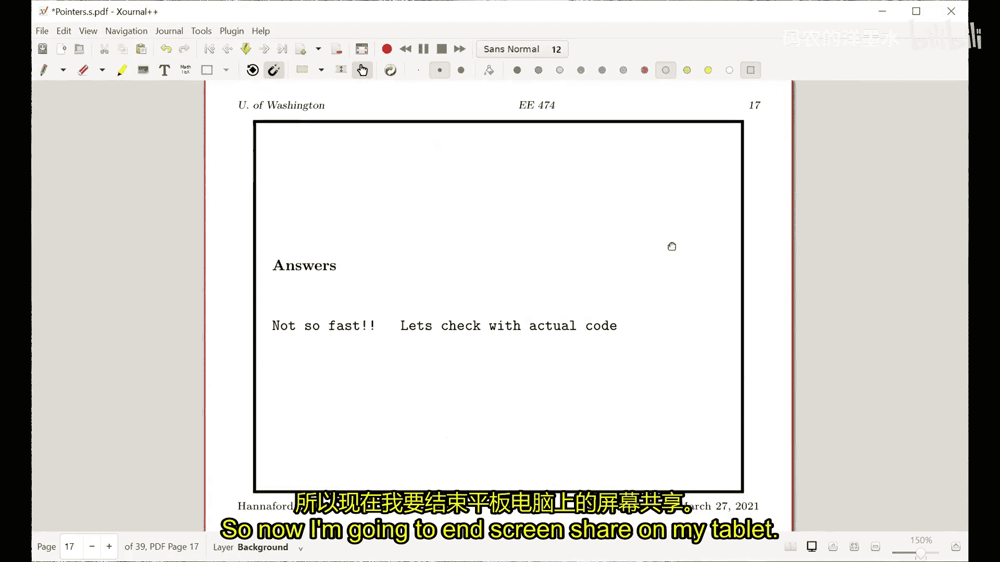
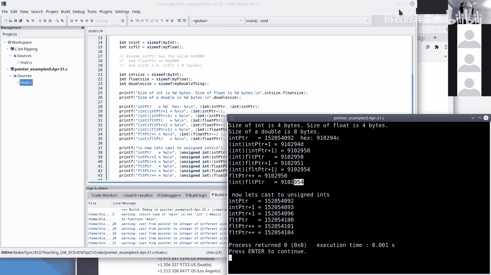
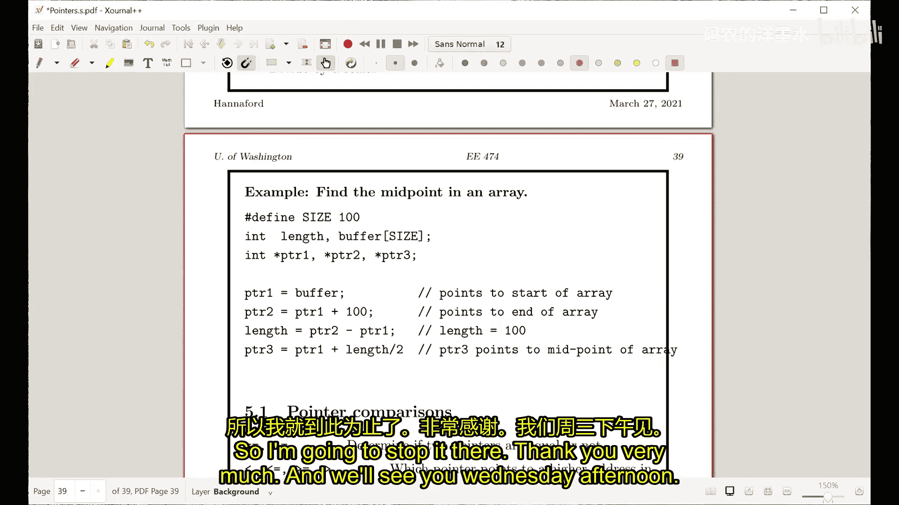

# 嵌入式系统导论 CSE474：第2讲：C编程导论


在本节课中，我们将要学习C语言编程的核心概念，特别是理解数据在计算机内存中的表示方式，以及如何使用指针来操作内存地址。这对于嵌入式系统编程至关重要，因为我们需要直接与硬件寄存器进行交互。

## 概述：数据在内存中的表示

上一节我们介绍了课程的基本信息。本节中，我们来看看C语言如何将我们编写的代码转换为计算机内存中实际的0和1。理解这一点是掌握C语言高级特性，尤其是其与硬件交互能力的关键。

与解释型语言不同，在C语言中，像 `int x = 5;` 这样的语句，不仅声明了一个变量，还决定了在内存的特定位置存储哪些二进制位。当我们进行嵌入式系统编程，控制像Arduino Mega 2560这样的硬件时，我们实际上是在操作芯片内部寄存器中的一个个“开关”（即0和1），以开启、关闭或配置硬件功能。

### 整数与字符的存储示例

假设我们声明一个16位的整数：
```c
int c_int_variable = 17;
```
在内存中，这个变量会占据两个字节（16位）。数字17的二进制表示为 `0000 0000 0001 0001`（16 + 1）。

接下来，我们声明一个字符数组（字符串）：
```c
char char_array[] = “OK”;
```
C编译器会将字符‘O’和‘K’转换为它们对应的8位ASCII（或UTF-8）码，并顺序存储在内存中。需要注意的是，在C语言中，一个真正的字符串必须以空字符（`\0`，即8位全0）结尾，这样函数才知道字符串在哪里结束。

内存中的每个字节都有一个唯一的地址，就像房子有门牌号一样。变量名通过符号表与这些地址关联起来。

## 指针：内存地址的抽象

理解了内存地址后，我们来看看指针。指针是C语言中一个强大且必要的工具，它允许我们直接操作内存地址，这对于访问硬件寄存器尤为重要。

### 指针的声明与赋值

声明一个整型指针：
```c
int *my_int_ptr; // 声明一个指向整数的指针，未初始化
```
这个指针变量本身用于存储一个内存地址，而不是一个整数值。我们可以让它指向之前定义的整数变量：
```c
my_int_ptr = &c_int_variable; // & 是“取地址”运算符
```
现在，`my_int_ptr` 中存储的是变量 `c_int_variable` 的内存地址，而不是数字17。

### 解引用指针

解引用操作是使用指针获取其指向地址中存储的值：
```c
int x = *my_int_ptr; // * 在这里是“解引用”运算符
```
如果 `my_int_ptr` 指向存储着17的内存，那么 `x` 的值就是17。解引用运算符 `*` 与声明指针时的 `*` 含义不同，前者是操作符，后者是类型说明符。

### 指针算术运算

指针可以进行加减运算，但其增减的单位取决于它所指向的数据类型的大小。
```c
int *pa = (int*)0x3000; // 假设这是一个有效的整型地址
pa++; // 指针递增
```
如果 `int` 类型占4个字节，那么 `pa++` 会使地址值增加4，指向下一个整数所在的内存位置，而不是下一个字节。这种特性使得遍历数组变得非常方便。

## 实践：通过代码理解指针




为了巩固概念，我们运行了一段示例代码来探索指针和类型转换。

*   **`sizeof` 运算符**：用于获取数据类型或变量在内存中所占的字节数。
*   **指针值的打印**：指针本身的值（地址）可以打印出来。需要注意的是，直接打印可能得到负数，这是因为系统将高位解释为符号位。将其转换为无符号整数（`unsigned int`）可以正确显示地址值。
*   **类型转换（Casting）**：我们可以改变数据的解释方式。例如，将指针强制转换为整数类型，就可以看到其地址的数值。
*   **运算优先级**：`(int)pa + 1` 和 `(int)(pa + 1)` 的结果截然不同。前者先将地址值转为整数再加1；后者先将指针移动一个`int`单位，再将新地址转为整数。

## 数组与指针的关系

在C语言中，数组和指针关系密切。数组名在很多情况下可以当作指向其第一个元素的指针来使用。
```c
int arr[3] = {5, 6, 7};
int *ap = arr; // 等价于 int *ap = &arr[0];
```
我们可以通过指针算术来访问数组元素：`*(ap + 2)` 等价于 `arr[2]`。



## 高级指针概念


### 通用（Void）指针

通用指针（`void *`）是一种可以指向任何数据类型的指针，但它不能直接进行解引用操作，因为编译器不知道它指向的数据类型。在使用前，必须将其转换为具体的指针类型。
```c
void *generic_ptr;
int value = 3;
generic_ptr = &value; // 合法
// int y = *generic_ptr; // 错误！不能解引用void指针
int y = *((int*)generic_ptr); // 合法，先进行类型转换
```

### 空指针

空指针（`NULL`）是一个不指向任何有效内存地址的指针，通常定义为0。在函数中使用指针前检查它是否为 `NULL` 是一种良好的错误预防实践。
```c
if (input_ptr != NULL) {
    // 安全地使用指针
} else {
    // 错误处理
}
```

### 函数指针

指针甚至可以指向函数。这在嵌入式系统中非常有用，例如，可以根据不同的系统状态（如白天、夜晚、雾天）动态选择要执行的任务函数。
```c
int some_function(int arg) { return arg * 2; }
int (*func_ptr)(int); // 声明一个函数指针
func_ptr = &some_function; // 指向函数
int result = (*func_ptr)(5); // 通过指针调用函数，result 为 10
// 简写方式：int result = func_ptr(5);
```
我们将在实时操作系统的任务调度中广泛使用函数指针。

## 总结



本节课中我们一起学习了C语言编程的核心基础。我们从数据在内存中的二进制表示开始，深入探讨了指针的概念——包括指针的声明、赋值、解引用和算术运算。我们还了解了数组与指针的紧密联系，以及通用指针、空指针和函数指针这些高级但重要的概念。掌握这些知识，特别是理解内存地址和指针操作，是进行高效、强大的嵌入式系统开发的基石。在接下来的课程中，我们将把这些概念应用到实际的Arduino硬件编程环境中。