# 【全集 附完整课件】华盛顿大学 嵌入式系统导论 CSE474 中英字幕 p03 Lecture 3 - C语言中的指针 -BV1ALqnBWEeu_p3-

明。

Where I forget。 So I really appreciate that Heads up。All right， good。对。O other make you look mad。

Okay， sorry， what was that last comment？If it's important。professorfess。

 there is also a question just I think we can clarify like does the submission for lab one have to be one contiguous video？

You know， you and I the TAs and I conferred about that and we'll get back to you with the precise thing we want on the submission so I'm not prepared to answer that but and also we're going to have I'm going to devote time in the second hour today to going over lab one and doing Q&A on lab one so thanks for that question we will definitely give you clear answer on that in plenty of time。

Anything else I should address now？All right， so after that sort of rocky start， I'm going to get。

Back to where we left off here， which was near the end。 We're going to do。

We had talked about function pointers a little bit。Which is sort of abstract， let's get rid of this。

That's better。 Alright， and so just to， I'll just get sort of I'll overlap just a bit with last time。

So this is declaring a function pointer。This first line here。Oh， I made a rectangle， why。U。

I'm supposed to be on pen。And I'll uncheck rectangle， all right。All right。

 so this statement here declares a thing called int function pointer。 That's my own name。

 That's not a key word。And what it is is a it's a pointer to a function which returns an int and has no arguments and no arguments。

 of course， comes from that empty parent there。 And then a fancier one is here。And it's a function。

 it's a function that we're going to point to with a pointer called double function pointer。

 double double funk PTR。And it returns a double， and it has two arguments。 One is an int。

 and one is a char， okay。And so this is how we declare function pointers and function pointers have this additional piece of information。

Besides just that they exist or their address， the additional piece of information is their parameter pattern。

Okay。Um。Assignment to function pointers。 So here we're starting the capital IFP is a function pointer。

 which is given a null value。 The nice thing about null is you can test for it。

And determined whether somebody has mistakenly not filled in that pointer yet。

But of course it has no meaning and it can't be executed。

Now the second line is setting up an actual function， not a function pointer， that's， of course。

 that doesn't contain the body of the function that is a function prototype。

But C can kind of work with that and say， okay， I assume the function exists somewhere。

 but now I know the prototype for that function， namely what it's going to return and what its argument list must look like。

So real function is now a thing it can work with。And then I can say the input。

 I can assign the address of my。Real pointer。 sorry， of my real function。To that pointer。 And so now。

 IFP points to the real function。And it in C， they give， you know。

 there's there are these cases where you get multiple ways to say something and you know it's a little annoying frankly。

 if you're learning it because which is right， which is better， what should I do。

But it's just the way it is。 and frankly。The reason for this and the similar one was character arrays being equivalent。

 declaring a character array like。C。Car。Chahar X。10。That's a character array。Actually。Yeah。

 and also a character pointer。Is is almost exactly the same thing as a character array， or if I go。嗯。

With no content， but I initialize it to a string。Then I can make a char star x equals string。

And the reason for these ambiguities is that the implementers of the C compiler initially sort of said。

 oh， well， Ably， an array is just like a pointer。 And so we're just going to put this layer of bandai over the pointer。

Process， and we're going to put it on like a bandai so that people see this familiar concept of a race。

But really， it's pointers under the hood。It's like， okay， great。

 But maybe you did that just to make your life easier and it makes it harder for the programmer。

 Python has a similar thing。Where classes。诶。You have to， every。

Every time you define a method in a class， you have to have a parameter called self as the first parameter。

 and I've been doing Python for years， and I always keep forgetting and it causes nasty bugs。

 and there's no good reason for that being there except。

Underneath the mechanism of objects is really just regular function calls。

 and so they had to do that to implement objects， and it made the Python developer life easier。

 made the programmer' life harder。But that's the way it is。 Alright。

 so that's a diversion digression。And then we'll go a little for。

 de referencing function pointers means to call the function that the pointer points to。

 which is the only reason to have these。Pointers， ultimately。And this is a similar， you know。

 two ways to do it because it it's really the easy way for the programmers who created it。

 And so these two are equivalent。 The top one explicitly de referenceences the function pointer and。

Applies the argument five to call the function and the bottom one just looks like any random function call。

 that's because any random function call really is a pointer thing。Okay。

Poiner arithmetic so we've already done a little bit and we're going to play around with that more to really solidify pointer arithmetic a little bit。

And。It's it's powerful， so you can sort of say， I want to go this far into memory。

And this far down a list of items or an array of items。

And so we can add a scalar specifically an integer。To a pointer。

We can subtract two pointers from each other and we get a distance that that could be handy What we are not allowed to do is we're not allowed to add two pointers together because it's meaningless it's like adding。

It's like adding two addresses in a city。What good is that Does nothing for you。 Okay。

 multiplier divide pointers can't do that。Multiply by a scalar can't do that。 Divide by a scalar。

 So it's pretty simple。 You add and subtract。 That's all that's allowed。

So let's find a midpoint in an array willll make a。Will make a symbolic。Constant。

 otherwise known as a pound to。And say our size is 100。

And we're going to have an integer called length。 and we're going to have an integer buffer。

 an array of 100 inch。And we have three pointers that are integer pointers。Okay。

 so now we point to the start of the array， pointer1。Points to the beginning of the buffer。

And pointer two points to the end of the array， obviously I should have used size here。U。

And then we can subtract the two pointers and we get in the end 100。

 it's kind of obvious from this code if I add 100 and then subtract， obviously I should get 100。

And of course， that does not mean 100 bytes， it means 100 ins， and so if your int is four bytes。

 it means 400 bytes。And then， I can do this math。Length is not a pointer， so I can divide。

 I can divide。 Okay， length is a regular int。And so I can divide by two。

 but I can add it back onto a pointer because integer division gives you an int if length were in odd number。

 it would truncate the remainder and give me a still an int。So this is also allowed。 and now。

Poiner 3 points in the middle of the array。Okay， so that's a thing we can do。

I'm seeing some chat action， so maybe I will。Look at that。Okay， somebody。

 thank you T Nn for calling me on the recording， that's great。And up arrows and。

Most likely we will want to be in one continuous video， I not sure the point there。

I can what I did last time was remember to pause during the break to shorten the video。

 but if's if I break it up， I'll post both videos it won't。

Be a big deal unless I'm missing the point of this chat here。 But Doctor。 Hanford。

 that was regarding the lab demo。 So don't worry about that for now。Got it， okay。All right。

 there might have been a private chapter。 Okay， thanks。 So pointer comparisons。

 So you can use equals and。Professor， yeah， I I had my hand up。 I don't know if you had seen him。

 but I just wanted to clarify something real quick。 Yeah， definitely。 and， and I。

 I did not see that hand anywhere。 So I'm glad you called me。 I'm glad you spoke up。

 I just wanted to see if you could go up to the part where you were defining。 I think it was。

 I think it two slides above。😊，One more above that right there with red writing。

 So you were saying that were you saying that those two are。The same thing， essentially。Yeah。

 the way you define it， okay。And remind me， we're going to open up code blocks and play around and run these examples and stuff。

 so remind me to do this red stuff when we get there if I don't remember。Okay。

 so actually we're right at the end of these slides。

You can determine if two pointers are the same or not with the standard。Comparison operators。

And you can also even use greater than or less than。It's not， you know。

 not sure that's it's rare that that's going to be important。

 buts go from lower addresses to higher addresses and。

You may just want to know which is higher in memory again。

 this will this is a kind of thing maybe you want to know that if you're writing an operating system or something。

Okay， so any more questions。

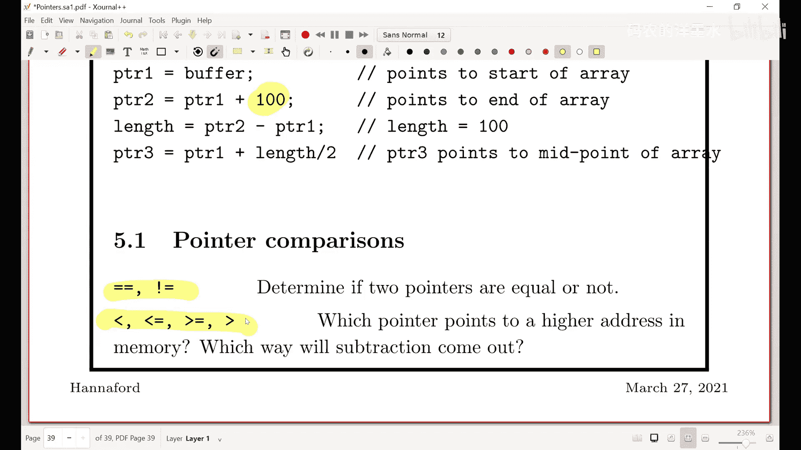

Okay， I'm going to stop sharing that account。 I'm actually。

 well I'll leave it on case we need to go back。And actually， I'll refer back to。

 I'll put this red scribble up to remind myself， okay， good。And now we'll share from here。

And we're going to start with。Some pointer。Playground， Let's see。 Where was that。 Oh， I， Yeah， right。

 So I'm doing some， I'll do most of this in code blocks。 But I like to also just do the command line。

Because it's。I don't know。 It's just lighter weight， simpler。But。

This will all work identical to code blocks。Okay， so can everybody see this。Little C program。

 very tiny。Right now。The screen doesn't seem to be shared right now。

That's because I didn't double click。 I only single clicked。 How about now。有咩有。Great。Okay， so yeah。

 So what we're going to do is just play around， break things， do experiments。嗯。😊。

My favorite breaker is I'm going to delete a semicolon。 I'm going to save the file。

 I'm going to compile it。And if I go dash， O here。I can call it。

Something really easy to type actually， you know， it generates by default a file called a dot out。

 I have no idea what that means。 Maybe that's a leftover from the really old programming language A。

 which is two generations before C， but at any rate， I'm going to call it。T 4，7，4， just for fun。

 and then we're going to compile the file string。Playground dot C。

And it found an error and a brake statement not within a loop or switch， but that's because。

This semicolon is missing and it didn't understand this for loop。

So that is not a very informative error message， is it？But I knew what I did wrong already。

 so now let's Gcc it oh， no errors， Okay， so I was right and then in C I have to run it with dot slash and then T4 tab。

And it prints my name。 Okay， so it's working。And so what did it do。

 So let's take it one line at a time。I have this character pointer initialized to the string and as I said before。

 if I this is the red。Scrribbbble。😊，If I go cha B name。呃。Brackt equals。嗯。The same。

With a new line return to at the end and a semi。And then we're going to comment that out this time。

And save it。 and build it。That worked too okay and it also will run the same Okay， good。

 so this is my little red thing， my red scribble telling you that these are two equivalents and the brilliant programmers behind the C language said。

 oh， we just have to we just have to do pointers and then somebody said， no I missed my arrays。

 I really want to raise so they just made a switcher that converts this to this okay。So okay。

 now I'm going to make a buffer and buffer is just a really traditional name for a block of memory and the original idea of buffer is like you have some communication link or a peripheral device and data is coming in and kind of bursty random times and so you fill up a buffer of memory and then you have a nice block and your code can process it okay and so it buffers the random timing of an external communication link of course there's no communication here。

 it just became a general term for a block of memory。

So I have this big block of memory or 100 that sort of big。 and I'm filling it up with all zeros so。

AA zero。Back slash means， well， first of all， it's in a double quote， a single quote there。

 So single quotes referred to chars， characters， which means an 8 bit value。But it's not a number。

 it's a character according to the ASCII or UTF8 standardized code。And if I typed a 0 there。

 I would have something different if it was just 0， Just 0 would be the character0。

Which is not the same as the number 0。And so， backslash 0 means。8 zeros，8 bits of 0。

And if you just give one value， but you declare an array。

 this knows to repeat that value for all 100 elements。Okay， so certainly。

 I don't want to type10 comma backlash 0， closea， I don't want to do that 100 times。 Okay。

 so I don't have to。 Alright， good。And then we're going to now do a loop。

 And this loop is a long loop。 It goes 5000 times。That's just， I did that， because。

I want to teach a feature here， and I just saw a hand raise in the corner of my other screen。

 where I'm not looking。So does somebody want to just say their question。Yeah。

 so I had a question about the buffer like how you have like a size of like 100。

 but you have one element I' pretty much repeat 100 times so does that mean let's say we have five elements and like in the array like when we declare it and then we keep as the sizes 100 is that going repeat until there are100 elements in their array or how does that work You know。

 I do not know the answer but we're going to find out So we're going to go slash we're going go one。

诶。Quote， capital M。Okay， so now we have three chas。 We have a0， the character  one and capital M。

 And then we're going to print them。As integers to see what they look like， no， we'll make a loop。

And then we're going to go printf。I guess I'll do it both ways， Per C。Person。Percent。I。New line。

And then we're going to have the character buffer。I。

 and then we're going to cast it to an int so we can。 This is supposed to be a D， sorry。呃。Ant buffer。

Hi， so we can see the underlying numerical code。Behind the character。

And then we're going to exit and skip the rest of the code。So let's see what happens。Save that。

Build it。Got a problem。Exit。That should not be empty， I guess。That worked。 and I will run it。And so。

 we got all these things。Okay， so we have now answered your excellent question。

 The answer is it did not cycle and cycle that those three until the end。

 It just stopped after three。Now， the rest of those zeros just happen to be there because this is a well implemented C compiler。

 okay， but we never explicitly set those other zeros。So I think does that answer your question。Yeah。

 so， so those zeros are there because they're just。

That's just how the default is when there's nothing， right？Yeah， now the way， I don't know。

 the way I've always been taught is do not count on that。 Like we got lucky。This， that。You。

 you might get random stuff in there。Okay， if you don't explicitly initialize it。

 which we did not do。Okay， so but we've definitively answered your first question。

 which is it goes through those first bitetes and by the way。

 you see here that the zero the null character slash zero。Did not print at all。

There's not even a space there。 Okay， so like if I replace that with a space。

And you can only put one character in between single quotes， okay。

So we're going to build it again and run it again and scroll back up。 So now there's a space there。

But the null just printed nothing。Okay， fine。But yeah， so we did not。Did not repeat。Okay。

 so that was a great question， I am going to fill this up explicitly with zeros again。

And I'm going to get rid of。Well，'s comment it out。 Who knows， Maybe we want it sometime。

Good professor， yeah。So when you just ran that code before right and then on the right side is the like the integer values。

 I could still run it because I haven't rebuilt， recompild。Yes。

 your question are are those like are those the ASI values of those characters， Yes。

 like the integer values of that okay？Thanks for asking that explicitly and these， by the way。

 because I used。Percent D in the print F right here。 Those are decimal。 Okay， so generally。

 we use hex for。That kind of level。 But it's still， you know， decimals a thing。

 And so the the decimal code， the， the ASI code for。Space is 32。

 and the ASII code for capital N is 77。Okay， thank you。 And so that's what we。

 that's what I was trying to do。 So， yeah， thanks for asking that question。 So now， okay。

 now we're going to go like this。😊，And we're going to。So sort of pick an arbitrary big number。

What could go wrong。 And then we're going to say， okay， if this B name。ACharacter pointed to by I。

 The Ih1 is equal to 0。 the null character。Then break， which means get out of the loop。Otherwise。

 copy it into the buffer， which is。This thing。So we're going to copy it from a string and what this is saying is。

 well， we just know that any string has a zero at the end of it。

 even though it's not written up here， but the way C knows that strings are over。

Is to put a0 at the end。And。So I'm going to copy it from。

The buffer into the from the buffer from Blake's name into the buffer。And so the kind of。

 kind of cool thing is since I filled this buffer up with zeros， I don't have to copy the zero over。

😊，And so now I'm printing the buffer， not printing B name。So let's see what happens here。

And it printed my name， even though I never initialized buffer to have my name in it。

Questions about that。I have a question， is the size of buffer still 100？Yeah， so actually。

 that's a great question。 Let's do this same code and print it out now。

 So I'm going to copy it and then paste it。😊，Down here。 I love that question。

 That's going to be educational for people。 if I answer it。

 So now we're going to do the exact same thing， right， But okay。

 I'm going to just simplify the screen。 So I'm going to push。

 I'm only going to print 30 characters just to because we know there's a bunch of zeros at the end。

 okay。😊，We already discovered that。So now we'll build it。 No errors， and we'll run it。

So now the string is in there， this is the print F。

 but now we're doing that loop and capital B is 66 and L is 108， et cetera， space is 32。

 And then at the end there's a oh sorry the last thing is the new line So backslash n which we had here is just like it's a character like everything else。

 but it doesn't。It doesn't show it's a non printing character。 it goes to the next line。

 And so what do you know it went to the next line， it skipped that line。And that's got the value 10。

Is new line care。In we can go into the， there's a little bit difference between how a new line is represented in different Oss。

 So if you do this same thing in Windows， you probably will get a carriage return line feed as two characters。

 But in Linux， it's just new line， which is actually the line feed。Character。

 we don't need to worry about that very much。So that's the new that's the end of line character。

 and then all that data is still in there， they're all zeros。So there was another question。

 hand raise。Yeah， I just wanted to， I guess be I wanted to make sure that I was understanding it correctly。

 but so the first for loop you had。Were you just trying to show to us like that you know。

 that when you create a character array that C has the ability to recognize when the string ends like when it's at the end of it it doesn't well。

When I create the array up here on line 12， okay。C is automatically allocating one more one more byte after the new line and putting a zero in there and then it's a convention so code has to be written to look for that zero to know where the end of the string is because there's no place that stores the length of the string。

And so we're going to illustrate that because we're going to break my little system here， okay。

How are we going to do that？We are going to do this again。Actually， I'm just。

 I don't need to do the big loop。But and I'm going to get rid of this exit at the end of a program。

 you don't need to explicitly exit。Okay。And this time， we're going to say that。

We're going to make a new array。Um。Actually。I'm going to just shorten it。

And I'm going to just not put the new line there， okay。So we' got a new name， a new buffer。

 a new string。And we're going to make this be named 2。 So we're going to do the same thing。

 C is putting a0 at the end of。Kamala H。 and we're going to run the exact same thing。

And we're going to print it again， we're going to copy it over into buffer。

 so let's see what happens。No errors。Run it。😊，And what happened there。 Oh， that What happened is。

 I didn't print。I didn't change the copy statement， so that was dumb。Okay。😊。

So now we'll build it again。And now we'll run it again。And。Yeah， so look at this。

What why does anyone know why that happened。It's almost like Kamala Hanford， isn't it。Yeah。

 because the length of your second child array。😔，It's shorter than the first one。

 and it's the same buffer， And we didn't actually clear it out explicitly in between the loops。

That's why the yes， the thought rest do the Yes， that Ed explanation is correct。

 So this is what was in buffer before I started with Kamala Harris。

And so we copy characters all the way to。To， to the period and the period got to like here。

But there's no zero at the end to terminate the string until we get down here。

And so when I print it later on as a string， it's going to go all the way to this to here because it's looking for a zero。

 So let's fix that。 So we can fix that。 When this loop is done， we've come out of the loop。

And we want to copy。 We will'll just add the zero to the buffer。Now the question is。

 do we write buffer I equals？Quote back slash 0， unquote， or I plus one。What do people think。

Jath raised a hand。What's your answer， E theoreticalically should not be using I at all。

Because you're no longer in the for loop。Hey， that's a great。 That's a great point。

 And I forgot about that。So let's make it out of that safe scope。I love it。

So now they're in the same scope and it's legit。So now should it be I or I plus1。I would再做错了。Okay。

 let's try it。That was good catch， you guys。Now we'll run it。And no， not quite。

 So there's still this N here。 base。 I don't know。 my。

 my command line prompt begins with base because of some Python thing。And so there's no new line。

 I'm going to do something else here。 I'm going to clear the。呃。Space a little bit。

With three new lines。Just to make sure there's no interference there。

 it's easier to understand the output。Alright， fine。 So no。

 the plus one captured an additional character。 If I take this one off and go back to I。Save。Build。

Run， it's correct。 Okay， And the reason is that this loop went around an incremented eye。

And then it looked for the terminating string。On the Kamala Harris。String。And it sees it。

 And now it breaks because I is now pointing past the period。Question from JaneO again。

Your hand is up， is that from your old question？I don't see my hand up。 Well。

 it there's definitely a lag of lower in your hand。 I've noticed that， too。 anyway， great。

So does that make sense， so it it does a break from the loop here。When it detects the termination。

0 of Kamela H。And so I is already incremented by this。Alright。嗯。😊。

So I think the key thing to kind of remember is that when we haven't。

 we can allocate a big buffer like this with 100 characters。And fill it up。

But the string interpretation of the data ends at0。

And actually might be good to print all that stuff again after the Kamala Harris transfer。

 so I'm going to do that。So we're going to print the first 30 elements of the buffer now。

 and that will be illustrative。Yeah， it's I'm glad I did that。

 So here's sort of how it was before Blake Hanniford。 then it it has this new string。

 Now the buffer looks like this。😊，Caa space， H， period 0。And now， that's why it stopped。

Because of that zero。 and it's ignoring this other stuff that's like lingering from the old use of the buffer。

Okay。😊，Alright， now。I' want to try。 Let's see。 You know。

 I think I'm going to take the break now and let's start up again at。3，20。5。

And we'll do some interactive stuff。So I'll see you at。

 I'm going to pause the Zoom recording and I'll see you at 325。

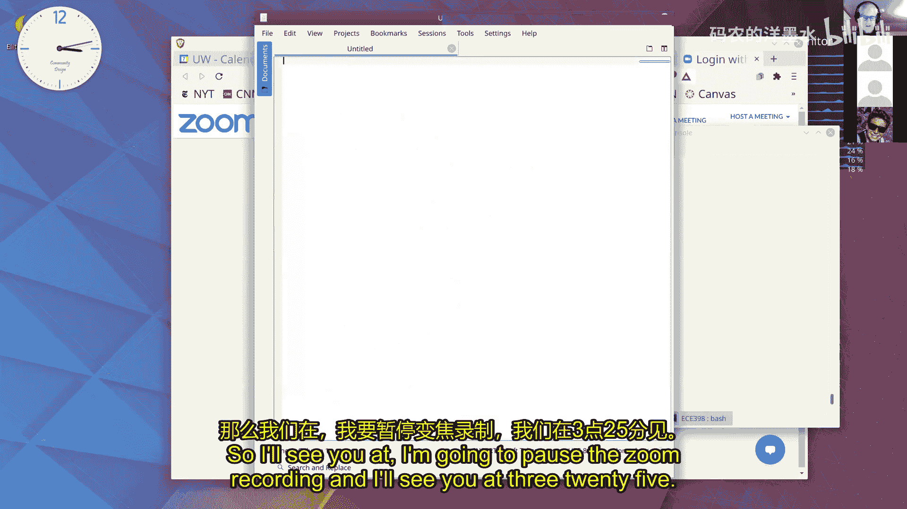

Recording is restarted from our break。 And so now we're going to do some interactive stuff。

 And we're going to do poll everywhere。 And I'm going to make some pointer。Expressions。

 and then you're going to guess what the value is， what's going to print。

 And you're going to enter your choice into a poll everywhere。

 And we're going to see where people are at。 So first thing we're going to do is look at some code。

 Let me see if there's anything important on chat now。No， we've had quiet chat for a while。

 that's fine。Alright， so we're gonna look at some code。

And I'm going to share my screen from desktop2。Okay， can everybody see a。A code box window。Yeah。Okay。

 great。 So most of this is commented out。 That's the light blue。

 And so we have something very simple here。 This is called pointer in class poll。

 And so what we're doing is we have a。String called hellello， my name is Joe or called data。

And we have a pointer that points to the。First element of the data。

 And this is another way to do that。 It says， okay， well， data bracket 0 actually is the character H。

 And now give me the address of it。 So， yeah， there's multiple ways to do stuff and see。

And now here's poll1。 And the question of poll1 is what is the value of star PR plus 5。

And we did cover this earlier， and I to save time， I made a generic poll。

 which I'm going to put into the chat。And chat doesn't show unless I stop the screen， oh， wait more。

 here we go， all right。Yep， okay， so there is a poll in chat。And it's generic。 It's just got answer。

 A， B， C， and D。And so what I want you to do is。Look at this first question from line 6 to 13。And。

Guess your answer。And then please start filling your answer into the quiz。And I see three answers。

 so people answers are coming in， so that's great。But we have a lot of people on the call。

Can we see the question again， Yes， I'm sorry I will my intent is to keep the question up there。

I'll move this over here， Okay， so still only about 14 answers and so people are still thinking。

People are changing their minds。 That's okay。But answers are coming in。Got 34 so far。

 I'd like to see 44。Maybe， maybe not quite 404。 I'd like to see 40。And we're getting very。

 very close。Alright。40。Show responses。Wait， that's。I don't know why that thinks it's the responses。

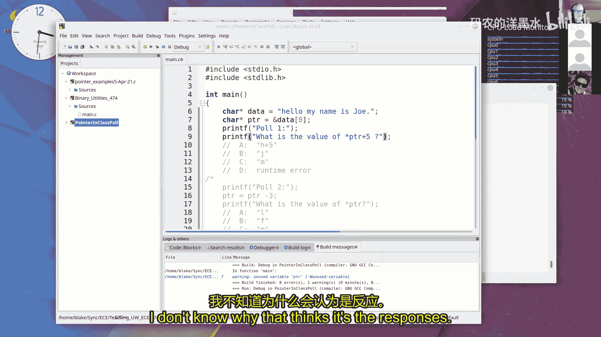

Maybe full screen。 That's terrible。That is not a good display。

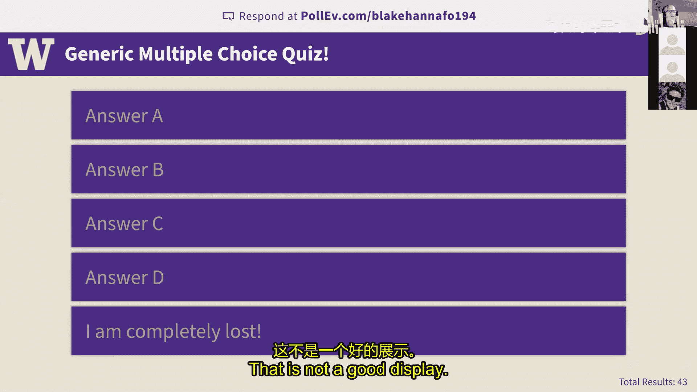

It worked better without the show responses。 Oh， maybe that is show responses。 Okay， anyway。

 most people like answer D and answer D is runtime error。 They think this is going to not work。

And answer C is the second most popular。 Oh， it's starting to grow。 Okay， which is the letter M。

 So now we're going to run this。 We're going build it and run it。And see what it does。 So build。

It's up to date， no problems， no complaints。And what is the value。 Oh， the， the problem is。

 I have to add the expression to print it。And a hint it's going to be a character。Okay。

 let's compile that。Why does it think the target is up to date。When I've edited， oh。

 I still have to close the debugger， okay。Nice to。 I get my nice blue lines down here。

 And so I'm going to run it。And the value of。Poiner plus 5 is M。

So that was answer C was the correct answer。 And we're still learning that。 So why。Okay， well。

 the reason is that。This math is performed after the D referencing。

So star PR pointers pointing to the zeroth element， which is the letter H。 So that's good。

 Now we're going to add5 to the letter H。 What the heck does that mean， What it means is I， J， K。

 L M。Because the ASCI codes are numerical and they increase in alphabetical order。So， okay， so。

 and we did this example last time。 If I change it with Pars。

With a parent reference to change the precedence of the dereference operator。

And I lost my second bracket there。 Okay， my second print there。 Now it's slightly different。

A problemblem。What's this one going to be。This time， it's going to。Start with age， and go。1，2，3，4，5。

 And sorry， it's going to go。1，2，3，4，5。 So it should print space。So just to make it readable。

 I'm going to print a6 there。Clarify my output。And put a new line here because they ran together。

So close the debugger。Build nice to blue。Lines there。And print。And star PTR plus 6 equals M。And。

I don't understand that。1，2，3， four，5，6。Oh， I know。 Okay， so。This is this is value 0。

 So this is value E is 1，2，3，4，5，6。So anyway， it's now incrementing the pointer first and then dereencing it。

 and so we get this letter right here。Oops， we get this letter right here M。Okay。😊。

Does that make sense to people。Professor what would happen if you didn't dereference。

 like if you just had like the。Pointer equals data。0， like without the ampersand。

Without this asterisk， you mean， no， the the when you first up here， Okay， Yeah。

 that is going to be an error， a runtime error。 Let's check it。It will build， but it's warning。

 I get a warning。 Okay， like I said， these warnings can be very conservative。

 but when you have a bug， it's the first place to look。 Okay， so let's run this。Segmentation fault。

 that means it tried， that's a Linux thing。 You don't see that same word in Windows。

 but you see something else。It crashed， because。It。😊，Takes the letter H。

 And I forget what H was like。100 or something was the ASCI value。

And it tries to go there in memory to that address， which is wrong and meaningless。

 and Linux is protecting itself。From us。 Okay， so now， on the other hand。Because of C magic。

 if I get rid of that subscript， Prety sure this is going to be okay。And work。Build it。No errors。

 no warnings。 It did work。Okay。😊，So good question。 All these things take a little getting used to。

Other questions。Alright， so in the poll， I'm going to clear the results。And I'm going to。

Start poll number two。 So we're going。Get this。 We're going to comment out， question1。

And uncomment question 2， and。Comment question 3。So now I'm doing a subtraction。Um。

I'm going to subtract three from the pointer and we saw that that is allowed。

And at least syntactically， it's allowed。Just to clarify that it's subtraction。And now。

 what is the pointer going to point to， Actually， I did a little too much commenting here because I have to have my original data here。

Okay， that is going to be a lot better。 it's got to know what the pointer is and what data is。Okay。

 so our new poll is what is going to happen here and people are answering already good。And again。

 the answers。Professor。鱼啊苗ed。Professor muted I muted myself。 Thank you very much。 I'm sorry。

 Now I want to get rid of this menu。

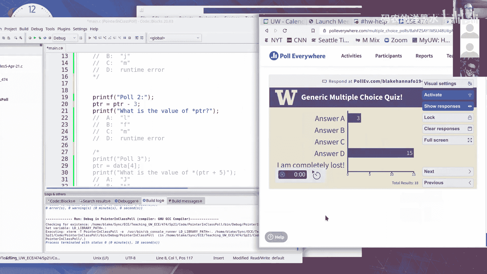

Oh， well。Try to put this on top。嗯。I'm going to momentarily stop the screen share and start it again because I。

Contaminated my screen。Okay。And。Again， the poll question is over there。

Answers coming in runtime error。And I got 27。 let's' let's try to get up to 40 again。

I guess you see the results as they're coming in。So don't just vote for the most popular answer。

 please。Professor， could you scroll up to the screen again？Yeah， let me try to get everything。

I'm gonna try to get everything。 That's everything。quite sir。Yes。😊，So for the cha pointer。

 so there's not going to be no the address data thing。Instead of just add data。Sorry。

 what and the the an sign before data， are we not putting up。You， yeah， I think you can do that。

 but it's redundant。 Actually， you may， I'm not sure you can do that。 Let's， let's test that later。

First， we're going to finish this poll。 Okay， so allright。

 so I'm going to stop people if I'm going now I'm going hide the responses next time during the poll acquisition。

Okay， so let's， let's play this。 Let's run this。So we'll add a printf for the。Answer。

And we're going to build it kind of run out of build build window space there， sorry。啊。

But that syntactically worked。U。Well， it printed out nothing， but it did not have a runtime error。

So what does that mean well， it means we got lucky。

 this is really bad programming here because the pointer points here to the H and now we're going to the left or below the string and so we don't know what was there。

If it happens that a zero was there， then we're kind of lucky because it just prints something benign。

So we printed something random and that is not so good。So danger， be careful there。 So technically。

 D is wrong， but it's also really more like right。So it really deeds the right answer， okay。ULet's。

 let's comment Professor Hannneford， yes， is， so is that just saying that？3， like。

Basically like registers in terms of like character space to the left of what our first value is is a zero。

As it turns out， because we got lucky， right？Yeah， and what you really mean is3 Bte addresses below the start of data。

Okay's that's the more tech way to say what you just said， but it's the same meaning。Okay， let's get。

Let's get a little。Wops， oh yeah。 sorry， I didn't want to。I want to keep that commented。

 I want to run this one more time where we will get something。Even more dangerous， let's， let's。呵呵。😊。

Let's， let's put a big number there。 Okay， that's going just。Kick it out of our whole program。

And that is， indeed， a seg fault。Because it's just pointing outside our whole allowed space。

 So in an operating system like Windows or Linux。TheThe system gives your program a block of memory。

 and if you try to access outside of it， it terminates your program because that's not safe。

 So I just didn't I needed a bigger offset。Okay， of course， plus would also do the same thing。

Alright， so we're gonna be done with that one。And now poll number three。And we now have a little。

 probably a few games。Pointer is。Actually， this needs an ampers am percent。

 that is going to be a mistake。 If I just say pointer equals data 4。

 it's going to set the pointer equal to that character itself， which in this case would be one0。

Element 0，1，2，3，4。 That would be the letter O。 Okay。

 so I'm going to point it to the letter O with the ampersand here。

Somebody asked about the ampersand up here，s okay， let's go ahead and throw that in。

 see what happens okay。U。And to see what happens。Will print the， print the pointer。Okay。

 so we're going build that。Something it didn't like。 Oh， there's some imbalance in my commas。

In my comments。We're trying to turn。 Well， I'm trying to turn on poll number 3。

That might be the problem。 And then down here， oh， that's just an extra done with commenting， okay。

Just warnings now。So， let's run it。And。This is interesting。Actually， this is our first。Pointer。

I don't know what's going on there， To be honest， Up to figure it out。So I'm going to put it back。

And this should just print hello， my name is Joe。And indeed， now it prints hello。 My name is Joe。

 Okay， so something was wrong when I put Ampersand there， it may have。Oh， I I think I know。

 what that is， is the address of the pointer。 So now it becomes a pointer to a pointer。

Because data already is a character pointer， like I declared it up here， okay。So。

 it found some garbage。Pointed to by the pointer， pointer。Okay， so that questions answered。

And now we're going to go down here and look at poll number three。And。So， okay。Let's。Oh， I see。

 There's another poll question， and I haven't commented it properly。Okay。

 poll4 is commented out and labeled。And now， we have。A new thing。 So this is a new pointer statement。

 We're initializing pointer to a new value。Notice the difference I had an ampersand here。

 but not an index， that's why it's different。Now I have an index。 So this is， again。

 data data bracket for。Is actually the character in the fourth slot of the data buffer data string。

So what do you think will be printed by this。And here's the options。And the the。

I'm going hide the responses。 I didn't hide them in time。But we have responses， okay。So or did I。

 I didn't clear them。 Did I clear them。Okay， I'm clearing them。

 so please reenter your responses for poll number three。And I'm going to hide them。

I guess when I hide them， they're hidden from me。 but I can， that's okay。

 I can see the number coming in， got 18，1920。Could you show us the string again。Yeah。😊。

I'm going to get move these questions that are commented out。Elsewhere。And then it will be easy。

The current question will be the top question。Okay。😊，So， yeah。Okay，32 is good enough。

 I'm going to show the responses。Most people think it's N answer C。 Okay， and why， well。

 so pointer is pointing to the fourth element，0，1，2，3，4。 pointer is pointing to the O。

 And now we're going to add 5 more to it。 So it's 1，2，3，4，5。 So now the pointer plus 5。

 is pointing to lowercase N， which is answer C。 And I'm very happy。 Most people got that。

 So let's print it。😊，And my friends match up， and I got my semicolon。

And this is indeed the correct thing we're evaluating， but there's an extra。Prient no。

 there's a missing print。 So that's there。 And this is here。And now， everything agrees。

So we're going to build it。Killed debugger。Build it。Nice two blue lines and here we go， it is N。

And was answer C。So this is great learning is taking place， so let's try this last one。

 except I had some kind of Se fault happening， but let's figure it out。

Put it down in our parking lot there。And so， let's look at poll 4。So now I have a new buffer。

I'm going to copy 15 characters。Into the buffer。With this little complicated formula here。

And I'm going to dereence them and put them in the buffer。And what does the buffer print out。So。

 I'll get rid of this。And I'll clear the responses and not show them so。

Let's see what people think on this。Poll number four， then we're done with polls。Okay，23。

 I'm going to for it's a long day。 So I'm going to call that enough。

Show responses answer C name is Joe is the most popular answer D runtime error。

 Let's see what we get。And so， we'll just print that。I can just copy it。Oops。Yeah， that well， yeah。

 that's fine。I had to put single quotes in there to be able to quote。The print F formatting string。

 which is not right。And somehow those got doubled。And I'm actually going to make that a new line as well。

 for clarity。And this a new line。Actually， I don't need to do that twice， okay。

So let's make sure this is runable。Got an error there， no because I forgot my semicolon。

The most popular C error in history。Okay， and let's run it。And what we got is， name is Joe。

So let's figure that out。 That one。Is answer C。 And it was the most popular。

And so let's just go through it。 So here。嗯。We got pointer plus 9 plus I。 So pointer plus 1，2，3，4，5，6。

7，8，9。That's where we're starting。 And we're going to go 15 characters，1，2，3，4，5，6，7，8，9，10，11，12，13。

14，15。 So we went over。Which is a concern。 However。

 the buffer has the zero terminator from this original string in it。And there may be some garbage。

After that， but when we print it out using this print F， it knows to stop at the zero。Makes sense。

So if I set this to 150， we probably will have some problems。Stack smashing detected。 That's cool。

So we're terminated， aborted。And we can go into what that is later。

 but that's the point is this is still sort of sketchy code， even though it worked when I did 15。

And the real way to fix this is certainly make sure we never go beyond 50。

 which is the size of the buffer。Okay。😊，All right， so that was a fun little exercise。

And I think what I want to do for the remaining of 1520 minutes is。Go over lab number one。Which is。

The next milestone。

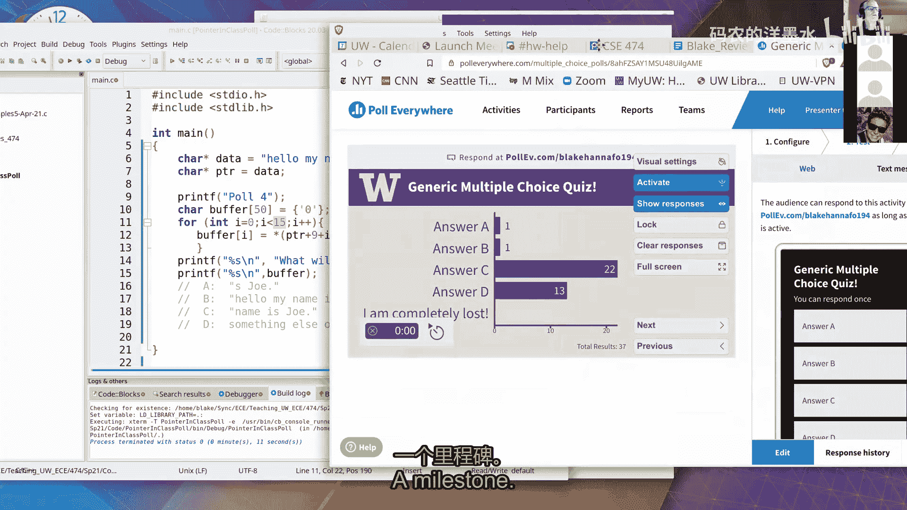

I'm going to change my screen share。To my other screen。

And， you know， it's not due for another。11 days so that's the good news and we will update you on the Ts and I have to huddle and figure out exactly what we want in that turn in video and we will be we'll clarify that。

So， okay。This is this is what your board looks like。

Oh before we get to that you might want to consider making a lab bench I have a guide and there's a little how to video just takes a few minutes。

 I already showed this to you I guess this is mine I haven't put the display on yet。

Although I have the8 by8 display on there。And it really will help when you get stuff attached to your Arduino board。

 that's the Arduinoomega and initially for lab1， you may not necessarily need this。

 but it takes you five，10 minutes to make this with some duct tape。Okay， so， and I just knocked my。

Thumbstick。offff。But recovered it， okay。But lab one doesn't need that， but anyway。

 this is all documented and cut your cardboard out like that， okay。So。

The equipment list we've gone over， hopefully your equipment is arriving already or will be soon。

And so we have three learning objectives， so that's install and set up your Arduino IDE。

 which is interactive development environment， which is code blockslock is an IDE and Arduino has their own IDE。

And then build and run a basic sketch sketch is their little term for program， so a basic program。

That's already written for you inside the Arduino examples and libraries。

Modify and demonstrate that you can change the program。And rebuild it。So。

Here's the equipment you need。I actually have found it。You know。

 we talked about wire strippers and wire and these come with the kits they're sort of convenient and I know a lot of students like to use them。

 but I have to say the ones I got recently some of these pins don't even fit in。The proto board。

 the breadboard very well。 And， but if you use wire， it always is fits。 So I guess I'm biased。

 but anyway。So this is an individual lab because obviously each individual student needs to show that they understand these basics of operating the。

Or do we know and downloading code？Um。And。So。Yeah， so procedures， basically I will so first of all。

 you have to install it。 Okay， and the link is here。 So just taking you in a little walk through。

 this is are do we know are do weino。Is a group that just became world famous and incredibly impactful by simplifying the mechanics of writing code for an embedded processor and they there's a lot of little there's a lot of complex code libraries kind of behind the scenes in Arduino that allow it to support all these chips and。

Make it really pretty painless to install this for for whatever operating system you want。And if you。

呃。And that actually was a revolution in the field of embedded programming。

 because if you're a company， let's say you're going to start developing a new。

Temperature controller for reptile。Reptile terariums。 Okay， you want to sell that。 And that's cool。

 And it's you're going to need a little chip and some sensors。 And it's just like this。😊。

But you have a team， you have an engineering team that's going to develop this as a commercial product with all the stuff and youre you know you're going to spend like six months perfecting this。

 making regulatory approvals， getting it manufacturable。

 all kinds of stuff that we don't have to deal with in the class。

And certainly stuff that hobbyists don't have to deal with and。So what the manager does is say。

 take the one engineer on the team who's the best software person。

And says you spend a week setting up the development environment so that everybody can write code and push it into the chip。

And so that person went off and spent a week， but that's just one person week out of an effort of four people for six months。

 It's not a big deal。 You've got it working。 You can now just run code。

 But if you're just a hobbyist or an individual entrepreneur。

 you can't afford to spend a week just fiddling around。Getting a tool chain working。

With not without very much information， you want to just download something and get it to run。

And that's expected today。 But it wasn't the case when Arduino started。

 So that's why it was a revolution。 And like I said， literally。

 we all know high school kids who download this and write their own little control。

A code in an Arduino。Okay， so follow the instructions， look at troubleshooting tips。

 YouTube videos and specifically if you have any difficulties there are some links here so first try their troubleshooting guide so you know millions and millions of people worldwide have installed this successfully when they run into roadblocks most of those roadblocks are in this FAQ here。

And so try those， but then just work with our Ts our TAs are great and they have lots of office hours and they know what problems most of what problems students have had and how to work around them。

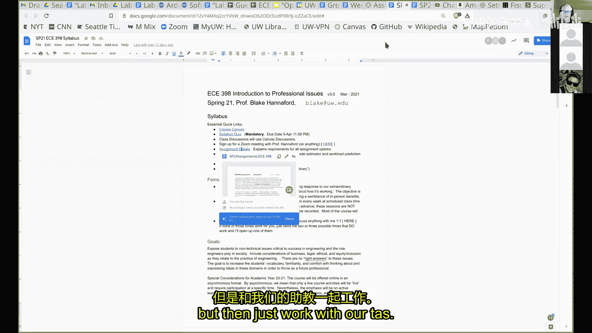

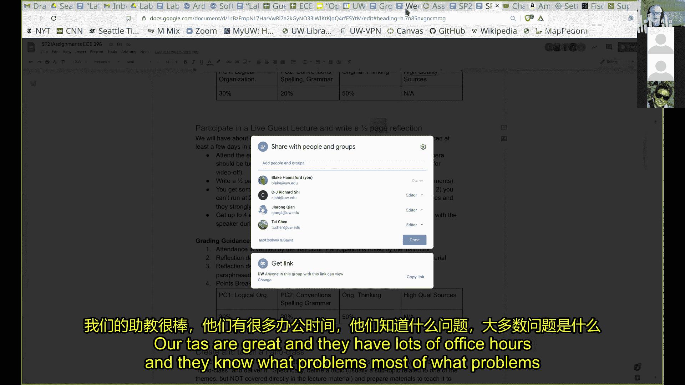

So you really， really， really should be able to get this installed on your PC or laptop。

 PC or Mac or Linux easily。And then so then open the Arduino IDE。On my， I can just， on mine。

 I can type A and get Arduino。And so I get a little window like this。 It's really tiny little window。

I'll make it bigger。 It's kind of tricky to configure it to make the font bigger。 So I apologize。

 you're only sharing your Google doc。Thank you， I'm going to fix that。😊。

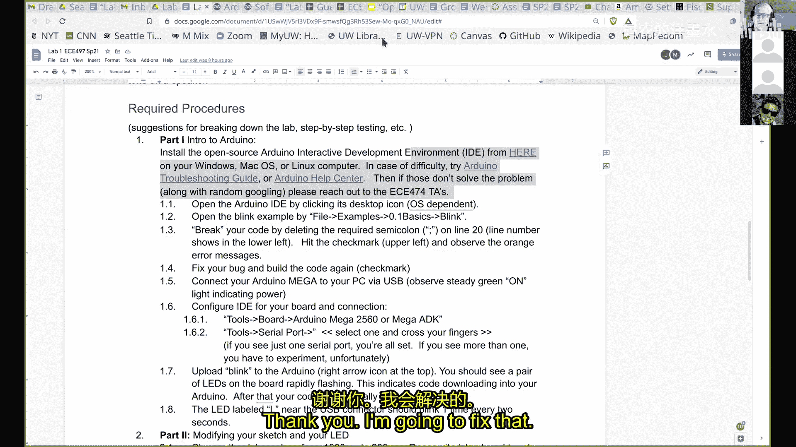

All right， I that better。Yeah， looks good。 Okay， now we can see both。 Okay。

 so this is a blank piece of paper or a blank piece of code， which doesn't help much。

 But in the file menu。 And again， I apologize for the small font。Maybe if I put it on。

My second monitor。I don't think so。 I think it's just a small font， but anyway， I'm clicking file。

And then we have examples and look at this long list of examples。

And there's basics and digital analog communication control sensors display so there's really a lot of USB。

 there's really a lot of example codes here and basics is where we start and there's a program called blink。

And why didn't it even load？What happened there。That's weird。

Something's wrong with my Arduino configuration。 Oh， it loaded。 I'm sorry。

 It loaded in another window， which is hidden somewhere。Off screen。 And it's。

 it's some weird compatibility thing。哈。That's funny。It's like， in an invisible part of my。

Two monitors set up。Okay， I'm stumped by that。 I'm going to kill this and I'm going to run it from a different location and see if that helps。

Okay， now I'm going to open blank from over here the same way I did it， you just can't see it。

 I realize you can't see it now。And you can see this basics， maybe。And。Blanlink。And now I got it。

 Okay， there it is。And so， here we go。And scrolling or convenient things don't make the font bigger。

See if I can preference it。 Oh， here we go。 Oh requires restart of Arduino， but let's。

 let's go up to 24。Okay。Oh， it didn't require a restart。 Okay， thank you。 That's oh。

 probably the menus required anyway。Alright， this is very， that's it。

 That's a very simple piece of code。It's saying， okay， LED is a thing called well。

 is an in of 13 because。Every board。Every year， Dowinino board has an LED installed。 This one is。

It's right here where I'm pointing。 It's very， very tiny。 Of course。

 it's easy to see when it lights up。And it's connected to P 13。In the board。

And then every Arduino software， you notice there's no main here。 They own main。

 and they they enter they。They add main to your code behind the scenes。

 So you have these two things that you have these two predefined functions set up and loop。

And setup is run at the beginning。Very first time when you start set up his run。

 and then loop is run。After that as an infinite loop， and that's when your code operates。

But you have to you may want to initialize things like for example。

 Arduino supplies a function called pin mode。Because the pins on the Arduino can operate in three different modes。

 but they can be inputs and outputs。And this is a way to set the mode so there's a predefined you notice I didn't include a dot H here that's automatic that again that's to make it easier for the high school kids。

Don't worry about that。 They do it。 And they've predefined a thing called output。

 which is the flag that。Will set this pin to be an output。And of course。

 it has to be an output in order to light the LED。And then we have this other predefined Arduino function and one of the things we're going to do in 472 because you guys are not high school students。

 474 is we're going to rewrite these functions from scratch using the low levell bit manipulation so you'll learn how pin mode and digital right have actually been implemented。

 but right now we're going to use them， so we're going to set the LED to high。

 then we're going to delay for 1000 milliseconds。That's one second。

 and then we're going to set the LED to low， and then we're going to wait another one second。

And then， we repeat forever。So Arduino is calling this loop function over and over。

And it'll do a little bit of other stuff back in there， but most of the CPU。

 a vast more majority of its cycles are available to you to run right here。

So now there's two icons up here。 Checkmark and right arrow。 Oh。

 and checkmark compiles it and checks for syntax errors。 So that looks good。

 If I make the classic error， I'm going to delete my semicolon。Oh， I can't。H it's acting weird again。

It's allowing me to modify it， but not。Not in a sensible way。 I， I can't explain this right now。

Maybe we do have to restart it because of that font change。

 so I'm going to save as because I'm intending to modify this。Okay。

 and maybe it will let me modify it now。 that's so weird。But I'm going to restart。

All my instances of Arduino。And I'm going to open。My recent one。Dovis makes a folder for you。

And then puts the code in the folder and the file extension is dot I O instead of dot C however。

 the Arduino's version of C is very close to real C and so you will find all those features pointers。

 pointer arithmetic stuff like that they'll still work。All right， so now am I able to edit stuff。

 Okay， that's working better。 Al right， I don't know what happened there。

 so I'm going to delete my semi oh， I left I did delete my。Cruly bracket。

 I'm going to delete my semicolon and we'll try to compile it。And there's red things。

 it's all that red stuff， and it's at expected semicolon。Before the right curly bracket。 And sure。

 Okay， fine。 So we'll put it back。Will check mark control S saves， or you can file， save。And okay。

 so that's building and this is correct and so let's actually program it so I've got my USB connector that came with the board this one is the less common USBB and if you have an old this is what printers use and you know I personally have like a box of 50 of these from the 90s。

Leftover。Okay， so anyway， but you get one usually when you buy your Arduino and I'm going to plug it into a USB port。

And now I should get a green light right there at the other end of the board。 That's the power light。

 it says。O， N on that tells me that I have power to my Arduino。

And I'm actually running some old code that I used to have that used to be in there because the memory on Arduino is non volatile。

The memory for code anyway。And now we're going to upload it。And I'm going to click this right arrow。

 Oh， but first， we have to set it。 So when you go into tools， you have to select what board you have。

 because there's this whole list of different Arduinos。 Okay， and I set mine to， and you have to。

 we're gonna to use the Arduino Mega 25，60 or mega AD K。 That's your setting。

 And it remembers that you only have to do that once that's great。 You're just set that。

 But you've got all these different options for different Arduinos。And then the serial port。

 I don't know if it does the same thing in Windows。

 but in Linux it keeps jumping around to different serial ports and that's a hassle。

 and I have to sometimes experiment。But at any rate， we'll take what it's。

G work it's guessing this one， if it doesn't work， I'll click on the other one。So we'll leave that。

 And so those have to be set right away at the beginning。 and now we'll upload。And I。

 I'll show you the board because there's some nifty flashing lights。That flash。A。Okay。

 so there's a pair of flashing lights called Tx and Rx and they they flash like this when the code is uploaded or downloaded。

And this one is such a tiny program。 It takes virtually no time for that to happen。

 And now what's happening is the light， the orange light is going on and off for one second。😊，On off。

And that means our code is running because that's what we told it to do。

 So we're going to make one little change， and then we're done for the day。

 So we're going to speed it up because that's boring。 So I'm going to cut this to 200 milliseconds。

And this one to 200 millisecond， I'm going to make this 100 milliseconds。

So the total loop is only because it takes almost no time to do these digital rights。

 The total loop is like 300 should be three cycles per second。We're going check it。

No nasty red messages。And we're going to download it again。And now I think this will show on Zoom。

It's flashing much faster。Because I changed the time delays。

So that's a really quick intro in a nutshell。I'm going to not bother to save it。

And that's what that's the main thing we want you to do now the other thing is there's a few other things like use an external LED。

 run some wires to an external LED and do the same thing and also run some wires to the speaker and make a tone by going faster so three cycles per second is not really a tone but 400 cycles per second is a tone and you'll see you can do that so。

U。I guess that's it if i'll open it wide open for the next three minutes questions on anything again you asked an appropriate question about how to turn in the video for lab and I'm going to get you answers shortly but I think we all want to me and the Ts need to be on the same page first so thanks for bringing that up。

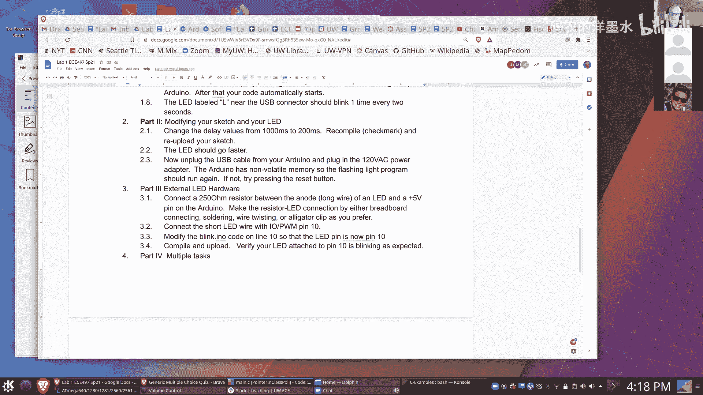

Professor， yeah。Do we have to use an Ar do we know omega like what if we had a preexisting like Arduduino unno or something like that would that still be feasible for the upcoming labs or I think you'll run out of pins quickly for the other labs I probably is okay for lab one Ishawn。

 do you have any opinion on that question。嗯。I'd have to see kind of what the rest of the labs are looking like。

 but I actually also have an uno， and I would agree that you'll probably run out of pins。

But if yourre oh， actually， I yeah， I， we're going to get into some specific peripheral parts in detail。

 which are in the 80 mega 25，60 like 16 bit timer counters。 and we're going to learn how to。

Go in there and program them。And I， you know。I just。

 you know what the what's the difference between all these Arduinos， The difference is that。

Atmel has hundreds of different flavors of these chips。

 And what's different is that often the CPU core is the same。

 but it's the peripherals that they glom in there by basically mousing blocks of silicon IP into the same chip。

And so we're going to dive into the innards， and I can't guarantee that it。

A random Arduino will have the same peripherals inside the silicon。Okay， thank you。For lab one。

 if like your mega hasn't arrived in time for lab1。And uno would probably be okay， Yeah。

 all you're doing is lighting up an LED， it's like hello world basically。

 but I think you should get a mega。That I think it will be sufficient for lab one to use any Arduino。

 actually。Okay， perfect， thank you。All right， then if there's nothing else。

 I will see you guys on Monday and best of luck， I guess you got a few more hours for the C assignment and then then diving into the lab Profess。

 there is a question in chat from Seth about how。Students are supposed to document progress through the lab。

Yeah。I see the question。 Part  one。 so we walk through the steps。Well， you're supposed to。嗯。

I guess I have to look at the instructions and。Kind of refresh my memory。

 I'm not sure why that's a question。 A lab report is documenting your progress， right。

I'll be glad to do a one on one with you later to dive into it more。I also have a question Okay。

 so I know I remember that that we have to have like the lab partner for the labs like does it require for our lab one very much no two two the remaining labs。

 just lab one is an individual lab。Okay， so when we decide on lab groups。

 that's just like we do that on our own eventually， right or。Will you kind of like help Yeah。

 I'm inclined to just say pick your own partner and then if there's people left over we' we'll match you guys。

 but now what one thing we have done in past courses past versions of the course is like。

After two labs as a team， you can switch to a new team if you desire。Okay。

 is there going to be like a almost like a canvas group page that we can like put ourselves in？

To fund the groups。Because I had some classes that kind of do this。Well， I， you know， I。Yeah， Ts。

 do you guys have ideas， I'm happy to do something like that， I just。😊。

Don't know exactly how to do it。 I mean， there have been some discussions in。A piazza。

 Some started a topic in piazza， I think。On that， I think that would be a good place to put it。

 Like maybe Yishan make a folder for。For group， for team formation。 And then。

The other thing could be a shared spreadsheet。Where people kind of rate themselves on various attributes and then。

I'm not sure I'm not sure how you want to do that Yeah last quarter Piazza actually has and also for this quarter Piazza has a thing called search for teammates and we can make that public and basically you give your name and I think your email and just little a blurb about yourself and then you guys can chat in the follow discussions and match yourselves。

It's like a dating app for team for lab teams。 Okay， let's go with that。

 will I'll make a post on that later today about some like guidelines that you guys should consider and then just be on the lookout for it。

Yeah， and also last question， just for like a clarification question for this C program。

 do submit the source code and nothing else？All right do you also have to submit Okay。

 just want to make sure。再 you。I have like a follow up question about the C program submission do you have like a preferred file that we submitted in like do you want like a text file or whatever the like i'm using code blocks so like I know code blocks has their own specific file file does it matter。

No， we want a plain textex。c file。Okay， thank you codeb should not。

 It doesn't have like its own proprietary file。 It just works in dot C files。

 so it has its own file to define the project， but but the project contains regular C files。Oh okay。

 I must have been looking at the project then I think I got yeah there is like a dot CBP format that's yeah。

 but those only are meta fileses that describe the whole project。Okay。

 thank you you have a good rest of your day Okay， you guys too see you later。

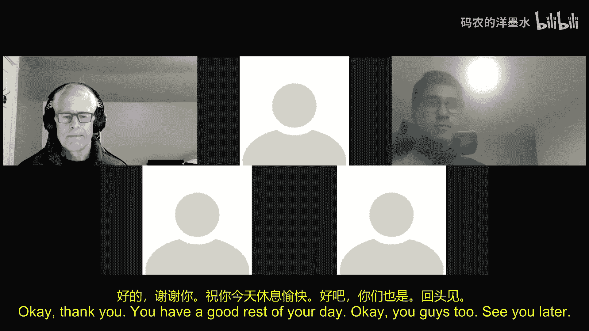

Thank。