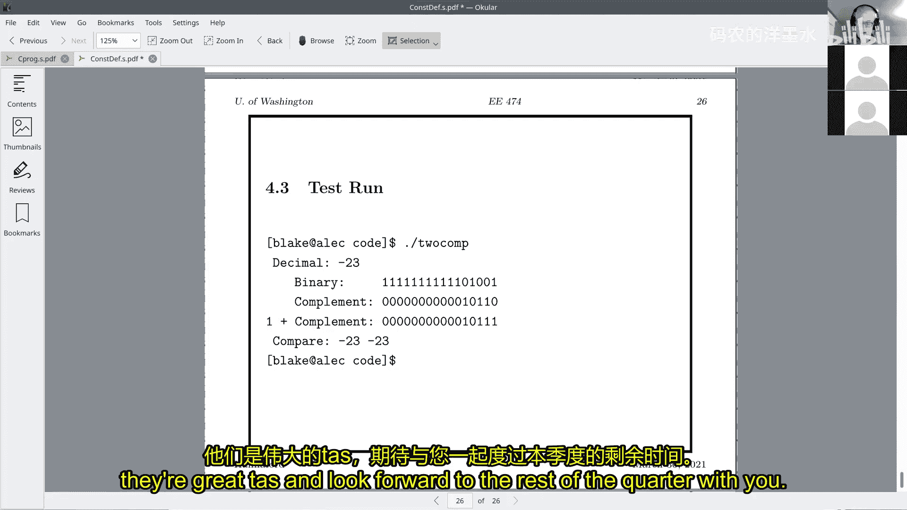

# 【全集 附完整课件】华盛顿大学 嵌入式系统导论 CSE474 中英字幕 p04 Lecture 4 - 数字表示与位运算符 -BV1ALqnBWEeu_p4-

All right。Resuming and I apologize， as I predicted。

 I forgot to start the recording at the beginning of today's lecture， so。

If you guys notice that I don't have recording going on， obviously if you're here。

 you're not as concerned， but I would appreciate a reminder to turn on recording I somehow I'm just。

Laser focused on everything else。 At any rate， I apologize for the recording skipping the first。

Part of the today's lecture。 And now here's part two。 So we'll resume a screen share。

And we'll talk a little more about some of the。

呃。Other aspects of C programming。So this is based on， you know， these two fellows。

In ancient times actually created the C programming language at the Bell Labs and there was apparently there was some language called B and they decided this was going to be called C。

And so that's why it's called C。But they wrote a book。Called the Carnegan and Richie book。

 And it's still in print and still widely used and famous。I don't use this book anymore， sorry。

 it's really old， okay。I haven't looked at it in many years。

So let's talk about constants in C and by constants， we mean like I typed in the number pi 3。

14159 in that example before。And。呃。That's a constant。

But I might have an integer constant or a string constant。And in C， a there's a big focus。

 C was kind of like a step away from assembly language and assembly language。

Is used when you or traditionally was very bit level oriented。

 And so C still retains the ability to go down to bit level when you need to and we will need to。

And so we can do really precise things with memories。 So first， let's。Review binary hex andocyl。

 you should know this， you should also be able to find easily online resources to refresh your memory。

But binary， of course， represents numbers as either 0 or  one and nothing else。 So here is a table。

Where we're counting up in binary。0，1，2， skipping Psal7，8 and so forth， and as you know。

 each of these positions represents a power of two。2 to the zero is one，2 to the two is2。 I mean。

 sorry，2 to the one is 2。 This is position zero， position one。Is two if you have a one here。

 like 100 binary， that's for， et cetera。And you add all the positions that have one in them。

 So this would be 4 plus 2 plus 1，4 plus 2 plus 1 is 7。

And hex andocyl are the same from zero to seven。And they change when we get to 8。

 because it basically boils down to。Just。Al， I'm not going to mess with that。Okay。

 it boils down to grouping the bits into groups and encoding them。

So that we don't have to write a 64 bit string of ones and zeros which would just be impossible or even a 16 bit one is pretty hard。

 So what we do in Hex is we group the bits into groups of four。

 I've only shown one group of four here。And we encode them up to the number nine。

 we just encode them as their decimal equivalent， but when we get to 1010， there is no single digit。

Deciimal number， because this has the value 10。It has8 plus not for plus two plus not one。

 so it's8 plus two equals 10。 and so we call that a。Capital A， usually。

 and the next one after a is obviously B until we get to this last one。

 this is the last possible fourit4 bit。Code or cluster group。And it's all ones。 And that's F。

 And then after that， it would carry to the next position。

So we can encode a longer number by just grouping it into these blocks of four。And。

Converting it according to this table。It means that you have to memorize things like B is equal to 1011。

Which is not so obvious now whats what's ocal ocal is you group them into groups of three bits so we all of these are the same until you get to seven which is the last possible three bit grouping and then what you do is you go to the next digit so this is the next ocal digit which is a one in the second group of three and the first group of three has the value0 first group of three here as the value1 so this is one1 in ocal。

For some reason， Otal is not nearly as popular anymore， it used to be used。

More often like when I was an undergrad， which is very long time ago。

But I like it because you don't have to memorize anything you just convert。

And you get what you want as long as you group these into groups of three。But in the PC world。

 the X is very， very universal and so。Pretty soon you'll have this down and memorized anyway。

 or maybe it doesn't matter， but you'll see a lot of hex numbers if you see numbers composed of0 through9 plus a through F。

 that's a hex number。Okay， so。This is sort of a big example of the hex number。呃。D to， F B。 Okay。

 so there's a D， A2 and F and a B。 And this B is。U。

Well this is supposed to be an example where we fill it out ourselves okay。

 so B is 1011 and we put that in here， this would be to convert it to decimal。

 we have to take the value b is 11 times1 so that we'd put an 11 here。And this is 16 times F。

 which is。15， so we put 16 times 15 here， et cetera。Alright。Now。

 let's say we write the number 25 in C。That's going to be interpreted as or compiled is more appropriate as decimal。

So it's just regular 25， there's 25 students in the class。If you want to use a hex value in C。

 you prefix it with 0 x。 So 0 x to F is the hex integer。Which is 15 plus two times 16。32 plus 15，47。

 okay。And octal values are have a leading zero。No X， just02，8。That's a little tricky。

 You might not know that， but C will interpret that as ocal。And this but this is actually an error。

 what's wrong with that？Anybody know what's wrong with this ocal constant。There's now eight。

Precisely， this is illegal because octal digits only go up to 7。

And so the C compiler would reject this， said I can't understand an ocal constant。

That has an aid in it， okay。So now here is something where we're going to talk change gears a little bit。

 We're going to talk about how to write professional C code。As opposed to C code。

 which compiles correctly。ok。😊，So， it's very possible to write。

50 pages of C that work that do the job correctly。And。And and perform well， but is bad code。

 And it's bad if it's not human readable。And there's many cases of organizations where。

They trusted one programmer to implement some very critical mission， critical code。

And that programmer did it。 and that's fine until the person left。

And then that person left and their code was unmatainable， because。Nobody understood how it worked。

 Nobody could read it， and nobody could。Fix problems with it or expand it or update it。This is very。

 very critical so in professional companies like Google you have to follow all kinds of standards in your code like we have in a simplified form in this course and your code has to follow a whole bunch of standards to make it readable。

 so it's uniform so in a way if you read some code at Google。

 you don't even know who wrote it because it follows the coding standard of Google and they won't accept your code into production。

Until experts have reviewed it in its past a checker for these rules。Okay。

 so one of the big things we're going to talk about here is。Symbolic constants， using the pound to。

Directive that we talked about already。Instead of typing numbers into your code。

So like I just did it， right， So I gave you an example。Which I can actually。Bring back up somewhere。

Yeah， so I said， well， there's five suffixes and I'm going to do this 15 times。 So I put code in。

 I mean， numbers into the code。Or all these numbers and that's fine in this little thing it's very simple everybody can understand it。

But that's a terrible to do in professional code。 And even at the scale of your guys lab projects。

 you will get the benefit of not doing this。 So what do we do instead。Okay。

 so it will be readable and it'll be easier to change， so here's some examples。

So pound toine example constant D，1，2，3，4。 Okay， that's decimal。

 This is just explaining decimal and octal again。And H and O， decimal。Hex and Oal。

And now we have integer x equals example constant D。 it means x equals。1，2，3，4。All right， et cetera。

And so actually， this is a good exercise here。😊，So we've got those examples， example constants。

 and we've assigned X， Y， and Z to those values。So this is kind of more going back to hex and decimal conversion。

Which of these statements print。So why doesn't everybody just take a minute to think about that？And。

Then we'll maybe we'll try this code。See what happens。Does everybody understand what we're doing now？

Anybody have a anybody not understand want a clarification？Profesor。

 can we scroll again to see the value of X， Y， Z， Y， thank you。Also。

 these slides are on canvas right now。Maybe I can。To a little more magnification。 That's better。

Will less magnification。All right， so basically， I'm going to sort of。Jump in。 Basically。

 you probably figured out that what this boils down to is figuring out the， say。

 the decimal value of。Example constant H and example constant O。

 and then you can evaluate whether these equals statements are true or not。

 so we're not sure if 4D2 is equal to 1，2，34 and to be honest I can't even remember even though I created these examples。

So， let's go into。Code blocks again and see what happens。 I'm just going to。By the way。

 I'm going to comment out。This， the earlier example。And in C。

 we have the ability to define multi line comments with。Slash star and star slash。

 so now we have a whole new program in mainine。And we're defining these pound defines and we're then setting up some ints。

And we're going to print some and see what happened， or we're going to see if these print。

So hello there， what's up Doc， the rain in Spain falls mainly on the plains， which is。

Corney song from the 60s。And we're going to， oh， I have to X out of some bug。

And we have to compile it。Warning。On line 32。Because I have a typo there。

 This is a classic C programming typo， which is using one equal instead of two。 And again。

 the warning helped me out。 What I meant is to。Not to assign a new value to Z。If this is true。

 so thank you again， warning system。And that compiles， and will run it。

And so what printed is hello there and what's up Doc， the first two， but the last two are not true。

 the last two are false。Does that make sense。So why is it false because Z is example constant O。

 which is 2332？But the reason is that this is a decimal value， not a constant not a hex value。

 not anocal value， so if I put a zero there， it's now an ocal interpretation。

 will save it and now the rain in Spain will print， but mainly falls on the planes will not print。

And that's also true， okay。So let me see if my slides have a typo。

 I may have done this on purpose to teach people about this bug， I can't remember。

Because it's so easy to miss that very experienced people still do it and what this says is z is equal to the decimal value 23。

22 not and it will evaluate to true because it's a nonzero value so this will print if you just leave the single zero there。

 actually let's verify that the single equal there。Alright， so I'm going do this one。In fact。

 let's make some random wild number。9，3，6，2，5。 Okay， none of the above。

And it's warning me because this is such a common bug。And， in fact。Fallse mainly on the planes。

 did print。Even though。Z is not equal to this number。 But now。

 after this is actually an assignment statement。Which is just like this one。

And changes the value of Z。In sea。If the。If the predicate or the thing inside your parentheses on it。

 if statement， if it's not zero。The if statement considers it true。

And so that's why this actually prints。Questions。Okay。😊，Now。

 that is really kind of flashing back to ocal Hex and decimal。Um。Conversion。

 but we're going to talk more about this issue of making your code readable and why these pound defines are really。

 really valuable。So let's say that you have to control a CDRM drive， that's kind of an old thing。

You remember that from when you were kids， maybe。And you want to open and close the door。

So there's a bit in the hardware that opens and closes the drawer and let's say it's the fourth bit in a register that's located at this hex address and we'll talk more about this a lot。

 but basically registers are little slots that hold bits in the hardware and they can be and most commonly are mapped into the same address space as memory。

 so they're not memory， well they kind of our memory because they store a bit but they're also wired to hardware。

So there's a bit in that register so。So let's say that there's some function IO register set。

 the address and the value。And address is this address here。And。

Value is the bit pattern you want to put there。 In this case， we want to set the fourth bit。So。

Technically， you could write this I O register set， O X 2 D A， O， X 1，0。In hes of。Actually， the。Yeah。

 so these this digit encodes bits zero， one， two， and three， and so this is actually the fourth bit。

And that's what we want to set。Okay， fine。But， this code is not。Human readable。

It's a bunch of numbers， you have to really know what's going on to know what these numbers mean。

And it's a waste of your brain to memorize that stuff。

So what we're going to do is write our code to be more readable。We're going to write。

 we're going to make a long symbol。CD Ro control register。

 And we're going to pound define that to the hex constant。

And then we're going to make another symbol for the command。Which is very understandable。

And we're going to pound to find that to this bit。 And now further way down inside some complex code。

We're going to write the code IO Reg set， CDRM control register， CDRM door open。

So this is much more understandable。By humans。And that means it's more maintainable。

And you may have dozens of these instructions throughout a complicated， say， hardware driver。

But then manufacturing calls you up and says， oh， we've got a new design because we can save $20 or more like 20 cents。

 we can save 20 cents on the CDRM if we move the control register to 2DF instead of 2DA。

So you go and you change it right here and all your code is instantly correct。

And still readable and understandable， that's a huge benefit even in 474 lab code。

 you will get paid off a pay off for that。And so we're going to enforce this。

 and if your code has numerical constants in it， like I did。😊，In the first thing。You will get dinged。

If you don't do stuff like this。Questions。Okay， so now we're going to talk about。

Manipulating bits directly。And。Also。Doing logic in an if statement。

 So you're probably familiar with combining two tests in in an if statement using something like and。

 If this is true and that is true， then。Do something， but there's。

We're going to and we have those in C， but we have kind of two completely different flavors that do different things。

So logical operators。We can use the expression true capital T false false is actually just the same thing as a zero integer。

But this is much more readable code。And then if you want， you know。To do a logical and。

 you use two ampers sands like that。A and B， if A is true， and B is true， then this expressions true。

 vertical bars for or。That's on your keyboard on the right hand side。

And exclamation point for not in Python， for example， it's ailde， but in see。

 it's an exclamation point。And that's straightforward to use in say an if statement。

But we have more a lower level and very powerful feature called Biwise operators in C。And so now。

 suppose we have。These kinds of types and we'll talk more about what they mean， but int is integer。

And how many bits is an integer， Well， it turns out that depends on what machine you are compiling your code for。

And so a big machine like your laptop。Big an Intel，64 B。Intel or AMD type chip。

 it's going to be 64 bits。Which is a lot。For the Arduino， it's going to be 16 Bs。

Which presents some interesting challenges because it means。You can only represent a number up to。6。

5，5，3，6， or actually 6，5，5，3，5。If it's not signed， if it's only positive numbers。

 if it's positive or negative， you only can go up to plus3632768 and minus32768。Okay， so。

 but let's say're let's focus for now on 16 bit integers So it's like a strip of 16 ones and zeros。

 that's kind of the unit inside the memory for ints。

And now we can do things with those bits using one ampersand instead of two。

One vertical bar set it to。And we get some other cool symbols， which we'll go into。

So now let's define some constants for various bits。 So bit0 is this in hex。嗯。😊，Bit 1，2，3，4。

Bit5 and bit 6。 So okay， that's our bits in in position order from the least significant bit 0 to the to a more significant one。

 bit6。And let's make some constants， so。Here's one X equals X0 B。 So the last8 bits of that。

 which is all I'm going to bother with here。而。The first dig the most significant hex digit is zero。

 which is indicated by these four bits。And the next， the least significant four bits is this one。

Which has the code B。And now here's another one， which isoctal 11。And in memory。

 that's going to have。A one in the second three bit group。

And another one in the first three bit group going from right to left。

 this is least significant bit and this out here is the most significant bit。And by the way。

 that can depend on your machine architecture， so that's called the enddianness of their machine architecture。

 so there are machine architectures where on the right side it's the most significant bit。

We're going to stick with this and not be confused right。So。Now， here's a cool feature。

 which is called shifting。So this means shift the bits left and right。

 and shift by two means shift it two positions。So， X was this originally。

This is the original value of x。 when we shift it to the left by two positions。We get this。

And if you take a look at， I just want to draw， okay， let's。Review pen。 Alright。

 so this bit goes to here， this bit。This bit goes to here。This bit。Goes to here。

And this bit goes to here。Because we've shifted left。By two positions。

I hate hate having to grab this thing every time。I still am looking for a good annotation solution。

Okay， every， does that make sense， Everything shifted over。Now， we're going to do why。

Which is this one that I've scratched out now。I wonder if I can clear those。Forget it。

 We'll just leave them there。 So y is 1，0，0，1。In binary 1，1 in octal。

 And now what we're going to do is do the bit wise and between y and bit 3。

 So bit3 is just the third， There's a one in the third position。Which。嗯。Just looks like 1，0，0。0。

 for3 zeros and a1。And。We're going to add that with。Why， so that means this one will be 0。

Because it's a 0 and with  one，0，0，0，0。 And this one will be 1，1。

 So that's why when we add them together， we just get one here， and we do not get the one here。

Does that make sense。Bit three is this position right here。

It's a binary number which has a one in that position is another way to say it。Okay。

 now we're going to say let's take Z， which is this number that's the result of the shift。

And we're going to or it with bit 4。 So bit 4 is just another shift from bit 3。So。

 it's this position。And so what we're going to do is we're going to take this binary。

 and we're going to ore it with a one in this position。

And that fills in this zero and keeps these because it's logical or。And that's what we have。

So that's what bitwise logical operations are， including shift and an ore。Any questions about that。H。

 professor。 so I have a question。Can we specify whether to make arithmetic or logic rid shift？

I'm sorry。 Say that again。Can we can we like make the decision to do with arithmetic rid shift or logical rid shift？

I'm not sure what your question means in this context。

 I'm just teaching you about the bit wise right shift or left shift。 Now。

 what I think you might be asking about is that。If you know about binary numbers。

 which I'm sure you do， you realize that if I shift something to the left。One position。

That's like multiplying the number by2。And if I shifted two positions that multiplies the number by four。

 just like in decimal， if I have the number 16 and I shift it one bit over one digit over。

 then I have 160。I multiply it by 10。 So if we shift binary， we multiply by 2。

 and if we shift to the right， we divide by 2。Is that what you're talking about？诶 yeah。Right， so。

Generally， yeah， if you， if you do an integer divide。And you tell you write a statement like， well。

 let's just say， suppose we had the statement int z equals x times4， okay。

Is that equivalent to this left shift。And I I think so。

 there might be subtle differences in how internal bits are set inside the CPU。 Okay。

 we're not going to go into that。But there are a bunch of bits called status bits that are set after every operation。

 for example。Um。If you try to divide by 0。It will set a bit called divide by zero。And。

Not return of value。 Or if you， there's a sign bit， if you get a negative result。From an operation。

 the sign bit will be set。And so there's a whole， it turns out there's like four or five bits like that。

That are set as a result of specific machine instructions。If I do a left shift。

 let's say I do a right shift by two compared to a divide by four。

The data in the int is probably going to be the same。

 but there may be different side effects on those bits。

 so I'm not going to say they're totally equivalent， but they are very similar。

Does that answer your question？Yes， thank you。Great， good question， others。All right。

 so this bit manipulation is probably new compared to what you've done in previous programming。

 but it's a powerful feature because we will be caring about specific bits sometimes。

So I think I'm going to leave these exercises to you guys。To do offline and you know。

 when I first did this， maybe your calculator had this function， maybe it didn't。

But you can find about 200 websites to do this for you。

In about two seconds of googling so that and that's fine go ahead and use that I don't care I don't need you to be a mental conversion whiz on these I want you to understand them but I don't need you to be able to do that really fast mentally。

But I recommend that you do these to understand the concepts。And I can， if anyone is interested。

 I'll put out the answers to these。Or you can just write your own little C code in code blocks to implement these and then see what happens。

You could write a function。That prints out a binary number。 Now， interestingly， printf。

 we talked about printf， and it has all these format codes for including hex and ocal and decimal and strings and floating point。

 but it does not have a binary output。Format code and so you have to write one yourself using bit wise operators to check each bit and shift and print out a one or a zero and when you're done print a new line or something。

It's a fun little exercise。 I assigned it one time， but not this year。Okay。😊，Alright。

 let's talk about integers。Very common， very important， especially in these。诶。

In Arduino and so forth， often you think of it as a 16 bit binary number and。

But we'd like to represent negative numbers too， and so how do we do that？

We obviously need to use a bit to represent whether the number is negative or positive。

But they do it in not quite a straightforward way。So there is a type called unsigned int。

Which we can declare by just using unsigned int instead of int。And then we don't have any sign bits。

 we can't represent negative numbers。But。We get this range all the way out to two to the 16th minus1。

Including zero， which gives you two to the 16th values to have。

So that's good a lot of times you know you're counting milliseconds or something。And wow。

 you realize， oh， I'm counting milliseconds in a real time embedded system。

 and I only can represent 6。5 seconds。So you have to think about this， there's ways around it， okay。

So here's some unsigned characters integers and also long ints so you can tell it well 16 bits isn't enough for what I want to do。

 so please give me what's called a long int and you can't tell it I want 32 bits。

 but on a particular machine architecture because C can be compiled on all these different chips and CPUs。

You will have a standard length for long， which will be typically twice as long as the standard length for int。

So maybe on Pentium， this would be 32 and 64 or even 64 and 128， I can't remember。Not a pentium。

 but a Qai 9 or whatever。All right， we're almost done。For the day。

Let's try to get through a little more。U。Yeah， so。I recommend writing a function to print。

A binary value of a 16 bit word， I'll show it to you quickly， but you guys should try to do this。

Here's a function called bin display。 Its argument is an unsigned integer named X。

 and we declare two more internally I and J。And then we go through the 16 bits with a four loop。

And we shift。The value 1， we take a one sitting there in the least significant bit。

It's the same in hex， octal and decimal。 It's just one。

And we shift it to the left by this many positions。 So each time we do， each time I is incremented。

 we shift it。Further， we want to print them starting from the most significant digit。

 not starting from the least significant digit because then it would print out backwards right。

 so that's why it's 15 minus I here。And then， we test that bit。If this bit， J is。

Set in the value X will print a1。But if it's not， we'll print a0。And we'll do that 16 times。

 and we get the binary value。So I'm going to deliberately not send you that file yet because you guys should try it in code blocks。

Okay， and I'm going to make this the final topic for today in the last few minutes。Tos complement。

 So this is how we represent negative numbers。 And you would think。

 while you take 15 Bs for the number。Magnitude and 1 bit for the sign。 And you're done。 right。

 It turns out that back in the day， the math portion of the CPU was complex and expensive。

And if you use this different representation。Which is not quite that simple。

 then mathematical operations like addition and subtraction become easier。

And so that's why we're going to learn about To's complement。

Today I think it wouldn't matter it might increase the surface area of your CPU chip by a tiny。

 tiny fraction to do it the logical way。Okay， so how to convert a number。To or from twos complement。

 So you complement all the bits。 Comp means if it's a one， you make it a0。 If it's a 0。

 you make it a one。And then you add one to it。 you increment it。And in two's complement notation。

This is equivalent to nagating the number。 It's equivalent to multiplication by minus minus-1。

So that lets us get this range of numbers from。We don't get n bits anymore， we get n minus1 bits。

But we can go from minus2 to the n minus1 all the way to plus2 to the n minus1 minus1。Okay。

So let's see how that would look。Let's negate assigned tos complement integer using bitwise logical operators and addition。

 in other words， instead of just saying。X equals minus y， which we could do。

 We're going to do it the hard way to simulate this notation。Or reproduce it。

Do not just multiply by minus1。So okay， so we're going to make a twoth complement demo。

 We're going to say， well， A' is minus23。And by the way， when you say this。

 it means to complement at the binary level。And we have an B and I and J。

 these are not initialized yet both of these forms of variable declaration are。

A required or one of them is required。And B both are acceptable。

 so you don't have to initialize typically the compiler will initialize it to zero for you if you don't say ant be equals zero。

 buts if you need that， it's better practice to explicitly do that。And now we're going to say， well。

 the decimal is a。呃。And the binary。Is something。And then we're going to say B equals a。

 and then we're going to dis oops。I don't know why we did it this way but。Then we're going to do， oh。

 I see。Then we're gonna binary display。The value of a so we're convert this is converting it from an int to an unsigned int。

 which is required by that routine we did to display the bits。

And then we're going to print the complement。And this is。

A bit wise logical operation to flip every bit in the word a。

So now we have a different thing we didn't， we don't just have binary a negative number。

We have the complement and now we're displaying those bits again。And then we're saying， okay。

 here's the complement plus one。 So this is this thing is just making it print on a new line。

And now we're saying one plus the complement of a。And we're displaying that in binary， as well。

And now we're going to compare。This new value with。A。And these should be the same。

Because this should have negated B。If that makes sense。Probably doesn't。

 So I'm going to actually see if I can't paste this into。嗯。Code blocks and run it。

In the remaining couple minutes。Why didn't that comment everything Oh。

 because there's already multiline comments。Okay， everything's gone。Paste。Let me copy this again。诶。

Actually， I have the output there， so。I probably don't need to， but it's fun。Okay， here it all is。诶。

And we have。This is our function prototype， this is mainine。And now we'll run that program。

 let's see if it compiles。Okay， I'm going to leave that and skip it。

 Let's instead just show you this test output。So the way that works is up here， put we printed out a。

Right in this position here。And we get minus23 as we expect。

 this is the binary value for minus 23 in two's complement notation。And。😊。

As a rule of thumb for smaller numbers， you see a lot of ones on negative numbers in the most significant bits in two's complement because that's just how it works。

The complement of。23。Or the complement of minus-23 is this I've flipped every bit。

And now I take one plus the complement， and I get this。😊。

And this should be 23 because I started with minus-23。 This is minus-23。

 and I'm reproducing the act of negation in two's complement。And now I print them out and they match。

So。That is a little bit complicated， but it's really some extremely simple。

Operations to negate a number。Complement the bits and add one。 That's the takeaway。So thanks。

 I will see you guys Monday， I have some， I guess I have no assignment， no sign up slots。This week。

 But the full deck of sign up slots。Opens up next week。

 including on Monday so if you need those otherwise I am going to be on piazza as I have been already and so throw your questions and issues on there for me and the Ts to deal with the TA office hours are up their great Ts and look forward to the rest of the quarter with you。

Thank you。