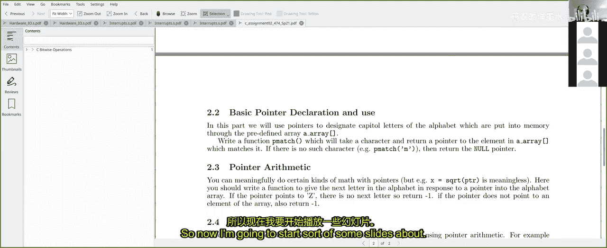
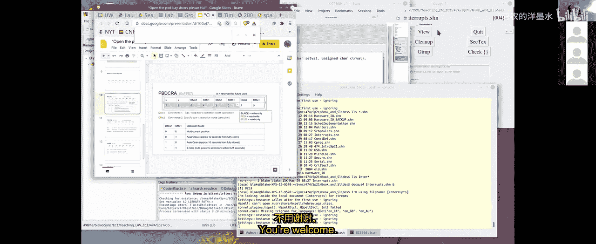

# 【全集 附完整课件】华盛顿大学 嵌入式系统导论 CSE474 中英字幕 p05 Lecture 5 - 硬件与机器组织 -BV1ALqnBWEeu_p5-

。

这。Okay， welcome， we're just on time people are joining rapidly。

 so while I'll give people just a few more minutes。

 any questions I can handle right now from anybody。

I have a question great sure for the lab report for this first lab。

 how detailed do we have to be with each of the sections because。Some of the stuff we did。

Like it gives u on the lab report thing it gives like。Length。Recommendations like half a page。

 fourth foot a page， but for this lab we didn't。Like do as much as we probably can to do in other labs。

 so how detailed do you want us to go into it？Well。

 I would try to match the detail that's in the lab description and。You know。U。

I we don't want like you know a write up where you summarize each line of your sea code or anything like that I mean this is a warm up lab right so what we're trying to do here is make sure that you demonstrate that you can。

Install， modify and demonstrate an app on the Arduino。And so that's our。

 that's think look at the learning objectives。What is it going to take to get that across to the greater？

And I， you know， I don't， I don't， I'm not going to give you a character count or anything， but。

You know， and maybe maybe ask to be more pragmatic。

 ask the TAs in their office hours if you you know， need them to walk you through that more。

Does that sound good because let's face it， they're going to be grading you。Yep， that one's good。

 Thank you okay。I hope that was useful。All right， we've got a good turnout。 Oh。

 I did have a question here。 Code assignment 2 on a high level of what we're doing。Okay， so。I'll。

 I'll just， I don't know exactly again。 I don't know exactly how to take that apart， but I'm gonna。

Oh， I need， I know what I need to do here。Okay， sorry， that's why I heard an echo。U。Yeah。

 so I'm going to。Why don't I not see that， Oh， it's on my my computer。Yeah。

 I'll go through it really quick at least verbally。I think really， you have what you need on this。

Sorry， I'm looking for my screen share now。

Here we go。Alright， so。This is this is the assignment。And。I you know， really。

 I tried to give as much details as I could here。 Do you have a specific section that you'd like to hear more about。

Or that you have you that doesn't seem clear enough。For assignment 2。Oh， there's the chats。 Okay。

 they are not showing up on my other computer。2。1。1。 Well， that's good。 That's specific。Yeah， so。

As you know， an int is represented in the computer as a binary number。 So if I have this。

 you should write this function bit check。Um。To answer that question， if I pick a number4，7，3，8。

 I really don't know if bit 4 is a one or a0 unless I manually do the conversion。So in this case。

 we're going to put that number 4138 in here， the first parameter。And then， have a。

Andt which has the bits I'm interested in。 Let's say in this case， it's just one bit， bit4。To be set。

 so that's what this int indicates if there's a one for each bit that I care is set。And in bits off。

um。😊，I'm going to use。A one to indicate that I care that it's a zero， if that makes sense。

So for in bits off， every bit that's set in this int。Must be zero in the data parameter。

And if these two conditions are met， then it should return。True。Oh， a one。

And if it doesn't match either of these， it should return zero。And。Right， so then。But。The the。

There is a problem where I could say what if I want Bi4 to be on and off simultaneously。

 that's invalid。So the code should check for that situation and then return minus1。Okay。

 so the original questioner seems happy with that answer。 are there multiple ways to do this problem。

I think there's multiple ways to do almost any code problem we're going to be looking for。A concise。

Piece of code。 That's correct。And meets these requirements so。Not， you know， not how you do its。

There's not too many really concise ways to do it， but I won't say there's only one way to do it。

Okay。😊，I think that's probably all we need to cover for that。 So let's。Well， we'll close。 No。

 I'm not going， I'm not going， I might need it。So now I'm going to start sort of some slides about。

Making sure we have just reviewing， I think to some of you， it'll be review to some of you。

 it'll be new， but we need to review the basics of。Computer organization。

 because what we're going to do in this， because for certain。

Okay， and my slides are showing。For certain， this AtML or A mega 2560 chip。

 which is the heart of our platform。Is a powerful computer。And it has all the aspects of。

Fon Neuumman architecture computers， which is sort of the typical computer since the 1950s even that we're going to talk about now。

 and so you need to understand these things for。诶。For programming them。All right。

So basic machine organization， first of all， we're going to use a lot of registers and we just want to review what is a register。

And a register is just a place to store a bunch of bits。

 its like it's really not that different from memory。

 except if a bunch of memory has sort of hardwired connections into the rest of the system。

Then we call it a register if it's memory， we can put something in it， we can get it back。

 but the bits don't otherwise matter a register often those bits will connect to things and do something。

So if you remember basic logic， a register consists of flip flops， often de flip flops like this。And。

When the clock is。Selected or when the clock is transitioned。Then whatever value is on the D input。

Will appear at the output。And it'll be locked so then the input can change but it'll be stored as long as until the next transition of the clock so that's a basic logic element and if you chain say 16 of those together like you see below then that's a 16 bit register oops that was bad。

Not sure it's important that I color this in， but。Oh， color memory is specific to the。Tool I'm using。

And so there's 16 D flip flos， they've got the same clock。

So when that clock fires all the inputs are copied to the outputs and held there until the next clock transition。

 hopefully that's a familiar concept but it's not a tough concept and and we're going to you know there's hundreds and hundreds and hundreds of registers inside your AT mega。

And then buses are the way data moves around inside the CPU。And so， this is like a basic。

Like generic architecture。That is， why is so common in almost every digital system。

And so for example， we have these three buses and a bus is nothing fancy except at the low level。

 think of it as just a bunch of parallel wires。So maybe it's 16 bits in a moderate sized chip or maybe 32 or even 64。

 so your laptop chip is probably 64 bit paths like this， but this 8 mega I think is 16。

And they're not always the same size， but let's just highlight one of them。

And my intent there is to say that there's 16 lines。

 let's say coming out of the CPU and they're going into each device。

 the device might be a memory chip with a few megabytes in it or even a gig， a couple of gigs。

It could be a hardware device like a timer counter that's built in one of the many timer counters that are built into the 8 mega。

 or it could be like a communications interface。Or an analog to digital converter could be a lot of things。

Even inside the CPU chip itself。Then the bus can also go outside the chip。For external devices。

And then another bus will contain the data。That can go back and forth to the devices。

And that could be the same width as the address bus， or it could be a different width。16。

 let's just for now， we're just going to call this 16 bit。Example。So 316 bit buses， actually two。

 three is not what I wanted to say there。Times 2。 and finally， the control bus。

 and I'll make that yellow。And I'll make that a highlighter。

And the reason I said only two instead of three times 16 is because the control bus' fewer signals might be a handful。

 four， five， three， something like that。But it also goes to every bus。And basically。

 it's going to synchronize the operation of the address and database。

And most the simplest architecture。The data， the address bus is one way。 It originates in the CPU。

 The CPU contains outputs that drive it。Little output thing。And the devices read it， and that's it。

There are other architectures where that could be bidirectional。

But the simplest sort of most core thing to understand is CPU controls it。

Data is bidirectional we sure hope so right because you want the CPU to read data in。

 but it sure also has to write it out it would be hard to imagine any use case for a one directional data bus。

And control has to be bidirectional to。 Well， actually， it depends on the architecture。

 So some of them。The CPU has total control， CPU only outputs the control bus。And， I think。

We're going to， let's just can keep ourselves simple and think about that architecture as well。

 So those are outputs， but。We'll make another to be consistent。 We'll make another graphic here。

 So bi directionional data bus， okay。So that's some enhancement to the graphic there and。Um。Again。

 bottom line address bus， which location？This you know， think of these devices as memory devices。

 which of the many places in memory do we want the value do we want to access？

Or if it's a hardware device， there will be multiple locations to control things and which of those and also which device。

 so not just within a device， but weve got to know device one， device two。

 we've got to talk to them individually。こ。And data is the the contents to or from memory， et cetera。

 controls the traffic signals。 So let's talk about this a little more。

 So first thing is to know about a device called the address comparator。

And an address comparator looks like sort of symbolically like this。

And you can draw sort of a big equal sign here， because this is just combinatorial logic designed to determine that two numbers are equal and so on one side。

Will have just a fixed input， typically， not always， but often。 So let's say this is an ocal number。

 I mean， a hex number， like。I don't know， A 4。B，72 G， Okay， that's 1，2，3，4，5，6。 That's 24 Bs。

 It's a little bit of an odd number。 But that's okay。 That's perfectly legit。

Address for something in a computer。Let's say that's a memory device。

 but not an individual word of memory， but a chip。And then we have the address bus connecting over here。

Sorry， I'm writing over my writing。And。Often we draw a line like this with a number like 16。

 that diagonal slash indicates that。There are 16 wires that I didn't want。

 I was too lazy to draw 16 wires。And so that's it。 And then it has one output。

And the output is a one for。Equal and a 0 for not equal。

So that's actually kind of a straightforward circuit。

 it's a bunch of gates one for each bit and if all the bits are the same。This comes out，1 or 0。

And so that's the address comparator。Color it in for a little bit of。啊。Niceness， okay。

And what are we going to do with that？There may， oh， sorry。

 there may also be a control input like something like this。

Which may tell it when to operate and just ignore the， you know。

 always put out zero unless control input is one or something another simple。Bolean thing to add。

And then here's how that's work。 Here's an expanded， more detailed version of the bus。

 So my color scheme is that the address comparator is a little bit of green。

And so these are sort of simpler drawings of a little3 bit address comparator。

 This is a tiny trivial computer with a 3 bit address bus。 That means it can only address8 locations。

 which is pathetic， but it's drawable for me。 Okay。

 so those comparators are just comparing something comparing the numbers。 And we have just to。

Emphasize that。 We have device 1， and we have device 2。And so therefore。

 we have the number one going into one address comparator and the number two going into another address comparator。

And so when the CPU wants to， let's say， write some data to device number two。

It has to put the number two on the address bus。And then。Send out a pulse on this control bus。Let's。

Well， I'll just sort of highlight that here。And the pulse is ended with the output of the address comparator。

 So now this device has a clock input for the register。Right there。That's kind of icky。

Let's call it a strobe。And so the data value， whatever was present on the data bus。

 gets locked into the register for device two， and it gets ignored by device one。

So thats how this is that's how data gets selectively， no。

 I didn't want that selectively moved around。In in our chip。Of course， with more than three bits。

 more like 32 bits or 16 bits。So let's get more into this。

Control bus and one bit isn't enough actually， for example。

 we might want to read the data from a device。Or we might want to write the data from a device so that's additional information that's not right the data to the device。

 and that information is not encoded up here。So we're going to use some sort of notation notation is a。

Kind of little more pretentious word for what we're talking about。

 really a graphic graphical shorthand might be better。

It's not really it's certainly an informal notation， not a formal notation。

And so we're going to use these kind of this kind of language of graph kind of time graphs， really。

 So on all these graphs， we have sort of heavy lines that are the X and Y axis。

And the X axis is time。And the Y axis is voltage or the just really the logic level。

 this is not analog， although we're going to try to operate， you know。

 we want this computer to be fast。And so we're going to try to operate this bus as fast as possible。

And so a transition from a1 to zero is not going to happen in zero time。

 it's going to happen in a finite time。So we're going to sometimes draw that。With diagonals。

 even though what we're talking about here is definitely digital logic。

So logic zero just to kind of run through these。嗯。Logic 0 is a low level。Logic 1 is a high level。U。

This is actually logic 1 is a high level。 This is multiple lines simultaneously with two levels。

 Okay， that is， I might want to graph something happening on the address bus。

But I'm not going to draw 16 graphs。 I'm sorry。 So this is， again， it's a shorthand notation。

Obviously， this is a pulse。As a function of time。I might。Again， because a bus。

 especially in old in the old days， the bus would be physically long。And if it's outside the chip。

 it still could be physically somewhat long。And so the pulses can start to lose their crisp rectangular shape。

And that means timing can be a little ambiguous in a real life bus。

So that's why we're drawing this X。 This shows。That the address lines are a certain value。

And then at a certain time， they change to another value。

So they're changing during that x and they're not changing at the other times。

Another thing we we can you know， kind of illustrate with this language is causality。

 so this edge causes。Those other lines to change their value。So that's a thing that can happen。

 That's what that arrow means， and it takes some time for that to happen。

That's why there's an offset between the edge and the transition。Okay。😊。

And the final thing of output is what we call a high Z high impedance output state。

And that's what the heck is that。 Okay， so that's a value that we're drawing as sort of intermediate between logic 1 and0。

 and that's not necessarily what the voltage is， but that's just to indicate this high impeded state。

And for those of you who don't know what that is， what is that。It solves the following problem。

How can multiple logic outputs。Be connected to the same wire。 That's not a thing， right。

 So let's go back up here。And take a look at our bus。

This data bus is bidirectional or it's meant to be because the devices have to give Bay data back to the CPU or even potentially to another device。

And so this register actually has outputs as well， but of course this one does too and every other device has an output。

So how can you hook up two outputs to the same wire， I mean if they agree that's fine。

 but what if one's trying to make a zero and the other's trying to make a logic one。

 they will have an epic battle and they will fight and something unpredictable and bad will happen。

So for bus systems， often they're implemented with a gate that's a little different than a regular logic gate。

 and it looks like this。So try state logic gate。And in addition to just regular logic， it has this。

Superpower。Okay， so when another output is generated when a second input called enable is generated。

It can put out a logic zero or a logic one， but when it's not enabled， the switch opens。Now。

 when the switch is open。It doesn't do anything。 It doesn't get into any fights。

With other outputs on the bus， as long as the logic guarantees that only one。

Output is enabled at a time。And it really is about that simple now there's one other thing， I guess。

 which is that you could and it's very common。Then for another input to go like this。And then again。

 this is sort of like the bus。Line that's going to all the devices。And input has no problem。

 you can have a bunch of inputs on a wire and they don't fight， they just listen。ThereYes。

 there's a thing called fan out so a single output can only drive a certain limited number of inputs and you may have studied that。

 but just assume that all this is done within the fan out specification， so fan outs a non issue。

And this way， of course， when our device wants to listen to the bus or pay attention to the bus。

 it can do so。Using that input。So are there any questions about what is a Tri state output？Okay。

 if you think of it later， type it in。So bus timing。 So let's talk about a right cycle。

 And when I highlight when I have the。Word CPU in here。 What I mean is that。

I think I'm gonna change to a。Slightly different color here。This means that the address。Is driven。

By the CPU。The tri state outputs of the CPU。Have been enabled。So this switch is closed。

 the CPU is driving that line。For those lines and also the data。

 So now what happens here in in time sequence， that's greener than I like。 So I'm going。

I'm fussing with the colors here。So， at this point。CPu。😔，Of changes values。On both buses。

 so they're changing， and then they settle down。And then the CPU initiates a right cycle。

And this is a time。For the。Signals to settle。So it just allows that， it just knows。

 might wait have to wait a nanosecond or two before it puts that pulse out。And。😊，We can't hear you。

Sorry about that。 I got to remember to and by the way， we have auto recording。

 so I didn't forget that I should just remember to turn it off at and on at the beginning of each。

A lecture。It's been a day of zooming。 Okay， so。There's the settling time， the right cycle。

 each device is looking at this address combination and the address comparator only fires on one device because they all have different address settings。

Okay， and then when one fires， when one recognizes its own address。

 it reads the data and the others ignore the data。Okay， hopefully that's familiar。

 Reed is a little bit more subtle because it's sort of a handshake。So the CPU writes the CPU。

Writes the address because it， it's the one that's saying， hey， I want to read this。And then。

 it generates this pulse。And that causes the device to recognize itself。 And after a while。

 the device puts some data on the bus。And the CPU then reads the data from the bus。

 And then the CPU says， okay， well， actually， I'm done。 I definitely got the data， so you can。

Release the bus。So that's a read cycle and there's various flavors and differences in how these interactions happen。

 but this conveys the main idea we don't need to get to more detail for 474。

But every time you read from memory， this happens or read from an IO device。Okay。

 this is like super simple microprocessor and it's a schematic of how one of them might be built so。

We have the basic components， the arithmetic logic unit。

Might as well write that out because it's not spelled out。And that's the ALU。

And that's doing everything， like。Addition， subtraction， comparisons。Logical shifts。

 arithmetic shifts。Any， you know， all the operations like that and after each operation。

 some flags may be set。So for example， if theres a if an operation results in a negative number like  seven minus 12。

 it results in a negative number， then there's a bit called the sign bit， which will be set in there。

And then other instructions can test those sign bits。And there's two registers。

 argument one and argument 2， and an output register R。And then this， of course。

 different chips have different flavors or variations of this。

 this is all it also has a bunch of general purpose registers。

And the code can use those to store intermediate results。

And why not store them in memory in this chip， the memory is all external。

Going through the data and address bus。And。In general。

 processors can access the registers dramatically faster than they can access memory。

So using the registers for intermediate results will speed things up very fast。

And then there's a program counter。No， I didn't want that。

And that tells that's a pointer into the program， which says， what's the next instruction coming up。

And there's logic in here， which is when some。Well。

 and then there's instruction register that holds the current machine language instruction。

Which is being executed right now。And then there's a logic that dedes the instruction and this logic block。

 decode and control has lines that go all through all these other parts to turn them on and off and send data back and forth between them。

And if an instruction needs to get information from the outside。

 like from memory or from an IO device， then it puts that address in here。

 which drives the address bus。And this can also the logic and control module can also generate control pulses for the exterior。

External communication bus。So that's kind of the level we need to understand for how we're programming it。

 perhaps just one level deeper than we need to care about right now。So these are those definitions。

Okay， I went over those。So how does that work if we were to write in our C program a fairly simple C statement like this okay？

And forgive the non descriptive variable names， but that's because they don't mean anything right now so。

First， first thing that happens is。The address of a。

The first variable gets loaded into the address register。 That is right here。

Which puts it on the bus。And so memories alerted that we need to get a。

And then where there's obviously a read and operation is initiated and we wait for that data to come。

 and then we clock it into the first argument of the ALU over here。

And the same thing happens with that second memory location B， which goes into the second argument。

And so we fetched those two pieces of data。And then we're going to send an addd command to the ALU。

And now we've got the result in the sum is the result， and that's in this little register here。

And now we have to write it back out to the location C to properly execute this statement。

And so we load the address of C， which is。Compiled into these instructions and transfer the result to the data bus and then wait for that right operation to complete。

And then we've executed this statement here。Using that architecture， okay？

And each of these 10 things are encoded in some machine language instructions。

 Maybe the waitinging is automatic， maybe that's built into the logic。

So what do those instructions look like？So just like everything else in the computer。

 the instructions are binary data。And they're just bites full of ones and zeros。

But they get interpreted by this logic。To explain to control the execution of the program。

So there's operation codes。Add， subtract， multiply divide shift。Compare。

 compare greater than or equal to compare equal， things like that。And there's operaans。

 the operaans are the data。For the operation。 and often these opera could be general purpose registers。

 so。Another way that line could have been compiled would be to move A into one of these registers。

 B into the other， and then have an instruction which would automatically load G0 into A1 and G1 into A2 and perform the addition。

And thats that depends on how sophisticated this decoding and controlling logic is and honestly in a bigger computer。

 including， I'm sure this one。嗯。😊，The at Mega 2560。

 there's actually a little computer in here running something called microcode。

 which implements the instructions。But we're not going to zoom in that level。Okay。

 and the instructions might be between one and eight bytes long。So that gives you general picture。

 so here's a diagram of some there are and they're not always the same length。

 so the CPU knows if it finds a seven byte an eight bit instruction。And executes it。

 then it should go to the very next byte in memory to find the next instruction。

 but if the op code corresponds to a 16 bit instruction， then after executing this。

 it has to go to here for the next instruction。These are not necessarily in order here。

 These are just tip different types。Of instructions that occupy different amounts of memory。So。Now。

 that means that if you use an op code here， like 1，7，6。Ocal。Or decimal。

 even anything because it's 8 bits in this example。There's only 255 instructions。I guess 256。

 but zero usually just halts the computer。So。255 possible instructions。And if I use the code for。

 let's say， let's say I have the。This I use this format and I have an instruction called。Um，You know。

 hex， u A1。And that means add two registers together。

 and these can be any of those G0 G1 general purpose registers。So in that case。

 if a1 is an instruction that corresponds to a three byte long instruction。

 I can't use that for any of these instructions or these instructions or these instructions or these instructions。

 so the op code encodes the operation and also how big that instruction is in memory。So okay。

 that's something and you know， in the old days they actually had to flip switches to set the really old days like before I was born。

 they had to flip switches one in zeros and then push a button and that instruction went into the computer and it got stored。

 of course they didn't have to do that over and over manually。But。Yeah， so anyway， it's binary。

And then， here's。That pretty soon they got tired of flipping those switches， as you might imagine。

 so they wrote this program called an assembler， which allows you to specify binary machine instructions using text。

So here's some simple examples for this same high level code。

So we're still trying to do to add these two simple numbers。

And so assembly language code would correspond to， you something like these instructions。And so。

 moving。The memory add location， a。Into argument 1。And so there's this is an instruction。

 which allows。You to have。2，2 fields here。 This one is a memory address。And this one。

Is a A L U argument。And this so all these， so these moves have that format， okay。

And actually I should probably this is probably invalid。

 but it's at the level we need to understand it。 so same thing here move the second argument from memory into a2。

And this might be a one byte argument that just says add。

And it adds whatever the two arguments are in the ALU。And then this is going to be。

 I'm going to change the name of this instruction because it's ambiguous with the previous。

Move lowercase R mover。And now we have different meanings for the second arguments。Because this is a。

A L， you register。And this is a memory location。Okay， so we're not sadly。

 we're not going to study asler programming in this course。

 it's a good way to really understand the bottom level of what's going on and you can write the fastest possible code can be written in asmbler。

It's better than any compiler optimizer。Although compiler optimizers are better than they ever have been and the advantage。

And the advantage of programming and assembler is extremely rare。

 there's very few use cases where people really need to do it。Compared to C。Okay。

 so there's all kinds of other things called addressing modes in most architectures today。

 So these are really basic machine language operations。 Just move some data from A to B。

But there's some very more sophisticated ones， for example， indexing。

So this is sort of aseler pseudo code that we're looking at here。But in this case， we've added。This。

Thing in parentheses。And what it's saying is。We're going to start with。This address。

And we're going to add to it。We're going to add those numbers together。This is a register。

And we're going to that is the address。I think to be and then move that into。General purpose。

 register number one。R2 is some other register or it could be a memory location。

Why would we want to do this， Well， this can be used to make array accesses very fast。

So the R2 could contain the offset of an array。Or the index of an array。

And registers can act like pointers。 So this is。R 2 is。A pointer。So don't use the value of R2。

 but use R2 as in the contents of our2 as an address and put that into one of the general purpose registers。

 So these are called addressing modes they're like different different ways that computers can generate addresses。

And they， they allow more you know， efficient。Implementation of the kind of things we do and sea。

Or other languages， too。Okay。We're almost ready for our break。

I'll just talk about kind of two different ways that code can do IO with external devices。

And this is the Intel method。That or you know， it's not only Intel。

 but Intel CPUs are famous for this。 there's an instruction in and out。And。This is a。

This is the the chart， the eight bit constant is the address， so there's like 256。

 this is pretty old like 8088 kind of microprocessor and they have tricks to expand this and keep compatible in the newer chips。

But this is the I O channel。 And then you can have a register where the data comes from or goes into。

 So this is in the in statement means。Read data。From this address into this register and output means send data out to the address specified here。

It's not， it's not a memory address， though。 There's a special I O bus。For devices。

So're these addresses are not part of the memory space。And then others， like our chip。

Have what's called memory mapped。Iio。And that simply means that the devices and memory share the same address space。

 I don't like that。And so wherever you have IO devices， you cannot have memory。Okay， fine。

 but there's you know， gigabytes of space available in their， say 32 bit。Addre bus。

And but from the software point of view， the device registers are just the same as memory locations。

 so that actually simplifies everything because we and in C we will you know。

 use this so we can just sort of read from and write to a variable。

If the variable has the right address， it。Does the IO that we need？And Arduino is helpful that way。

 so we'll see that the Arduino has predclared variables。

For the registers that we care about in the hardware。So okay。

 so I'm going to stop here Any questions about this material that I've just covered。

Then we'll take our break。All right then so I'm going to pause is there anything on chat。

 I should be aware of no， there's a bunch of Fs， whatever that is。

 but that's when I had my headphones freeze So I will we're going to take a exactly 10 minute break so I'll see you guys at 335。

Okay， welcome back， We are going to start with a little poll everywhere poll。And it's my same link。

 but just in case I'm posting it。In the chat。So please take a moment。 It's one question。And。

Let's see where we're at on a certain landmark of American and。Western culture。Results coming in。

Keep them coming。We're above 50%。 That's good。Stragggles。Get it done。Whoever you are。Okay。

 we're going to stop at 36。And here's the result。Okay。

 so this is a very famous movie from 1969 directed by Stanley Kubrick。

 and what we're going to do is study a little thing that happened in that movie。

And see if we can use it as an example to get down and dirty into some hardware issues with a computer that didn't do too well in that movie。

So okay， some of you haven't heard of it， but we're going to actually show the。Key episode。

And I'm going to share screen again。For some slides。Can people see the screen and hear me？没。Good。😊。

All right， so we're going to fix a computer bug from the 2001 movie。This is the famous movie。

I was a pretty little kid when it came out， but it was considered it was so， so cool and exciting。

And then， of course， it was pretty disappointing when we actually got to 2001 in terms of where space technology is at。

That's a thing called a pod Bay where these pods are。

 and the astronauts can get in a pod and fly around and maintain the ship。

And the pods go into this pod bay， and they have doors。So， watch this scene。Hopefully， it is playing。

I think it's quiet right now， and then you'll get some audio。He's out in the pod right now。啊。

I'm going to get you this sound hold on。I'm going to pause it and get you the sound。For some reason。

 sound doesn't play the same way。Through my， let's see here。Okay， we'll just go back a little ways。

Not much sound first。 And then。How is the AI computer？That runs runs this ship。P。Anyway。

I'm going to stop it， you get the point， how will not open the doors。So I don't know。

 I just got inspired to make this example。 Can people hear me again just checking。Yes。

Can people hear me。Yes， professoror， okay。Yeah， sorry about my。

Audio troubles can't figure out how to get the YouTube to play back through Zoom。Probably some。

 I don't know。 anyway。 Al right， so let's dig into this and figure out if we can write some code。

That will definitely open the pod bay doors。So we found some made up documentation for the pod Bay Doors control system。

And it was written in 1998 allegedly， so we have these three doors， A， B and C。

And the function of this system is to control the three pod bay doors。

And there are three hardware registers now think back to what we just covered。诶。

That are part of this control system。The pod Bay dooror control register， a。PD B， PBD CR。

 it's 8 bits。Register B。8 Bs。 and the podbaor status register，8 bits。

And so capital A and capital B are just the names of registers。

 and we're going to call the doors themselves little A， little B and little C， Oops， I have a typo。

 that should be a B。Okay， pod B Poddoor B is in use right now in this picture， sorry about that typo。

Okay， so what is what how do we， What's our programming model of a hardware control register。

 So I Photoshopped this little。Image。Everybody can understand eight switches。

And now we're going to analog the bits in a hardware control register to those switches。

And there's zero to seven， and we'll just name them right now， function  zero， function 7， et cetera。

And right now they have some values because the switch is on， if we go back， these two are on these。

 this is off， on， on， on， off on， okay。So those bits have values，1，1，0，1，1，1，0，1。

And so we're going to kind of in the as programmers of embedded hardware。

 we're going to sort of abstract away all the switches and we're left with this。

And so we're going to see a lot of description。In the pod Bay door control documentation。

 and more importantly in the A mega 2560 documentation of this nature。

 but this is going to be on a simpler scale so that we get the concepts across。

So let's look at pod Bay Do Control Reg A， it has some address FFB7， of course。

 I'm making this stuff up， but that is where we would read the value of that register or and or write new information to that register。

And then we have some documentation here of what the bits actually mean or do。We have DMA 1， DMA2。

 DMB1， DMB2， DMC1， DMC 2。And DMmX1 is door mode1。Which means you consider read the operation mode of door X。

X being the second from character from the right。And door set mode two so what do they mean well there's a table here。

 so we have four possible combinations for door mode x1 and door mode x2 and each of the three doors has two mode bits。

So if they're 0，0， we're setting the mode to hold the current position， maybe halfway open。

 maybe close， maybe open， maybe halfway open， just stop。And mode 01 is auto close。

Which means the door will close itself。 takes about 10 seconds。

 At least that's what I recall from the movie。And 1，0 is auto open， okay。And。11 is an e stop。

 just freeze， something's wrong， something dangerous is happening。

 we can just lock stop the motors and cut power and stop the doors in an emergency。

And I also have a color code for these bits。 So black is right only bits。

 which means you can set them， but you can't read them。Red is read write bits。

 you can set them and you can read them and blue bits are read only。

 and these are red because we can read them and write them and what does it mean。To set it mode。

 but then read it， it's just like this switch。 So visually， I can read these switches。

 I can see their state。And I can use my finger to change their state。

 So these are readable and writeable。Okay。😊，Now we're going to have the second register register B。

 notice the capital letter registers。Do not correspond to。The door numbers or the the door。

 it's the system as a whole。 and this is F FB 8。 So it's one by further in the address space than the other register。

 And these have different names。 These bits have different meanings so。DG， A， DG B， DGC。DS T A。

 DSST B， DSST C， these are just names for bits。And e stop all。 And then X。

 So you'll see this sometimes in。In hardware docs， that this doesn't mean anything。

But don't do anything with it because we may issue future hardware that uses that for some cool new feature。

 So your code should not mess with it because if so。

 it will break the new feature or it will break your code when we issue new hardware。

 So leave it alone。 It's reserved for future use。So what we're calling what these bits are is the door go bit means。

We're going， to do something with the door is a two step process。 We're going to set the mode。

And then we're going to set the go bit， and then it will do that mode。So that way we could like set。

3， the three doors into different modes and start them at different times。And or status。Is。

These bits， the status of door A， status of door B， These are read only bits。 Okay。

 so the hardware is going to tell us。The status of the door that it's open and or moving。

And zero means it's closed and air the pressure seal， so air can't get out。So it only。It。

 it's only 1 B。But it's really just telling us the pressure seal status of the door。Okay， and we can。

 We can't set that because。That's a physical fact from the external world， we can only read it。

And e stop， we can write to。And we， in fact， these are right only bits。

 We can't read them because like the go bit is meaningless after we set it。

 So it's kind of like pushing the button on the elevator。No， it's not。 That's a bad example。

 but it's like。Um。It's， it's like。Oh， pushing the closed door button on the elevator。 You push it。

 The door closes。It doesn't matter whether you don't need to read that button。All right。

And same with the e stop， we cause the e stop。It's an event that we're generating， it's not a state。

Okay， and then the status register， notice I have some status bits not in the status register。

 it happens。The hardware designer is packing bits in where they can。So we have DMA and DDA。

Doors moving。This is slightly different than the door mode。And actually， this， I think I better。

Fix this。No， this is okay。 So we， these are DMMA 1 and 2。So their modes。

 this is actually different than the DMA bit。 it's the DMA 1 bit。

 so it's a bad idea to repeat these names as users as we program the A mega。

 we won't make up these names at Mel made them up and they're fixed and we will use them。

So I didn't really screw up here， but anyway， the status register DMA means the door is moving or not moving。

And the door direction register is whether it's opening or closing。

 so now we get a little more information than that other status bit because we know which direction it's going。

And SEC is a single bit that says the pod bay is secure。

 which means all the doors are closed and the pressure sealed and therefore we can release oxygen back in to the pod bay。

So people can go in。Okay， so when we what the reason I'm。Making up this fun example。

 at least I think it's fun is it's pretty simple there's just three registers and 24 bits and when we start to dive into the timers in the8 mega you'll see。

That it's， it's almost an overwhelming amount of complexity。 So it helps to see。

The system in which that is described。 So this is pretty similar， actually。

 to how the components in our chip are documented。 And that's the intent here。So yeah。

 so we're going to sort of play around with writing some fake code to control these pod bay doors and I think the way I'm going to do it。

Let's see more。There's a couple of chats， let's see if there's anything I need to pay attention to。

Aha。Somebody just figured out my audio problem。 Thank you。It's too late。

 but go watch the movie again if you want or find that I'll post these slides and you can。

You can watch the YouTube later， or if you just go to YouTube and type open the pod Bay doors。

 hell you will get that video。All right， so I'm going to， I want to stop exit presenting here。

 there we go。And we'll sort of make this smaller。But not that small。

And then we'll start to just sort of mock up some code。Okay。Yeah。Al right， so here's。

 here's what we're going to do。 We're going to be the。

 we're going to write a driver set of drivers for this hardware。

 And so we have to start defining these。Names so that we can use them。And。

What this is actually a little bit tricky， but in actually defining a int。

To have a very specific address is a little tricky， but they do it in the libraries for the Arrduino。

 And we don't have to worry about it。 That's the good news。

 So I'm just going to sort of fake this and say in。Um。PB D CRRA。Equals 0。 Okay。

 now that declares an integer。It's called the right thing。 The only reason this is different。

 Actually， I don't want it to be an int。 Of course， I want it to be an unsigned char。

Because that's an eight bit value， which is what we require。

And the only difference between this and quote unquote reality is that this will be just put into memory somewhere and it won't point to the actual hardware register。

At， O， X， F， B7。And if， I'll get around to showing you how they do it。

But it's kind of advanced sea magic that's beyond what we expect in 474。

And then we'll set up the other registers。Pod B or control register B equals0， same thing。

Pod Bay door status register equals 0。Okay， I think that was all the registers we had， right B？

Status register。 Now， I'm not going to， we're not going to do every possible thing here。

 but let's start getting ready to control of the first door door little a。

And so we're going to find- so these are registers。And let's find some bits。诶。For each register。So。

We'll use defines for these。Pound defined compile pre pre processor macros。

 and so let's do all the bits that we need for。A， little a。And okay， so bit。

 let's referring back to our slides， hopefully you can see them。

Maybe I can make that a little bigger。Anyway， DMA1 is bit zero。

 so we're just going to give that a bit number。And DM A。2。

And my numbering scheme doesn't begin with zero there， but that's arbitrary， okay。

 so I certainly want to use zero through seven to indicate the bits。

But naming let's say that this is the， you know， this pod bay is based on a really old pod bay design that's gone through three iterations and everyone's just used to one and two so they they didn't want to change the name okay that's the kind of thing you'll see in real code。

All the time。Okay， so anyway， there's a disconnect there， but we have the correct bit number。

 bit one for DMA2。And then those， that's everything we need for。Bit of for door A on。

The first control register capital A， and then we need some bits over here。So we have doorgo A。

And that's 0。Bit 0 is the go button for door a for door A。 And we also have the door status。

Which is bid 3。And let's have， well， we need e stop for everything。嗯。Actually。

 I'll just use the exact same。Name without the space， I should change that in the slide actually。

You know， working on the labs， the folks at AtML have。Documented everything in that 600 page PDF。

 which you guys are going to be referring to a lot。

And I'm trying to reduce your pain by giving you guys a lot of specific page numbers and table numbers to refer to in there。

Um。😊，And I have to say they're so good about making these names unique。

Using them consistently everywhere they're needed in the document。And that saves a lot of trouble。

Okay， so I'm going to try to emulate their ability to do that。And finally。

 we have the status register and in the status register。We have that other door mode。Oops。

 wrong window to be tabbbing through。Also， a0。 Okay， because zero is early in the。

I'm going to put that up there。In the alphabet。I mean， a is early in the alphabet and we also have。

SEC。I probably should not have a period here either for consistency。Okay， and that's a seven as well。

Okay， so you notice they're not unique， but that's because these are unique within a register。

And here's some really good news also that once we get into the hardware of the 8 mega 2560。

All these are done for you， and they already exist。And so you don't have to worry about that。

 So that's the good news。Okay。😊，So let's make a main。We have to give it a return type。And。Now。

We're going to， let's say， we want to。Well， we may put some tests in here。

 but we're going to write some functions and actually this is our list that we're supposed to write。

 open a door and return when the door is fully open， okay。So let's and then， by the way。

 every command has to return these things。One of those things。 Okay， so let's define those as well。

This might be something we would have to write。Now I'm prefacing that with DR give not because it's a doctor。

 but it's a door return code。So， I do not。You know， it's。

It's worth it to do that extra keyboarding to make your pound defines specific to what you're going to use them for。

 A， your code is going to be more readable B。It's less likely that you'll collide with some other pound defined that's been defined in some library way in the background that you can't even see。

 and there are a lot of them。In your Arduino environment。 And so if I just define timeout as 0。

 I might clobber some other timeout that unfortunately had a simple name in some earlier code， so。DR。

 you know， you could argue I should really type it out full length， door return。

 but I'm not going to。And so then let's， so those are， we'll call those ints。In， you know。

 to make it this a really good spec。They should be typed。

And so I'm going to now be consistent with that new spec。Or more maybe a better name would be Do。

Open so that all the door functions。And then we're going to。All the door functions begin with door。

 for example， these are techniques that come from experience when you write really big programs and stuff gets confusing and let's decide what door we're going to have so this is where gets a little tricky because we have all those bits that are statically defined and there's a different one for a。

 different ones for B， different ones for C。And so how fancy do we want our code to get in terms of knowing which door or let's say。

 using these values for the right door？I am going to use a char for the。D name。And we should have a。

嗯。Comment up here。And we want to say D name must be。A。As characters be。C。And nothing else。

Because there's no other meaningful pod bayit doors。Now。

How much do we have to check for valid arguments。Well， it's not given here in your lab code。

we're going to not require that super strictly。 However， we certainly recommend it。

 And the reason is。That when you make a bug。It will find。

 it will be easier to find your bug if your own code is testing for buggy inputs。So， we could。

Test for that， but。But I'm not going to now。Okay， but we still have to branch on it in some useful way and one way we could do it。

Is to。Define these commands for other doors。In an array， an index using A。

 B and C index into the array。 That's a thing we could do Right now。

 I'm going to skip that part as well。So that I don't have to type in all the pound defines for。

The different doors。So what I'm going to do is just write code like this。Okay， so now else。Print F。

Code for doors， B and C， not yet implemented。Okay， and then exit。

So I'm not going to drag us along through this whole。Exercise。

 but I want to give you the flavor here。 So now let's open the door。

 So let's go back to our documents and see what we need to do。 So for the first one。

 the door mode that we want is pretty obviously this door mode。 We want to auto open。

 So we're going to set we're going to say。Let's， let's build a value。

 So here's where it gets a little subtle。 And we have to think about it。And in particular。

 what we need to do， I'm going to just comment the code， create the code as a list of comments。

 and then we'll fill it in。So we need to set the DMA。And bits in。APD B CR。Okay。

 and then the next thing we have to do we'll set the mode and then。

We're going to set the go bit to trigger that motion。

I'll just make that clearer one and two in P pod B door control Reg B， this is a typo。Okay。

So we're going to trigger the motion and now we're going to wait for the motion to complete because this spec says return when the door is fully open。

So now we're going to read。The status of the door。Oops。And then we're going to this is loop， though。

Okay， just want to confirm people can hear me again， I thought I lost audio for a moment there。

Anybody there， we can hear you Yeah， we can hear you good， okay。So now this is while DMA。

From P B DSSR。Is。Is one。We'll just sleep。In the language of Arduduino， we will delay for maybe。Oh。

 let's say，500 milliseconds， half half of a second。

It's about 10 seconds we said to completely open the door， so that'll get us you know within 5%。

maximum wasted time was 5%。And then we'll check the status。That it's closed and sealed。

So we know whether we can return the right。Ohoops。Dm。呃。I just deleted a slide。Okay。

 I'm going to undo that。😊，There it is。 Okay， good， so。We're going to read this status bit here。

And make sure that the door is sealed at the end of the actually， this is a door open。

 So we're going to make sure that is not。Oh， actually。 Oh， okay。We're going to make sure it's one。

Okay， that's this is actually kind of incomplete because。

We don't have a status that says it's fully open。嗯。But we know that the other status bit。

 D door mode a。Wait， on the status bit， door mode a。Is not moving。

We'll just double check it to make sure it didn't start moving again。So， then， we can return。Door。

 okay， signal。And。Else。Now， if the door is moving。Let's say， well。

 now we have to build in some logic to see if it's timed out or there's some error。

 And let's see if we have an error bit。Yeah， I think I would redesign this example a little bit so that。

We can distinguish between。Being in an error and just not being done with the move。 And we can't。

 So that means we can't determine time out versus error， but a timeout is an error。

 So I'm going to just return。DR timeout。Okay。So does that logic make sense to people？Show of hands。

Questions。I see a thumbs up。 That's good。But not many。Okay， I see more。Alright。

So then how do we do this， okay？Let's get back to the screen。And this I found。 So I was， you know。

 implementing stuff on the timer。Which is， again， this is a simplified version of。

 and I found it trickier than I thought it was going to be to simply set the bits。Okay。

 so let's think about that。So the first task is to set DMmaA one and two up here。

 So that's we just want to set these to bits where two is a one and。1 is 0。

 as shown here so that we can whoops。We can auto open。

And let's think carefully about what we want to do there。 We want to put those bits in。

 but it's not okay to just write， let's see if I write P B， D CR equals。Let's say， O X 2。That's2。

 that's 1，0， right， So is that okay。And the answer is。

 it's not because it puts all the other doors into mode 0。Because it's an equals operation。

 It's not specifically just flipping a switch。Flipping a bit。So。What is a good idea， I think。

 is to write some functions to reliably set the bits you want and clear the bits you want。

Because it's also not enough to just set this bit。Because we don't want to be in mode 11。

 so we have to clear this bit as well。But again， we want to leave all these other bits alone。

Because they're used for other doors and other software might be doing things to those doors。

 and we can't mess with those。So how can we set just those bits。Set and clear those bits。

And so I suggest， I think we put in， we're going to give you specific guidance for this， I think。

 actually， no， so pay attention。And I'll put an announcement out， I guess。 so let's。

 let's say bit set。8ight。😡，And then， the register。I named it eight because this is an eight bit operation。

Okay， so that's sort of complicated。And I defined a function set to have to do this operation and what we're going to do here。

Is we're going to define specifically in the set valve， what bits we want to set。

And we're also going to define in the clear vow what bits we want to clear。And it can be confusing。

 Should we use zeros to indicate the bits that we want to clear。

Or should we use ones to indicate the bits that we want to clear？

So the way I did it is to think about ones for everything。

 So we we're choosing bits by using the the ones， but their effect is determined by their name and their position there。

So， first thing we can do。Is make a temporary value。SeSe it equal to the register。

So now this has this TV has all the existing bits that were already in the register。

For whatever reason。Put this a little closer here。And now， then we have。

We're going to set the bits that are ones in the set valve。

And the way we do that is with the logical or， and or equals。

And I'll explain that again just in case that's you're rusty on that。Actually。

 I'll make it more explicit。Okay， so what did I just do， I did the logical or。

Between the register's old data and these ones in the set valve byte。

And so or means that where set file is zero， it keeps the old value and where set file is one。

 it's going to set that。Regardless of the old value。

And sort of a shorthand method that C supports and that you see a lot in professional codes。

Is these or equals。And these two have identical effects。They're the same。 They're exactly the same。

 So just in case you're missing that。Now。Set Val also has some zeros in it most of the time。

 Like if I just want to set valve set bit 3， the other bits are 0。What happened to the zeros。

 Nothing， they had no effect on our temporary value because。X ord with0 equals x。

So now we have to clear the bits in the clear value， so how can we do that？

And clearing bits cannot be done with or because or is a logical or。

 and you can't force a bit to be cleared with an or。 So we have to use logical and。

And we can do the same thing and equals。But I cannot say， Clve。

Because I've used one to indicate the bits that I want to clear。So that's easy。 We'll just。

And it with the knot of Cl vow。And we'll return T Eval。So this does not modify the register directly。

We're going to have to equals it in order to do that。But this way。

 bits that we don't care about are left unmolested in the register。

And I think what we need to do and what I strongly recommend you do is write a little separate code in block code blocks to test your function。

 And so we're going to do that。 So maybe I'll just start code blocks。

Mine looks a little different because it's the Linux version， but it's。It's pretty。

 pretty much the same。So now we're going to copy this from my random text editor。

Into our code blocks。And then we're going to make some variables so。

And what should we set it equal to， Well， let's use hex because we're thinking about bits and oh。

 let's set it to all ones。And then we'll do an unsigned。We're going to do a bunch of these。

 So I'm going to speed this up。And now I'm going to make my set bits。And so actually。

 F F is terrible because they're all set already。 So let's do F 0。

 So the first four bits are ones and the last four bits are zeros。

And let's set some bits in an interesting way， like 22。Okay。

 so the first four bits are 0200 and the second four bits are 0200， let's see what happens。

And whoops。And clear bits。Let's clear。Maybe 44。And we don't need these other ones。

And now we're going to。Say that。And so， our register is Regg Val。

Our set Val is set bits and our clear Val is the clear bits。And let's see what happens。

 Then we're going to print F。We got percent X。Comma result。

And we're going to upgrade this because in 2001， they went to Jupiter。All right。

So do we have any mistakes？Yes。Pararameter name， omitted。Oh， can't use register。

 that's a key word in C。 So because C is used for system programming。You can actually。

 remember I showed CPU registers like the general purpose Regs。

So you can actually tell see that this variable belongs in a register and we we don't want to go there。

 so we're going to call this。Let's say HW register。

Because it's a hardware register that we're usually going to use this with。

 even though it doesn't have to be。Okay， so let's see what happens then。Okay。

 we have conflicting types。 We didn't give a type to Biet 8。 so it's obviously an unsigned。Char。

Except I spelled it wrong。Okay， so now we have the right type。Conflicting types for bit set a still。

 that means we didn't have the function prototype。I think it defaults to void。Now it's thinking。

 okay， I'm going to see a function called bitet 8， which has got to be an unsigned char。

Now we get our favorite beautiful two blue lines。And let's give it a run。And the answer is hello。

 Jupiter。 We got B2。And so what happened？We set in the zero part。

 the second digit was initially zero and we set bit2 and we cleared bit4。

 but bit4 was already cleared so the second digit's right。

 and on the first bit the first digit we set bit two。

 but bit2 was already set so after the first set bit operation it's still F。And then。

 we cleared bit 4。So。Sorry， not bit 4， but bit 0，2，4。 So that's 0，1，2。 It's actually bit 2。

 So it's like F-2。F minus-4。 So that's F。二。呃，第。AC， right， B。Let's see。 I， I never memorized。

 I've never memorized hex very well。 So B， well， a is。10， so that's 1，0，1，0。 And B is 1，0。 Yeah。

 Okay， so let's I'm going to comment this and illustrate it with comments。So hex。B equals。呃。0。1。0。

1 plus one。Sorry。X a equals。10， which is 1，0，1，0。And therefore， hex B。Equals。1，0，1，1。

 which is exactly what we expect， which equals。F。With。😊，Bit 1，0，0 cleared。And that's the four here。

 cleared。1，0，0。Does that make sense， Anyway， this is， that means this is working。Now。

 you could say you don't like the aesthetic that you have to。

You have to specify your clear bits as ones。And yes。

 you could specify them as zeros and not use this little complement here。 And it would work the same。

 So， okay， let's prove it。 So I'm going to change my convention。

And so I have to take out this compliment， but I also it also means I have to， instead of clearing 4。

4，4， I'm going to complement that。And I'm going to clear the。Zeros this time。

 So I predict we'll get the same answer， B2。Build it。Run it。B2。

So that's an aesthetic thing if you would prefer to have zeros here for the bits that must be cleared and ones for the bits that you leave alone。

Then you can do it this way。So okay， we've tested our and we found a bug。

And just going back and I'm not going to be oh and and we're out of time so it's perfect I am done I've taken you a little too long。

 I apologize， but this is the kind of programming we're going to do as we dig deep into the registers to control timers and similar hardware in the A mega Thank you and we'll see you Wednesday。

Thank you， Pros。You're welcome。

