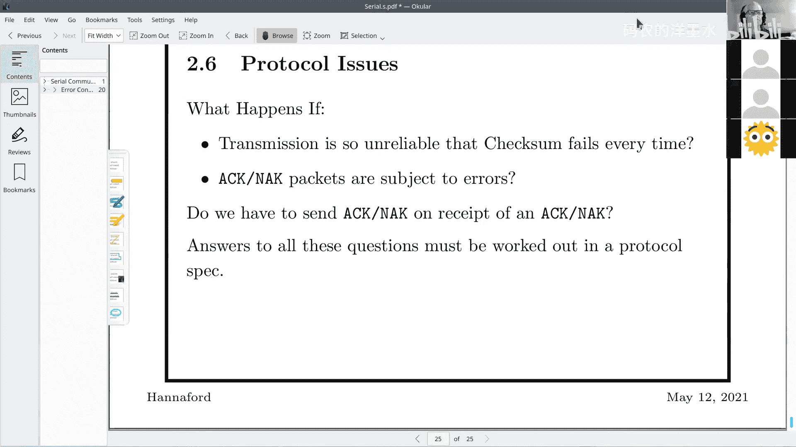
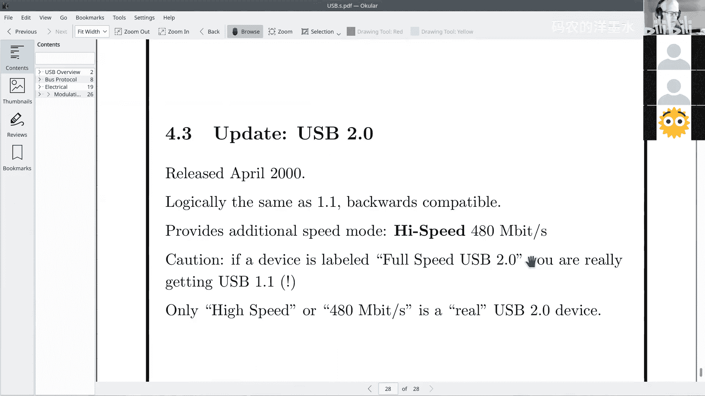

# 【全集 附完整课件】华盛顿大学 嵌入式系统导论 CSE474 中英字幕 p06 Lecture 6 - 使用寄存器与IMU演示 -BV1ALqnBWEeu_p6-

Okay， good afternoon。I guess let's see。 We got about the usual number。Recording is started。

All right recording has started I'm assuming people can hear me we've got about the right number so here we go first of all。

 you know a bunch of people have asked for extensions and so we're extending lab three to Wednesday May 19th I think it is so that's a three full day extension。

And so。You may or may not be happy to hear that， mostly happy。

But then we have lab four coming which I'm really hoping is going to be especially fun because it will include a project component in that lab so we want to leave room for it and me I and the Ts we pledge to release that lab prior to the due date of lab3 so no more delays from our end。

And so with that， what we're going to do is talk about some topics which are a little。

Wwhichch are part of the standard 474 syllabus， but a little bit hard for us to work into the labs generally with COVID with home labs and we've done a lot and what we're going to talk about today in particular is communication we're going to get started with that。

And serial communication， USB communication。And sadly。

 we don't really have anything to communicate with in our home setups。

We thought about ways around that for future offerings。

 but for now we're going to do as much as we can in the lab on one computer not talking to anybody。

 recognizing that it's too bad because so many embedded applications today do not stand alone and almost all of them you could say communicate in some way with some other computer and so we really do want to cover that。

Material as well， but sadly， not necessarily。In a hands on manner this quarter。So I'm going to。

Share my screen and look at some slides。Give me one second here。

I'll look at the slides and then share the screen is a better way to say it。Okay。

 we're not going to do it that way。Alright， that's better。Thank you for your patience。呵。

And we'll share a screen。

Okay， so serial communication。 So basically， we're sending bits from point A to point B。

1 B at a time。And how does that actually work in practice， This is actually a。

Really old subject if you think about it because actually the first ever telecom system was the telegraph and a telegraph does this。

 it sends bits from point A to point point B one at a time and so there's actually you know terminology that will go over that actually is hung around from those days and so that's kind of interesting。

From the history point of view。So we're going to start with RS 232C。

 which is a standard for sending bits over a wire。And it's kind of the first modern one Before that。

 it was all mixed up with things like teletypes and stock market tickers and railroad。

Telegraphs and stuff like that and you know really dated now this is still really old 1960s and in its raw form it's essentially not used anymore。

 but it has really it established the basic ideas for all the other serial communication system so we're going to we're going to dive into it still it's still very influential these days。

So it starts， we always start out like what's the。啊。Lowest level。

 And this starts with changing voltage on a wire。 That's how you send a signal。

 And so we have a logic 0 and logic 1， and the levels are defined。Sort of large voltage swing。

 So Rs 232 devices should support up to 15vols for logic 0。 For some reason， it's inverted。

 So a positive voltage is logic 0 and a negative voltage is logic 1。But you know。

 we're used to that as EEs， like the charge on an electron is negative， okay。Anyway。

 then minus down to minus 15 volts is logic one and this is kind of older。Terminology。

 space and mark are old terms occasionally you'll hear those。

 but they mean logic zero and logic  one。And because a logic zero is anywhere between 2。5 and 15。

 if you think about it that's a very big range and we call that a margin。

And that margin gives it quite a bit of immunity to noise if you think about it right so there could be three volts of noise on the signal and it would still stay within this range if at least if we're above5。

5 volts。So that's kind of where the history of these large logic levels comes from。But these days。

 it's a big hassle because。Ourre systems like the Arduino， they don't need a 15 V。

Power supply and they certainly don't need a15volt power supply。

 but you can't pull these voltages out of nowhere。 so if you're going to support the Rs 232 protocol。

 you would need to have those extra power supplies and who wants that。

And special driver chips for those big voltages。 So a lot of systems today just use a5 vol zero volt。

Signalling system so that the so that everything fits within the。

Power supplies that are around already and also。Sometimes。

 you the original application would sometimes be in say。

 an industrial plant where you're running a wire hundreds of feet through a plant and then it's subject to large electric heavy machinery generating transient yadidita。

 whereas so many applications today， it's inside even a single board。

 or between one board and another board inside a sealed metal box for a product。

So how does that how do we send data that way one bit at a time。

 so when the line is idle it's not sending any data。

And think about that like if you're talking to your Arduino over ceal， which is not really Rs232。

 it's more USB， but they're kind of simulating cereal on USB because cereal is。

Well understood and supported by laws of software so。Anyway， when when you're not sending anything。

 the line should be in the mark state， that means a negative voltage down to15 volts。

 so it's just sitting there down there at15 when you're not sending。And then。

 the first bit that sent。Is called is a space。 So that means it's a plus 15。

And so that transition from minus 15 to plus 15 signals to the receiver that a bid date is coming。

And then。It starts a clock， which starts at reading the next nine。The next eight positions。U。

Which are our eight data bits， starting with the least significant bit and ending with the most significant bit。

And those data bits。And this。😊，these bits are defined just in terms of time。

 so there's a fixed clock and if we start with the start bit。

 then we delay half a clock cycle and sample half every clock cycle will hit the middle of each bit that's coming in。

And I'll illustrate that in a moment。 and we have a parity bit and we'll talk about that and a stop bit。

 So then it goes to mark， which is the plus state。And sits there for at least one bit time。

And there's optional configurations， some some setups have no parity bit and only one stop bit and other setups have。

嗯。Podity and two stop bits and back in the day you really had to configure all this every time you plugged in a new device。

 it was a huge pain。And we've gotten beyond that now， thankfully。

So this is what it looks like as a function of time。So're in we've got space at plus 15。

 this is voltage on the y axis and time on the x axis。

And we we have some fixed time interval that we agree on。

 which is the speed and that can that's not fixed by the Rs 232 standard， but it can be。Adjustable。

And。Then we're idle for a while and then。Somebody wants to send data， so there's a start bit。

And then I drew these as kind of boxes because each of the data bits can be either a one or a zero。

Actually， a one is。A negative pulse and a 0 is a positive pulse。 And these are 8 bits。

 So they could be like the character on the ASI or UTF 8。ACharacter code。Which they typically are。

 or if it's a binary value like a 16 bit integer， you have to send two of these bytes。

Then our pary bit and the parodity bit we will see is used for checking the integrity of these signals。

 checking for errors。And then up to two stop its。Which would be negative。

 I just drew this vertical line to kind of identify the。clocklock time。

 but you wouldn't see it most likely on an oscilloscope。Also。I mentioned half a cycle。

 So if the you don't want to sample right on these transition times。

 that would be the worst time to sample when you're receiving this data。

 So once you detect this edge you。Look at half o'clock to get into the middle of the pulse。

That's what this start bit is giving you， it's giving you time to sync your clock up with a half half cycle offset and then one clock later you're right in the middle of D0 so you get a good sample without worrying about the exact integrity of this transition。

And you may go along a wire and so the transitions may not be as rectangular as they look here。

 then you go one moreclock time and you're right in the middle of D1 etc。And if that's not。

Accurate enough， or let's say if if your signals are not clean enough that that works。

 then you have to select a slower clock speed。And that may be the case over a very long wire。Okay。😊。

Like in my Wifi system。It's complaining that I have a long run in my house from the hub from the switch to one of my access points。

 and it's saying I can make0 I can't make a gigabit work on that wire。

I'm down at 100 megabits per second because I'm not getting reliable transmission。Okay。

 and then one or one or two stop bits and here comes the next character immediately after this stop it or there could be a gap as well and it's asynchronous meaning。

This transition doesn't necessarily occur at some known time， it's going to occur at a random time。

 and it's up to the receiver to sync up its clock。Okay， any questions about this so far。Yeah。

 so what is the parodity for？We're getting to that。

Excellent question let's answer that in the next slide Okay that's the professor's favorite question Okay so we compute pary with exclusive or that's one of those bit wise logic argument logic functions and remember D zero is just one bit that's this bit。

😊，And as the system is transmitting this data。Or prior to transmitting it。

It computes an exclusive or of all these bits together。And it reports that here。

And so what does that mean Well， if you worked it out， one interpretation of exclusive war is。

It's a one if the number of ones in this set is odd and it's a zero if the number of ones is even。

So here's an example， so I'm not going to take it out to eight bits， but for three bits。

IfIf we start here， zero exclusive word with zero。Is0， exclusive word with 0 is 0。 So we get0。

And then over here，0 exclusive word with 0 is 0， but0 exclusive word with 1 is one。

 so the exclusive or of all three of these bits is one same here for the same reason。

 then over here you've got a1 and then one exclusive word with one is zero and so you get zero。

And go ahead and review the exclusive or Tru table for two bits if you're still confused。So anyway。

 another way to read that is we have one one here， one's an odd number。

 and so we have a one here and we have one one here。

 but now we have two ones and so that's an even number and as long as there's two ones we get oops I have a typo。

I thought I fixed that typo。Anyway， this should definitely be a zero right here so that's my bad and then here's a zero and when there's all three or one。

 then there's an odd number okay。So I'm sorry I didn't get time to set up my tablet and have and scribble all over this let's see if I can。

Tools。It's bugging the heck out of me， so I'm going to fix it。Or at least highlight it。That's wrong。

 okay。I don't like this tool because you have to click it over and over。 Al right， so that's a bug。😊。

So anyway， why are we doing that？Well， here's the reason， so we're receiving this data。

 but let's say we're in a challenging environment like， oh， for example。

 the data is coming from a helicopter on Mars and it's traveling for millions of miles and the system signal is therefore really。

 really weak， okay。And noise may be corrupting some of this。So as you receive it。

 you also compute the exclusive order of these bits。And you compare your parody bit。

With the computed parodity bit。So if one of these bits gets flipped from a0 to one or a one to a0。

 the parity bit that you get will be different than the received parity bit。

And if the parodity bit itself gets flipped。That's an error。 And you'll flag that， as well。

If you have two bits flipped， it does not detect it。 Okay。

 so this requires a statistical understanding of the communication link where you can hope that the odds of a2 bit error are very small。

Compared to the odds of a 1 B error。And of course， pary。

 this is not a perfect error detection scheme， furthermore。

 it doesn't tell you how to correct the error。You don't know which bit is incorrect。

You just know that one bit is incorrect。 So this is like the world's oldest most primitive error detection and correction scheme。

But it still helps to ensure reliable communication。When you send data from Mars。

You use a much more sophisticated scheme， which but it's ultimately based on this and you could basically you could。

 for example， if this was a packet of data， you could also send a parity bit for the column as well as the row。

And then if you've got an error on one row and one column， you know which bit。Failed。

 and you could actually flip it and correct the error。If there's only one bit error。

And then it goes on from there to much more sophisticated codes that are even more reliable。

 but are not only able to detect errors， but correct them。But in plain old serial communication。

 one parody bit is usually what you get per character。And so if you detect an error。

 you just ask the sender to send the data again。And then keep asking until you get it without a parody error。

Speed。Bud is what we use for bits per second it's named for this guy Buux who was a telegrapher and you know Morse code is optimized in a way that the letter E is one dot。

And some rarer letters， like with high scrabble point values。

 unusual letters take more taps to send and that that's nice because it speeds up transmission because the letter E is used most often。

But there's other applications where you might want it to be a fixed length。

And especially if you use a machine to transmit the data。

 and so Bux invented the first telegrapher code that was of a fixed length for every character。

And we still see that， so like when you set the Arduino serialal port。It's defaulted to 9600 ba。

Which means 9600 bits per second or signal changes per second。

And it's really sort of simulated on the USB， but it's sending data at effectively that rate。

So divide that by8 and you get the bytes per second。What is 9600 over 8？1200 bitetes per second。

And you can change that， by the way， in your Arduino code。

 and then you can set your Arduino serial port。To match what you're sending。

But this is an this is ideal because most almost any computer can handle this speed and any Arduino code can handle this speed sometimes when you push it。

 the communication will fail。Okay， so synchronization。

 there is no common clock between the two and so that's why and we have these two possible modes。

 so in one mode it's constantly running， there's always a transition on the line and they only skip the transitions when there's like two two ones in a row or two zeros in a row in the data。

And the receiver syncs up to that。 And then you can have no start bits or fewer sync bits。

 We have up to three sync bits in the in what I've shown you。So。

 but synchronous mode is it was fading out a long time ago and it's almost never used now asynchronous mode means that。

 as I showed you。This transition here at the beginning of the。

Pulse or at the beginning of the bitete triggers logic in the receiver that starts a clock up。

There's some clock that's running dramatically faster than this internal to the receiver that syncs that starts going as soon as this event happens。

But this event will always happen because you always have a mark or logic one at the end of the previous packet。

 even if the line is busy。Of course this is wasted time and so is this because there's no data coming through so you're paying if you look at this。

 including the parity bit and these up and two stop bits and a start bit。

You've got four wasted bits for eight data bits， so that's a penalty。

 but it makes the communication more reliable。Okay， so asynchronous mode is how it's all is used。

These days。嗯。😊，Sending information in both directions is multiplexing and in the old old olden days。

 you know if you run a telegraph line from St Louis to Salt Lake City you really don't want to run two wires you want to run one wire because it's expensive so then how do you send data both ways and they that was a big technology challenge of。

You know， the 19th century。So anyway， there are these terms you will still hear occasionally。

 simplex mode means that there's just one sender and one receiver like you set up， you know。

 between one and 2 pm， it's all going to go from St。 Louis to Salt Lake City and from 2 pm to 3 p。m。

 it's all going to go from Salt Lake City to St。 Louis or something terrible like that。

And then half duplex， you're kind of alternating and taking turns， full duplex。

 both sides can send at the same time。So today， everything's full duplex。

The wiring could be really messy on the old standard。

 the minimum today is you'll still see pretty often where you have one one a device will connect to three terminals。

 three pins on a connector transmit， receive and ground to define your voltages as a reference。

But it can be there were many devices like when I was a grad student that use this connector and they'd all use a different subset of these many。

 many signals which are just pretty irrelevant and this is one of those standards where different vendors want to lock you in by having a unique flavor of the standard and all that bad stuff。

So boss basically though pin two and three are your data and pin one is ground so what's all the rest well like if you're talking to a modem there would be a bit in here somewhere that would say the modem is connected。

And stuff like that。And also， there was one thing you will still occasionally see is called hardware flow control。

 So there's a bit in here which says stop， I don't I can't I can't receive data now。 Okay。

 give me more data。So that bit the hardware hardware flow control is messed in here in one of these bits。

 but like data terminal ready means I'm ready or not so again， but thankfully。

You guys don't have to worry about this almost probably ever。

And then because you have noticed that there's a transmit。

On pin two and a receive on pin three and so you can't actually hook these connectors together with a straight through wire because transmit will talk to transmit and receive will talk to receive。

 which won't work。So another thing that you don't have to worry about anymore thanks to USB is making sure the cable would swap those lines and。

I'm not this is here for completeness， but I'm not going to make you suffer through it。

There is a thing you'll see occasion， so that's that's it for the pinouts and it's best left forgotten。

Um。They used to is stilling， this is fading out but still present in older systems like industrial control systems。

 as they transition to full networks like Ethernet， so if it hasn't made that transition yet。

 it may use a multidrop system， meaning there's one transmitter that can talk to a bunch of devices and they all listen。

And。Perhaps they all transmit on the same transmit line。

 but they have software that ensures that they take turns and there may be a controller which says。

 okay， device five， you can talk now and stuff like that。These are。

 this is sort of a primitive form of networking， which you may see。

 but it'ss it's fading out thankfully too。Um。Yeah， and just don't worry about null modeems。

Flow control， I mentioned。 There is one flow control。

Hangover holdover that's still very widely used today， which is these two characters。

 So the hardware solution is these bits request to send and clear to send。

And these are in the two directions allow data transmission or not and in the old days a device would be too slow and it would say stop and then when it was ready。

 start it would say I'm clear to send。Okay， but again， those are used much less now but。

You could also build those into the serial data。 So in fact。

 these characters control Q and control S， which you can make on your keyboard。

Are the software flow control。 And so actually， if you have。

 I don't know if this works in the Windows command line， but in Linux， if appropriate。

Zoom is much better now it Zoom has a new version or something and even though。I didn't have a。

Even though I'm on screen share， it exploded with a lot of little alerts that you guys are raising your hand。

 and I'm well trained right now that I know that my audio failed。 So thank you。 anyway。

 even today on the Linux。😊，Command line you can use these if if your application is viewing too much data。

 you can type control Q it will freeze and you can type control S and it will start again and so that's something that's still there。

Alright。So， error control。Um。😊，Again I've talked about errors I didn't go into too much detail on their cause electrical interference is a big one like your cable runs by a huge electrical machine that has massive currents switching on and off and inductively they're coupled into your line。

Along wire lengths may not be any interference， but there's a lot of capacitance then。

 And so now your bit transitions get smoother and softer and slower。So they then become hard to read。

Ground is at both ends， but the ground potential difference can be something between the systems and therefore you have what's called a ground loop and you have errors in reading the logic levels。

Timing errors。 Okay， so parity。 now once you get beyond the parity。There is， there are other ways。

 So let's say you put your your packets into a block and every 10 blocks。

 you add up the packets and send the sum。Or every hundred blocks or something。

This is another type of。呃。Arrrow checking， which can be more， more efficient。 For example。

 it could be 1000 bytes。 You add it up now， the sum of 1008 bit numbers could be much greater than 8 bits。

 but it doesn't matter。 You just send the least significant8 bits。And then a error would show up。

Okay， parodity， rows and columns， you'll see occasionally CRC cyclic redundancy check。

And this comes from fancy math， the theory of binary polynomials and you。

You add some data at the end so that you can divide this by some other binary polynomial and there's you know you there's specific algorithms to do that。

 Why is it better than check sums and parity I'm not sure。Take a coding class。

 it's pretty interesting。So that implies grouping the data and a very common thing is packets。

 including on the internet internet protocols and USB。

So a typical packet will be a bunch of bites and it will start with some sort of administrative information there'll be what you need to do though is you need to be able to identify the beginning of a packet。

And since。You only have eight bits in a byte that can be sometimes tricky because your data payload could have any values in it。

So there are kind of only statistical proofs or probabilistic guarantees that you reliably find the beginning of a packet。

But as long as that's a high probability， you can always， if you find the if somewhere in here。

 this is where your data is， if somewhere in here， there's something that looks just like the start character。

And your algorithm gets confused， then the check some will be wrong and you can just ask to retransmit。

Okay， so this is ideally， this is a character that doesn't appear in your data。Or anywhere else。

 but sometimes you just rely on statistical low probability。You may have different types of packets。

 for example， a printer， you're sending data to a printer and some of the packets are for turning on the scanner and initiating a scan whereas other packets are data that you're going to print and they may you know you may want to put the printing data into big packets because it could contain images and all kinds of stuff。

But administrative control packets might want to just be。10 bytes or something。

They may be variable length， so you may have a length field here。

 say is this is the start of a packet， it's printer data and it's 2 k bytes long。

So then the receiver can start counting and it will know when the packet is over and when the check sum should be evaluated。

Alternatively， your software could just make all the packets the same size and then the software always assumes that on the other end。

Okay。😊，So now you get a whole packet and what happens？If the packets received。

 but the check sum is wrong or the parity bits are wrong or the CRC is wrong。Okay， so。Normally。

 without errors， the sender sends the packet， but the sender has to save the packet。

And hold on to it for a while。And then the receiver。After it receives it， it checks the check sum。

And if the check sum's correct。It sends an acknowledge back to the receiver saying good， I got it。

That was correct。And we call that an act。And then the sender can throw away the packet and send another packet。

So on the other hand， if there's an error， the sender sends and saves the packet just like before。

 it doesn't know there's going to be an error and then the receiver。Tries to do the check sum。

 but the check sum's wrong and sends anack， it's called negative acknowledge。Bad。

So then we go back to step one， the sender sends it again。Repeat。If there's usually some maximum。

 if it sends it four times and never gets a good packet。

 then the user is alerted that something's really， really wrong。

So you may have special packets called act and NA packets。

But they would still need a packet start and maybe a check some just to see how chaotic the situation is。

And then。Protocol， so you've got to figure out what's going to happen if the transmission is so bad that you never get a good packet。

You got to do something。Intelligent。嗯。😊，And， you know。

 act and neck packets could be subject to errors generally if an act is an error。

 then you can just send the packet again。But the other thing is that packets going back to this。

 they may need something else in here like a serial number， depending on what you're doing。

Often a packet will have a sequence number so that if you're sending a block of things like a page that's going to be printed by a printer。

You can kind of guarantee that all the packets made it。So you send packet one， act NAC。

 whatever until packet one gets through， and then packet two。And if your act packets get screwed up。

 you may get confused about which packet got through correctly so it's little a really robust communication protocol is a little deeper issue than what we're presenting here。

Okay， so that's this section， Any questions so far。

Okay， so I' going to take a break of I'm going to just make it eight minutes and then in 320。

 we'll start again and probably finish up a little early。

 but we'll take this up to the present day into USB。So see you at 320。All right， welcome back。

I saw a。I saw a question on chat from a few minutes ago， like which was a good one。

 what happens if the voltage on the line is between。Minus 2。5 and plus 2。5。It means it's。Unfined。

 and that means that whichever device is。If you're receiving that。

 it's an error and you're kind of off the hook。 like， let's say you've designed a receiver。

And somebody gives you that a voltage in that range。

 there's no requirement or you don't have to be accurate it's not defined is the short answer above 2。

5， if it's 2。6， you better report it as a space or mark or whatever， logic0， it's below minus2。6。

 if it's minus 2。6， you better detect it as a  zero， but in between doesn't matter。

You're off the hook。And certainly as a transmitter。

 you're not allowed to generate any voltage between the two 2。5s。 so that is a good question。

All right， so I'm going to share a screen again first。

 any questions as you guys have digested what we just saw。Any questions or comments？Okay。So。

 let's go back to slides。

And。We're going to talk about USB and USB2 as well。

 but the basic principles of USB don't change and I guess three， yeah， this needs a little updating。

 but we do introduce where it goes from 1。1 to 1。 to 2。0。Okay， so the overview。

 a lot of USB was about correcting some of those miserable problems that were constantly coming up with Rs 2。

32。 and it became。You know， it's like if technicians in a chemical plant are dealing with those problems。

 it's okay， they eventually learn it and it's a small price to pay compared to the value of an refinery equipment that you're controlling or whatever。

But if you've got millions of consumers trying to plug a printer into their PC using that protocol。

 it's sort of a nightmare scenario。And it was， so the goals of USB included consumer ease of use and they've made huge strides compared to those days。

 although， gosh， USB has its own problems as we all know。

Low cost up to 12 megabits per second in the original version。

Supporting real time data and multimedia。Flexibility for different devices and needs。

That's an important one。Um。Compatible with laptops and desktops。

 but mainly what that means is you can't have a big fat connector on a laptop。

Highly standardized for easy adoption by industry， okay， fine。Now。

 when they first started it way back， these are the applications they were thinking of， of course。

 keyboard mouse stylus game game controllers。And also， phones and audio， phones and audio。 Now。

 if you think about it， we don't use USB that much for audio these days。In fact。

 that application never really took off as far as I recall。But it was considered at the time。

 kind of like。This isWe're going to plug our telephones into the computer using USB。

This is all kind of before cellular rollout and everything。

And so they made a lot of effort make it to put modes in there to support telephony。

But not video and disk drives in 1。1 we all know that USB3 can really display a 4K video and stuff that's pretty cool and certainly we put our disk drives on USB2。

So here's， here is the USB。Pyramid。You've got a host and that's your CPU。In your PC。

And then you've got a hub， but hubs extend hubs can plug into hubs。

 and a typical laptop will have more than one hub， and sometimes there's internal USB。

 so like your sometimes your wireless card inside your laptop will be actually talking USB to the CPU。

 even though it's bolted in there and you're never going to unplug it。

And then nodes are your devices， whatever your device is。

And so this is USB is designed for this kind of expansion。And it has some terminology。

 so they use the word function。To mean a peripheral。 So your mouse is a function if it's a USB mouse。

And a function can have different endpoints。 So that's a little interesting because like。

But like your mouse has the tracker that gives X and Y motion。

 and it also has buttons and and thumb wheelels and stuff。 So those are。

 I'm sorry about all these notifications， I'm going to。It's bothering me， if not you， all right。

 they're gone。So。Endpoints。Are like， specific。Sources or sinks of data。 So like， like。

 I talked about a printer with a scanner and a printer。But O mouse has the thumb wheel。

 it has the buttons， as well as its XY sensing。And then we have hubs。

 hubs are already introduced in this architecture。And a compound。Device。

 which has a hub and other things like these port expanders that you plug in， for example。Okay。

 so here's you know， this is pretty familiar by now。But there are。Here's your host。

 and then these are subsidiary hubs that。Have functions plugged into them。 So again。

 this is really the same thing。 It's the same as this pyramid。Okay， so the different modes。

 low speed is only 1。5 megabits per second or megabod。In the same terminology。12。

5 megabot for full speed。And we'll kind of ignore low speed mode for now。Um。

The the protocol there is a protocol sort of superimposed on it。

 It's not just asynchronous communication like we talked about before。

 because you've got this tree structure and we certainly have to have a traffic cop。

 which is telling the devices when to talk and when to not talk because they're just sharing two communication wires。

 really one because it's differential signal， So this all really goes on one wire。

And so they set up a millisecond clock and block it off into frames。And every time a frame starts。

 the host sends out a start a frame packet。So， it's little packet。It's got a thing called sync。

 a process Id。U。And a frame number。And a CRC that protects or validates this data。

The frame number just rolls over11 Bs is only 2000。Counts。😡。

So it's every two seconds this number rolls over， but it keeps things locally organized。

And then the PID。Is an identifier for what kind of packet it is。

I called that a type up above in the earlier stuff。And it it's encoded with little redundancy again。

 to just make extra sure that it's robust and so it's a four bit number and then it's followed by its complement。

The opposite four bit number， not exactly sure why it's doing it that way， but。It can。

 at least you can read a byte and check if the second four bits is the complement of the first four bits。

And the PID values are the types of packets include these， so AkinAC。

 we've learned about AkinAC that they're handhaking or acknowledgement。In and out。

 which sets the direction of this one wire。Start a frame。Data types， et cetera。

 this is not all the possibilities。Okay， and so then there's sort of a polling sequence， which says。

Which says it starts with the ID of out， which is just one。And or in。

And it's asking an endpoint to receive data or asking an endpoint to send data according to the control of the host。

 then a seven bit address and an end point number within that device so might say okay mouse。

 tell me your button status or okay mouse， tell me X and Y Delta X and Dlta Y and then error checking。

And then whatever function is addressed sends the data back。

With an ID and a CRC and it could be up to  a thousand0 bytes if it's a big device like a camera or something。

And then the destination sends an act。Or a neck。According to the error checking information。

And that there doesn't have to be just one of these in a frame。

 so there can be many and up to 10% of the or 10% of the frame is reserved。For controlling the bus。

And device， when it starts up， it asks for a thing called a pipe。Within the USB。

 did you know this much stuff was going on inside the USB。

And the pipe has attributes like how much bandwidth it's going to take。

 what kind of data flow it's going to be， what are the endpoint characteristics do I have readable endpoints or writeriable outputs and how big are the endpoints。

And when you plug that device in， it has a special set of packets that explain and reserve and negotiate the pipe。

But there's always a default control pipe， which is a separate pipe that controls the device。

And then pipes can be one of several types。So it can be a control pipe。

 we talked about that just now。There's bulk data， interrupt data， and isocchronous data。And so。

Buul is like a file transfer， and it's the lowest priority。

 It's like a background task that USB can work on whenever。Whenever nothing else is going on。

Of higher priority。And that might be used for printers， it is used for printers。

 so when you when you're printing a document if you move you don't want if you move your mouse while a document is printing。

 you really need that mouse to you need your cursor to move right away。And so it takes priority。

 the printing can take just a little bit longer if you move your mouse while it's printing。Um。😊。

And then interrupt data transfer would be used for devices in USB lingo。

 they're called human interface devices， H。And so they would be called interrupt data transfers。

And they're small data， but they need to be responded too fast。

I'm not sure it really means that an interrupt is caused at the CPU。

I think all of these costs interrupts at the CPU actually。

But this is emphasizing that it requires a short latency response。

And then isocronous means that a dedicated amount of bandwidth is devoted in every frame。

So like with audio on a telephone， you need to be sending the same amount of data every millisecond。

Period， it's predictable， it's regular。 It's periodic。 It's not changing。U。😊。

Although you could argue if it's compressed， it should be changing。

Like if there's a pause in the conversation， maybe you don't need to send anything， but this。

This mode anticipated。Non compressed audio。And this will be like a fixed slice within the frame that's set aside。

So they each have a different packet format， they typically have a known direction of flow one way or the other。

 or both like telephone， the packet size， constraints on access and latency。

 like priority versus latency。And how the errors are handled。Okay， so bulk lowest priority。

 the data can be in any format。The packet size can be 8，16 or 64 bytes。

In any any kind of arrangement。And then， there's。Actually。

 three sync bytes and a Pd and the endpoint selection and the CRC。 So this is overhead。The data。

 I think the data is。In between endpoint and CRC， I'd have to verify that。

Should have been in the diagram。Okay， and so actually this relates how many of these appear in three transactions。

There's three sinks in three transactions， but。Data， there's only two CRCs。

 I'm not sure I remember what that actually means， but this gets into the overhead。

 So 13 B packet header，3 B delay between packets。 It pretty high overhead。 if you have a 8 B。Packet。

It does retry transfers if there's errors so that means it's reliable you really need that because you can't print a page and have a few characters disappear in the middle of your essay that you want to turn in。

So in bulk mode， the data delivery is guaranteed， but there's no speed guarantee。Okay。

 and then keystrokes and mouse movements， often your keyboard is USB， of course。And。

There's various things negotiated at plug in time， what the maximum packet size is。

 but always less than 64 bytes and less than 108 transactions per frame。

 which is quite a lot for one millisecond if you think about it。Again， the sink bite。

There's one by for Delta X and one by for Delta Y on your typical mouse。

 so there's you're moving it a little。It's just a movement in1 millisecond。

 So that's really a very small amount。And then isocchronists。

 think about audio that's not compressed， so you just have to keep up continuous stream。

And the payload can be up to 10，23 bytes， so that's sort of a lot。Gloudededda。

But there's no time for as and nas and retransmissions， so errors are just going to get through。

 so that's a big difference。But maybe you just hear a click on your phone call and you never even notice it。

 After all， there's plenty of quality issues on Internet phone calls or any other kind of phone call。

Okay， so and another interesting thing about USB is like。

As you may recall from some computer languages， you can think of hierarchies and class inheritance。

And USB devices have packets of data that follow that。 So like。U。😊。

TheresThe top level class is just USB devices or functions。

So every USB device and that that class has。Members like the vendor ID。

 what did Logitech make it or Microsoft or HP？And what class it's going to be in is it what type it is。

 power management functions it might have like maybe the laptop can put the mouse to sleep when the laptop goes to sleep。

What endpoints it has。And it's control and status info。

 So that has to be in a class that the device can deliver。

Or at least the driver can compile into its code。And then the class info is like。

There's a class called keyboard。 So all keyboards have a standardized class that。They fill out。

 This is like， really a nice。Actually， this is really a nice advance。

Compared to things like printers。 Okay， so as you might know， even today。

 every printer has a different random driver。 And even within the same company。

 you have to get the latest driver for your exact model of printer。And that's a pain。And so。

 by doing this class structure。Only the most very specific information is specific to your product and the driver for keyboards can count on all the standard info and all the class info to just be standardized。

And that means you don't need a standard level driver for each device。

 you don't need a class level device for each keyboard。

But you need a vendor level driver for each keyboard。

So maybe the firmware revision number for your keyboard is。Or your printer is in in that last level。

 and then the device driver can just write specific things for that。Okay， so this is again。

 this is all 1。1， so it it's now about 10 times faster， I think。But。

The different payload sizes for bulk mode doesn't use the much of the frame。

 you can get up to this many bytes per second。Iocchronous mode uses much more of the frame but。Can。呃。

I'm not sure why it can use less of the frame。And send almost more data than 35% of the frame in isocchronous mode so there's some something I'm missing there。

 but it's it's a big because the payo load's big I think。Anyway。嗯。😊，So that's 8 megabits per second。

Iocchronous only allows one transfer per frame but bulk can do many this may be per transfer and if you do 20 of these you get this many bytes per second。

 I think that's what it is。Okay。Okay， back to electrical。Much simpler than RS232， as you guys know。

 probably from staring into your USB cable to try and figure out what's wrong or wiring up some power。

 it's just four wires。Plus，5 volts and ground， and。

At the time revolutionary you can actually power devices off this five volts。

 we all do that a lot now， of course it's not just miceive keyboards but and then the newer standards like 3。

0 you can put you can generate up to 2040， 50， 60 watts coming out of this 5 volt line here。

But it's still only four wires。And。We can charge our phones very fast with the up to date standards and then the two data lines I'll talk a little bit more about that it's really just one signal。

But， it's a differential signal。And good old ground。

And then all the negotiation of how much current you're going to take and stuff happens in software。

So to make the signal reliable on USB， one thing right off the bed is keeping the wires short。

 So you're not going to find 100 foot USB cable extension。

Anywhere unless it's got fancy signal conditioning electronics， but I've never even heard of one。

Generally speaking up to a couple of meters and that's it。嗯。😊。

Differential line drivers shielding in the cable CRC protection。 So this is interesting。

 So the CRC detects。All one and two bit errors reliably in a packet。So if it's a  three bit error。

 maybe there's a problem。But it detects one in two bits， it doesn't correct them。

 but you've seen there's a lot of retransmission。There's timeouts for lost packets。

 meaning that you can send ae and get a retransmission。There's flow control， meaning that。

In bulk mode， it only sends data when it's asked for a packet and so there's never an overload of data coming in over USB。

And it's kind of really kind of remarkable that you can just plug a random device into your computer through USB and it just comes alive。

 at least if the driver's around。And so the hub has a bit。For each port。

 each of your USB ports has a little bit in it in its controller chip。And the host。

Querries the hub and the hub says I have things plugged into these two ports and not these ports。

And if the host detects that a new thing is plugged in。

It gives it a unique address and starts sending packets to say what are you， what do you need。

 I'm going to enable you now。Except if that new device is a hub， it just。Let's the hub take over。

And if the device is a function， it tries to wake up a driver on the host。

That gets the device working again。So yeah， so these are the voltage levels。

 you know rise time should be four to 20 nanoseconds within a USB line that we can have six megahertz signals。

 I guess maximum。U。And the impedance of the line 39 ohms。So that is that。

Means that the quality of these waveforms will be optimized if everything plugged in to the bus has an impedance of 39 ohms。

These are the voltage ranges。That are allowed for logic levels。There's a margin， you know anything。

 if it transmits， it must a logic one， it must be greater than 2。8。

The receiver will receive anything greater than 2。0 and call it a logic one so there's a margin of 0。

8 volts for safety。I'm not sure the difference between the 90 ohms and this 39 ohms。

 I'll have to check on why that's different。So anyway， this is what I meant by differential drive。

Here is an output enable bit， which turns these two things on and off so if。You know。

If if the USB bus is。Taking data from a microphone， it does not。

The mouse should not be talking because there's only this one。

 two wire pair shared in common by everything。Now here's this is 28 to 44。

 so I don't know where this 90 oh thing comes in。And then TxD is the data bit that's being transmitted。

 but there's a positive and negative version of it。

 so the two levels are always opposite and that has favorable properties for noise resistance。

Noise immunity。Like if there's any common voltage between the two。

 the input is just subtracting them。Okay， and then high speed has， I guess， different。

Different signal levels， which is interesting。 I guess， yeah。

 it can expect different signal levels on the same wires。Because it's。Programming what the mode is。

 The hub is telling the device what mode to use。This is getting interesting modulation and channel coding。

 so if you take communications courses you'll learn about this。Um。

Not all bit sequences transmit down a line as reliably as the。As as they could， as others do。And so。

 this is a。This is called non return to zero encoding。And it。Requires the bits to change a lot。

Even if the data you're setting is something like a megabyte of all zeros。

 if your data happens to be a megabyte of all zeros。That's going to not transmit well。

 it's not going to allow the clocks to synchronize on the receiver and sender because it's going to look like DC。

丢。This is great this has got a new thing which pops notifications up and so I pick this up faster and I appreciate that so anyway like for example。

 suppose my data is all zeros。And I， first of all， you send a zero by toggling something。

Whatever it is， you flip it， that's sending0。 And if you send a one。You do not toggle。

In N RziI en codingding。And so a bunch of zeros goes to 01，01，01。

 and a bunch of ones goes to all ones。And。But。Even that's not so good because like I don't want to send all ones if my data is all ones。

So then they have what's called bit stuffing。So the receiver needs to see some transitions every once in a while。

 at least every7 bits to keep itself phase locked。Onto the transmission。

And bit stuffing just randomly inserts， not randomly。

 but inserts zeros whenever there are six ones in a row。

And now the receivers guaranteed to see a couple these transition no matter what the data stream is。

And somehow。The receiver hardware has a smart logic circuit that undoes that and figures out what bits are real and what bits are stuffed。

And we're not going to cover that that's for a different class。

 but it's kind of fascinating that it can do that and that way the data stream is never all the same it's no matter what your original data was it always has a few transitions to keep the clocks synced。

And then USB2 is backwards compatible they were， that's an important thing for the releasing updates。

 goes up to 480 megabits per second。And then this was a gotcha back then。

 the terminology was tricky that in the official standard。

Manufacturers were able to say this is a full speed USB2 device。And full speed is actually USB1。

And the name for USB2 is quote unquote， high speed。

 so they could sell their old products misleadingly as compliant with USB2。

And that was a bad thing back then。And USB3， I forget what the rate is now。

 but it's probably 10 times more。But again， following the same otherwise the same protocol and the other big thing with USB3 is。

That it。诶。Allowed much more power to flow out。I'll say one more thing about。Well。

Yeah， I'm going to say I'm going to stop the share。

And I'm going to see if I can switch cameras briefly。To my bench。Maybe that will not。Oh。

 I push the wrong button， okay。Now I'll get it。And I crashed soon。Not any more。

 Zoom is not crashed any more。Okay， now I have my little bench set and the reason is I'm going to show you the history of USB connectors because this is what you guys have on your Arduduino connector。

USBA， which is kind of the first one。And then。This is USBC and you're all familiar with these。

 but it just seems like they never get it completely right USBC is nice and small。

 They solved the big problem of flipping it 180 degrees。

But at least on my last phone USBC was not tight enough and so if you're listening to a headphone headphones through an adapter。

 it would keep working its way out and not strongly attaching because if you look the sides of USBC are just smooth。

So they don't hold it in。 Anyway， you guys are as well versed on those as I am。

And they keep changing the connector。Which。Is not necessarily consumer friendly， because。

It just forces us to buy all new cables all the time。How many chargers， whoops， that's the wrong one。

How many chargers do you have lying around in drawers from the 90s or 2000s， 2010s， etca？All right。

 so any questions， comments， suggestions。Those of you who joined late labb three is officially extended。

To Wednesday the 19th at midnight， 1159， Wednesday the 19th， so that's also posted to Canvas already。

 at least the assignment is updated on canvasva。So that is going to be it for class today unless there's any more comments。

 I'll hang out if people want to hang out。Thank you。

